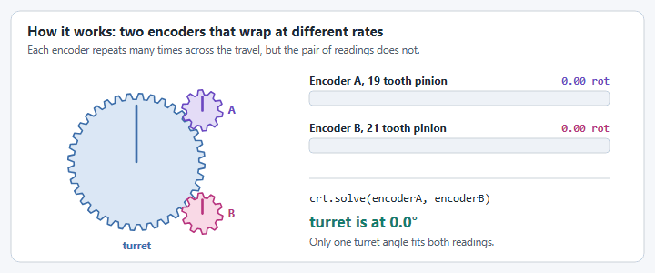
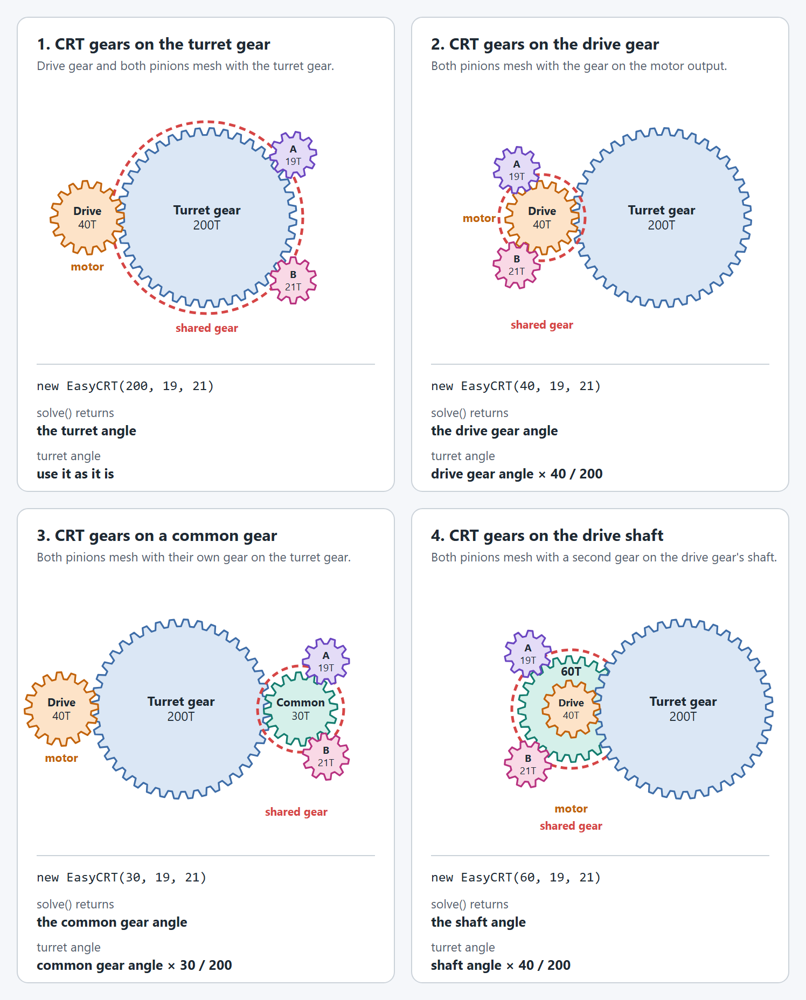
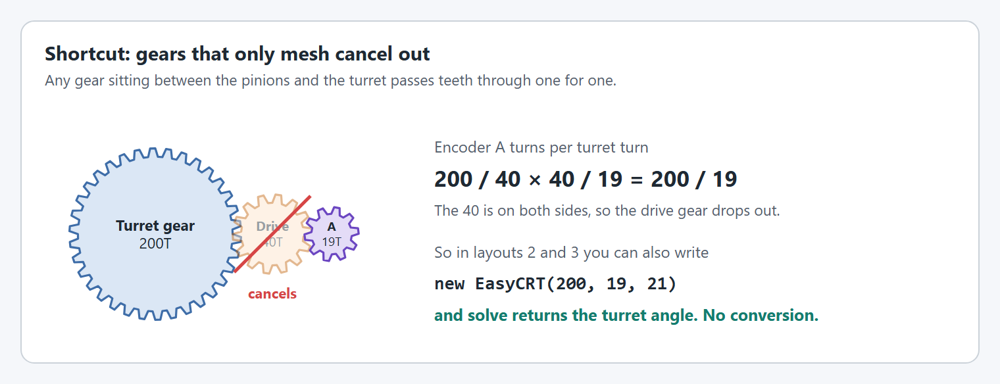
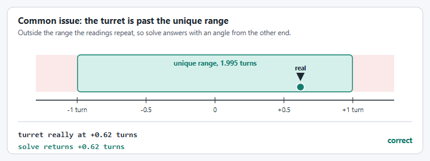
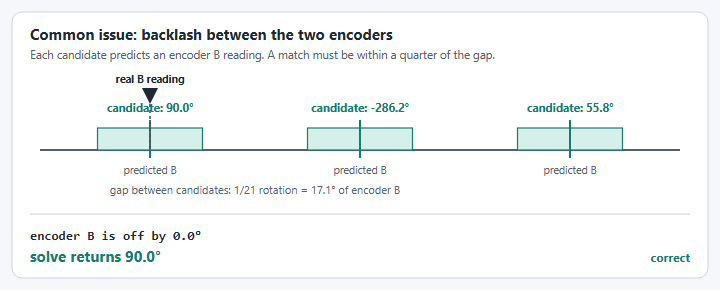

# EasyCRT Guide

`EasyCRT` finds the absolute angle of a mechanism that turns more than once, usually a turret, from
two absolute encoders. Each encoder sits on a pinion with a different tooth count, and both pinions
mesh with the same gear. Neither encoder knows the angle on its own, but the pair of readings is
unique over a much longer travel than either one.

```java
// 100 tooth turret gear, 19 tooth pinion on encoder A, 21 tooth pinion on encoder B.
EasyCRT crt = new EasyCRT(100, 19, 21);

// Read once at startup, while the turret is not moving.
Optional<Angle> turretAngle = crt.solve(encoderA.get(), encoderB.get());
```

```cpp
yams::units::EasyCRT crt{100, 19, 21};
std::optional<wpi::units::turn_t> turretAngle = crt.Solve(encoderA, encoderB);
```

That is the whole API:

| Java | C++ | What it does |
| ---- | --- | ------------ |
| `new EasyCRT(shared, a, b)` | `EasyCRT{shared, a, b}` | Tooth counts of the shared gear and the two encoder pinions. |
| `solve(a, b)` | `Solve(a, b)` | Angle of the shared gear, for travel centered on zero. |
| `solve(a, b, min, max)` | `Solve(a, b, min, max)` | The same, for travel that is not centered on zero. |
| `getUniqueRange()` | `GetUniqueRange()` | How far the shared gear can turn before the readings repeat. |

`solve` returns an empty `Optional` when the two readings do not agree on one angle.

Everything else you might want (choosing gears, zeroing, inversion, gear trains, checking your
margin) is something you do yourself, and the rest of this guide shows how.

## How the solver works



1. Encoder A's reading fits several shared gear angles, one for each number of whole turns the
   pinion could have made. `EasyCRT` lists every one inside the travel.
2. For each candidate it predicts what encoder B should read.
3. The candidate whose prediction is closest to encoder B's real reading wins.

This is not a textbook Chinese Remainder Theorem solve. It is the same idea done as a search, which
keeps working with backlash and sensor noise. Created by team 6911.

## Before you call solve


`EasyCRT` takes the two readings as they are, so the encoders have to be set up first:

- **Zero both encoders with the mechanism at zero.** Use the vendor tool to set each encoder's
  offset. If an encoder cannot store an offset, subtract it yourself:
  `crt.solve(encoderA.get().minus(offsetA), encoderB.get().minus(offsetB))`.
- **Both encoders must count up when the mechanism moves in its positive direction.** A pinion
  turns the opposite way to the gear it meshes with, so this usually means inverting both encoders.
  Set the direction on the encoder, or negate the reading before passing it in.
- **Read while the mechanism is still.** The two readings are taken one after the other, so any
  motion between them looks like disagreement. Solve once at startup and seed the motor with the
  result. Do not use `EasyCRT` as closed loop feedback.

## Choosing tooth counts

The readings repeat together every `lcm(a, b)` teeth of the shared gear, so:

```
unique range (rotations of the shared gear) = lcm(a, b) / shared
```

Pick pinions with no common factor, so the lcm is their product. Sharing a factor throws range away:
20 and 30 teeth only cover 60 teeth of the shared gear, not 600.

| Pinion A | Pinion B | Teeth covered | Range on a 100 tooth gear | Range on a 200 tooth gear |
| -------- | -------- | ------------- | ------------------------- | ------------------------- |
| 13 | 15 | 195 | 1.95 turns | 0.975 turns |
| 17 | 19 | 323 | 3.23 turns | 1.615 turns |
| 19 | 21 | 399 | 3.99 turns | 1.995 turns |
| 20 | 21 | 420 | 4.20 turns | 2.10 turns |
| 25 | 27 | 675 | 6.75 turns | 3.375 turns |
| 30 | 31 | 930 | 9.30 turns | 4.65 turns |

The range has to be at least your full travel, including how far the mechanism can coast past its
soft limits. `getUniqueRange()` returns it, and `solve(a, b, min, max)` throws if the travel you pass
is longer.

To check a pair before you build it:

```java
Angle range = new EasyCRT(200, 19, 21).getUniqueRange(); // 1.995 rotations
```

## Travel that is not centered on zero

`solve(a, b)` assumes the mechanism's zero is in the middle of its travel, and returns an angle
within half the unique range either side of zero. For a turret that goes from 0 to 540 degrees, give
the travel:

```java
Optional<Angle> angle = crt.solve(encoderA.get(), encoderB.get(), Degrees.of(0), Degrees.of(540));
```

Give the real travel, not the whole unique range. A tighter range leaves fewer candidates, and it
keeps a reading taken slightly past an end stop from wrapping to the other end.

## Gear layouts

There are four common places to put the two encoder pinions on a turret. In every one, the gear
both pinions mesh with is the **shared gear**: give `EasyCRT` its tooth count, and `solve` returns
its angle. What changes is whether that angle is already the turret angle.



The drawings are not to scale.

Each example sets up the turret's `SmartMotorController` with its gearing and then sets its encoder
position from `EasyCRT`. Two gearings are involved, and they are not the same thing:

- **The motor's gearing** (`motorToTurret`) goes in the `SmartMotorControllerConfig` with
  `withGearing(...)`. It is the whole reduction from the motor to the turret, and it is the same in
  every layout because the motor drives the turret the same way.
- **The shared gear's gearing** (`driveToTurret`, `commonToTurret`) is only used to turn the solved
  angle into the turret angle, in layouts 2, 3 and 4.

`setEncoderPosition(...)` always takes the turret angle. The tooth counts are examples.

### Layout 1: CRT gears on the turret gear


The motor's drive gear and both encoder pinions mesh with the turret gear. The turret gear is the
shared gear, so there is nothing to convert.

```java
// Motor: 10:1 gearbox, then the 40 tooth drive gear on the 200 tooth turret gear (5:1).
MechanismGearing motorToTurret = new MechanismGearing(GearBox.fromReductionStages(10, 200.0 / 40));

SmartMotorControllerConfig motorConfig = new SmartMotorControllerConfig(this)
    .withGearing(motorToTurret)
    .withControlMode(ControlMode.CLOSED_LOOP)
    .withClosedLoopController(20, 0, 0);
SmartMotorController motor = new SparkWrapper(sparkMax, DCMotor.getNEO(1), motorConfig);

EasyCRT crt = new EasyCRT(200, 19, 21); // turret gear, pinion A, pinion B

// The turret gear is the shared gear, so the solved angle is the turret angle.
// setEncoderPosition takes the turret angle and applies motorToTurret itself.
crt.solve(encoderA.get(), encoderB.get()).ifPresent(motor::setEncoderPosition);
```

```cpp
// Motor: 10:1 gearbox, then the 40 tooth drive gear on the 200 tooth turret gear (5:1).
yams::gearing::MechanismGearing motorToTurret{
    yams::gearing::GearBox::FromReductionStages({10.0, 200.0 / 40.0})};
motorConfig.WithMotorGearing(motorToTurret);
// ... finish motorConfig and build the SmartMotorController `motor` with it.

yams::units::EasyCRT crt{200, 19, 21};  // turret gear, pinion A, pinion B

// The turret gear is the shared gear, so the solved angle is the turret angle.
// SetEncoderPosition takes the turret angle and applies motorToTurret itself.
if (auto turretAngle = crt.Solve(encoderA, encoderB)) {
  motor.SetEncoderPosition(*turretAngle);
}
```

Each pinion turns the opposite way to the turret, so both encoders usually need inverting.

### Layout 2: CRT gears on the drive gear


Both pinions mesh with the gear on the motor's output, which drives the turret gear. The drive gear
is the shared gear, so `solve` returns the drive gear angle. Describe the drive gear to turret stage
as a `MechanismGearing` and multiply by `getRotorToMechanismRatio()` to get the turret angle.

```java
// Motor: 10:1 gearbox, then the 40 tooth drive gear on the 200 tooth turret gear (5:1).
MechanismGearing motorToTurret = new MechanismGearing(GearBox.fromReductionStages(10, 200.0 / 40));

SmartMotorControllerConfig motorConfig = new SmartMotorControllerConfig(this)
    .withGearing(motorToTurret)
    .withControlMode(ControlMode.CLOSED_LOOP)
    .withClosedLoopController(20, 0, 0);
SmartMotorController motor = new SparkWrapper(sparkMax, DCMotor.getNEO(1), motorConfig);

// The pinions mesh with the 40 tooth drive gear, which turns 5 times per turret turn.
MechanismGearing driveToTurret = new MechanismGearing(GearBox.fromTeeth(40, 200));
EasyCRT crt = new EasyCRT(40, 19, 21); // drive gear, pinion A, pinion B

crt.solve(encoderA.get(), encoderB.get()).ifPresent(driveGearAngle -> {
  // Scale the drive gear angle down to the turret, then seed the motor with the turret angle.
  Angle turretAngle = driveGearAngle.times(driveToTurret.getRotorToMechanismRatio());
  motor.setEncoderPosition(turretAngle);
});
```

```cpp
// Motor: 10:1 gearbox, then the 40 tooth drive gear on the 200 tooth turret gear (5:1).
yams::gearing::MechanismGearing motorToTurret{
    yams::gearing::GearBox::FromReductionStages({10.0, 200.0 / 40.0})};
motorConfig.WithMotorGearing(motorToTurret);
// ... finish motorConfig and build the SmartMotorController `motor` with it.

// The pinions mesh with the 40 tooth drive gear, which turns 5 times per turret turn.
yams::gearing::MechanismGearing driveToTurret{yams::gearing::GearBox::FromTeeth({40, 200})};
yams::units::EasyCRT crt{40, 19, 21};  // drive gear, pinion A, pinion B

if (auto driveGearAngle = crt.Solve(encoderA, encoderB)) {
  // Scale the drive gear angle down to the turret, then seed the motor with the turret angle.
  wpi::units::turn_t turretAngle = *driveGearAngle * driveToTurret.GetRotorToMechanismRatio();
  motor.SetEncoderPosition(turretAngle);
}
```

The pinions are two meshes away from the turret, so they turn the same way as the turret.

### Layout 3: CRT gears on a common gear


Both pinions mesh with their own gear, which meshes with the turret gear. The motor's drive gear
also meshes with the turret gear. The common gear is the shared gear, so `solve` returns the common
gear angle, and the conversion works the same way as layout 2.

```java
// Motor: 10:1 gearbox, then the 40 tooth drive gear on the 200 tooth turret gear (5:1).
MechanismGearing motorToTurret = new MechanismGearing(GearBox.fromReductionStages(10, 200.0 / 40));

SmartMotorControllerConfig motorConfig = new SmartMotorControllerConfig(this)
    .withGearing(motorToTurret)
    .withControlMode(ControlMode.CLOSED_LOOP)
    .withClosedLoopController(20, 0, 0);
SmartMotorController motor = new SparkWrapper(sparkMax, DCMotor.getNEO(1), motorConfig);

// The pinions mesh with a 30 tooth common gear, which turns 6.67 times per turret turn.
MechanismGearing commonToTurret = new MechanismGearing(GearBox.fromTeeth(30, 200));
EasyCRT crt = new EasyCRT(30, 19, 21); // common gear, pinion A, pinion B

crt.solve(encoderA.get(), encoderB.get()).ifPresent(commonGearAngle -> {
  // Scale the common gear angle down to the turret, then seed the motor with the turret angle.
  Angle turretAngle = commonGearAngle.times(commonToTurret.getRotorToMechanismRatio());
  motor.setEncoderPosition(turretAngle);
});
```

```cpp
// Motor: 10:1 gearbox, then the 40 tooth drive gear on the 200 tooth turret gear (5:1).
yams::gearing::MechanismGearing motorToTurret{
    yams::gearing::GearBox::FromReductionStages({10.0, 200.0 / 40.0})};
motorConfig.WithMotorGearing(motorToTurret);
// ... finish motorConfig and build the SmartMotorController `motor` with it.

// The pinions mesh with a 30 tooth common gear, which turns 6.67 times per turret turn.
yams::gearing::MechanismGearing commonToTurret{yams::gearing::GearBox::FromTeeth({30, 200})};
yams::units::EasyCRT crt{30, 19, 21};  // common gear, pinion A, pinion B

if (auto commonGearAngle = crt.Solve(encoderA, encoderB)) {
  // Scale the common gear angle down to the turret, then seed the motor with the turret angle.
  wpi::units::turn_t turretAngle = *commonGearAngle * commonToTurret.GetRotorToMechanismRatio();
  motor.SetEncoderPosition(turretAngle);
}
```

As in layout 2, the pinions turn the same way as the turret.

### Layout 4: CRT gears on the drive shaft


Both pinions mesh with a second gear that is fixed to the same shaft as the motor's drive gear.
The 60 tooth gear on that shaft is the shared gear, so `solve` returns the shaft angle. The shaft
turns the turret through the 40 tooth drive gear, so that stage is the `MechanismGearing` to
multiply by.

```java
// Motor: 10:1 gearbox, then the 40 tooth drive gear on the 200 tooth turret gear (5:1).
MechanismGearing motorToTurret = new MechanismGearing(GearBox.fromReductionStages(10, 200.0 / 40));

SmartMotorControllerConfig motorConfig = new SmartMotorControllerConfig(this)
    .withGearing(motorToTurret)
    .withControlMode(ControlMode.CLOSED_LOOP)
    .withClosedLoopController(20, 0, 0);
SmartMotorController motor = new SparkWrapper(sparkMax, DCMotor.getNEO(1), motorConfig);

// The pinions mesh with a 60 tooth gear on the drive gear's shaft.
// That shaft turns 5 times per turret turn (40 tooth drive gear on the 200 tooth turret gear).
MechanismGearing shaftToTurret = new MechanismGearing(GearBox.fromTeeth(40, 200));
EasyCRT crt = new EasyCRT(60, 19, 21); // gear on the shaft, pinion A, pinion B

crt.solve(encoderA.get(), encoderB.get()).ifPresent(shaftAngle -> {
  // Scale the shaft angle down to the turret, then seed the motor with the turret angle.
  Angle turretAngle = shaftAngle.times(shaftToTurret.getRotorToMechanismRatio());
  motor.setEncoderPosition(turretAngle);
});
```

```cpp
// Motor: 10:1 gearbox, then the 40 tooth drive gear on the 200 tooth turret gear (5:1).
yams::gearing::MechanismGearing motorToTurret{
    yams::gearing::GearBox::FromReductionStages({10.0, 200.0 / 40.0})};
motorConfig.WithMotorGearing(motorToTurret);
// ... finish motorConfig and build the SmartMotorController `motor` with it.

// The pinions mesh with a 60 tooth gear on the drive gear's shaft.
// That shaft turns 5 times per turret turn (40 tooth drive gear on the 200 tooth turret gear).
yams::gearing::MechanismGearing shaftToTurret{yams::gearing::GearBox::FromTeeth({40, 200})};
yams::units::EasyCRT crt{60, 19, 21};  // gear on the shaft, pinion A, pinion B

if (auto shaftAngle = crt.Solve(encoderA, encoderB)) {
  // Scale the shaft angle down to the turret, then seed the motor with the turret angle.
  wpi::units::turn_t turretAngle = *shaftAngle * shaftToTurret.GetRotorToMechanismRatio();
  motor.SetEncoderPosition(turretAngle);
}
```

The pinions turn the same way as the turret. Because two different gears share the shaft, the
shortcut below does not apply to this layout, and its unique range is shorter (see below).

### Travel, range and shortcuts


`solve(a, b)` and `solve(a, b, min, max)` work in shared gear angles. In layouts 2, 3 and 4 that is
not the turret, so convert the turret's travel before passing it in:

```java
// Turret travel of -200 to 200 degrees, expressed as drive gear angles.
double driveTurnsPerTurretTurn = driveToTurret.getMechanismToRotorRatio(); // 5
crt.solve(encoderA.get(), encoderB.get(),
    Degrees.of(-200).times(driveTurnsPerTurretTurn), Degrees.of(200).times(driveTurnsPerTurretTurn));
```


The unique range is the same in layouts 1, 2 and 3. Meshing gears pass the same number of teeth,
so the readings repeat every `lcm(19, 21) = 399` teeth on whichever gear you look at, which is
`399 / 200 = 1.995` turns of the turret. Layout 4 is different: 399 teeth of the 60 tooth gear is
`399 / 60 = 6.65` turns of the shaft, which is `6.65 / 5 = 1.33` turns of the turret. A bigger
gear on the shaft uses the range up faster, so check `getUniqueRange()` against your travel.



**Shortcut for layouts 2 and 3.** When every gear between the pinions and the turret simply meshes
with the next one, the gears in between cancel out: each pinion turns `200 / 19` or `200 / 21`
times per turret turn no matter which gear it touches. So you can use the turret tooth count,
`new EasyCRT(200, 19, 21)`, and the result is the turret angle with no conversion. Only the encoder
directions differ between layouts.


**When you need the ratio.** The shortcut does not work if the shared gear sits on a shaft with a
different gear, as in layout 4, or behind a gearbox stage. Then use the shared gear's own tooth
count and a `MechanismGearing` for everything between that shaft and the turret. The unique range
in turret turns is `getUniqueRange()` multiplied by the same `getRotorToMechanismRatio()`.

In every layout, check the encoder directions on the robot instead of assuming them: both must
count up when the turret moves in its positive direction.

## Margin: how much backlash is too much

`EasyCRT` has no tolerance setting. It works the tolerance out from the gears:

- Neighboring candidates predict encoder B readings `gcd(a, b) / b` of a rotation apart. For 19 and
  21 teeth that is 1/21 of a rotation, about 17 degrees of encoder B.
- A match is accepted when encoder B is within a quarter of that gap of its prediction, about 4.3
  degrees here. Anything further off returns empty instead of a guess.

So the backlash and noise between the two encoders, measured at encoder B, has to stay under a
quarter of the gap. To measure what you actually have, log the error yourself while moving the
mechanism slowly by hand through its travel:

```java
// Encoder B rotations per rotation of the shared gear is shared / b.
double predictedB = solvedAngle.in(Rotations) * 100.0 / 21.0;
double error = MathUtil.inputModulus(predictedB - encoderB.get().in(Rotations), -0.5, 0.5);
```

If the error gets near the limit:

- Preload the mechanism to one side of its backlash before reading.
- Use a larger pinion B, or pinions with a bigger tooth difference, which widens the gap.
- Check that both encoder magnets and pinions are secure.

The accuracy of the result comes from encoder A alone: an error on encoder A shows up divided by
`shared / a`.

## Seeding a motor controller

Use the solved angle to tell the motor where the mechanism is, once, at startup.

The motor's relative encoder counts rotor rotations, which is the turret angle multiplied by the reduction between the motor and the turret. Put that reduction in a `MechanismGearing`, give it to the `SmartMotorController` config, and `setEncoderPosition(...)` does the multiplication for you. This is the usual layout when three gears mesh with the turret gear: the two encoder pinions and the motor's pinion.

```java
// Three gears mesh with the 200 tooth turret gear: the two encoder pinions and the motor's
// 40 tooth drive gear, which is driven through a 10:1 gearbox.
MechanismGearing turretGearing = new MechanismGearing(GearBox.fromReductionStages(10, 200.0 / 40));
EasyCRT crt = new EasyCRT(200, 19, 21);

SmartMotorControllerConfig motorConfig = new SmartMotorControllerConfig(this)
    .withGearing(turretGearing)
    .withControlMode(ControlMode.CLOSED_LOOP)
    .withClosedLoopController(20, 0, 0);
SmartMotorController motor = new SparkWrapper(sparkMax, DCMotor.getNEO(1), motorConfig);

crt.solve(encoderA.get(), encoderB.get()).ifPresent(turretAngle -> {
  // The turret gear is the shared gear, so the solved angle is already the turret angle.
  // setEncoderPosition takes the mechanism angle and sets the motor's relative encoder to
  // turretAngle.times(turretGearing.getMechanismToRotorRatio()) for you.
  motor.setEncoderPosition(turretAngle);

  // The same conversion, if you want the rotor angle yourself (for logging or a sanity check):
  Angle rotorAngle = turretAngle.times(turretGearing.getMechanismToRotorRatio());
});
```

```cpp
// Three gears mesh with the 200 tooth turret gear: the two encoder pinions and the motor's
// 40 tooth drive gear, which is driven through a 10:1 gearbox.
yams::gearing::MechanismGearing turretGearing{
    yams::gearing::GearBox::FromReductionStages({10.0, 200.0 / 40.0})};
yams::units::EasyCRT crt{200, 19, 21};

// motor is a yams::motorcontrollers::SmartMotorController whose config has
// WithMotorGearing(turretGearing).
if (auto turretAngle = crt.Solve(encoderA, encoderB)) {
  // The turret gear is the shared gear, so the solved angle is already the turret angle.
  // SetEncoderPosition takes the mechanism angle and sets the motor's relative encoder to
  // *turretAngle * turretGearing.GetMechanismToRotorRatio() for you.
  motor.SetEncoderPosition(*turretAngle);

  // The same conversion, if you want the rotor angle yourself (for logging or a sanity check):
  wpi::units::turn_t rotorAngle = *turretAngle * turretGearing.GetMechanismToRotorRatio();
}
```

Pass `setEncoderPosition(...)` the mechanism angle, not the rotor angle: it applies the `MechanismGearing` from the config, so multiplying first would apply the gearing twice. `turretAngle.times(turretGearing.getMechanismToRotorRatio())` is the rotor angle it ends up setting. If the pinions mesh with a gear that is not the mechanism, convert the solved angle to the mechanism angle first (see Gear layouts).

Decide what happens when the result is empty. Raising an alert and refusing to move the mechanism is
safer than assuming it is at zero. The `BroncBotz_2026` examples under `examples/commands2` and
`examples/commands3` have a complete `Turret` class.

## Troubleshooting

Two failures are worth seeing in motion.





| Symptom | Likely cause |
| ------- | ------------ |
| Always empty | An encoder is not zeroed at the mechanism's zero, or one encoder counts the wrong way. |
| Empty in some positions only | Backlash or a loose pinion is using up the margin. See the margin section. |
| Empty at the ends of travel | The mechanism is past the travel you gave, or the travel is the whole unique range. |
| Angle is off by a fixed amount | Encoder A's zero is off. The result follows encoder A. |
| Angle is off by a whole number of pinion turns | The readings were taken while moving, or encoder B's zero is off. |
| Angle is mirrored | Both encoders count the wrong way. |
| `solve(a, b, min, max)` throws | The travel is longer than the unique range. Choose different pinions. |

## Checklist

- [ ] Pinion tooth counts share no factor, and the unique range covers the full travel with room to spare.
- [ ] Both encoders read zero with the mechanism at zero.
- [ ] Both encoders count up when the mechanism moves in its positive direction.
- [ ] The solved angle matches the real angle at several positions across the travel.
- [ ] The error on encoder B stays well under a quarter of the gap between candidates.
- [ ] The robot gives the right angle after a power cycle in several positions.
- [ ] The code handles an empty result.
