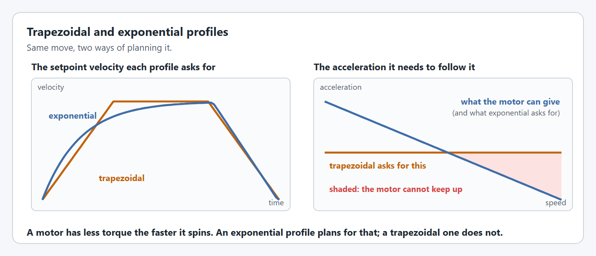

# Yet Another Mechanism System

<h2 align="center">Yet Another Mechanism System</h2>

<p align="center">What top FRC teams spent seasons building into their own robot code, in one library any team can use.<br>Describe your mechanism once. YAMS gives you the commands, the simulation, the telemetry, and live tuning.</p>

<table data-card-size="large" data-view="cards"><thead><tr><th></th><th></th><th></th><th data-hidden data-card-target data-type="content-ref"></th><th data-hidden data-card-cover data-type="image">Cover image</th></tr></thead><tbody><tr><td><i class="fa-wand-magic-sparkles">:wand-magic-sparkles:</i></td><td><strong>Generate a mechanism</strong></td><td>Fill in a form and YAMG writes the subsystem for you: elevators, arms, pivots, turrets, and flywheels, with absolute encoders and homing switches, ready to drop into your robot.</td><td><a href="https://yamg.yassrobotics.com">https://yamg.yassrobotics.com</a></td><td><a href=".gitbook/assets/yamg.png">yamg.png</a></td></tr><tr><td><i class="fa-book">:book:</i></td><td><strong>Documentation</strong></td><td>Step-by-step tutorials for every mechanism, from your first arm to swerve, simulation, and live tuning.</td><td><a href="https://app.gitbook.com/o/MwECAyhaWCMK5V9K79gd/s/ZM0CFmYiQzcrY4zDcTtZ/">Documentation</a></td><td><a href=".gitbook/assets/YAMS.png">YAMS.png</a></td></tr><tr><td><i class="fa-code">:code:</i></td><td><strong>API reference</strong></td><td>Every class and every config option, with what it does and how to use it.</td><td><a href="https://app.gitbook.com/o/MwECAyhaWCMK5V9K79gd/s/ezOwaXLQ3h1N7tr3zYnj/">API Reference</a></td><td><a href=".gitbook/assets/api-reference.jpg">api-reference.jpg</a></td></tr><tr><td><i class="fa-robot">:robot:</i></td><td><strong>Examples</strong></td><td>Download complete robot projects built with YAMS from the latest release, for Commands v2 and v3: BroncBotz, Everybot, Kitbot, the REV and WCP 2026 robots, and more, each ready to simulate.</td><td><a href="https://github.com/Yet-Another-Software-Suite/YAMS/releases/latest">https://github.com/Yet-Another-Software-Suite/YAMS/releases/latest</a></td><td><a href=".gitbook/assets/examples.png">examples.png</a></td></tr></tbody></table>



### Built from years of FRC experience

The best FRC teams have spent years building their own mechanism code: motion profiles that plan for what a motor can really do, simulations that include the battery sagging under load, gains they can tune while the robot runs, absolute encoders that know where a turret is the moment it turns on. That code usually stays inside one team, and every other team starts again from zero.

YAMS brings those ideas together in one open source library, so your team can use them from its very first mechanism. It is built by Yet Another Software Suite, the team behind YAGSL, whose main developers have been doing FRC for over 10 years.

<a href="https://app.gitbook.com/s/ZM0CFmYiQzcrY4zDcTtZ/why-yams" class="button primary" data-icon="rocket">Why YAMS?</a> <a href="https://github.com/Yet-Another-Software-Suite/YAMS" class="button secondary" data-icon="github">Source on GitHub</a>



<figure><figcaption><p>YAMS simulates the whole robot's battery, so a brownout shows up before competition.</p></figcaption></figure>





### Getting started

1. **Create a project and install YAMS.** It is one vendordep in a standard WPILib 2027 project.
2. **Describe your mechanism.** Configure the motor controller, then the mechanism, as in the code here. The tutorials walk you through it, or [YAMG](https://yamg.yassrobotics.com) writes it for you from a form.
3. **Run it in simulation.** Every mechanism simulates itself. Drive it, tune it, and graph it in AdvantageScope before the robot is built.

<a href="https://yams.yassrobotics.com/documentation/tutorials/project-setup" class="button primary" data-icon="rocket-launch">Get started</a> <a href="https://yamg.yassrobotics.com" class="button secondary" data-icon="wand-magic-sparkles">Open YAMG</a> <a href="https://github.com/Yet-Another-Software-Suite/YAMS/releases/latest" class="button secondary" data-icon="download">Download examples</a>




```java
// 1. Configure the motor controller: control, gains, gearing and limits.
SmartMotorControllerConfig motorConfig = new SmartMotorControllerConfig(this)
    .withControlMode(ControlMode.CLOSED_LOOP)
    .withClosedLoopController(4, 0, 0)
    .withTrapezoidalProfile(DegreesPerSecond.of(180), DegreesPerSecondPerSecond.of(90))
    .withFeedforward(new ArmFeedforward(0, 0, 0, 0)) // Placeholder gains, until you tune them.
    .withGearing(new MechanismGearing(GearBox.fromReductionStages(3, 4)))
    .withSoftLimits(Degrees.of(-30), Degrees.of(100))
    .withStatorCurrentLimit(Amps.of(40))
    .withZeroPower(MotorMode.BRAKE)
    .withStartingPosition(Degrees.of(0))
    .withTelemetry("ArmMotor", TelemetryVerbosity.HIGH);

// 2. Create the motor controller.
TalonFX armMotor = new TalonFX(1, new CANBus(CANPort.CAN_S0));
SmartMotorController motor = new TalonFXWrapper(armMotor, DCMotor.getKrakenX60(1), motorConfig);

// 3. Configure the arm.
ArmConfig armConfig = new ArmConfig()
    .withLength(Meters.of(0.135))
    .withHardLimits(Degrees.of(-100), Degrees.of(200))
    .withTelemetry("Arm", TelemetryVerbosity.HIGH);

// 4. Create the arm, and use its commands.
Arm arm = new Arm(armConfig, motor);
Command raise = arm.setAngle(Degrees.of(90));
```






<figure><figcaption><p>Exponential profiles plan for a motor losing torque as it speeds up.</p></figcaption></figure>



### Everything a mechanism needs, built in

* **Simulation** of every mechanism with no extra code, including a [battery simulation](https://yams.yassrobotics.com/documentation/how-to-simulation-and-logging/how-do-i-enable-battery-discharge-simulation) of the whole robot.
* **[Live tuning](https://yams.yassrobotics.com/documentation/how-to-tuning/live-tuning)** of the gains, the profile, and the limits from a dashboard, applied while the robot runs.
* **[Telemetry](https://yams.yassrobotics.com/documentation/understanding/telemetry)** of the motor and the mechanism, at the verbosity you choose.
* **Control** beyond PID: trapezoidal and [exponential profiles](https://yams.yassrobotics.com/documentation/how-to-motor-controllers-and-sensors/how-do-i-use-exponential-profiles), and [LQR](https://yams.yassrobotics.com/documentation/details/editor/lqr-controllers).
* **[Absolute encoders](https://yams.yassrobotics.com/documentation/how-to-mechanisms/how-do-i-use-absolute-encoders-on-my-arm)**, and [EasyCRT](https://yams.yassrobotics.com/documentation/details/easycrt) to find a turret's angle from two of them.
* **Sensors** that simulate themselves: wrap a limit switch, a beam break, or any other [sensor](https://yams.yassrobotics.com/documentation/details/sensors), and the simulation triggers it the way the real one is, such as a [homing switch](https://yams.yassrobotics.com/documentation/how-to-mechanisms/how-do-i-home-a-mechanism-with-limit-switches) pressed when the mechanism reaches its hard stop.
* **Every common mechanism**: arms, elevators, pivots, turrets, flywheels, double-jointed arms, differential mechanisms, and swerve drives.
* **Your hardware**: TalonFX, TalonFXS, SPARK MAX, SPARK Flex, and Thrifty Nova, in Java and C++, with WPILib Commands v2 or v3.



<h2 align="center">Join a community of over 400 teams</h2>

<p align="center">Ask questions on Discord, or help build YAMS on GitHub.</p>



### Discord community

Post questions, get help, and share resources with over 3,000 like-minded developers.

<a href="https://discord.gg/yass" class="button primary" data-icon="discord">Join Discord</a>



### GitHub

YAMS is 100% open source and built by developers just like you. Report a bug or ask for a feature in the issues, or open a pull request with your fix.

<a href="https://github.com/Yet-Another-Software-Suite/YAMS/issues" class="button primary" data-icon="github">Report an issue</a> <a href="https://github.com/Yet-Another-Software-Suite/YAMS/pulls" class="button secondary" data-icon="code-pull-request">Pull requests</a>


