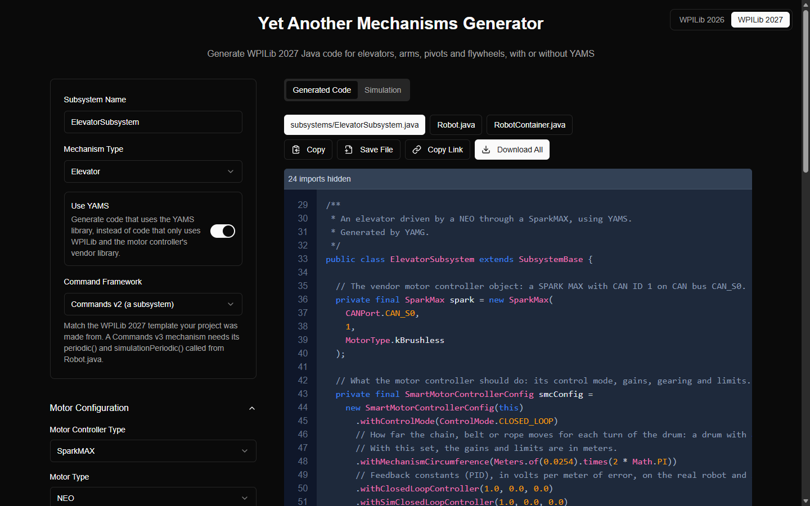

# Yet Another Mechanism System

<h2 align="center">Yet Another Mechanism System</h2>

<p align="center">Describe your mechanism once. YAMS gives you the commands, the simulation, the telemetry and live tuning.</p>

<table data-card-size="large" data-view="cards"><thead><tr><th></th><th></th><th></th><th data-hidden data-card-target data-type="content-ref"></th><th data-hidden data-card-cover data-type="image">Cover image</th></tr></thead><tbody><tr><td><i class="fa-wand-magic-sparkles">:sparkles:</i></td><td><strong>Generate a mechanism</strong></td><td>Fill in a form and YAMG writes the subsystem for you: elevators, arms, pivots, turrets and flywheels, ready to drop into your robot.</td><td><a href="https://yamg.yassrobotics.com">https://yamg.yassrobotics.com</a></td><td><a href=".gitbook/assets/yamg.png">yamg.png</a></td></tr><tr><td><i class="fa-leaf">:leaf:</i></td><td><strong>Documentation</strong></td><td>Guides for every mechanism, from your first arm to swerve, simulation and live tuning.</td><td><a href="https://app.gitbook.com/o/MwECAyhaWCMK5V9K79gd/s/ZM0CFmYiQzcrY4zDcTtZ/">Documentation</a></td><td><a href="https://images.unsplash.com/photo-1515879218367-8466d910aaa4?crop=entropy&#x26;cs=srgb&#x26;fm=jpg&#x26;ixid=M3wxOTcwMjR8MHwxfHNlYXJjaHwxfHxjb2RlfGVufDB8fHx8MTc1NjgzODk4Nnww&#x26;ixlib=rb-4.1.0&#x26;q=85">https://images.unsplash.com/photo-1515879218367-8466d910aaa4?crop=entropy&#x26;cs=srgb&#x26;fm=jpg&#x26;ixid=M3wxOTcwMjR8MHwxfHNlYXJjaHwxfHxjb2RlfGVufDB8fHx8MTc1NjgzODk4Nnww&#x26;ixlib=rb-4.1.0&#x26;q=85</a></td></tr><tr><td><i class="fa-terminal">:terminal:</i></td><td><strong>API reference</strong></td><td>Every class and every config option, with what it does and how to use it.</td><td><a href="https://app.gitbook.com/o/MwECAyhaWCMK5V9K79gd/s/ezOwaXLQ3h1N7tr3zYnj/">API Reference</a></td><td><a href="https://images.unsplash.com/photo-1509475826633-fed577a2c71b?crop=entropy&#x26;cs=srgb&#x26;fm=jpg&#x26;ixid=M3wxOTcwMjR8MHwxfHNlYXJjaHw0fHxEb2N1bWVudGF0aW9ufGVufDB8fHx8MTc1NjgzOTQzOXww&#x26;ixlib=rb-4.1.0&#x26;q=85">https://images.unsplash.com/photo-1509475826633-fed577a2c71b?crop=entropy&#x26;cs=srgb&#x26;fm=jpg&#x26;ixid=M3wxOTcwMjR8MHwxfHNlYXJjaHw0fHxEb2N1bWVudGF0aW9ufGVufDB8fHx8MTc1NjgzOTQzOXww&#x26;ixlib=rb-4.1.0&#x26;q=85</a></td></tr></tbody></table>



**Get started in minutes with YAMG**

The quickest way to your first mechanism is [YAMG](https://yamg.yassrobotics.com), Yet Another Mechanisms Generator. Pick the mechanism, the motor controller and the motor, fill in the gearing and the limits, and turn on Use YAMS.

YAMG writes the subsystem and the robot files for WPILib 2027, for Commands v2 or v3. It can add an absolute encoder, or two with CRT for a turret, and it shows the mechanism moving in a simulation before you download the code. Share a link to the form with your team, and everyone gets the same mechanism.

<a href="https://yamg.yassrobotics.com" class="button primary" data-icon="wand-magic-sparkles">Open YAMG</a> <a href="https://app.gitbook.com/o/MwECAyhaWCMK5V9K79gd/s/ZM0CFmYiQzcrY4zDcTtZ/" class="button secondary" data-icon="rocket-launch">Read the guides</a>



<figure><figcaption><p>YAMG generates the subsystem as you fill in the form.</p></figcaption></figure>





**Four steps to a mechanism**

YAMS splits a mechanism into four steps: configure the motor controller, create it, configure the mechanism, and create the mechanism. You then drive it with the commands the mechanism gives you, such as `setAngle` for an arm and `setHeight` for an elevator.

YAMS has arms, elevators, pivots (turrets and hoods), flywheels (shooters, intakes and rollers), double jointed arms, differential mechanisms and swerve drives. It runs on the TalonFX, TalonFXS, SPARK MAX, SPARK Flex and Thrifty Nova, in Java and C++, with WPILib Commands v2 or v3.

<a href="https://app.gitbook.com/o/MwECAyhaWCMK5V9K79gd/s/ZM0CFmYiQzcrY4zDcTtZ/" class="button primary" data-icon="rocket-launch">Get started</a> <a href="https://app.gitbook.com/o/MwECAyhaWCMK5V9K79gd/s/ezOwaXLQ3h1N7tr3zYnj/" class="button secondary" data-icon="terminal">API reference</a>




```java
// 1. Configure the motor controller: control, gains, gearing and limits.
SmartMotorControllerConfig motorConfig = new SmartMotorControllerConfig(this)
    .withControlMode(ControlMode.CLOSED_LOOP)
    .withClosedLoopController(4, 0, 0)
    .withTrapezoidalProfile(DegreesPerSecond.of(180), DegreesPerSecondPerSecond.of(90))
    .withFeedforward(new ArmFeedforward(0, 0, 0, 0))
    .withGearing(new MechanismGearing(GearBox.fromReductionStages(3, 4)))
    .withSoftLimits(Degrees.of(-30), Degrees.of(100))
    .withStatorCurrentLimit(Amps.of(40))
    .withZeroPower(MotorMode.BRAKE)
    .withStartingPosition(Degrees.of(0))
    .withTelemetry("ArmMotor", TelemetryVerbosity.HIGH);

// 2. Create the motor controller.
TalonFX armMotor = new TalonFX(1, new CANBus(CANPort.CAN_S0));
SmartMotorController motor = new TalonFXWrapper(armMotor, DCMotor.getKrakenX60(1), motorConfig);

// 3. Configure the arm.
ArmConfig armConfig = new ArmConfig()
    .withLength(Meters.of(0.135))
    .withHardLimits(Degrees.of(-100), Degrees.of(200))
    .withTelemetry("Arm", TelemetryVerbosity.HIGH);

// 4. Create the arm, and use its commands.
Arm arm = new Arm(armConfig, motor);
Command raise = arm.setAngle(Degrees.of(90));
```






<figure><figcaption></figcaption></figure>



**Everything a mechanism needs, built in**

* **Simulation** of every mechanism, with no extra code, including a battery simulation of the whole robot so a brownout shows up before competition.
* **Live tuning** of the gains, the profile and the limits from a dashboard, applied while the robot runs.
* **Telemetry** of the motor and the mechanism, at the verbosity you choose.
* **Control** beyond PID: trapezoidal and exponential profiles, and LQR.
* **Absolute encoders**, and EasyCRT to find a turret's angle from two of them.

<a href="https://app.gitbook.com/s/ZM0CFmYiQzcrY4zDcTtZ/tutorials" class="button primary" data-icon="book-open">Guides</a> <a href="https://app.gitbook.com/o/MwECAyhaWCMK5V9K79gd/s/ZM0CFmYiQzcrY4zDcTtZ/" class="button secondary" data-icon="book">Documentation</a>



<h2 align="center">Join a community of over 400 teams!</h2>

<p align="center">Join our Discord community or create your first PR in just a few steps.</p>

<table data-card-size="large" data-view="cards"><thead><tr><th></th><th></th><th></th><th></th><th data-hidden data-card-cover data-type="image">Cover image</th></tr></thead><tbody><tr><td><i class="fa-discord">:discord:</i></td><td><strong>Discord community</strong></td><td>Join our Discord community to post questions, get help, and share resources with over 3,000 like-minded developers.</td><td><a href="https://discord.gg/yass" class="button secondary">Join Discord</a></td><td><a href="https://images.unsplash.com/photo-1679057001914-59ab4131dfff?crop=entropy&#x26;cs=srgb&#x26;fm=jpg&#x26;ixid=M3wxOTcwMjR8MHwxfHNlYXJjaHwyfHxkaXNjb3JkfGVufDB8fHx8MTc1NjgzODk5M3ww&#x26;ixlib=rb-4.1.0&#x26;q=85">https://images.unsplash.com/photo-1679057001914-59ab4131dfff?crop=entropy&#x26;cs=srgb&#x26;fm=jpg&#x26;ixid=M3wxOTcwMjR8MHwxfHNlYXJjaHwyfHxkaXNjb3JkfGVufDB8fHx8MTc1NjgzODk5M3ww&#x26;ixlib=rb-4.1.0&#x26;q=85</a></td></tr><tr><td><i class="fa-github">:github:</i></td><td><strong>GitHub</strong></td><td>YAMS is 100% open source and built by developers just like you. Head to our GitHub repository to learn how to submit your first PR.</td><td><a href="https://github.com/Yet-Another-Software-Suite/YAMS/pulls" class="button secondary">Submit a PR</a></td><td><a href=".gitbook/assets/YASS_LOGO.png">YASS_LOGO.png</a></td></tr></tbody></table>
