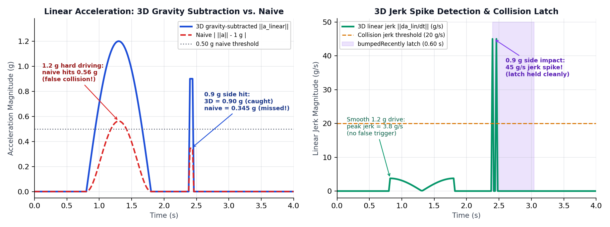

# Collision and jerk detection

Knowing the instant your robot hits a field wall or another robot is useful for pausing fragile scoring sequences, down-weighting wheel odometry during an impact, or triggering driver haptic feedback. Because an IMU accelerometer measures **proper acceleration** (linear acceleration *plus* `1 g` of upward gravity reaction), subtracting gravity incorrectly is the #1 reason collision detectors miss real hits or false-trigger during hard driving.

This page shows how to build a standalone `CollisionJerkMonitor` in robot code using your gyro's `Rotation3d` for **3D gravity subtraction**, computing **3D linear jerk** (`||da_linear / dt||`), and holding a NaN-safe `bumpedRecently` latch.

## Why `| ||a|| - 1 g |` fails

A common shortcut is checking `Math.abs(accelMagnitude - 1.0)` against a threshold like `0.5 g`. The math breaks in both directions:

* **Missed side collisions:** a `0.9 g` horizontal side hit on flat carpet produces `a_raw = (0, 0.9 g, 1.0 g)`. Its vector norm is `sqrt(0.9² + 1.0²) = 1.345 g`, so `| ||a|| - 1 g | = 0.345 g` — **missed** by a `0.5 g` threshold.
* **False triggers on hard driving:** smooth `1.2 g` swerve acceleration produces `sqrt(1.2² + 1.0²) = 1.562 g`, so `| ||a|| - 1 g | = 0.562 g` — **falsely flagged** as a collision even though the robot never hit anything.

Rotating the world-up unit gravity vector `(0, 0, 1 g)` into the robot body frame by `new Rotation3d(attitude.getQuaternion().inverse())` and subtracting it recovers true 3D linear acceleration (`a_linear = a_raw - g_body`). Differentiating `a_linear` with respect to `Timer.getTimestamp()` gives **3D linear jerk**: smooth `1.2 g` driving produces only ~`3–5 g/s`, while a `0.9 g` impact in one 20 ms loop spikes to `45 g/s`.

<figure><figcaption>
Left: 3D gravity subtraction recovers the full 0.90 g side impact that naive | ||a|| - 1 g | under-reports as 0.345 g. Right: thresholding 3D linear jerk separates sharp impacts (45 g/s) from smooth 1.2 g swerve acceleration (3.8 g/s).
</figcaption></figure>

## How the monitor works

| Concern | Pattern used in the example |
| --- | --- |
| True 3D linear acceleration | Rotate `(0, 0, 1 g)` by `new Rotation3d(attitude.getQuaternion().inverse())` and subtract from `(ax, ay, az)` |
| Separating hits from hard driving | Compute 3D linear jerk `||a_lin(t) - a_lin(t - dt)|| / dt` and trigger when jerk exceeds `jerkThreshold` |
| Non-finite IMU samples | Ignore `NaN`/infinite inputs and **preserve** the active `bumpedRecently` latch instead of clearing it |
| Impact direction | Report the body-frame unit vector of the collision impulse for driver feedback or evasive recovery |
| WPILib 2027 Units & timing | Pass `Time`, `Rotation3d`, and `LinearAcceleration` (`Gs`) into `update(...)` using `Timer.getTimestamp()` |

## WPILib building blocks

* [`Rotation3d` & `Translation3d`](https://docs.wpilib.org/en/stable/docs/software/advanced-controls/geometry/transformations.html) — exact 3D quaternion rotation of the gravity vector into the robot body frame.
* `Timer.getTimestamp()` — monotonic WPILib 2027 timestamp in seconds (replaces the removed `getFPGATimestamp()`).
* `org.wpilib.units.measure.{Time, LinearAcceleration}` — type-safe units passed directly into `CollisionJerkMonitor.update(...)`.

## Further reading

* WPILib: [Geometry Classes (`Rotation3d`, `Translation3d`)](https://docs.wpilib.org/en/stable/docs/software/advanced-controls/geometry/transformations.html)
* NavX / Kauai Labs: [Collision Detection Application Note](https://pdocs.kauailabs.com/navx-mxp/examples/collision-detection/)
* Next page: [The collision and jerk detection example](the-example.md)
