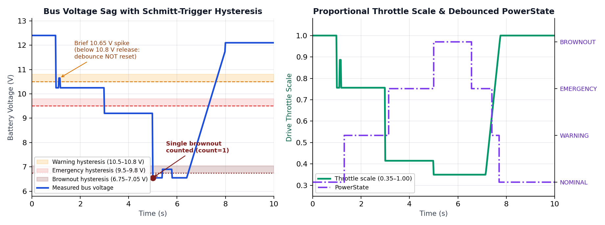

# Power health monitoring

Current limits on each motor controller are your first line of defense against brownouts (see [How do I limit power consumption?](../../how-to-motor-controllers-and-sensors/limiting-power-consumption.md)). Even with good per-motor limits, an aging competition battery or simultaneous full-power maneuvers across swerve, intake, and shooter can still pull bus voltage low enough to trigger a roboRIO / SystemCore brownout.

This page shows how to build a standalone `PowerHealthMonitor` in robot code that watches `RobotController.getMeasureBatteryVoltage()`, classifies bus health with **Schmitt-trigger hysteresis**, counts brownout events cleanly, integrates amp-hour consumption from an explicit starting state of charge, and outputs a smooth proportional **throttle scale** to ease drivetrain demand before a brownout occurs.

## Why a naive voltage check fails on a real robot

A simple `if (voltage < 10.5)` check causes three common problems in matches:

1. **Non-finite sensor glitches**: if a CAN or HAL read briefly returns `NaN`, clamping it to `0 V` falsely trips a brownout and slams drive throttle to its floor. Non-finite samples should be ignored so the monitor holds its last valid reading.
2. **Debounce flicker and double-counted brownouts**: real battery voltage under PWM load bounces by `0.2–0.5 V` every loop. Without **hysteresis**, a single `10.55 V` sample resets a `10.5 V` warning debounce timer, and voltage hovering around the brownout rail counts dozens of false brownouts in one second.
3. **Hardcoded brownout rails and assumed 100% batteries**: WPILib 2027 lets you configure the hardware brownout rail via `RobotController.setBrownoutVoltages(...)`, and a robot booted on a practice or mid-event battery does not always start at 100% state of charge. Both should be explicit configuration parameters.

<figure><figcaption>
Left: hysteresis prevents a brief 10.65 V spike from resetting the warning debounce and prevents hovering around 6.75 V from double-counting brownouts. Right: throttle scale ramps smoothly from 1.00 down to 0.35 as bus voltage sags.
</figcaption></figure>

## How the monitor works

| Concern | Pattern used in the example |
| --- | --- |
| Non-finite voltage or current | Ignore non-finite samples (`!Double.isFinite(...)`) and retain last valid state |
| Warning & emergency debounce | Accumulate timer below threshold; pause inside the hysteresis band; reset only above `threshold + hysteresis` |
| Brownout transition counting | Latch `inBrownout = true` at or below `brownoutRailVoltage` (increment count once); release only above `brownoutRailVoltage + hysteresis` |
| Configurable brownout rail | Pass `brownoutRailVoltage` in `PowerHealthConfig` to match your `RobotController.setBrownoutVoltages(...)` setting |
| Coulomb-counted SoC | Integrate `totalCurrent * dt / 3600` against `batteryCapacityAh` starting from an explicit `initialStateOfCharge` in `[0.0, 1.0]` |
| Smooth throttle scaling | Linearly scale drive output from `1.0` at `throttleStartVoltage` (`11.0 V`) down to `minThrottleScale` (`0.35`) at `throttleFloorVoltage` (`9.0 V`) |


**Testing in simulation:** Turn on YAMS battery discharge modeling with `BatterySim.enableDischarge(...)` (see [How do I enable battery discharge simulation?](../../how-to-simulation-and-logging/how-do-i-enable-battery-discharge-simulation.md)) so sustained driving actually drains the simulated battery and exercises your throttle curve before you ever get on a field.


## WPILib building blocks

* [`RobotController.getMeasureBatteryVoltage()`](https://docs.wpilib.org/en/stable/docs/software/roborio-info/roborio-brownouts.html) — typed `Voltage` reading of the main power rail.
* `Timer.getTimestamp()` — monotonic WPILib 2027 timestamp in seconds (replaces the removed `getFPGATimestamp()`).
* `org.wpilib.units.measure.{Time, Voltage, Current}` — type-safe units passed directly into `PowerHealthMonitor.update(...)`.

## Further reading

* WPILib: [roboRIO Brownouts and Understanding Current Draw](https://docs.wpilib.org/en/stable/docs/software/roborio-info/roborio-brownouts.html)
* CTRE: [Improving performance with current limits](https://v6.docs.ctr-electronics.com/en/stable/docs/hardware-reference/talonfx/improving-performance-with-current-limits.html)
* YAMS: [How do I limit power consumption?](../../how-to-motor-controllers-and-sensors/limiting-power-consumption.md) and [How do I enable battery discharge simulation?](../../how-to-simulation-and-logging/how-do-i-enable-battery-discharge-simulation.md)
* Next page: [The power health monitoring example](the-example.md)
