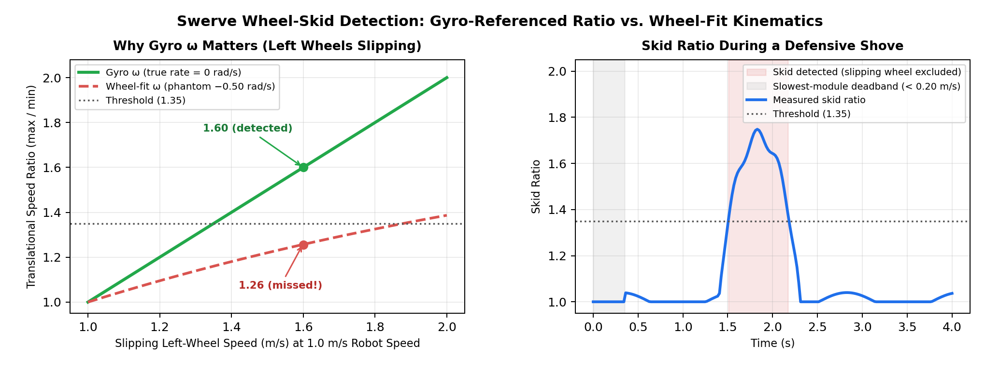

# Swerve skid detection

**The idea:** detect when one or more swerve wheels are slipping against the carpet — during defense, a wall hit, or a hard launch — and exclude only the slipping wheels' distance deltas from your pose estimator before they corrupt field odometry.

This page is a reference: where to learn the math, why the gyro's angular velocity matters, and which public YAMS `SwerveDrive` getters supply each input. The [`swerve_skid_detection` example](https://github.com/Yet-Another-Software-Suite/YAMS/tree/master/examples/commands2/swerve_skid_detection) in the YAMS repository puts it all together in Java with Commands v2 and [Commands v3](https://github.com/Yet-Another-Software-Suite/YAMS/tree/master/examples/commands3/swerve_skid_detection), with C++ equivalents in [The swerve skid detection example](the-example.md).

## Read these first

| Source | Read it for |
| --- | --- |
| [Orbit 1690 Online Software Sessions](https://www.chiefdelphi.com/t/orbit-1690-online-software-sessions/467221) (Chief Delphi) | The original FRC derivation of subtracting pure chassis rotation (`ω × r`) from each swerve module's measured velocity vector to compare translational speeds across all four wheels. |
| WPILib [Swerve Drive Kinematics](https://docs.wpilib.org/en/stable/docs/software/kinematics-and-odometry/swerve-drive-kinematics.html) | How module positions `(x, y)` and `SwerveModuleVelocity` vectors relate to chassis linear and angular velocity. |
| WPILib [Pose Estimators](https://docs.wpilib.org/en/stable/docs/software/advanced-controls/state-space/state-space-pose-estimators.html) | How `SwerveDrivePoseEstimator` fuses wheel odometry with vision and why bad wheel deltas shift the pose estimate until vision corrects it. |

## Why gyro ω and a slowest-module deadband matter

On a rigid swerve chassis with no wheel slip, every module's velocity vector minus the chassis rotation contribution `ω × r_i = (−ω·y_i, +ω·x_i)` must equal the exact same robot translational velocity `(v_x, v_y)`. When a wheel breaks traction, its translational speed jumps away from the gripping wheels, pushing `max(v_trans) / min(v_trans)` above `1.0`.

Two subtle traps break naive implementations:

1. **Never compute `ω` from the same wheels you are checking.** If you pass `kinematics.toChassisVelocities(states).omega` into the skid check, a slipping pair of wheels bends the fitted rotation rate. On a 0.6 m square chassis driving straight at 1.0 m/s with both left wheels slipping to 1.6 m/s, the wheel fit reports a phantom `−0.50 rad/s` and lowers the ratio to `1.26` — missing a `1.35` threshold. Using the gyro's true rate (`0 rad/s`) gives the real `1.60` ratio.
2. **Apply the low-speed deadband to the slowest module, not the fastest.** Because the ratio divides by `min(v_trans)`, checking only `max(v_trans) >= 0.10 m/s` lets `0.04 m/s` of low-speed encoder noise (`0.12` vs. `0.08 m/s`) produce a false `1.50` ratio. Requiring `min(v_trans) >= 0.20 m/s` eliminates low-speed false positives.

*Left: a 0.6 m square chassis at 1.0 m/s with left wheels slipping — wheel-fit ω hides the skid below 1.35 while gyro ω catches it at 1.60. Right: skid ratio over a 4-second maneuver with a defensive shove and slowest-module deadband.*

## How the sources' ideas apply to YAMS

| Concept | Read about it in | In YAMS |
| --- | --- | --- |
| Measured velocity and angle of each swerve module | [Swerve Drive Kinematics](https://docs.wpilib.org/en/stable/docs/software/kinematics-and-odometry/swerve-drive-kinematics.html) | `drive.getModuleStates()` (`SwerveModuleVelocity[]`) on [Swerve Drive](../../understanding/swerve-drive/) |
| Cumulative wheel distance and angle for odometry | [Pose Estimators](https://docs.wpilib.org/en/stable/docs/software/advanced-controls/state-space/state-space-pose-estimators.html) | `drive.getModulePositions()` (`SwerveModulePosition[]`) |
| True chassis rotation rate `ω` (independent of wheels) | [Why gyro ω matters](#why-gyro-ω-and-a-slowest-module-deadband-matter) | Your gyro's yaw rate (for example Pigeon2's `gyro.getAngularVelocityZWorld()`) |
| Field-relative odometry heading | [Swerve Drive](../../understanding/swerve-drive/) | `drive.getRotation()` (`Rotation2d`) |
| Per-wheel slip filtering without modifying YAMS | [The swerve skid detection example](the-example.md) | A standalone `SkidDetector` + `SwerveDrivePoseEstimator` that freezes only slipping modules' deltas while healthy modules keep integrating |

## Tuning the YAMS side

| Their advice | Setting in the example |
| --- | --- |
| Start conservative so normal acceleration does not trip false skids | `SKID_RATIO_THRESHOLD = 1.35` in `Constants.SkidConstants` |
| Prevent encoder noise at creep speeds from dividing by near-zero | `MIN_MODULE_TRANSLATIONAL_SPEED = MetersPerSecond.of(0.20)` (applied to the **slowest** module) |
| Keep odometry moving when only one wheel slips | `SkidDetector.detect(...)` returns a per-module `boolean[] slippingModules` mask so healthy modules continue advancing the pose estimator |
| Verify your gyro sign convention before trusting skid ratios | Counterclockwise positive (`+Z` up) matching WPILib's [Coordinate System](https://docs.wpilib.org/en/stable/docs/software/basic-programming/coordinate-system.html) |

## WPILib building blocks

The released WPILib documentation is written for WPILib 2026. The ideas are the same in 2027, though some classes were renamed: `SwerveModuleState` is `SwerveModuleVelocity` (with `.velocity` instead of `.speed`), and `ChassisSpeeds` is `ChassisVelocities`.

| Page | Why it matters here |
| --- | --- |
| [Coordinate System](https://docs.wpilib.org/en/stable/docs/software/basic-programming/coordinate-system.html) | Sign convention for `+X`, `+Y`, and `+ω` (CCW positive) in `ω × r`. |
| [Swerve Drive Kinematics](https://docs.wpilib.org/en/stable/docs/software/kinematics-and-odometry/swerve-drive-kinematics.html) | Module mounting coordinates and forward kinematics. |
| [Pose Estimators](https://docs.wpilib.org/en/stable/docs/software/advanced-controls/state-space/state-space-pose-estimators.html) | Running a custom `SwerveDrivePoseEstimator` fed by filtered module positions. |
