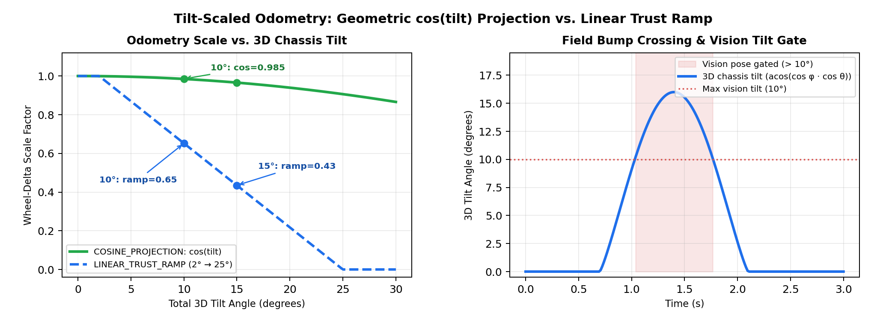

# Tilt-scaled odometry

**The idea:** when your robot drives over a field bump, cable protector, or ramp, 2D wheel odometry over-counts horizontal travel and 2D AprilTag projections can jump. Use the gyro's 3D attitude (`Rotation3d`) to scale wheel deltas onto the flat field plane and reject vision updates while heavily tilted.

This page is a reference: the geometry behind `cos(tilt)` vs. a linear trust heuristic, and which public YAMS `SwerveDrive` getters supply each input. The [`tilt_scaled_odometry` example](https://github.com/Yet-Another-Software-Suite/YAMS/tree/master/examples/commands2/tilt_scaled_odometry) in the YAMS repository puts it all together in Java with Commands v2 and [Commands v3](https://github.com/Yet-Another-Software-Suite/YAMS/tree/master/examples/commands3/tilt_scaled_odometry), with C++ equivalents in [The tilt-scaled odometry example](the-example.md).

## Read these first

| Source | Read it for |
| --- | --- |
| WPILib [Pose Estimators](https://docs.wpilib.org/en/stable/docs/software/advanced-controls/state-space/state-space-pose-estimators.html) | How `SwerveDrivePoseEstimator` integrates wheel deltas and rejects or weights vision measurements. |
| WPILib [Rotation3d & 3D Geometry](https://docs.wpilib.org/en/stable/docs/software/advanced-controls/geometry/pose.html) | How roll and pitch compose into total 3D tilt away from vertical (`acos(cos(roll) · cos(pitch))`). |
| [Spectrum 3847 (`2026-FM-SystemCore`)](https://github.com/Spectrum3847/2026-FM-SystemCore) | Production FRC tilt-state gating (`TiltState`) for suppressing vision and shots while crossing field bumps. |

## Choosing `COSINE_PROJECTION` vs. `LINEAR_TRUST_RAMP`

Both modes compute the exact 3D tilt angle `α = acos(cos(roll) · cos(pitch))` from the gyro's `Rotation3d`, but they answer two different physical situations:

1. **`COSINE_PROJECTION` (`scale = cos(α)`, recommended default on smooth ramps):** On a rigid slope where all four wheels stay planted, the true horizontal field distance covered is `Δs_flat = Δs_wheel × cos(α)` (`0.985` at `10°`, `0.966` at `15°`). This preserves real travel so odometry does not fall behind while climbing a ramp.
2. **`LINEAR_TRUST_RAMP` (conservative trust heuristic for abrupt bumps):** On sharp field bumps where wheels momentarily bounce or unweight and spin in mid-air, a linear ramp from `1.0` at `fullTrustTilt` (e.g., `2°`) down to `0.0` at `zeroTrustTilt` (e.g., `25°`) aggressively damps wheel deltas (`0.65` at `10°`, `0.43` at `15°`) so airborne wheel spin does not corrupt the pose before vision recovers.

*Left: `COSINE_PROJECTION` preserves true flat travel on ramps (`0.985` at `10°`), whereas `LINEAR_TRUST_RAMP` aggressively damps airborne wheel spin (`0.65` at `10°`). Right: vision measurements are gated whenever 3D tilt exceeds `10°`.*


**Timestamp note for vision gating:** Checking `shouldAcceptVision(drive.getGyroRotation3d())` compares the robot's *current* tilt rather than historical tilt at the vision frame's capture timestamp. For most cameras (~20–40 ms latency) this is sufficient; if your vision pipeline has high latency, buffer `(timestamp, Rotation3d)` samples in a WPILib `TimeInterpolatableBuffer`.


## How the sources' ideas apply to YAMS

| Concept | Read about it in | In YAMS |
| --- | --- | --- |
| 3D robot roll and pitch | [Rotation3d & 3D Geometry](https://docs.wpilib.org/en/stable/docs/software/advanced-controls/geometry/pose.html) | `drive.getGyroRotation3d()` on [Swerve Drive](../../understanding/swerve-drive/) |
| Cumulative wheel positions for odometry | [Pose Estimators](https://docs.wpilib.org/en/stable/docs/software/advanced-controls/state-space/state-space-pose-estimators.html) | `drive.getModulePositions()` (`SwerveModulePosition[]`) |
| Field-relative odometry heading | [Swerve Drive](../../understanding/swerve-drive/) | `drive.getRotation()` (`Rotation2d`) |
| Tilt-scaled pose estimation without modifying YAMS | [The tilt-scaled odometry example](the-example.md) | Standalone `TiltOdometryScaler` + `SwerveDrivePoseEstimator` |

## Tuning the YAMS side

| Their advice | Setting in the example |
| --- | --- |
| Use geometric projection on steady ramps so pose does not lag | `ScalingMode.COSINE_PROJECTION` in `Constants.TiltConstants` |
| Switch to aggressive damping if wheels frequently go airborne on bumps | `ScalingMode.LINEAR_TRUST_RAMP` with `FULL_TRUST_TILT = Degrees.of(2)` and `ZERO_TRUST_TILT = Degrees.of(25)` |
| Reject tilted 2D vision poses before they pull your estimator off-field | `MAX_VISION_TILT = Degrees.of(10)` passed to `scaler.shouldAcceptVision(attitude)` |
| Re-sync raw wheel baselines whenever odometry is reset | Call `scaler.reset(drive.getModulePositions())` inside your `resetOdometry(Pose2d)` helper |

## WPILib building blocks

| Page | Why it matters here |
| --- | --- |
| [Rotation3d & Pose](https://docs.wpilib.org/en/stable/docs/software/advanced-controls/geometry/pose.html) | Extracting roll (`getX()`) and pitch (`getY()`) in radians. |
| [Pose Estimators](https://docs.wpilib.org/en/stable/docs/software/advanced-controls/state-space/state-space-pose-estimators.html) | Feeding scaled `SwerveModulePosition[]` and tilt-gated vision updates into `SwerveDrivePoseEstimator`. |
