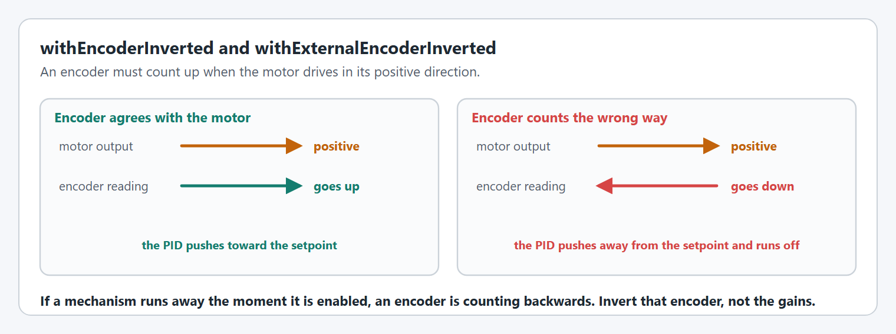
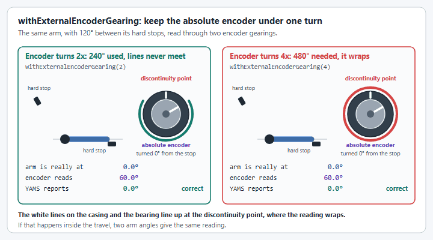

# How do I use absolute encoders on my arm?

**Goal:** have the arm know its angle the moment the robot turns on, with no homing, by closing its loop on an absolute encoder.

An absolute encoder keeps its reading through a power cycle, and YAMS maps that reading to your arm's angles with a zero offset and a wrapping range.

## Supported encoder types

Each `SmartMotorController` wrapper only accepts the encoders from its own vendor ecosystem. `SparkWrapper`, `NovaWrapper` and `A301Wrapper` throw an `IllegalArgumentException` when given an encoder type they do not support.

| Wrapper                               | Supported absolute encoders                                                               |
| ------------------------------------- | ----------------------------------------------------------------------------------------- |
| `SparkWrapper` (SparkMax / SparkFlex) | `SparkAbsoluteEncoder` (`armMotor.getAbsoluteEncoder()`), `DetachedEncoder`               |
| `TalonFXWrapper` (TalonFX / Kraken)   | `CANcoder`, `CANdi`                                                                       |
| `TalonFXSWrapper` (TalonFXS / Minion) | `CANcoder`, `CANdi`                                                                       |
| `NovaWrapper` (Thrifty Nova)          | `FeedbackSensorType.ABS` (absolute encoder on the Nova's data port), Thrifty `CanEncoder` |
| `A301Wrapper` (FIRST A301)            | The `A301` itself: its own absolute encoder, on its output shaft                          |

Set the encoder up in this order, in your `SmartMotorControllerConfig`. The [complete examples](how-do-i-use-absolute-encoders-on-my-arm.md#complete-examples) below put every step together for each motor controller.



### Check your inversion

Using the vendor hardware client (REV Hardware Client or Phoenix Tuner X), apply positive power to the motor and graph the absolute encoder position. The position should **increase** as the motor turns in the positive direction.

If it decreases, invert the encoder reading:

```java
.withExternalEncoderInverted(true)
```

<figure><figcaption><p>What a backwards encoder does to closed loop control.</p></figcaption></figure>

**Check it:** with positive power, the encoder position goes up.



### Check your gear ratio and mount

The absolute encoder must complete **at most one full rotation** across the entire range of motion of the arm. Confirm this in the hardware client by moving the arm through its full travel and watching the encoder position, it must never wrap from 1 rotation back to 0 more than once.

If the encoder is mounted directly on the arm's shaft (1:1), leave `withExternalEncoderGearing` unset. Only if the encoder is driven through a reduction, pass the encoder-to-mechanism ratio with `.withExternalEncoderGearing(...)`, and read the note on gearing in [Choose the wrapping range](how-do-i-use-absolute-encoders-on-my-arm.md#choose-the-wrapping-range).


If the gear ratio causes the encoder to exceed 1 rotation during the arm's range of motion, the encoder position will wrap unpredictably and **cannot** be used as the primary PID feedback device. Either remount the encoder closer to the mechanism output shaft or change the reduction so the encoder never exceeds 1 rotation.


<figure><figcaption><p>The same arm and hard stops. Both read [0, 1), so they wrap at the line on the casing. With a gearing of 2 the white lines never meet. With a gearing of 4 they do, and the reported angle is wrong.</p></figcaption></figure>

**Check it:** across the arm's whole travel, the encoder turns less than one rotation.



### Choose the wrapping range

An absolute encoder reads one rotation, and wraps at the ends of its range: its **wrap point**, where the reading jumps from its maximum back to its minimum. [`withWrapping`](../reference/editor/config/encoders.md#withwrapping) chooses the range. The two usual ones:

* `withWrapping(Rotations.of(0), Rotations.of(1))`: the encoder reads **\[0, 1)** rotations, and wraps from 1 rotation back to 0
* `withWrapping(Rotations.of(-0.5), Rotations.of(0.5))`: the encoder reads **\[-0.5, 0.5)** rotations, and wraps at ±0.5 rotations

```java
.withWrapping(Rotations.of(-0.5), Rotations.of(0.5))  // [-0.5, 0.5) range, for an arm either side of zero
// or
.withWrapping(Rotations.of(0), Rotations.of(1))       // [0, 1) range
```

`withWrapping` only sets what the encoder reads: the arm's closed loop never goes the other way round to a setpoint, so it works with soft limits. Do not use [`withContinuousWrapping`](../reference/editor/config/closed-loop-control.md#withcontinuouswrapping) on an arm: it makes the closed loop take the shortest path, which could be through the arm's hard stops.


Without `withWrapping`, a SPARK, Thrifty Nova or A301 absolute encoder reads **\[0, 1)**, and a `CANcoder` or `CANdi` keeps the range it has. Each motor controller accepts only the ranges its encoder can read: see [`withWrapping`](../reference/editor/config/encoders.md#withwrapping). A Thrifty Nova closing its loop on the encoder runs the loop itself only over **\[0, 1)**; with any other range the loop runs on the SystemCore. The range is one rotation of the **encoder**, so with `.withExternalEncoderGearing(...)` it is not one rotation of the arm.



If the arm's physical range of motion crosses the wrap point, the position will jump mid-travel and break closed-loop control. If this happens, remove the encoder, rotate the bearing so the wrap point falls outside the arm's travel range, and remount.


<figure><figcaption><p>Wrapping over [0, 1), the wrap point is at the line on the casing. Over [-0.5, 0.5) it is 180° from it, and the line has not moved.</p></figcaption></figure>

**Check it:** move the arm through its whole travel in the hardware client. The reading never jumps.



### Find your zero offset

Move the arm to exactly horizontal (0° from horizontal, parallel to the ground). Read the raw encoder position in the hardware client, with no offset set in the client: that value is your zero offset.

**Units.** The hardware clients show the position in **rotations**, from 0 to 1. `withExternalEncoderZeroOffset` takes an `Angle`, so pass the reading as rotations, or multiply it by 360 for degrees. A reading of 0.0924 is either of these:

```java
.withExternalEncoderZeroOffset(Rotations.of(0.0924))  // the reading, as shown in the client
.withExternalEncoderZeroOffset(Degrees.of(33.25))     // the same, 0.0924 × 360
```

Use one of the two, with your own reading. The offset is in **arm (mechanism) rotations**. With the encoder on the arm's shaft (1:1) and no `withExternalEncoderGearing`, an encoder rotation and an arm rotation are the same, so the client's reading goes in as it is. If you set `withExternalEncoderGearing`, measure the offset as an arm angle instead.

Negative offsets are automatically converted to their positive equivalent (1 rotation is added internally). The offset is applied to the absolute encoder itself, such as the CANcoder's magnet offset or the SPARK's absolute encoder zero offset. On an A301, YAMS applies it to the reading itself.

<figure><figcaption><p>The zero offset moves the zero, and the wrap point moves with it. The line on the casing stays where it is.</p></figcaption></figure>

**Check it:** deploy and hold the arm horizontal. `getExternalEncoderMechanismPosition()` on the `SmartMotorController`, the absolute encoder's angle, reads about 0°, as does the arm's angle under **NetworkTables > Mechanisms**.



### Configure the simulation starting position

Simulation has no physical encoder, so the absolute encoder reading is unavailable in sim. Use `.withSimStartingPosition()` to tell the simulator where the arm starts. On a real robot this value is ignored, the true encoder reading is always used.

```java
.withSimStartingPosition(Degrees.of(0))  // arm starts horizontal in sim
```

**Check it:** start the simulation. The arm starts at the angle you gave.



***

## Complete examples

The gains in these examples (`kP` of 4, and an `ArmFeedforward` of all zeros) are **placeholders**: with them the arm moves but sags below its setpoints. Find `kG` and then `kP` with the [Arm tutorial's Tune it step](../tutorials/arm/tune.md).

### SparkMax + SparkAbsoluteEncoder

```java
private final SparkMax armMotor = new SparkMax(CANPort.CAN_S0, 1, MotorType.kBrushless);

private final SmartMotorControllerConfig motorConfig = new SmartMotorControllerConfig(this)
    .withControlMode(ControlMode.CLOSED_LOOP)
    .withClosedLoopController(4, 0, 0)
    .withTrapezoidalProfile(DegreesPerSecond.of(180), DegreesPerSecondPerSecond.of(90))
    .withFeedforward(new ArmFeedforward(0, 0, 0, 0))
    .withSoftLimits(Degrees.of(-30), Degrees.of(100))
    .withGearing(new MechanismGearing(GearBox.fromReductionStages(3, 4)))
    .withZeroPower(MotorMode.BRAKE)
    .withTelemetry("ArmMotor", TelemetryVerbosity.HIGH)
    .withStatorCurrentLimit(Amps.of(40))
    .withExternalEncoder(armMotor.getAbsoluteEncoder())
    .withExternalEncoderInverted(false)
    .withExternalEncoderZeroOffset(Degrees.of(33.25))
    .withWrapping(Rotations.of(-0.5), Rotations.of(0.5))  // [-0.5, 0.5) range
    .withUseExternalFeedbackEncoder(true)
    .withSimStartingPosition(Degrees.of(0));

private final SmartMotorController smc = new SparkWrapper(armMotor, DCMotor.getNEO(1), motorConfig);
```

### TalonFX + CANcoder

```java
private final TalonFX armMotor = new TalonFX(1, new CANBus(CANPort.CAN_S0));
private final CANcoder cancoder = new CANcoder(2, new CANBus(CANPort.CAN_S0));

private final SmartMotorControllerConfig motorConfig = new SmartMotorControllerConfig(this)
    .withControlMode(ControlMode.CLOSED_LOOP)
    .withClosedLoopController(4, 0, 0)
    .withTrapezoidalProfile(DegreesPerSecond.of(180), DegreesPerSecondPerSecond.of(90))
    .withFeedforward(new ArmFeedforward(0, 0, 0, 0))
    .withSoftLimits(Degrees.of(-30), Degrees.of(100))
    .withGearing(new MechanismGearing(GearBox.fromReductionStages(3, 4)))
    .withZeroPower(MotorMode.BRAKE)
    .withTelemetry("ArmMotor", TelemetryVerbosity.HIGH)
    .withStatorCurrentLimit(Amps.of(40))
    .withExternalEncoder(cancoder)
    .withExternalEncoderInverted(false)
    .withExternalEncoderZeroOffset(Degrees.of(33.25))
    .withWrapping(Rotations.of(-0.5), Rotations.of(0.5))  // [-0.5, 0.5) range
    .withUseExternalFeedbackEncoder(true)
    .withSimStartingPosition(Degrees.of(0));

private final SmartMotorController smc = new TalonFXWrapper(armMotor, DCMotor.getKrakenX60(1), motorConfig);
```

### TalonFXS + CANdi

The absolute encoder plugs into one of the `CANdi`'s PWM inputs, and the TalonFXS reads the `CANdi` over CAN, so the encoder is not wired to the Talon at all. YAMS configures the `CANdi` the same way as a CANcoder.

A `CANdi` has two PWM inputs, so tell the Talon which one the encoder is on with a vendor config. Without it, YAMS throws a `SmartMotorControllerConfigurationException` because no PWM input is selected. Use `SyncCANdiPWM1` for the PWM1 input or `SyncCANdiPWM2` for PWM2. YAMS sets the matching input on the `CANdi` from the other options here.

```java
private final TalonFXS armMotor = new TalonFXS(1, new CANBus(CANPort.CAN_S0));
private final CANdi candi = new CANdi(2, new CANBus(CANPort.CAN_S0));

private final SmartMotorControllerConfig motorConfig = new SmartMotorControllerConfig(this)
    .withControlMode(ControlMode.CLOSED_LOOP)
    .withClosedLoopController(4, 0, 0)
    .withTrapezoidalProfile(DegreesPerSecond.of(180), DegreesPerSecondPerSecond.of(90))
    .withFeedforward(new ArmFeedforward(0, 0, 0, 0))
    .withSoftLimits(Degrees.of(-30), Degrees.of(100))
    .withGearing(new MechanismGearing(GearBox.fromReductionStages(3, 4)))
    .withZeroPower(MotorMode.BRAKE)
    .withTelemetry("ArmMotor", TelemetryVerbosity.HIGH)
    .withStatorCurrentLimit(Amps.of(40))
    // The encoder is on the CANdi's PWM1 input.
    .withVendorConfig(new TalonFXSConfiguration()
        .withExternalFeedback(new ExternalFeedbackConfigs()
            .withExternalFeedbackSensorSource(ExternalFeedbackSensorSourceValue.SyncCANdiPWM1)))
    .withExternalEncoder(candi)
    .withExternalEncoderInverted(false)
    .withExternalEncoderZeroOffset(Degrees.of(33.25))
    .withWrapping(Rotations.of(-0.5), Rotations.of(0.5))  // [-0.5, 0.5) range
    .withUseExternalFeedbackEncoder(true)
    .withSimStartingPosition(Degrees.of(0));

private final SmartMotorController smc = new TalonFXSWrapper(armMotor, DCMotor.getMinion(1), motorConfig);
```

On a TalonFX the feedback source is in `Feedback` instead:

```java
.withVendorConfig(new TalonFXConfiguration()
    .withFeedback(new FeedbackConfigs()
        .withFeedbackSensorSource(FeedbackSensorSourceValue.SyncCANdiPWM1)))
```

The CTRE types come from Phoenix 6: `com.ctre.phoenix6.configs.TalonFXSConfiguration`, `ExternalFeedbackConfigs`, `TalonFXConfiguration` and `FeedbackConfigs`, and `com.ctre.phoenix6.signals.ExternalFeedbackSensorSourceValue` and `FeedbackSensorSourceValue`.

### Thrifty Nova + absolute encoder on the data port

Pass `FeedbackSensorType.ABS` as the external encoder and tell the Nova which encoder is wired to its data port through the vendor config. The Nova runs this arm's PID, profile and feedforward itself, closing its loop on the encoder, which it reads over \[0, 1): set the zero offset so the wrap point, at the arm's zero, is outside the travel. For an arm that crosses it, set another range with `withWrapping`, and the loop runs on the SystemCore instead. A Thrifty `CanEncoder` on the same CAN bus works too: pass the `CanEncoder` object to `.withExternalEncoder(...)` instead.

```java
private final Nova armMotor = new Nova(0, 1, MotorType.NEO);

private final SmartMotorControllerConfig motorConfig = new SmartMotorControllerConfig(this)
    .withControlMode(ControlMode.CLOSED_LOOP)
    .withClosedLoopController(4, 0, 0)
    .withTrapezoidalProfile(DegreesPerSecond.of(180), DegreesPerSecondPerSecond.of(90))
    .withFeedforward(new ArmFeedforward(0, 0, 0, 0))
    .withSoftLimits(Degrees.of(-30), Degrees.of(100))
    .withGearing(new MechanismGearing(GearBox.fromReductionStages(3, 4)))
    .withZeroPower(MotorMode.BRAKE)
    .withTelemetry("ArmMotor", TelemetryVerbosity.HIGH)
    .withStatorCurrentLimit(Amps.of(40))
    .withVendorConfig(NovaConfig.absoluteEncoderType(AbsoluteEncoderType.REV_ENCODER))
    .withExternalEncoder(FeedbackSensorType.ABS)
    .withExternalEncoderInverted(false)
    .withExternalEncoderZeroOffset(Degrees.of(33.25))
    // The Nova closes its loop on the encoder, which it reads over [0, 1): the default.
    .withUseExternalFeedbackEncoder(true)
    .withSimStartingPosition(Degrees.of(0));

private final SmartMotorController smc = new NovaWrapper(armMotor, DCMotor.getNEO(1), motorConfig);
```

The Nova types come from ThriftyLib: `com.thrifty.nova.Nova`, `com.thrifty.nova.NovaConfig`, `com.thrifty.core.Motor.MotorType`, `com.thrifty.core.Motor.FeedbackSensorType` and `com.thrifty.core.Motor.AbsoluteEncoderType`. The [motor controller feature matrix](../reference/editor/feature-matrix.md) lists what the Nova supports.

### FIRST A301 + its own absolute encoder

The A301 has an absolute encoder on its output shaft, after its gearbox. Pass the `A301` itself as the external encoder. YAMS applies the zero offset, inversion and wrapping range to its reading, and runs the arm's PID, profile and feedforward on the SystemCore. The A301 has no current limits, so leave out `withStatorCurrentLimit`.

Here the A301's 135:1 gearbox drives the arm's shaft directly, so the encoder turns once per arm turn and needs no `withExternalEncoderGearing`. With a chain or gears after the A301, the encoder gearing is that ratio, such as `.withExternalEncoderGearing(3)` for a 3:1 chain, and the arm's travel times that ratio must stay under one rotation: see [Check your gear ratio and mount](how-do-i-use-absolute-encoders-on-my-arm.md#check-your-gear-ratio-and-mount).

```java
private final A301 armMotor = new A301(CANPorts.fromBusId(1), 1);

private final SmartMotorControllerConfig motorConfig = new SmartMotorControllerConfig(this)
    .withControlMode(ControlMode.CLOSED_LOOP)
    .withClosedLoopController(4, 0, 0)
    .withTrapezoidalProfile(DegreesPerSecond.of(180), DegreesPerSecondPerSecond.of(90))
    .withFeedforward(new ArmFeedforward(0, 0, 0, 0))
    .withSoftLimits(Degrees.of(-30), Degrees.of(100))
    .withGearing(new MechanismGearing(GearBox.fromReductionStages(135)))  // the A301's gearbox, rotor to arm
    .withZeroPower(MotorMode.BRAKE)
    .withTelemetry("ArmMotor", TelemetryVerbosity.HIGH)
    .withExternalEncoder(armMotor)
    .withExternalEncoderInverted(false)
    .withExternalEncoderZeroOffset(Degrees.of(33.25))
    .withWrapping(Rotations.of(-0.5), Rotations.of(0.5))  // [-0.5, 0.5) range
    .withUseExternalFeedbackEncoder(true)
    .withSimStartingPosition(Degrees.of(0));

private final SmartMotorController smc = new A301Wrapper(armMotor, motorConfig);
```

The A301 comes from REVLib: `com.revrobotics.spark.A301`, with `com.revrobotics.util.CANPorts`. `A301Wrapper` takes no `DCMotor`.


Imports for these examples: `SmartMotorControllerConfig` comes from `yams.commands2.config` (or `yams.commands3.config` for Commands v3). `SmartMotorController`, the wrappers (`yams.core.motorcontrollers.local.SparkWrapper`, `yams.core.motorcontrollers.local.NovaWrapper`, `yams.core.motorcontrollers.local.A301Wrapper`, `yams.core.motorcontrollers.remote.TalonFXWrapper`, `yams.core.motorcontrollers.remote.TalonFXSWrapper`), `yams.core.motorcontrollers.enums.ControlMode`/`MotorMode`, `yams.core.gearing.*` and `yams.core.telemetry.enums.TelemetryVerbosity` all come from `yams.core`. CTRE devices take a `com.ctre.phoenix6.CANBus`, built here from WPILib's `org.wpilib.hardware.bus.CANPort`.


***

## Using absolute encoders on a Pivot

The exact same external encoder setup described above works identically for `Pivot` mechanisms (turrets, wrists, and any other single-axis rotational mechanism). The configuration API and all five setup steps are unchanged, just substitute your `PivotConfig` and the appropriate wrapper.

## Code reference

The arm example demonstrates configuring an arm with a CANcoder as its external feedback encoder:



## Check it

1. Deploy, and hold the arm horizontal. The arm's angle under **NetworkTables > Mechanisms** should read about 0°.
2. Move the arm by hand through its whole travel. The angle should follow it smoothly, with no jump of 360° anywhere.
3. Power cycle the robot with the arm somewhere else. After boot it should read the right angle straight away, with no homing.

## If it did not work

* **The angle reads about twice your offset, or the offset is the wrong way.** Check the units above, and that the client had no offset of its own set when you read the value.
* **The angle jumps by 360° partway through the travel.** The wrap point is inside the travel; see [Choose the wrapping range](how-do-i-use-absolute-encoders-on-my-arm.md#choose-the-wrapping-range).
* **The angle goes the wrong way.** See [Check your inversion](how-do-i-use-absolute-encoders-on-my-arm.md#check-your-inversion), or [Troubleshooting](../tutorials/troubleshooting.md).

## Read more

Send the arm to an angle: [How do I set an arm's target angle?](how-to-set-an-arms-target-angle.md)
