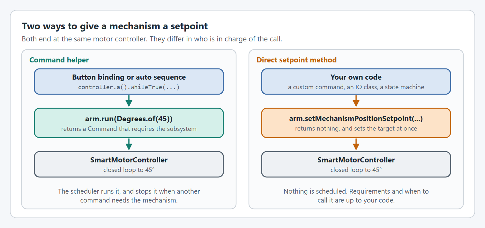

# How do I write my own mechanism command?

The built-in commands, `run`, `runTo`, `set` and `setVoltage`, cover most needs. When they do not, for example when the target needs extra logic every loop, when an AdvantageKit IO class sets it, or when a state machine decides it, set the target yourself with the mechanism's **setpoint functions**. This page shows each case.

[Controlling a mechanism](../reference/controlling-a-mechanism.md#setpoint-functions) lists every setpoint function for each mechanism.

<figure><figcaption><p>A built-in command and a setpoint function end at the same motor controller.</p></figcaption></figure>

## The rules

* **A setpoint function sets the target and returns at once.** It is not a command, and it does not require the subsystem. Call it from inside a command that does, so two pieces of code never fight over the motor.
* **Position and velocity setpoint functions start the closed loop if it was stopped.** Voltage and duty cycle ones stop it. You do not need to manage the loop when you use them.
* **Starting a stopped loop resets it** to where the mechanism is now: the PID controller, the motion profile and the LQR's estimate start fresh. On a loop that is already running, starting it does nothing, so calling `setMechanismPositionSetpoint(...)` every loop is fine.
* **The motor keeps its last request when your command ends,** as with the built-in commands. See [When mechanism commands end](../understanding/run-vs-runto.md).

## A command with extra logic

This command follows a target from a supplier, and adds 5 degrees while the arm is below level.



```java
package first.robot.commands;

import static org.wpilib.units.Units.Degrees;

import java.util.function.Supplier;
import org.wpilib.command2.Command;
import org.wpilib.units.measure.Angle;
import first.robot.subsystems.ArmSubsystem;

public class OffsetArmCommand extends Command
{
  private final ArmSubsystem    armSubsystem;
  private final Supplier<Angle> target;

  public OffsetArmCommand(ArmSubsystem armSubsystem, Supplier<Angle> target)
  {
    this.armSubsystem = armSubsystem;
    this.target = target;
    addRequirements(armSubsystem); // so no other command drives the arm at the same time
  }

  @Override
  public void execute()
  {
    Angle goal = target.get();
    if (armSubsystem.getArm().getAngle().lt(Degrees.of(0)))
    {
      goal = goal.plus(Degrees.of(5)); // below level, aim a little higher
    }
    armSubsystem.getArm().setMechanismPositionSetpoint(goal); // safe every loop
  }
}
```

`getArm()` is a getter you add to `ArmSubsystem` that returns its YAMS `Arm` field. The command never finishes, so bind it with `whileTrue`, or use it as a default command.



Commands v3 has no command classes with `execute()`. Write the same logic as a `while (true)` coroutine in your `ArmMechanism`, where `arm` is its YAMS `Arm` field:

```java
// In ArmMechanism
public Command offsetTo(Supplier<Angle> target)
{
  return run(coroutine -> {
    while (true)
    {
      Angle goal = target.get();
      if (arm.getAngle().lt(Degrees.of(0)))
      {
        goal = goal.plus(Degrees.of(5)); // below level, aim a little higher
      }
      arm.setMechanismPositionSetpoint(goal); // safe every loop
      coroutine.yield();
    }
  }).named("Arm Offset To");
}
```

`run(...)` on a `Mechanism` requires that mechanism, so no other command drives the arm at the same time.



To end a command like this when the arm arrives, check `arm.isNear(goal, tolerance)`: in Commands v2 return it from `isFinished()`, and in Commands v3 make it the `while` condition.

## An AdvantageKit IO class

An IO class is called by the subsystem, which owns the requirement, so it uses the setpoint functions directly. Take `Measure` types, not `double`:

```java
// Fragment: ArmIO is your IO interface, with setTargetAngle(Angle) and setVoltage(Voltage).
public class ArmIOYAMS implements ArmIO
{
  private final Arm arm; // built as in the Arm tutorial

  public ArmIOYAMS(Arm arm)
  {
    this.arm = arm;
  }

  @Override
  public void setTargetAngle(Angle angle)
  {
    arm.setMechanismPositionSetpoint(angle); // starts the closed loop if it was stopped
  }

  @Override
  public void setVoltage(Voltage volts)
  {
    arm.setVoltageSetpoint(volts); // stops the closed loop
  }
}
```

[AdvantageKit Integration](../tutorials/advantagekit-integration/) builds the whole IO layer.

## A state machine (Commands v3)

WPILib's Commands v3 has a state machine built in, `org.wpilib.command3.StateMachine`. Each state runs one command, and transitions say when to move to another state. The state machine cancels the current state's command and starts the next one for you.

```java
// Fragment of ArmMechanism. motorConfig, motor and armConfig are built as in the Arm tutorial.
private static final Angle STOW_ANGLE   = Degrees.of(0);
private static final Angle INTAKE_ANGLE = Degrees.of(-20);
private static final Angle SCORE_ANGLE  = Degrees.of(80);
private static final Angle TOLERANCE    = Degrees.of(2);

private final Arm arm = new Arm(armConfig, motor);

/** The command for one state: hold an angle until the state machine moves on. */
private Command holdAt(String name, Angle angle)
{
  return run(coroutine -> {
    while (true)
    {
      arm.setMechanismPositionSetpoint(angle); // safe every loop
      coroutine.yield();
    }
  }).named(name);
}

/** Build the arm's state machine. It is itself a Command. */
public Command stateMachine(BooleanSupplier intakeRequested, BooleanSupplier scoreRequested,
                            BooleanSupplier hasGamePiece)
{
  StateMachine machine = new StateMachine("Arm State Machine");

  State stowed   = machine.addState(holdAt("Arm Stowed", STOW_ANGLE));
  State intaking = machine.addState(holdAt("Arm Intaking", INTAKE_ANGLE));
  State scoring  = machine.addState(holdAt("Arm Scoring", SCORE_ANGLE));

  machine.setInitialState(stowed);

  stowed.switchTo(intaking).when(intakeRequested);
  stowed.switchTo(scoring).when(() -> scoreRequested.getAsBoolean() && hasGamePiece.getAsBoolean());
  intaking.switchTo(stowed).when(hasGamePiece);  // stow once a game piece is in
  scoring.switchTo(stowed).when(() -> arm.isNear(SCORE_ANGLE, TOLERANCE) && !hasGamePiece.getAsBoolean());

  return machine;
}
```

The imports are `org.wpilib.command3.StateMachine`, `org.wpilib.command3.StateMachine.State` and `java.util.function.BooleanSupplier`. Schedule it like any other command. A `Trigger` is a `BooleanSupplier`, so buttons can be the conditions:

```java
// In Robot. arm is your ArmMechanism; intake.hasGamePiece() is your own sensor check.
Scheduler.getDefault().schedule(arm.stateMachine(controller.a(), controller.b(), intake::hasGamePiece));
```

How it behaves:

* **`setInitialState(state)` is required.** Without it the state machine throws when it starts.
* **`when(condition)` fires when the condition turns from false to true while that state is active.** A button already held when the state starts does not count until it is released and pressed again.
* **If two transitions fire in the same loop, the first one declared wins.**
* **The state machine itself requires nothing; each state's command requires the arm.** Another command that takes the arm cancels the running state, and with no `whenComplete()` transition from that state, the state machine exits.
* **A state whose command ends by itself, with no `whenComplete()` transition, also ends the state machine.** These `holdAt` commands never end, so this one runs until it is canceled.

## Driving the motor controller yourself

You can skip the mechanism and call the `SmartMotorController` from `arm.getMotorController()`, with `setPosition(...)`, `setVelocity(...)`, `setVoltage(...)` or `setDutyCycle(...)`. Unlike the setpoint functions, these calls do not start or stop the closed loop, so your command calls `startClosedLoopController()` or `stopClosedLoopController()` once when it starts. [How do I control a mechanism without a mechanism class?](how-do-i-control-a-mechanism-without-a-mechanism-class.md) shows this in full.

<figure><figcaption><p>Calling the motor controller directly: start the closed loop for position and velocity, stop it for voltage and duty cycle. The setpoint functions do this for you.</p></figcaption></figure>

## Read more

[When mechanism commands end](../understanding/run-vs-runto.md) explains how your command fits with `runTo` and the default command.
