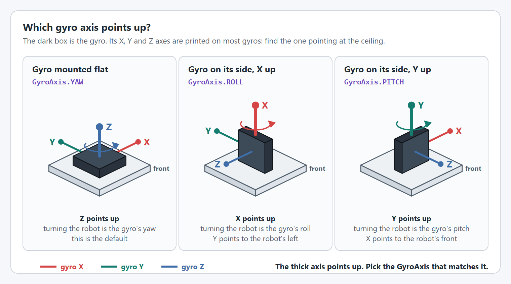

# How do I use a gyro mounted on its side?

A swerve drive needs the robot's heading, which is rotation about the axis pointing up through the robot. A gyro mounted flat reports that as its yaw. If packaging forces you to mount the gyro on its side (for example vertically on a superstructure plate), the robot turning shows up as the gyro's roll or pitch instead, and a `SwerveDrive` reading yaw will see almost no heading change. `SwerveDriveConfig.withGyroHeadingAxis(GyroAxis)` tells YAMS which gyro axis points up, so the heading and tilt are read correctly without any math in your robot code.

## Give the drive the gyro's full attitude

`withGyro(...)` takes a `Supplier<Rotation3d>` (`WithGyro(std::function<Rotation3d()>)` in C++): the gyro's full 3D attitude, not just a yaw angle. `withRotation(...)` (C++ `WithRotation`) is the same method under another name. Most gyros expose this directly, such as `pigeon::getRotation3d`.

## Pick the heading axis

`GyroAxis` lives in `yams.core.mechanisms.config.enums` (`yams::mechanisms::config::GyroAxis` in C++) and names the gyro axis that points up through the robot:

<figure><figcaption><p>Find the gyro axis that points up, and pick the matching <code>GyroAxis</code>.</p></figcaption></figure>

| `GyroAxis`      | Gyro mounting                                                                                      | Robot turning shows up as |
| --------------- | -------------------------------------------------------------------------------------------------- | ------------------------- |
| `YAW` (default) | Flat, the gyro's Z axis points up                                                                  | The gyro's yaw            |
| `ROLL`          | On its side, the gyro's X axis points up. The gyro's Y axis is taken to point to the robot's left  | The gyro's roll           |
| `PITCH`         | On its side, the gyro's Y axis points up. The gyro's X axis is taken to point to the robot's front | The gyro's pitch          |




```java
import com.ctre.phoenix6.CANBus;
import com.ctre.phoenix6.hardware.Pigeon2;
import org.wpilib.hardware.bus.CANPort;
import org.wpilib.math.controller.PIDController;
import org.wpilib.math.geometry.Pose2d;
import org.wpilib.math.geometry.Rotation2d;
import yams.commands2.config.SwerveDriveConfig;
import yams.commands2.swerve.SwerveDrive;
import yams.core.mechanisms.config.enums.GyroAxis;

private final Pigeon2 gyro = new Pigeon2(14, new CANBus(CANPort.CAN_S0));

// In the constructor, after the four modules are created:
SwerveDriveConfig config = new SwerveDriveConfig(this, fl, fr, bl, br)
    .withGyro(gyro::getRotation3d)
    // The gyro is mounted with its X axis pointing up, so the robot's heading is the gyro's roll.
    .withGyroHeadingAxis(GyroAxis.ROLL)
    .withStartingPose(new Pose2d(0, 0, Rotation2d.fromDegrees(0)))
    .withTranslationController(new PIDController(1, 0, 0))
    .withRotationController(new PIDController(1, 0, 0));
drive = new SwerveDrive(config);
```


For Commands v3, import `SwerveDriveConfig` and `SwerveDrive` from `yams.commands3` instead. `GyroAxis` is the same class for both.




```cpp
#include <ctre/phoenix6/Pigeon2.hpp>
#include <wpi/math/geometry/Rotation3d.hpp>

#include "yams/mechanisms/config/GyroAxis.hpp"
#include "yams/mechanisms/swerve/SwerveDrive.hpp"

// The header declares: ctre::phoenix6::hardware::Pigeon2 m_gyro{14, ctre::phoenix6::CANBus{}};
m_driveConfig
    .WithSubsystem(this)
    .WithModules({&m_frontLeft.module.value(), &m_frontRight.module.value(),
                  &m_backLeft.module.value(), &m_backRight.module.value()})
    .WithGyro([this]() -> wpi::math::Rotation3d { return m_gyro.GetRotation3d(); })
    // The gyro is mounted with its X axis pointing up, so the robot's heading is the gyro's roll.
    .WithGyroHeadingAxis(yams::mechanisms::config::GyroAxis::ROLL)
    .WithStartingPose(wpi::math::Pose2d{})
    .WithTranslationController(wpi::math::PIDController{1, 0, 0})
    .WithRotationController(wpi::math::PIDController{1, 0, 0})
    .WithTelemetry("swerve", Cfg::TelemetryVerbosity::HIGH);

m_drive.emplace(&m_driveConfig);
```


This is the drive config from the [Swerve Drive tutorial](../tutorials/swerve-drive/modules-and-drive.md) with one line added. `WithGyroHeadingAxis` needs the `Rotation3d` overload of `WithGyro`: the `degree_t` overload gives only a heading, with nothing to rotate.



YAMS rotates the gyro's attitude into the robot's frame before anything reads it. After that, the yaw of the result is the robot's heading, and its roll and pitch are the robot's tilt (which anti-tipping uses), whichever way the gyro is mounted. `withGyroInverted(...)` applies to the resulting heading.

## Read the heading

Use `getGyroRotation3d()` (`GetGyroRotation3d()` in C++), which returns the robot's attitude with the heading axis already applied:

```java
Rotation2d heading = drive.getGyroRotation3d().toRotation2d();
```

The heading wraps at ±180 degrees. Use `drive.getPose().getRotation()` if you want the odometry heading instead of the raw gyro heading.

## Check it

Put the robot on blocks or a cart, and graph `NT:/Mechanisms/<drive name>/gyro` (such as `NT:/Mechanisms/swerve/gyro`), the heading in degrees, in AdvantageScope. It is published at every telemetry verbosity. Rotate the robot counterclockwise, viewed from above: the heading should increase by about as much as the robot turned.

## If it did not work

* **The heading barely changes:** the wrong axis is selected. Try the other of `ROLL` and `PITCH`.
* **It changes in the wrong direction:** add `.withGyroInverted(true)`.

## Related pages

* [Swerve Drive](../tutorials/swerve-drive/)
