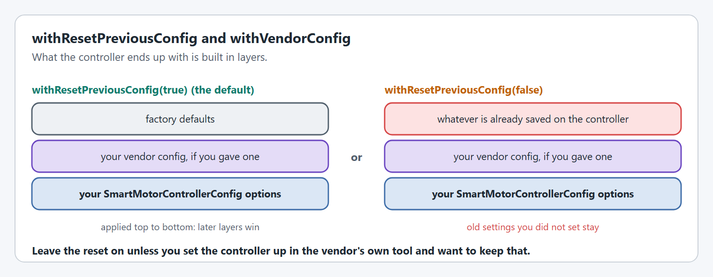

# How do I use a vendor hardware config?

**Goal:** use a motor controller option that YAMS does not have a method for, such as beep settings, peak voltages or status frame rates.

YAMS configures your motor controller from your `SmartMotorControllerConfig`. For anything else, build the vendor's own config object and pass it to `SmartMotorControllerConfig.withVendorConfig(...)`. YAMS starts from it and applies its own settings on top, so anything you set in `SmartMotorControllerConfig` wins, and everything else in the vendor object is kept.

Each example below is a fragment for your subsystem's fields or constructor.

## CTRE TalonFX

Pass a `TalonFXConfiguration` object:

```java
TalonFXConfiguration talonConfig = new TalonFXConfiguration()
    .withAudio(new AudioConfigs().withBeepOnBoot(false).withBeepOnConfig(false))
    .withVoltage(new VoltageConfigs().withPeakReverseVoltage(-10).withPeakForwardVoltage(10));

SmartMotorControllerConfig motorConfig = new SmartMotorControllerConfig(this)
    .withVendorConfig(talonConfig)
    .withControlMode(ControlMode.CLOSED_LOOP)
    .withClosedLoopController(4, 0, 0)
    .withGearing(new MechanismGearing(GearBox.fromReductionStages(3, 4)))
    .withZeroPower(MotorMode.BRAKE);

TalonFX talonFX = new TalonFX(1, new CANBus(CANPort.CAN_S0));
SmartMotorController smc = new TalonFXWrapper(talonFX, DCMotor.getKrakenX60(1), motorConfig);
```

## CTRE TalonFXS

Pass a `TalonFXSConfiguration` object:

```java
TalonFXSConfiguration talonConfig = new TalonFXSConfiguration()
    .withMotorOutput(new MotorOutputConfigs().withNeutralMode(NeutralModeValue.Brake))
    .withAudio(new AudioConfigs().withBeepOnBoot(false));

SmartMotorControllerConfig motorConfig = new SmartMotorControllerConfig(this)
    .withVendorConfig(talonConfig)
    .withControlMode(ControlMode.CLOSED_LOOP)
    .withClosedLoopController(4, 0, 0)
    .withGearing(new MechanismGearing(GearBox.fromReductionStages(3, 4)));

TalonFXS talonFXS = new TalonFXS(1, new CANBus(CANPort.CAN_S0));
SmartMotorController smc = new TalonFXSWrapper(talonFXS, DCMotor.getMinion(1), motorConfig);
```

`TalonFXSWrapper` sets the motor arrangement (Minion, NEO, NEO 550, NEO Vortex, Thrifty Pulsar from `YMotors.getThriftyPulsar(1)`) from the `DCMotor` you pass, so you do not set it in the vendor config. A `DCMotor` it does not recognize, such as `DCMotor.getKrakenX60(1)`, throws an `IllegalArgumentException` ("Unknown motor for TalonFXS"), because a Kraken X60 cannot run on a TalonFXS.

## REV SparkMax

Pass a `SparkMaxConfig` object:

```java
SparkMaxConfig sparkConfig = new SparkMaxConfig();
sparkConfig.signals
    .primaryEncoderPositionPeriodMs(10)
    .primaryEncoderVelocityPeriodMs(20);

SmartMotorControllerConfig motorConfig = new SmartMotorControllerConfig(this)
    .withVendorConfig(sparkConfig)
    .withControlMode(ControlMode.CLOSED_LOOP)
    .withClosedLoopController(4, 0, 0)
    .withGearing(new MechanismGearing(GearBox.fromReductionStages(3, 4)))
    .withZeroPower(MotorMode.BRAKE);

SparkMax spark = new SparkMax(CANPort.CAN_S0, 1, MotorType.kBrushless);
SmartMotorController smc = new SparkWrapper(spark, DCMotor.getNEO(1), motorConfig);
```

## REV SparkFlex

Pass a `SparkFlexConfig` object:

```java
SparkFlexConfig sparkConfig = new SparkFlexConfig();
sparkConfig.signals
    .primaryEncoderPositionPeriodMs(10)
    .primaryEncoderVelocityPeriodMs(20);

SmartMotorControllerConfig motorConfig = new SmartMotorControllerConfig(this)
    .withVendorConfig(sparkConfig)
    .withControlMode(ControlMode.CLOSED_LOOP)
    .withClosedLoopController(4, 0, 0)
    .withGearing(new MechanismGearing(GearBox.fromReductionStages(3, 4)))
    .withZeroPower(MotorMode.BRAKE);

SparkFlex spark = new SparkFlex(CANPort.CAN_S0, 1, MotorType.kBrushless);
SmartMotorController smc = new SparkWrapper(spark, DCMotor.getNeoVortex(1), motorConfig);
```

## Thrifty Nova

Pass a ThriftyLib `NovaConfig.Config`, usually a `NovaConfigBatch` holding one or more `NovaConfig` options. The vendor config is applied to the Nova before the YAMS config:

```java
SmartMotorControllerConfig motorConfig = new SmartMotorControllerConfig(this)
    .withVendorConfig(new NovaConfigBatch(NovaConfig.tempThrottleEnable(true)))
    .withControlMode(ControlMode.CLOSED_LOOP)
    .withClosedLoopController(4, 0, 0)
    .withGearing(new MechanismGearing(GearBox.fromReductionStages(3, 4)))
    .withZeroPower(MotorMode.BRAKE);

Nova nova = new Nova(0, 1, MotorType.NEO); // CAN bus 0, CAN ID 1
SmartMotorController smc = new NovaWrapper(nova, DCMotor.getNEO(1), motorConfig);
```

Any other vendor config type throws a `SmartMotorControllerConfigurationException`.

## FIRST A301

The A301 has no vendor config. `A301Wrapper` throws a `SmartMotorControllerConfigurationException` for any `withVendorConfig`, so everything it supports is set through `SmartMotorControllerConfig`.

## Factory reset: `withResetPreviousConfig`

Motor controllers keep their settings in flash, across power cycles and code deploys. With `withResetPreviousConfig(true)`, the default, YAMS clears them before applying your config, so settings left over from last season, or from someone clicking around in the vendor's tool, cannot sneak in: a TalonFX or TalonFXS gets a complete config (your vendor config, or the defaults) with the YAMS options on top, a SPARK resets its parameters first (`ResetMode.kResetSafeParameters`), and a Nova is sent a factory reset first. `A301Wrapper` ignores the option.

```java
// Keep what is already saved on the controller, and only change what this config sets.
.withResetPreviousConfig(false)
```

Turn the reset off only when you configured something on purpose in the vendor's tool (Phoenix Tuner X or REV Hardware Client) and want to keep it. With the reset off, any old setting you did not set yourself stays, which is a common cause of a motor that behaves differently from its twin.

A vendor config passed to `withVendorConfig` is applied either way, and its settings win over the ones saved on the controller. On a SPARK or a Nova, only the settings the vendor config sets change. A `TalonFXConfiguration` or `TalonFXSConfiguration` holds every setting, so on a TalonFX or TalonFXS a vendor config replaces all the saved settings, even with the reset off: to keep a setting saved on a Talon, leave out the vendor config, or set that setting in it too.

<figure><figcaption><p>What the controller ends up with, with and without the reset.</p></figcaption></figure>


Always verify the final applied configuration on your hardware. Use your vendor's tuning tool (such as Phoenix Tuner X or REV Hardware Client) to confirm that YAMS didn't silently overwrite a setting you intended to keep from your vendor config.


## Check it

Open the controller in Phoenix Tuner X or REV Hardware Client after the robot code has started, and check that the vendor setting you added is there (for example, the TalonFX no longer beeps on boot), and that the settings from your `SmartMotorControllerConfig` (gear ratio, current limit, brake mode) are there too.

## If it did not work

* **`SmartMotorControllerConfigurationException` about the vendor config.** The object is the wrong type for the wrapper: a TalonFX needs a `TalonFXConfiguration`, a TalonFXS a `TalonFXSConfiguration`, a SPARK MAX a `SparkMaxConfig`, a SPARK Flex a `SparkFlexConfig`, and a Nova a `NovaConfig.Config` such as a `NovaConfigBatch`. An A301 takes none: remove the vendor config.
* **Your vendor setting is gone.** `SmartMotorControllerConfig` sets the same option, and it wins. Set it there instead.
* **Something else.** See [Troubleshooting](../tutorials/troubleshooting.md).

## Read more

To see every option `SmartMotorControllerConfig` does have, see [SmartMotorControllerConfig](../reference/editor/config/).
