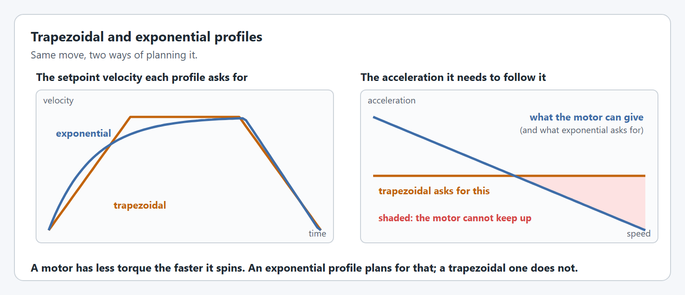
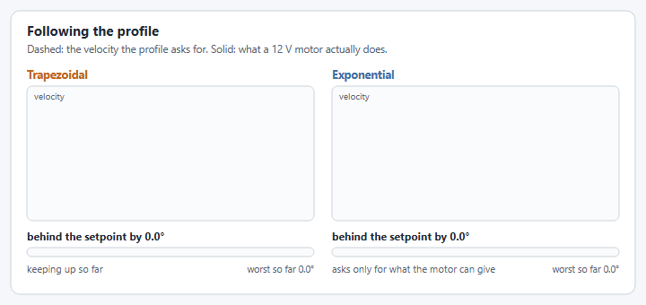

# How do I use exponential profiles?

An exponential profile plans a move the way a DC motor actually moves: hard acceleration at first, then less as it nears top speed. Every `SmartMotorController` in YAMS supports them. This is the short version: [Exponential profiles](../understanding/exponential-profiles.md) has the full explanation and the tuning steps.

<figure><figcaption><p>The two profiles, and why the motor can follow one more easily than the other.</p></figcaption></figure>

## Use one

Add `withExponentialProfile(...)` instead of `withTrapezoidalProfile(...)`. For an elevator, YAMS works out starting values from the motor, the carriage and the drum. This is a fragment of an elevator subsystem's fields; the rest of the config (feedforward, limits, telemetry) is as in the [Elevator tutorial](../tutorials/elevator/).


```java
private final Distance drumRadius = Inches.of(0.25).times(22).div(2 * Math.PI); // 22 tooth sprocket, #25 chain
private final Mass     weight = Pounds.of(16);
private final DCMotor  motors = DCMotor.getNEO(1);
private final MechanismGearing gearing = new MechanismGearing(GearBox.fromReductionStages(3, 4));

private final SmartMotorControllerConfig motorConfig = new SmartMotorControllerConfig(this)
    .withControlMode(ControlMode.CLOSED_LOOP)
    // Gearing first: withExponentialProfile reads it to build the profile.
    .withGearing(gearing)
    .withDrumRadius(drumRadius)
    // PLACEHOLDER kP, in volts per meter. Tune it after the profile.
    .withClosedLoopController(10, 0, 0)
    // Maximum voltage during the profile, the motor, the carriage weight and the drum radius.
    .withExponentialProfile(Volts.of(12), motors, weight, drumRadius);
```


`withGearing` must come **before** `withExponentialProfile`, because the profile is calculated from the gearing at that moment. This form also makes the closed loop work in meters (see [How do I tune my elevator in rotations instead of meters?](how-to-disable-linear-closed-loop-control.md)).

There are helpers for arms, flywheels and custom limits too: see [creating constraints](../understanding/exponential-profiles.md#creating-constraints).

## When should I use one?

<figure><figcaption><p>A simulated 12 V motor following each profile. The trapezoidal profile asks for more than the motor has left at speed.</p></figcaption></figure>

* **Use one** when a trapezoidal profile is hard to tune, or the mechanism falls behind it and then overshoots.
* **Keep the trapezoidal profile** if it already works well, or the motor is always current limited.
* **It cannot fix an underpowered mechanism.**

See [when to use each profile type](../understanding/exponential-profiles.md#when-to-use-each-profile-type).

## Tune it

Start from the helper's values and [refine the profile live](../understanding/exponential-profiles.md#refining-the-profile-live). The profile only plans the move, so it still needs a feedforward, and the profile's `kV` and `kA` are [not the feedforward's](../reference/editor/config/feedforward.md#these-are-not-an-exponential-profiles-kv-and-ka).

## Check it

Start the simulation, command a new height, and graph the motor's `closedloop/setpoint/position` against `measurement/position` under **NetworkTables > Mechanisms**. The setpoint should curve smoothly to the target, and the measurement should stay close behind it the whole way.

## If it did not work

* **The setpoint jumps straight to the target, or the elevator does not move.** The profile is missing or empty: check that `withGearing` comes before `withExponentialProfile`, and that the drum radius and carriage weight are right.
* **The elevator falls behind the setpoint and then overshoots.** The feedforward is missing or `kG` is 0. See [Feedforward](../reference/editor/config/feedforward.md).

## Code reference


