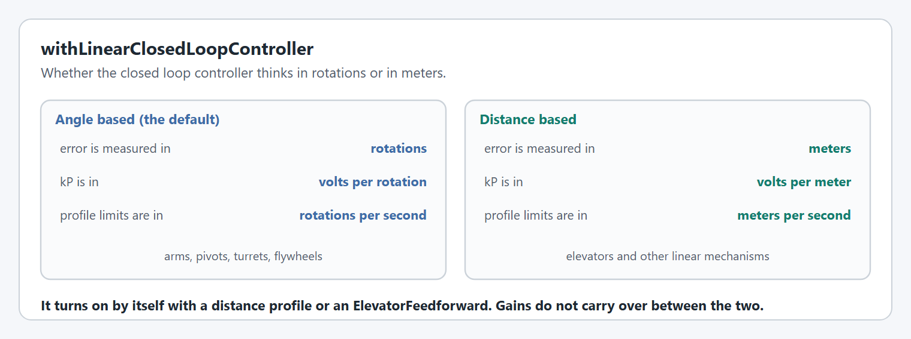

# How do I tune my elevator in rotations instead of meters?

**Goal:** keep the closed loop controller (its error, `kP` and profile limits) in rotations, while still reading positions and speeds in meters.

## What is linear closed loop control?

YAMS's closed loop controller can work in one of two units:

* **Angle based** (rotations). The error is in rotations, `kP` is in volts per rotation, and profile limits are in rotations per second.
* **Distance based**, or **linear** (meters). The error is in meters, `kP` is in volts per meter, and profile limits are in meters per second.

<figure><figcaption><p>The units the gains and limits are in.</p></figcaption></figure>

The units change what your gains mean: a `kP` of 4 volts per meter is a very different controller from 4 volts per rotation.

## When is it on?

It is **off by default**. Setting a circumference (`withWheelDiameter`, `withDrumRadius` and so on) does not turn it on; that only lets YAMS report distances. These `SmartMotorControllerConfig` calls turn it on:

* `withFeedforward(ElevatorFeedforward)` or `withSimFeedforward(ElevatorFeedforward)`
* `withTrapezoidalProfile(LinearVelocity, LinearAcceleration)` (a profile in meters per second)
* `withTrapezoidalProfile(LinearAcceleration, Velocity<LinearAccelerationUnit>)`
* `withExponentialProfile(Voltage, DCMotor, Mass, Distance)` (the elevator form)

So a typical elevator config uses linear closed loop control without you asking for it.

## When would I turn it off?

* You tuned an elevator in rotations and want to keep those gains.
* You are copying gains from a tool or another robot that works in rotations.
* You use an `ElevatorFeedforward` for a mechanism that you want to control in rotations.

Turning it off does not stop YAMS reporting distances. `getMeasurementPosition()` and `getMeasurementVelocity()` still return meters, as long as the circumference is set.



### Turn it off

Add `withLinearClosedLoopController(false)` **after** every call in the list above. Those calls switch it back on, so if one comes later in the chain, your `false` is lost.


```java
SmartMotorControllerConfig smcConfig = new SmartMotorControllerConfig(this)
    .withControlMode(ControlMode.CLOSED_LOOP)
    .withDrumRadius(Inches.of(0.25), 22)
    // Placeholder gains, now in volts per rotation. Tune them for your elevator.
    .withClosedLoopController(4, 0, 0)
    .withFeedforward(new ElevatorFeedforward(0, 0, 0))   // turns linear on...
    // ...so this comes last, to turn it off again.
    .withLinearClosedLoopController(false);
```


**Check it:** the code builds, and `withLinearClosedLoopController(false)` is the last call in the chain.



### Make the profile limits angular

If the config has a motion profile, its limits must now be angular too, for example `withTrapezoidalProfile(RotationsPerSecond.of(2), RotationsPerSecondPerSecond.of(4))`, placed before the `false`. Your gains are now in volts per rotation, so tune `kP` again.

**Check it:** the code builds, and a commanded move is neither much softer nor much harsher than you expect.



## Check it

1. Deploy (or start the simulation) and command a height.
2. Under **NetworkTables > Mechanisms**, the motor's `closedloop/setpoint/position` is now in rotations, while `measurement/position` is still in meters.

## If it did not work

* **The setpoint is still in meters.** A call from the list above comes after `withLinearClosedLoopController(false)`. Move the `false` to the end of the chain.
* **The elevator is much too soft or too aggressive.** Your gains were tuned in the other unit. Tune `kP` again; see [Troubleshooting](../tutorials/troubleshooting.md).

## Read more

Command the elevator in meters: [How do I set an elevator's target height?](../how-to-mechanisms/how-to-set-an-elevators-target-height.md)
