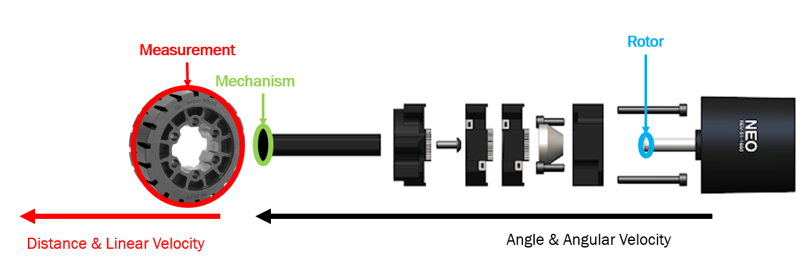
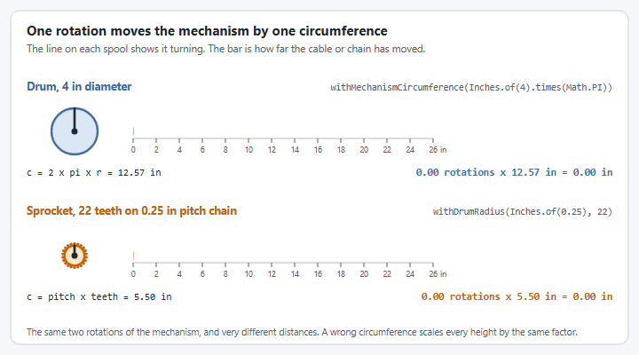

# How do I tell YAMS my drum or sprocket size?

**Goal:** tell YAMS how far your elevator (or wheel, or linear slide) moves for each rotation, so you can give it targets in meters or inches instead of rotations.

YAMS turns rotations into distance with the **mechanism circumference**: the distance the mechanism moves for one rotation of its final shaft (after the gearbox). If the circumference is wrong, every height is off by the same factor, and the gains you tune will not make sense.

<figure><figcaption><p>The circumference turns Mechanism rotations into a Measurement distance.</p></figcaption></figure>

## Find the circumference

The circumference belongs to the last part that turns: the drum, sprocket, pulley or wheel that moves the load.

* **Drum or wheel:** circumference = 2 × π × radius = π × diameter.
* **Sprocket on chain:** circumference = chain pitch × number of teeth. For example #25 chain (0.25 inch pitch) on a 22 tooth sprocket moves 5.5 inches per rotation.

<figure><figcaption><p>Each rotation of the mechanism moves it by one circumference.</p></figcaption></figure>

## Set it in YAMS

Use **exactly one** of these methods in your `SmartMotorControllerConfig`. They all set the same value, so if you call more than one, the last call wins. Pick the one that matches what you can measure. Each line below is a fragment that goes in the config chain.

```java
// A sprocket on chain: pass the chain pitch and the tooth count.
.withDrumRadius(Inches.of(0.25), 22)        // 0.25 in × 22 = 5.5 in per rotation
```

```java
// A drum or spool, measured across the middle.
.withWheelDiameter(Inches.of(2))            // π × 2 in = 6.28 in per rotation
```

```java
// A drum or spool, measured from the center to the edge.
.withDrumRadius(Inches.of(1))               // same as withWheelRadius(Inches.of(1))
```

```java
// You already know the distance per rotation.
.withMechanismCircumference(Inches.of(5.5))
```

A complete elevator config, using the sprocket:


```java
SmartMotorControllerConfig smcConfig = new SmartMotorControllerConfig(this)
    .withControlMode(ControlMode.CLOSED_LOOP)
    .withGearing(new MechanismGearing(GearBox.fromReductionStages(3, 4)))
    // The one circumference call: 0.25 inch pitch chain on a 22 tooth sprocket.
    .withDrumRadius(Inches.of(0.25), 22)
    // Where the carriage is when the robot turns on.
    .withStartingPosition(Meters.of(0))
    .withTelemetry("ElevatorMotor", TelemetryVerbosity.HIGH);
```


### A cascading elevator

In a cascading elevator each stage pulls the next, so the carriage moves faster than the chain or cable: with two moving stages, twice as fast. Tell the motor config with `withCascadingElevatorStages(2)`, called **after** `withGearing(...)`: it divides the gearing already set by the number of stages, so a `withGearing` call after it replaces the result. See [`withCascadingElevatorStages`](../reference/editor/config/gearing-and-units.md#withcascadingelevatorstages).


```java
.withGearing(new MechanismGearing(GearBox.fromReductionStages(3, 4)))
.withCascadingElevatorStages(2) // after withGearing: the carriage moves 2 × the chain
.withDrumRadius(Inches.of(0.25), 22)
```


`ElevatorConfig.withStages(...)` is a different thing: it gives the height each stage travels, so YAMS can draw every stage on a 3D model. It does not change the gearing, so a cascading elevator needs both. See [How do I show an elevator's stages on a 3D robot model?](../how-to-simulation-and-logging/how-do-i-show-my-mechanisms-on-a-3d-robot-model/how-do-i-show-an-elevators-stages-on-a-3d-robot-model.md)


The height YAMS reports is measured from where the carriage was when the robot turned on, not from the floor. If you want heights from the floor, set `withStartingPosition` to the carriage's real starting height and set your limits to match.


## Check it

1. Deploy (or start the simulation) and open the motor's `measurement/position` value under **NetworkTables > Mechanisms**. It is in meters.
2. On the robot, disable it and move the carriage by hand a known distance, for example 0.5 m with a tape measure.
3. `measurement/position` should change by the same amount. If it changes by twice as much, or half, the circumference or the gearing is wrong.

## If it did not work

* **The reading is off by a constant factor.** Check the gearing first (`withGearing`), then the circumference. A cascading elevator also needs `withCascadingElevatorStages`, after `withGearing`: see [A cascading elevator](how-to-find-your-mechanism-circumference.md#a-cascading-elevator).
* **The reading goes the wrong way.** The motor is inverted; see [Troubleshooting](../tutorials/troubleshooting.md).

## Read more

Send the elevator to a height in meters: [How do I set an elevator's target height?](../how-to-mechanisms/how-to-set-an-elevators-target-height.md)
