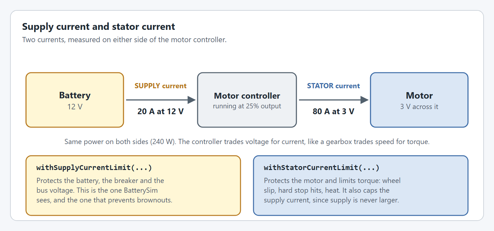
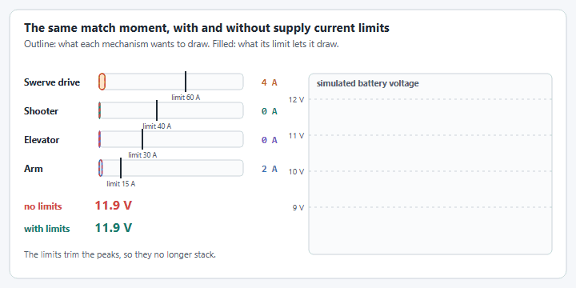
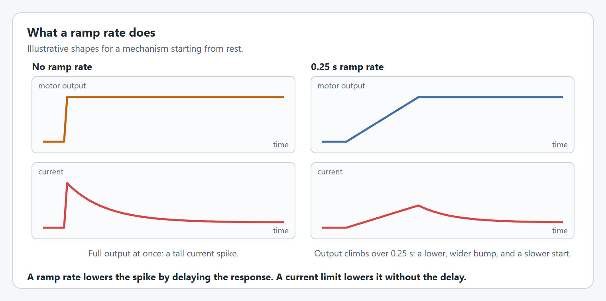

# How do I limit power consumption?

**Goal:** set current limits so that the robot's mechanisms, all running at once, do not pull the battery low enough to brown out.

A motor controller has two currents. The **supply** current flows from the battery into the controller, and its limit protects the battery, the breakers and the voltage everything else runs on. The **stator** current flows from the controller through the motor, and its limit protects the motor and caps its torque. CTRE's [Improving performance with current limits](https://v6.docs.ctr-electronics.com/en/stable/docs/hardware-reference/talonfx/improving-performance-with-current-limits.html) explains how they relate.

<figure><figcaption><p>The two currents, and what each limit protects.</p></figcaption></figure>


A SPARK MAX or SPARK Flex only has a stator current limit. `SparkWrapper` throws a `SmartMotorControllerConfigurationException` if you set a supply current limit, and it does not publish the supply current.


## Before you start

* Your mechanisms run in simulation, each with `simIterate()` called every loop. YAMS adds their current draw into one simulated battery: see [Battery simulation](../understanding/battery-simulation.md).
* Each motor's telemetry is at `TelemetryVerbosity.HIGH`, so the current limits are published and tunable. The keys below are under `NT:/Mechanisms/<Mechanism>/<Motor>/`, as in [Live tuning keys and units](../reference/keys-and-units.md).



### Publish the battery voltage

YAMS sets the simulated battery voltage, but does not publish it. Log it every loop:




```java
import static org.wpilib.units.Units.Volts;

import org.wpilib.system.RobotController;
import org.wpilib.telemetry.Telemetry;

@Override
public void robotPeriodic() {
  // ...
  Telemetry.log("Battery/Voltage", RobotController.getMeasureBatteryVoltage().in(Volts));
}
```





```cpp
#include <wpi/system/RobotController.hpp>
#include <wpi/telemetry/Telemetry.hpp>

void Robot::RobotPeriodic() {
  // ...
  wpi::telemetry::Log("Battery/Voltage", wpi::RobotController::GetBatteryVoltage().value());
}
```




**Check it:** start the simulation and open AdvantageScope. `Battery/Voltage` reads 12 volts with the robot still, and dips when a mechanism moves.



### Find the worst moment

In simulation, do the things that happen together in a match: accelerate the drive, spin up the shooter, raise the elevator. Graph `Battery/Voltage` and each motor's current:

* TalonFX, TalonFXS and Thrifty Nova: `current/supply`, the current drawn from the battery, and `current/limit/supply`.
* SPARK MAX and SPARK Flex: `current/stator` and `current/limit/stator`, since their supply current is not published.
* FIRST A301: `current/stator`. It publishes no supply current and has no limits.

**Check it:** you can see the moment the voltage is lowest, and which motors draw the most current then.



### Set a starting limit on each motor

Add the limits to each `SmartMotorControllerConfig`:


```java
import static org.wpilib.units.Units.Amps;

.withStatorCurrentLimit(Amps.of(40)) // stator: current through the motor, limits torque and heat
.withSupplyCurrentLimit(Amps.of(30)) // supply: current from the battery; leave out on a SPARK
```


In C++, `WithStatorCurrentLimit(40_A)` and `WithSupplyCurrentLimit(30_A)`. These are places to start, not rules. Drive motors usually run higher stator limits than mechanisms, and a NEO 550 overheats quickly when stalled, so keep its stator limit low on intakes and rollers that can jam.

| Motor      | Usually on                | Stator limit to start | Supply limit to start              |
| ---------- | ------------------------- | --------------------- | ---------------------------------- |
| Kraken X60 | TalonFX                   | 60 A                  | 40 A                               |
| NEO        | SPARK MAX, TalonFXS, Nova | 40 A                  | 30 A, where the controller has one |
| NEO 550    | SPARK MAX, TalonFXS       | 20 A                  | 20 A, where the controller has one |
| NEO Vortex | SPARK Flex, TalonFXS      | 60 A                  | 40 A, where the controller has one |


The FIRST A301 has no current limits: `A301Wrapper` throws a `SmartMotorControllerConfigurationException` if either one is set, so leave them out on an A301. Its motor peaks at about 28 W, so it draws little from the battery; lower its load with gearing or a [maximum closed loop voltage](../reference/editor/config/closed-loop-control.md#withclosedloopcontrollermaximumvoltage) instead.


**Check it:** `current/limit/stator` (and `current/limit/supply`, where published) shows the value you set.



### Lower the biggest load first

The drive is usually the largest draw, so limiting it does the most. Then the next largest. For each load, stop at the first thing that brings the dip under control:

1. A [motion profile](../reference/editor/config/motion-profiles.md), if one suits the mechanism, so it asks for less current in the first place.
2. A lower supply current limit, where the motor controller has one.
3. A lower stator current limit, where it does not.
4. A ramp rate, only if nothing else works: see [Ramp rates](limiting-power-consumption.md#ramp-rates).

The limits are tunable while the simulation runs: type a new value into `current/limit/supply` or `current/limit/stator` under `NT:/Tuning/<Mechanism>/<Motor>/`, as in [Live tuning](../how-to-tuning/live-tuning/).

**Check it:** repeat the worst moment. The lowest `Battery/Voltage` is higher than before.



### Check the mechanism still does its job

A limit that is too low makes the mechanism slow or stalls it. Lower each limit until the voltage is acceptable, not further, then copy the values you settled on into your configs.

**Check it:** each mechanism still reaches its target in about the time it did, and `current/stator` sits at the limit for only a short time.



<figure><figcaption><p>The same few seconds with and without supply current limits. Example currents and limits.</p></figcaption></figure>

## Check it

Run the worst moment once more with the limits in your code: the lowest battery voltage is higher than it was without limits, and every mechanism still does its job.

## If it did not work

* **`SmartMotorControllerConfigurationException` about a supply current limit:** the motor controller is a SPARK MAX or SPARK Flex. Remove `withSupplyCurrentLimit(...)` and use the stator limit.
* **`current/limit/...` is missing:** the motor's telemetry verbosity is below `HIGH`. On a SPARK, `current/supply` and `current/limit/supply` never appear.
* **The voltage barely dips:** the simulated currents depend on each mechanism's moment of inertia or mass. A guessed value that is too light understates them: see [Battery simulation](../understanding/battery-simulation.md).
* **A mechanism stutters while pushing on a game piece or stuck:** the current is being held at the limit, which is what the limit is for. Raise it a little if the mechanism is too weak.

## Ramp rates

A ramp rate is the shortest time the motor's output may take to go from 0% to 100%. It delays everything the motor does, which makes the robot seem slow, so it is the last thing to reach for.

<figure><figcaption><p>A ramp rate trades the current spike for a slower start.</p></figcaption></figure>

The closed loop ramp rate applies when the motor controller's closed loop drives the motor, and the open loop ramp rate when a voltage or duty cycle does:


```java
import static org.wpilib.units.Units.Seconds;

.withClosedLoopRampRate(Seconds.of(0.25)) // at least 0.25 s from 0 to full output under closed loop
.withOpenLoopRampRate(Seconds.of(0.25))   // the same for voltage and duty cycle commands
```



The Thrifty Nova has a single ramp rate for open and closed loop control. `NovaWrapper` throws a `SmartMotorControllerConfigurationException` if the two ramp rates differ, so set only one of them, or both to the same value.



The FIRST A301 has no ramp rates. `A301Wrapper` throws a `SmartMotorControllerConfigurationException` if either one is set.

