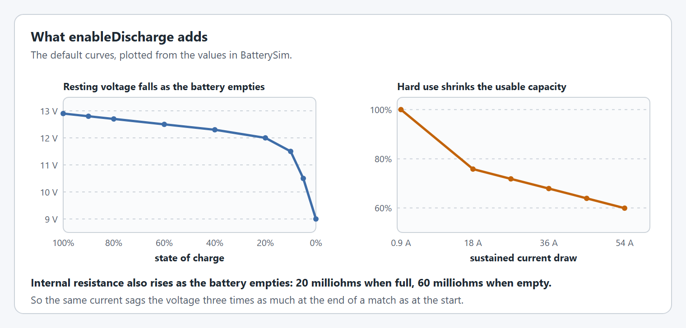
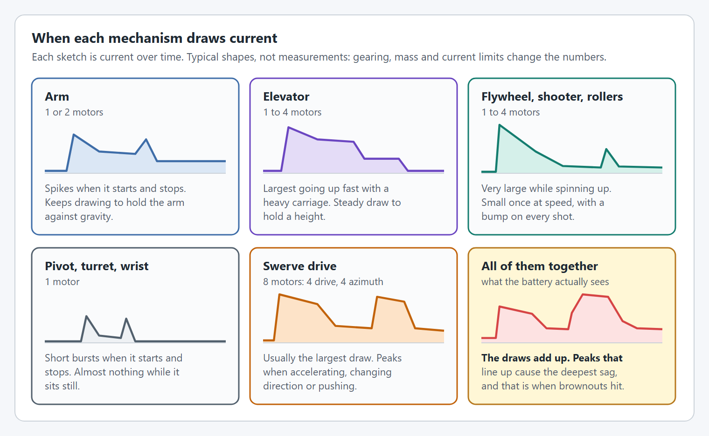

# How do I enable battery discharge simulation?

**Goal:** make the simulated battery run down over a match, so the voltage sags harder near the end than at the start, as a real battery does.

By default the simulated battery sags while your mechanisms draw current, but it never runs down: every moment of the run starts from a full 12 V battery. Discharge simulation adds the battery's **state of charge**, how full it is from 1 (full) to 0 (empty). As your mechanisms draw current, the charge goes down. A battery that is less full rests at a lower voltage, and its **internal resistance**, which makes the voltage sag under load, goes up. So late in a long simulated run, the same load sags the voltage further.

For why YAMS models one shared battery at all, see [Battery Simulation](../understanding/battery-simulation.md).

## Turn on discharge modeling

Call `enableDischarge(...)` once, early on, with the battery's capacity in amp-hours (how much charge it holds), its voltage when full, and its internal resistance when full. The `Robot` constructor is a good place for it. A fresh 18 Ah competition battery is a reasonable default if you have no measured numbers for your own.




```java
import static org.wpilib.units.Units.MilliOhms;
import static org.wpilib.units.Units.Volts;

import yams.core.motorcontrollers.simulation.BatterySim;

public Robot() {
  // 18 Ah, 12.9 V and 20 milliohms when full.
  BatterySim.enableDischarge(18.0, Volts.of(12.9), MilliOhms.of(20));
}
```





```cpp
#include <yams/motorcontrollers/simulation/BatterySim.hpp>

Robot::Robot() {
  // 18 Ah, 12.9 V and 20 milliohms when full.
  yams::motorcontrollers::simulation::BatterySim::EnableDischarge(
      18.0, wpi::units::volt_t{12.9}, wpi::units::ohm_t{0.020});
}
```





Discharge modeling only affects simulation. On a real robot `BatterySim` is never used: the SystemCore reports the real battery voltage, so this call does nothing there.


<figure><figcaption><p>The default discharge curves.</p></figcaption></figure>

## Make sure your mechanisms report accurate current draw

The simulated battery only runs down as fast as the current your mechanisms draw, and that comes from each mechanism's physics simulation. If a mechanism's moment of inertia is guessed rather than measured, its simulated current draw, and so how fast it drains the battery, will be off. Set a real one on each `SmartMotorControllerConfig` with `withMomentOfInertia(...)` before relying on discharge numbers: see [MOI](../understanding/turrets-wrists.md#moment-of-inertia) for how.

<figure><figcaption><p>When each kind of mechanism draws current.</p></figcaption></figure>

## Reset between runs (optional)

The simulated battery keeps its charge from one simulated match to the next, as a real battery does. To start every simulated match or unit test from a full battery, call `resetDischarge()` at the start of it: in the setup of your unit tests, or wherever you reset robot state between simulated matches. `disableDischarge()` turns discharge modeling back off.




```java
import org.junit.jupiter.api.BeforeEach;
import yams.core.motorcontrollers.simulation.BatterySim;

@BeforeEach
void setup() {
  BatterySim.resetDischarge();
}
```





```cpp
#include <yams/motorcontrollers/simulation/BatterySim.hpp>

// At the start of each test.
yams::motorcontrollers::simulation::BatterySim::ResetDischarge();
```




## Read the state of charge for telemetry (optional)

`getStateOfCharge()` returns the charge from `0` (empty) to `1` (full). Publish it every loop to watch the battery run down over a simulated match. YAMS sets the simulated battery voltage but does not publish it, so publish that too: it is what `RobotController` reports, in simulation as on the robot.




```java
import static org.wpilib.units.Units.Volts;

import org.wpilib.system.RobotController;
import org.wpilib.telemetry.Telemetry;
import yams.core.motorcontrollers.simulation.BatterySim;

@Override
public void robotPeriodic() {
  // ...
  Telemetry.log("Battery/StateOfCharge", BatterySim.getStateOfCharge());
  Telemetry.log("Battery/Voltage", RobotController.getMeasureBatteryVoltage().in(Volts));
}
```





```cpp
#include <wpi/system/RobotController.hpp>
#include <wpi/telemetry/Telemetry.hpp>
#include <yams/motorcontrollers/simulation/BatterySim.hpp>

void Robot::RobotPeriodic() {
  // ...
  wpi::telemetry::Log("Battery/StateOfCharge",
                      yams::motorcontrollers::simulation::BatterySim::GetStateOfCharge());
  wpi::telemetry::Log("Battery/Voltage", wpi::RobotController::GetBatteryVoltage().value());
}
```




## Replace the state-of-charge curve (optional)

`enableDischarge(...)` lowers the resting voltage along a curve for a typical FRC sealed lead-acid battery: flat through most of the charge, then dropping quickly near empty. To model a different battery, such as a well-used one that sags earlier, or one you measured with a load tester, call `replaceSOCInterpolation(...)` with your own curve of state of charge to voltage, **before** `enableDischarge(...)`.




```java
import static org.wpilib.units.Units.MilliOhms;
import static org.wpilib.units.Units.Volts;

import org.wpilib.math.interpolation.InterpolatingDoubleTreeMap;
import yams.core.motorcontrollers.simulation.BatterySim;

// State of charge, then the resting voltage at that charge.
InterpolatingDoubleTreeMap wornBatteryCurve = new InterpolatingDoubleTreeMap();
wornBatteryCurve.put(0.00, 8.0);
wornBatteryCurve.put(0.05, 9.5);
wornBatteryCurve.put(0.10, 10.5);
wornBatteryCurve.put(0.20, 11.2);
wornBatteryCurve.put(0.40, 11.6);
wornBatteryCurve.put(0.60, 11.9);
wornBatteryCurve.put(0.80, 12.2);
wornBatteryCurve.put(0.90, 12.4);
wornBatteryCurve.put(1.00, 12.6);

BatterySim.replaceSOCInterpolation(wornBatteryCurve);
// replaceSOCInterpolation swaps the curve as soon as it is called. Calling it first means discharge uses your curve from the start.
BatterySim.enableDischarge(15.0, Volts.of(12.6), MilliOhms.of(28));
```





```cpp
#include <map>

#include <yams/motorcontrollers/simulation/BatterySim.hpp>

using yams::motorcontrollers::simulation::BatterySim;

// State of charge, then the resting voltage at that charge.
std::map<double, double> wornBatteryCurve{
    {0.00, 8.0},  {0.05, 9.5},  {0.10, 10.5}, {0.20, 11.2}, {0.40, 11.6},
    {0.60, 11.9}, {0.80, 12.2}, {0.90, 12.4}, {1.00, 12.6},
};

BatterySim::ReplaceSOCInterpolation(wornBatteryCurve);
// ReplaceSOCInterpolation swaps the curve as soon as it is called. Calling it first means discharge uses your curve from the start.
BatterySim::EnableDischarge(15.0, wpi::units::volt_t{12.6}, wpi::units::ohm_t{0.028});
```





Cover the whole range of charge, from `0` to `1`. Outside the points you give, the voltage stays at the nearest point's, so a curve missing the low or high end will not sag realistically there. See [Custom discharge curves](../understanding/battery-simulation.md#custom-discharge-curves) for choosing the points.


## Replace the capacity derating curve (optional)

A lead-acid battery gives fewer amp-hours the faster it is drained (the Peukert effect). `enableDischarge(...)` accounts for this with a curve of sustained current to the fraction of the capacity you get, averaged from real FRC battery testing. If you measured your own battery, call `replaceCapacityDerating(...)` with your curve, **before** `enableDischarge(...)`.




```java
import static org.wpilib.units.Units.MilliOhms;
import static org.wpilib.units.Units.Volts;

import org.wpilib.math.interpolation.InterpolatingDoubleTreeMap;
import yams.core.motorcontrollers.simulation.BatterySim;

// Sustained current in amps, then the fraction of the capacity you get at that current.
InterpolatingDoubleTreeMap measuredDerating = new InterpolatingDoubleTreeMap();
measuredDerating.put(0.9, 1.000);
measuredDerating.put(20.0, 0.80);
measuredDerating.put(40.0, 0.65);
measuredDerating.put(60.0, 0.55);

BatterySim.replaceCapacityDerating(measuredDerating);
// replaceCapacityDerating swaps the curve as soon as it is called. Calling it first means discharge uses your curve from the start.
BatterySim.enableDischarge(18.0, Volts.of(12.9), MilliOhms.of(20));
```





```cpp
#include <map>

#include <yams/motorcontrollers/simulation/BatterySim.hpp>

using yams::motorcontrollers::simulation::BatterySim;

// Sustained current in amps, then the fraction of the capacity you get at that current.
std::map<double, double> measuredDerating{{0.9, 1.000}, {20.0, 0.80}, {40.0, 0.65}, {60.0, 0.55}};

BatterySim::ReplaceCapacityDerating(measuredDerating);
// ReplaceCapacityDerating swaps the curve as soon as it is called. Calling it first means discharge uses your curve from the start.
BatterySim::EnableDischarge(18.0, wpi::units::volt_t{12.9}, wpi::units::ohm_t{0.020});
```




See [Capacity derating](../understanding/battery-simulation.md#capacity-derating) for where the default curve comes from.

## Check it

1. Publish the state of charge and the battery voltage as in [Read the state of charge for telemetry](how-do-i-enable-battery-discharge-simulation.md#read-the-state-of-charge-for-telemetry-optional), start the simulation, and graph `Battery/StateOfCharge` and `Battery/Voltage` in AdvantageScope.
2. Run your mechanisms hard for a minute or two: spin up a shooter, drive the swerve back and forth.
3. `Battery/StateOfCharge` should start at 1 and fall steadily while mechanisms run, and stay put while they are idle. `Battery/Voltage` should sag more under the same load late in the run than at the start, and its resting value should creep down.

If the state of charge never moves, `enableDischarge(...)` was not called. If it barely moves, check the moments of inertia: see [Make sure your mechanisms report accurate current draw](how-do-i-enable-battery-discharge-simulation.md#make-sure-your-mechanisms-report-accurate-current-draw).

## Related pages

* [Battery Simulation](../understanding/battery-simulation.md), the full explanation of the shared battery model and why it matters
* [MOI](../understanding/turrets-wrists.md#moment-of-inertia), accurate current draw starts with an accurate moment of inertia
* [Limiting Power Consumption](../how-to-motor-controllers-and-sensors/limiting-power-consumption.md)
