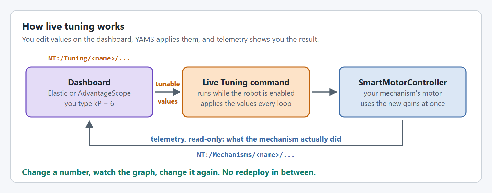
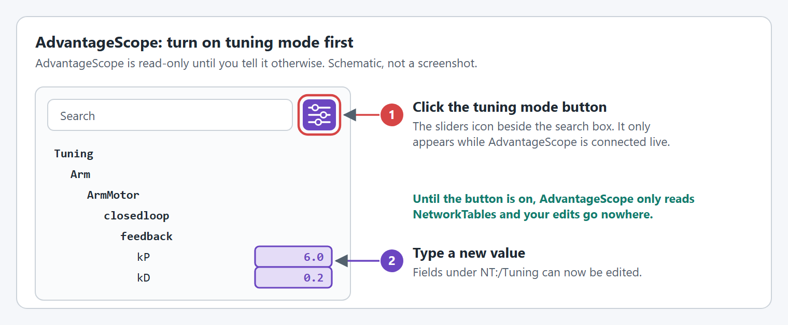
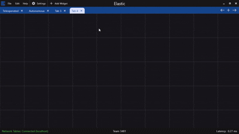
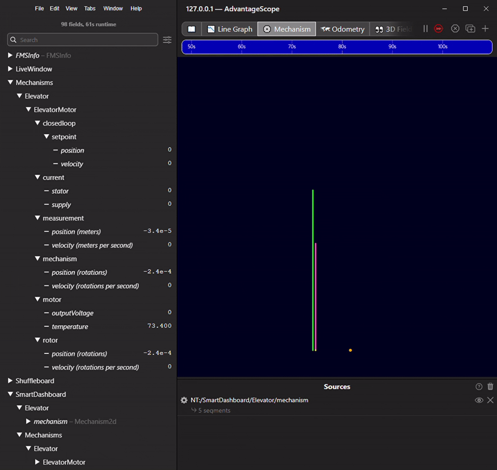
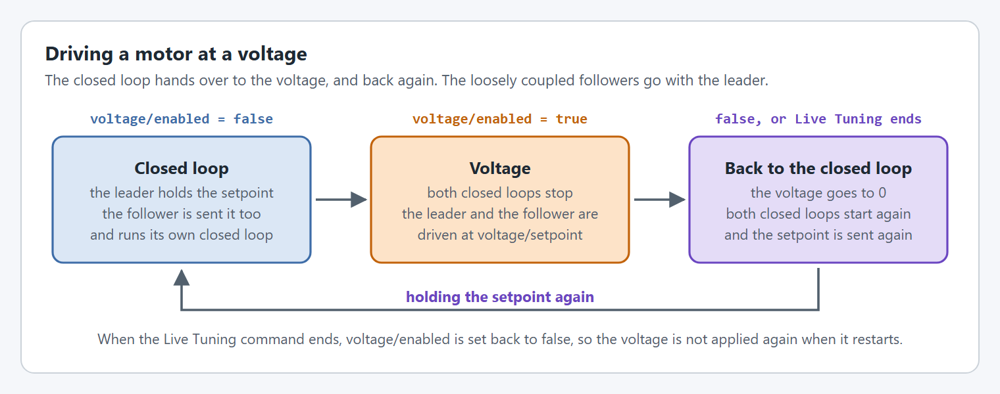
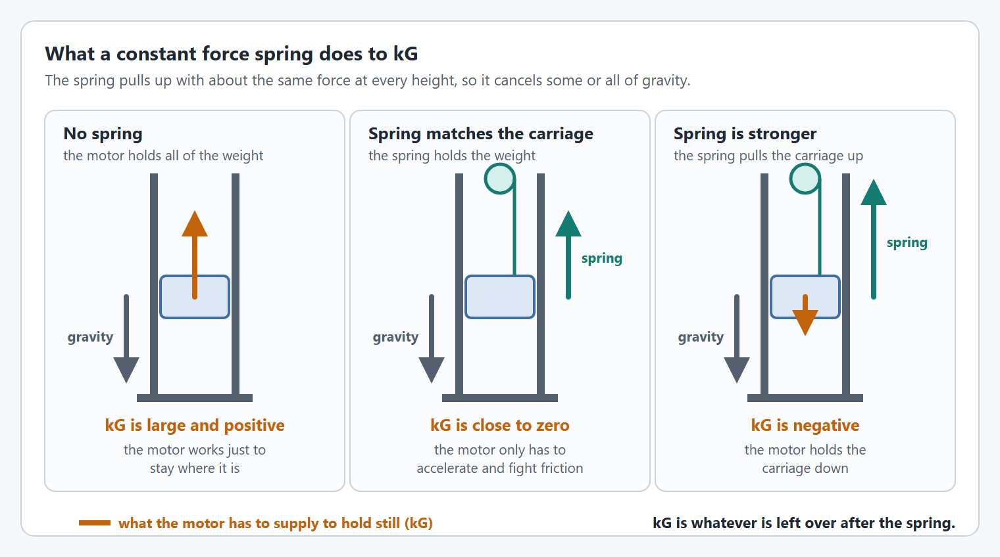
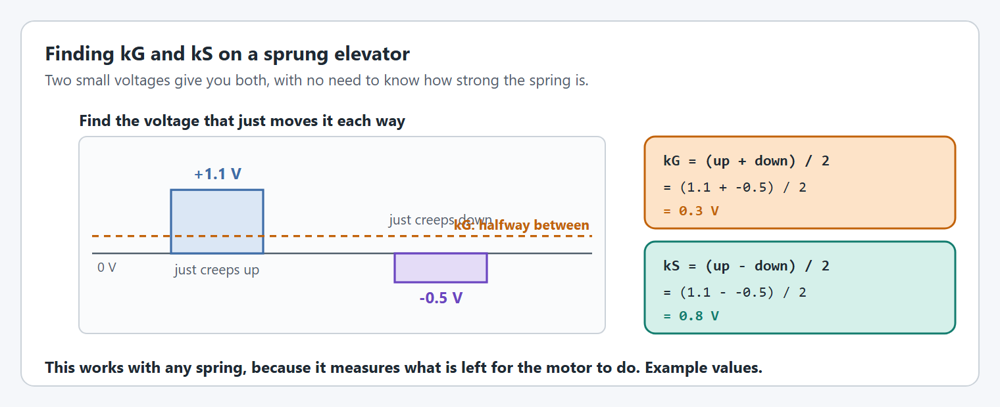

# Live tuning

Live tuning lets you change gains, motion profiles and limits from a dashboard while the robot is enabled, and see the result straight away. It works over NetworkTables with AdvantageScope or Elastic.

This page shows how to turn it on, start it, change values and drive a motor at a voltage. [Tune a swerve drive](swerve-drive.md) covers the `SwerveDrive` tuning command. For every key, its units and what to watch, see [Live tuning keys and units](../../reference/keys-and-units.md).

<figure><figcaption><p>Change a number, watch the graph, change it again.</p></figcaption></figure>

## Turn it on

**If you followed a tutorial, live tuning is already on.** It comes from this one line on the motor's `SmartMotorControllerConfig`:

```java
.withTelemetry("ArmMotor", TelemetryVerbosity.HIGH) // yams.core.telemetry.enums.TelemetryVerbosity
```

`TelemetryVerbosity.HIGH` publishes the tunable values and registers the `Live Tuning` command. That is all most robots need. Live tuning also needs `.withControlMode(ControlMode.CLOSED_LOOP)` on the same config, and a subsystem (Commands v2) or mechanism (Commands v3) on it, from `new SmartMotorControllerConfig(this)`, `withSubsystem(...)` or `withMechanism(...)`: the command is registered with it.

Only what the config has is published. The motion profile keys, `closedloop/motionprofile/...`, only exist when the config has a profile, such as `withTrapezoidalProfile(...)` or `withExponentialProfile(...)`, and `closedloop/feedforward/kG` only with a feedforward.

A fragment of a flywheel motor config, with the line in place:

<pre class="language-java" data-title="Fragment: a flywheel&#x27;s SmartMotorControllerConfig"><code class="lang-java">SmartMotorControllerConfig lowerFlyWheelConfig = new SmartMotorControllerConfig(this)
      .withControlMode(ControlMode.CLOSED_LOOP)
      .withZeroPower(MotorMode.COAST)
      .withGearing(new MechanismGearing(GearBox.fromReductionStages(3, 4)))
      .withMomentOfInertia(Inches.of(4), Pounds.of(2))
      .withClosedLoopController(1,
                                0,
                                0) // You generally do not want a profile because its not a position controlled loop.
      .withFeedforward(new SimpleMotorFeedforward(0, 0, 0)) // Helps track changing RPM goals
      .withMotorInverted(false)
<strong>      .withTelemetry("LowerFlyWheel", TelemetryVerbosity.HIGH);
</strong></code></pre>

| How the motor's telemetry is set up                                                                               | Live Tuning command                                       |
| ----------------------------------------------------------------------------------------------------------------- | --------------------------------------------------------- |
| `withTelemetry(name, TelemetryVerbosity.HIGH)`                                                                    | Registered for you                                        |
| `withTelemetry(name, telemetryConfig)` with a `SmartMotorControllerTelemetryConfig`                               | Registered for you                                        |
| A mechanism, such as an `Arm`, `Elevator`, `Pivot` or `FlyWheel`, with `withTelemetry(...)` on its own config too | Registered for you, for the mechanism's motor controllers |
| You call `setupTelemetry(NetworkTable, NetworkTable)` yourself (Java)                                             | Call `setupLiveTuning()` afterwards, see below            |
| C++ with `TelemetryVerbosity::HIGH` and a subsystem on the config                                                 | Registered for you when `SetupTelemetry()` runs           |

YAMS registers **one** `Live Tuning` command per subsystem (Commands v2) or mechanism (Commands v3). Every motor controller in that subsystem or mechanism joins the same command.

<details>

<summary>Setting up live tuning explicitly</summary>

If you set up telemetry yourself, the `Live Tuning` command is not registered for you. Call `setupLiveTuning()` on the config after the telemetry is set up:

```java
SmartMotorControllerConfig motorConfig = new SmartMotorControllerConfig(this)
    .withTelemetry("ArmMotor", TelemetryVerbosity.HIGH);
SmartMotorController motor = new TalonFXWrapper(armMotor, DCMotor.getKrakenX60(1), motorConfig);

motor.setupTelemetry(telemetryTable, tuningTable);
motorConfig.setupLiveTuning();
```

`setupLiveTuning()` does nothing when:

* the `SmartMotorController` has not set up its telemetry yet (that is what attaches the controller to the config), or
* the config has no subsystem (Commands v2) or mechanism (Commands v3).

Registering two different subsystem or mechanism instances with the same name throws an `IllegalStateException`. Give each one a unique name, for example `LeftTurret` and `RightTurret`.

In C++ there is no explicit call.

</details>


Tuning an elevator, arm, pivot or flywheel? The [YAMS Live Tuner](live-tuner.md) walks you through checking the mechanism, then sends setpoints and gains while you watch a graph.



Using CTRE TalonFX or TalonFXS motors? Phoenix Tuner X can connect to your simulation too. See [TunerX in simulation](tunerx-in-simulation.md).


## Use it


Like all tuning, live tuning can be **dangerous**. It's best to practice in simulation before the real robot.


The steps below are a first run with the arm from the [Arm tutorial](../../tutorials/arm/): `ArmSubsystem` in Commands v2 and C++, `ArmMechanism` in Commands v3. Its mechanism is named `Arm` and its motor `ArmMotor`, so:

* The `Live Tuning` command is at `NT:/Tuning/ArmSubsystem/Live Tuning` (Commands v2 and C++, the subsystem's name) or `NT:/Tuning/ArmMechanism/Live Tuning` (Commands v3, the `Mechanism`'s `getName()`).
* The values you type are under `NT:/Tuning/Arm/ArmMotor/`.
* The values you watch are under `NT:/Mechanisms/Arm/ArmMotor/`.

For your own robot, swap in your subsystem's class name and the names you gave `withTelemetry(...)`. [NetworkTables keys](../../reference/keys-and-units.md#networktables-keys) explains each part.



### Run the code in simulation

Run the robot code in simulation and go through these steps there first. In simulation you are tuning the `withSimClosedLoopController(...)` and `withSimFeedforward(...)` gains: the simulation uses those when they are set, so the values the dashboard starts at, and the ones you find, belong in the `withSim...` lines.

**Check it:** the arm shows on the simulation's `Mechanism2d` and `NT:/Mechanisms/Arm/ArmMotor/mechanism/position` updates.



### Enable the robot

Set the robot to Teleoperated and enable it. Dashboard edits are only applied while the robot is enabled and the `Live Tuning` command is running.

**Check it:** the Driver Station (or the simulation GUI) shows the robot enabled in Teleoperated.



### Start the `Live Tuning` command



It is a regular WPILib Commands v2 `Command` that requires the subsystem, published at `NT:/Tuning/ArmSubsystem/Live Tuning` with a `running` boolean:

* **Elastic:** drag `NT:/Tuning/ArmSubsystem/Live Tuning` onto your dashboard and press its button.
* **AdvantageScope:** turn on tuning mode (see [Change a value](./#change-a-value)), then set `running` under `NT:/Tuning/ArmSubsystem/Live Tuning` to `true`. Set it to `false` to stop the command.

Or bind it to a controller button in `RobotContainer`:

```java
import yams.commands2.telemetry.SmartMotorControllerCommandRegistry;

// In configureBindings(), after the subsystem is created.
// getCommand returns an Optional<Command>: it is empty if no Live Tuning command was registered.
SmartMotorControllerCommandRegistry.getCommand("Live Tuning", arm)
    .ifPresent(liveTuning -> driverController.rightStick().toggleOnTrue(liveTuning));
```

Pressing the right stick starts it, and pressing it again stops it.



Commands v3 commands are not dashboard widgets themselves, so YAMS publishes the command through `yams.commands3.telemetry.CommandTunable`. It shows up with a single `running` boolean at `NT:/Tuning/ArmMechanism/Live Tuning/running`, named after the Commands v3 `Mechanism`'s `getName()`, which is its class name unless you change it. In AdvantageScope, turn on tuning mode first.

* Set `running` to `true` to schedule the command on the default `Scheduler`.
* Set `running` to `false` to cancel it.
* `running` reads back whether the command is currently running.

The command requires the mechanism and runs a `while (true)` loop that applies the dashboard values and calls `coroutine.yield()` each loop.



The command takes over from the default command and holds the setpoint the motor controller had. In the Arm tutorial that is the default command's 0 degrees, so the arm holds level.


If the default command coasted the motor with a duty cycle or voltage, it stopped any closed loop that runs on the SystemCore, such as an [LQR](../../understanding/lqr-controllers.md) or an [exponential profile](../../understanding/exponential-profiles.md). The `Live Tuning` command starts it again.


**Check it:** in Elastic the button shows the command running, or `running` reads `true`.



### Graph what to watch

Graph these two together. They are what you compare after every change:

* `NT:/Mechanisms/Arm/ArmMotor/closedloop/setpoint/position`: where the arm is told to be.
* `NT:/Mechanisms/Arm/ArmMotor/mechanism/position`: where it is.

Add `NT:/Mechanisms/Arm/ArmMotor/motor/outputVoltage` too: it is how you find kG below.


**You type degrees, you read rotations.** A setpoint typed as `15` (degrees) is graphed as `0.0417` (rotations). To graph in degrees, see [See both in the same units with AdvantageScope](../../reference/keys-and-units.md#see-both-in-the-same-units-with-advantagescope). All the units are in [Units: what you type and what you read](../../reference/keys-and-units.md#units-what-you-type-and-what-you-read).


**Check it:** both lines are on the graph, on top of each other while the arm holds still.



### Change a value

The tunable values are under `NT:/Tuning/Arm/ArmMotor/`. Edit one, and it is applied on the next loop. A value is only applied when it changes, so typing the number that is already there does nothing.



AdvantageScope only reads NetworkTables until you turn on **tuning mode**. Click the tuning mode button, the sliders icon beside the search box at the top of the sidebar. It is only shown while AdvantageScope is connected to a live robot or simulation.

<figure><figcaption><p>Turn tuning mode on, then edit the fields under <code>NT:/Tuning</code>.</p></figcaption></figure>

With tuning mode on, the fields under `NT:/Tuning` can be edited in the sidebar. If typing a value does nothing, check this button first.



Drag a field from `NT:/Tuning/` onto the dashboard as a text or number widget and type the new value. Elastic can always write to NetworkTables, so there is nothing to turn on.



Try it: type `10` into `NT:/Tuning/Arm/ArmMotor/closedloop/setpoint/position`.

**Check it:** `closedloop/setpoint/position` under `NT:/Mechanisms` jumps to about `0.028` (10 degrees in rotations), and `mechanism/position` follows it up. Type `0` to bring the arm back to level.



### Tune, then copy the values into your code

Follow the [Tuning order](./#tuning-order) for your mechanism. Values typed on the dashboard are lost when the robot code restarts, so the last step is always to copy them into your config: in simulation into the `withSim...` lines, on the robot into `withClosedLoopController(...)` and `withFeedforward(...)`.

**Check it:** after restarting the robot code, the values under `NT:/Tuning` start at the ones you found.




The `Live Tuning` command requires the subsystem or mechanism, so the controller, a default command, or any other trigger for that subsystem or mechanism can interrupt it. Dashboard edits stop being applied when it is interrupted. If your edits suddenly do nothing, check the command is still running.


<figure><figcaption><p>Starting the command and changing a value.</p></figcaption></figure>

<figure><figcaption><p>Tuning while the robot is enabled.</p></figcaption></figure>

## Tuning order

Tune the feedforward first, then the feedback, then the motion profile last, one value at a time. Each tutorial's Tune it step goes through it for its mechanism, with the keys to type and the graph to expect, in simulation:

* [Arm: Tune it](../../tutorials/arm/tune.md)
* [Elevator: Tune it](../../tutorials/elevator/tune.md)
* [Shooter/FlyWheels: Tune it](../../tutorials/shooter-flywheels/tune.md)
* [Double FlyWheel: Tune it](../../tutorials/double-flywheel/tune.md)
* [Swerve Drive: Tune it](../../tutorials/swerve-drive/tune.md), then [Tune a swerve drive](swerve-drive.md) on the real robot

[What to tune and what to watch](../../reference/keys-and-units.md#what-to-tune-and-what-to-watch) lists the key to watch for each value. The WPILib docs explain what each gain does, with interactive simulations to practice on: [Introduction to PID](https://docs.wpilib.org/en/stable/docs/software/advanced-controls/introduction/introduction-to-pid.html) and [introduction to feedforward](https://docs.wpilib.org/en/stable/docs/software/advanced-controls/introduction/introduction-to-feedforward.html).

### What is different on a real robot

Use the same order on the robot, and start again from the tutorial's placeholder gains rather than trusting the simulation's: the simulation does not know about friction, cables, springs or a slightly wrong mass.

* **kS is real.** The simulation has almost no friction, so kS there is near 0. On the robot, find the voltage that just starts the mechanism moving with [Drive a motor at a voltage](./#drive-a-motor-at-a-voltage).
* **Friction and binding make kG and kS harder to read.** Holding an arm or elevator with kP and reading the voltage lands anywhere between the voltage that moves it up and the one that lets it move down. Find both with a voltage: `kG = (up + down) / 2` and `kS = (up - down) / 2`.
* **Springs change kG.** A constant force spring on an elevator does part of the motor's job: see [Elevators with a constant force spring](./#elevators-with-a-constant-force-spring).
* **The robot gains go in different lines.** Copy what you find on the robot into `withClosedLoopController(...)` and `withFeedforward(...)`, not the `withSim...` lines.


**With an LQR**, tune the feedforward the same way, then the `closedloop/lqr/` fields where the steps say kP and kD. See [Tune it live](../how-do-i-use-lqr/#tune-it-live).


## Drive a motor at a voltage

Sometimes you want no closed loop at all, just a voltage: to find the voltage that just starts a mechanism moving, to check that a positive voltage moves it the way you expect, or to see how fast it goes at 3 V. Every motor controller with `TelemetryVerbosity.HIGH` has two keys for this under `NT:/Tuning/<Mechanism>/<Motor>/`:

| You type           | Units   | What it is                                                                                                                                                                                                                                                                                                                        |
| ------------------ | ------- | --------------------------------------------------------------------------------------------------------------------------------------------------------------------------------------------------------------------------------------------------------------------------------------------------------------------------------- |
| `voltage/enabled`  | Boolean | Drive the motor at `voltage/setpoint` while `true`.                                                                                                                                                                                                                                                                               |
| `voltage/setpoint` | Volts   | The voltage. Set back to `0` when `voltage/enabled` turns on, and sent to the motor and its [loosely coupled followers](../../reference/editor/config/followers.md#withlooselycoupledfollowers) every loop while `voltage/enabled` is `true`, even when it has not changed. It is not applied while `voltage/enabled` is `false`. |

<figure><figcaption><p>The closed loop hands over to the voltage, and back again.</p></figcaption></figure>



### Start the `Live Tuning` command

As in [Use it](./#use-it), for example from `NT:/Tuning/ArmSubsystem/Live Tuning`. The voltage is only applied while the command runs.

**Check it:** the command shows as running.



### Turn it on, then type a voltage

Set `voltage/enabled` to `true`. YAMS stops the closed loop and starts the motor at 0 V, with `voltage/setpoint` set back to `0`, so nothing moves until you type a voltage. A closed loop that runs on the SystemCore (with an [LQR](../../understanding/lqr-controllers.md) or an [exponential profile](../../understanding/exponential-profiles.md), or a velocity trapezoidal profile or another loop a Thrifty Nova can't run, and every closed loop on an A301), would replace the voltage on its next loop, which is why it is stopped.

Now type a small voltage, such as `1`, into `voltage/setpoint`, for example `NT:/Tuning/Arm/ArmMotor/voltage/setpoint`. It is sent every loop, so the motor keeps outputting it until you change it.

**Check it:** `motor/outputVoltage` under `NT:/Mechanisms` reads the voltage you typed.



### Watch it move

Graph `mechanism/velocity` (or `measurement/velocity`), `motor/outputVoltage` and `current/stator`. Raise or lower `voltage/setpoint` a little at a time.

**Check it:** a positive voltage moves the mechanism the way you expect, faster as you raise it.



### Turn it off

Set `voltage/enabled` to `false`. The voltage goes to 0, the closed loop starts again, and the setpoint it held before is sent again, so the mechanism goes back to it.

**Check it:** the mechanism returns to its setpoint and holds it.



**Setpoints typed while the voltage is on are skipped.** A value typed into `closedloop/setpoint/position` or `closedloop/setpoint/velocity` then is not saved for later. Type it again once the voltage is off. Gains, limits and the other tunable values are applied as soon as you type them, even while the voltage is on.

**Loosely coupled followers** are driven at the same voltage, each with its own inversion, and their closed loops stop and start again with the leader's.

**When the `Live Tuning` command ends**, because you stopped it or another command for the subsystem or mechanism interrupted it, the voltage stops too. YAMS turns the voltage off, sets `voltage/enabled` back to `false` so the voltage is not applied again as soon as the command starts again, and the closed loop holds the setpoint.


A voltage has no speed limit and no motion profile. Start low, keep the mechanism away from its hard stops, and keep a hand on disable. On an arm or elevator, a voltage too small to hold it up lets it fall.



Live tuning needs `ControlMode.CLOSED_LOOP`. The voltage keys are published at `TelemetryVerbosity.HIGH`, or with `withCustom(DoubleTelemetryField.TunableVoltage, true)` and `withCustom(BooleanTelemetryField.TunableVoltageEnabled, true)` on a `SmartMotorControllerTelemetryConfig`.


## Elevators with a constant force spring

A constant force spring pulls the carriage up with about the same force at every height. It does part of the motor's job, which changes what kG should be.

<figure><figcaption><p>kG is what is left for the motor to do after the spring.</p></figcaption></figure>

Do not copy kG from a calculation or from the robot before the springs went on. Measure it. With a spring, holding the carriage with kP and reading the voltage (as the [Elevator tutorial's Tune it step](../../tutorials/elevator/tune.md) does) can land anywhere between the up and down voltages, so use the two voltages below instead. The steps below type the voltages into `closedloop/feedforward/kG`; you can type them into [`voltage/setpoint`](./#drive-a-motor-at-a-voltage) with `voltage/enabled` on instead, which takes the closed loop out of the way without zeroing any gains:

<figure><figcaption><p>Two voltages give kG and kS. Example values.</p></figcaption></figure>



### Find the voltage that just moves it up

Put the carriage in the middle of the travel and start the `Live Tuning` command. Set kP, kI, kD and `closedloop/feedforward/kS` to 0. Now `closedloop/feedforward/kG` is the only voltage reaching the motor. Raise it slowly until the carriage just creeps upward, and write the value down.

**Check it:** at that voltage the carriage creeps up, and a little below it, it stays put.



### Find the voltage that just moves it down

Lower `closedloop/feedforward/kG` slowly until the carriage just creeps downward. This number is often negative on a sprung elevator. Write it down.

**Check it:** the down voltage is smaller than the up voltage.



### Work out kG and kS

`kG = (up + down) / 2` and `kS = (up - down) / 2`. Type them into `closedloop/feedforward/kG` and `closedloop/feedforward/kS`.

**Check it:** the carriage stays where you leave it in the middle of the travel.



### Check it at the bottom, middle and top

With only the feedforward, the carriage should stay where you leave it at every height. "Constant force" springs are not perfectly constant, and each stage of a multi stage elevator can have its own springs. If the carriage drifts at one end, use the kG that holds best in the range you care about most and let kP hold the rest.

**Check it:** the carriage holds at the heights you use most.



### Tune kV, kP and kD as usual

Follow the [Elevator tutorial's Tune it step](../../tutorials/elevator/tune.md), including copying the values into your code at the end. The spring does not change them.

**Check it:** the carriage reaches its setpoints up and down, and the values are in your code.



| With a spring, expect         | Why                                                                                                                               |
| ----------------------------- | --------------------------------------------------------------------------------------------------------------------------------- |
| kG near zero, or negative     | The spring carries the weight. If it is stronger than the carriage, the motor has to pull down.                                   |
| A larger kS                   | The spring and its spool add friction.                                                                                            |
| Different effort up and down  | Check `motor/outputVoltage` in both directions. Size the motion profile's `maxAcceleration` for the direction that needs more.    |
| A drift when the load changes | A spring sized for the empty carriage is too weak with a game piece, and the other way round. Tune for the load you hold longest. |


The simulation does not know about the spring: it models the full carriage weight from `ElevatorConfig.withCarriageWeight(...)`. Keep a separate kG for simulation with `withSimFeedforward(...)`, so a sprung robot's small kG does not make the simulated elevator sag.


## Troubleshooting

For problems outside live tuning, such as a mechanism that does not move at all or moves the wrong way, see [Troubleshooting](../../tutorials/troubleshooting.md).

### Live tuning does nothing

| What you see                                                 | Likely cause                                                                                                                                          | Fix                                                                                                             |
| ------------------------------------------------------------ | ----------------------------------------------------------------------------------------------------------------------------------------------------- | --------------------------------------------------------------------------------------------------------------- |
| Typing a value changes nothing                               | The `Live Tuning` command is not running, or something interrupted it                                                                                 | Start it again. A button binding or default command for the same subsystem interrupts it.                       |
| Typing a value in AdvantageScope changes nothing             | Tuning mode is off                                                                                                                                    | Click the sliders icon at the top of the sidebar.                                                               |
| Typing the same setpoint again does nothing                  | Values are applied only when they change                                                                                                              | Type a different value, then the one you want.                                                                  |
| There is no `NT:/Tuning/.../Live Tuning`                     | The motor is not at `TelemetryVerbosity.HIGH`, you set up telemetry yourself, or the config has no subsystem (Commands v2) or mechanism (Commands v3) | See [Turn it on](./#turn-it-on).                                                                                |
| Live tuning throws "Live tuning does not work in OPEN\_LOOP" | The config is open loop                                                                                                                               | Add `.withControlMode(ControlMode.CLOSED_LOOP)`.                                                                |
| The gains reset when the code restarts                       | Dashboard values are not saved                                                                                                                        | Copy them into your config, the last step of each tutorial's Tune it step: see [Tuning order](./#tuning-order). |
| The gains you found in simulation do nothing on the robot    | Simulation uses the `withSim...` gains                                                                                                                | Copy them into `withClosedLoopController(...)` and `withFeedforward(...)` too, then tune again on the robot.    |

When the gains are right but the mechanism still cannot reach its setpoint, see [When tuning does not help](../../tutorials/troubleshooting.md#when-tuning-does-not-help).
