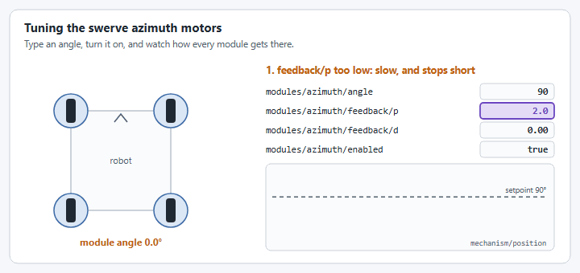
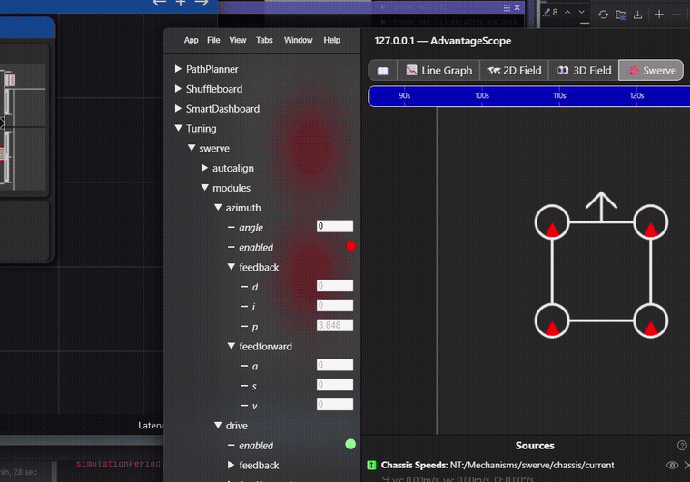
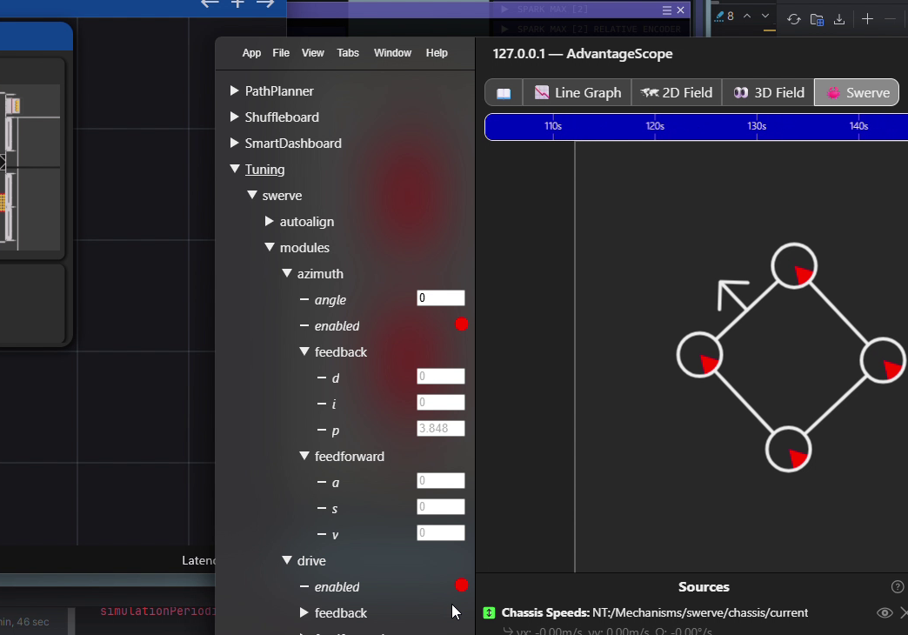
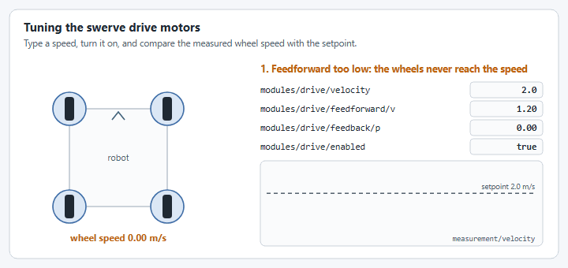
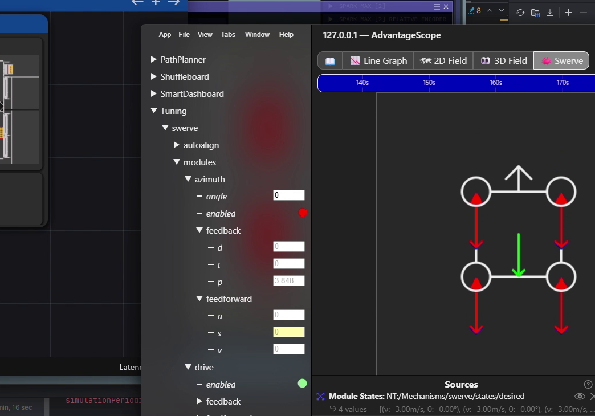
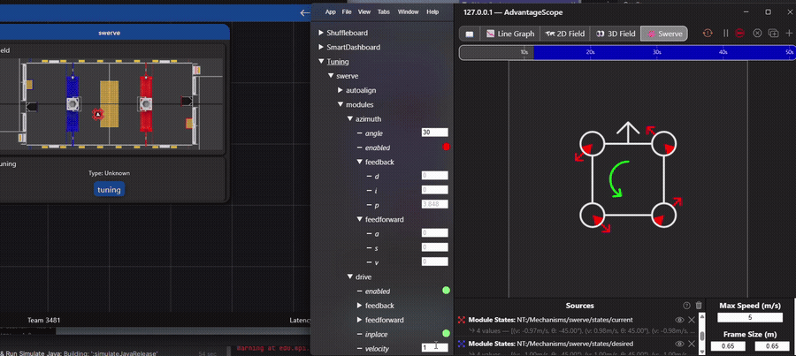
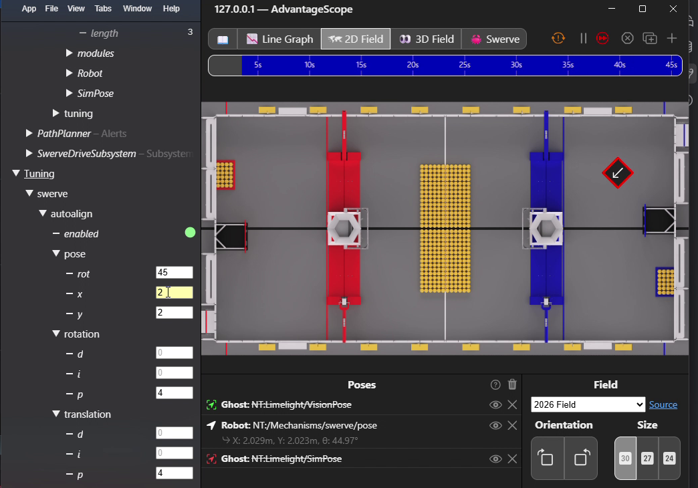
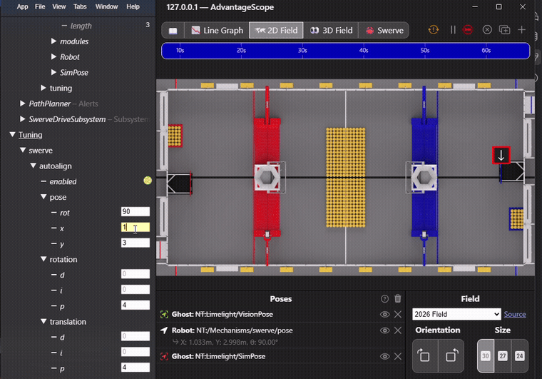
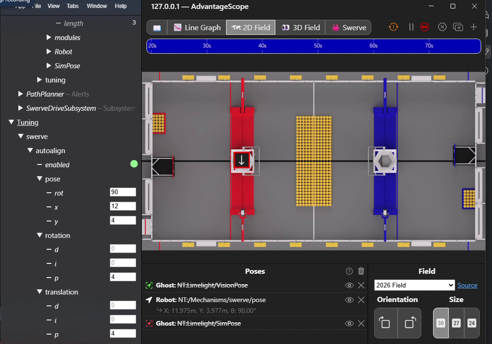

# Tune a swerve drive

**Goal:** tune the swerve modules on the real robot, lifted on blocks, and then its auto-align, with the `SwerveDrive` tuning command.

To learn these steps first, go through the [Swerve Drive tutorial's Tune it step](../../tutorials/swerve-drive/tune.md) in simulation. [Live tuning](./) explains how live tuning works for any mechanism.

`SwerveDrive` has its own tuning command and its own keys. It can tune three things, one at a time:

| Mode                  | Turn it on with           | What it does                                                                       |
| --------------------- | ------------------------- | ---------------------------------------------------------------------------------- |
| Module azimuth motors | `modules/azimuth/enabled` | Turns every module to an angle you type.                                           |
| Module drive motors   | `modules/drive/enabled`   | Runs every module's drive motor at a velocity you type.                            |
| Auto-align            | `autoalign/enabled`       | Drives the robot to a pose you type, using the translation and rotation PID gains. |

| What                    | Where it is published           |
| ----------------------- | ------------------------------- |
| Values you type         | `NT:/Tuning/<name>/<key>`       |
| The tuning command      | `NT:/Tuning/<name>/Live Tuning` |
| The robot pose to watch | `NT:/Mechanisms/<name>/pose`    |

`<name>` is the name given to `SwerveDriveConfig.withTelemetry(name, ...)`. The keys are published at `TelemetryVerbosity.HIGH`.

Only one mode drives the robot at a time. Auto-align outranks drive tuning, and drive tuning outranks azimuth tuning: turning on a mode turns the ones below it back off, in NetworkTables too, so the dashboard shows what is actually running.


The tuning command is only published when both a translation and a rotation controller are set with `withTranslationController(...)` and `withRotationController(...)`. Nothing you type is applied unless the command is running.


## Start the tuning command



In Elastic, drag `NT:/Tuning/<name>/Live Tuning` onto your dashboard and press its button. In AdvantageScope, turn on tuning mode and set `running` under `NT:/Tuning/<name>/Live Tuning` to `true`. You can also bind it to a controller button.



The command is published through `CommandTunable`. Set `NT:/Tuning/<name>/Live Tuning/running` to `true` to start it and `false` to stop it.



Starting the command resets the translation and rotation PID controllers. It requires the drive, so it pauses the default drive command while it runs. Stopping it turns every mode off, holds the wheels where they are, and brings the default drive command back.

## Tune the swerve modules

Tune the modules before auto-align: auto-align can only be as good as the modules under it. Do the azimuth motors first, so the wheels point where they are told while you tune the drive motors.

The module keys are shared. One value is applied to all four modules, which is what you want when the modules are built the same.

| What                     | Where it is published                                                             |
| ------------------------ | --------------------------------------------------------------------------------- |
| Values you type          | `NT:/Tuning/<name>/modules/azimuth/...` and `NT:/Tuning/<name>/modules/drive/...` |
| One motor's telemetry    | `NT:/Mechanisms/<name>/modules/<module>/<motor>/...`                              |
| All four modules at once | `NT:/Mechanisms/<name>/states/desired` and `states/current`                       |

`<module>` and `<motor>` are the names given to the module's and the motor's `withTelemetry(...)`. In AdvantageScope, drag `states/desired` and `states/current` onto a **Swerve** tab to see every module's target and actual state together.


Always start on the real robot with it lifted on blocks, and every wheel clear of the blocks and of the ground, for the azimuth and drive steps.



**Practice in simulation first.** The [Swerve Drive tutorial's Tune it step](../../tutorials/swerve-drive/tune.md) goes through these steps in simulation. Gains found there cannot be relied on for the real modules: tune again on the lifted robot, as on this page, before the wheels touch the ground.


### Azimuth motors

<figure><figcaption>
What each azimuth gain change looks like.
</figcaption></figure>

| You type (`NT:/Tuning/<name>/`)           | Units             | What it is                                                                                                                                            |
| ----------------------------------------- | ----------------- | ----------------------------------------------------------------------------------------------------------------------------------------------------- |
| `modules/azimuth/enabled`                 | Boolean           | Hold the angle while `true`.                                                                                                                          |
| `modules/azimuth/angle`                   | Degrees           | Target angle for every module.                                                                                                                        |
| `modules/azimuth/feedback/p`, `i`, `d`    | PID gains         | Azimuth motor feedback gains.                                                                                                                         |
| `modules/azimuth/feedforward/s`, `v`, `a` | Feedforward gains | Azimuth motor kS, kV, kA.                                                                                                                             |
| `modules/azimuth/voltage/enabled`         | Boolean           | Turn the azimuth motors at `voltage/setpoint` instead of holding the angle. See [Characterize the modules](swerve-drive.md#characterize-the-modules). |
| `modules/azimuth/voltage/setpoint`        | Volts             | Voltage for every azimuth motor.                                                                                                                      |

Watch one azimuth motor's `mechanism/position` against its `closedloop/setpoint/position`, or the module arrows on the Swerve tab.



### Start the tuning command and turn the mode on

Start `NT:/Tuning/<name>/Live Tuning`, type `0` into `modules/azimuth/angle`, then set `modules/azimuth/enabled` to `true`. The drive motors are held at 0, so the wheels only turn in place.

**Check it:** every wheel points straight ahead and does not spin.



### Step the angle

Type `90` into `NT:/Tuning/<name>/modules/azimuth/angle`, then `0`, and keep switching. That key is the setpoint angle for every azimuth motor, in degrees. Each change is a step you can judge the gains by.

**Check it:** every module turns when you change the angle.



### Raise `feedback/p`

Raise it until the modules snap to the angle quickly. If they stop short or turn lazily, it is too low. If they overshoot and shake, it is too high: back it off.

**Check it:** the modules reach 90° quickly and stop without shaking.



### Add `feedback/d` if it still overshoots

A small amount takes out the last of the overshoot. Leave `feedback/i` at 0.

**Check it:** the modules settle on the angle without swinging past it.



### Add `feedforward/s` if the modules stop just short

If they settle a degree or two away from the angle, a little kS overcomes the friction.

**Check it:** `mechanism/position` settles on `closedloop/setpoint/position`.



### Save the gains and turn the mode off

Copy the gains into the azimuth motor's `withClosedLoopController(...)` and `withFeedforward(...)`. Values typed on the dashboard are lost when the robot code restarts. Set `modules/azimuth/enabled` to `false`. The modules stay at the last angle; they do not return to 0°.

**Check it:** after restarting the code, the azimuth gains under `NT:/Tuning/<name>/modules/azimuth/` show your values.



<figure><figcaption>
In AdvantageScope: every module following <code>modules/azimuth/angle</code>.
</figcaption></figure>

<figure><figcaption>
The <code>Tuning/swerve/modules</code> tree.
</figcaption></figure>

### Drive motors

<figure><figcaption>
What each drive gain change looks like.
</figcaption></figure>

| You type (`NT:/Tuning/<name>/`)         | Units             | What it is                                                                                                                                            |
| --------------------------------------- | ----------------- | ----------------------------------------------------------------------------------------------------------------------------------------------------- |
| `modules/drive/enabled`                 | Boolean           | Run the drive motors while `true`.                                                                                                                    |
| `modules/drive/velocity`                | Meters per second | Wheel speed for every module.                                                                                                                         |
| `modules/drive/inplace`                 | Boolean           | `false`: every module points at 0° and the robot drives straight. `true`: the modules point tangent to the robot center and the robot spins in place. |
| `modules/drive/feedback/p`, `i`, `d`    | PID gains         | Drive motor feedback gains.                                                                                                                           |
| `modules/drive/feedforward/s`, `v`, `a` | Feedforward gains | Drive motor kS, kV, kA.                                                                                                                               |
| `modules/drive/voltage/enabled`         | Boolean           | Drive the drive motors at `voltage/setpoint` instead of the velocity. See [Characterize the modules](swerve-drive.md#characterize-the-modules).       |
| `modules/drive/voltage/setpoint`        | Volts             | Voltage for every drive motor.                                                                                                                        |

Watch one drive motor's `measurement/velocity` against its `closedloop/setpoint/velocity`. The gains start at the first module's configured values.



### Start the tuning command and turn the mode on

Start `NT:/Tuning/<name>/Live Tuning`, type `0` into `modules/drive/velocity`, then set `modules/drive/enabled` to `true`.

**Check it:** the wheels point forward and do not spin.



### Zero the feedback

Set `modules/drive/feedback/p`, `i` and `d` to 0 so you can see what the feedforward does on its own.

**Check it:** the three feedback keys read 0.



### Find `feedforward/s`

Type a very small velocity, such as `0.1`, into `NT:/Tuning/<name>/modules/drive/velocity`. That key is the setpoint velocity for every drive motor, in meters per second. Raise `modules/drive/feedforward/s` until the wheels just start to turn, then back it off slightly.

**Check it:** at 0.1 m/s the wheels barely turn, or just stop.



### Find `feedforward/v`

Type a normal driving speed, such as `2`, into `NT:/Tuning/<name>/modules/drive/velocity`. Raise `modules/drive/feedforward/v` until the motor's `measurement/velocity` settles on its `closedloop/setpoint/velocity`. Check a second speed, such as `1` or `3`, in the same key: it should match there too.

**Check it:** at two speeds, `measurement/velocity` settles within a few percent of the setpoint.



### Add `feedback/p`

Raise `modules/drive/feedback/p` until the speed reaches the setpoint quickly and holds when the wheels are loaded. If the speed starts to buzz or oscillate, it is too high. `feedback/d` is rarely needed on a drive motor.

**Check it:** the speed reaches the setpoint quickly and does not buzz.



### Check it on the ground with `inplace`

Take the robot off the blocks and set `modules/drive/inplace` to `true`. The modules point tangent to the robot center, so the robot spins in place instead of crossing the field. A positive `modules/drive/velocity` spins it counter-clockwise.

**Check it:** the robot spins in place without wandering.



### Save the gains and turn the mode off

Copy the gains into the drive motor's `withClosedLoopController(...)` and `withFeedforward(...)`, then set `modules/drive/enabled` to `false`. The drive motors are commanded to 0 m/s once it is off.

**Check it:** after restarting the code, the drive gains under `NT:/Tuning/<name>/modules/drive/` show your values.



<figure><figcaption>
In AdvantageScope: every module driving at the typed velocity.
</figcaption></figure>

<figure><figcaption>
In AdvantageScope: spinning in place with <code>modules/drive/inplace</code>.
</figcaption></figure>

## Characterize the modules

Instead of tuning by hand, the modules can be driven at a voltage and the gains worked out from how they move, the way WPILib's SysId does. While drive or azimuth tuning is on, set its `voltage/enabled` to `true` and type a voltage into `voltage/setpoint`:

* **Drive:** every drive motor runs at the voltage, without its closed loop. The wheels point forward, or around the robot with `modules/drive/inplace`, and are not optimized, so they always drive the same way.
* **Azimuth:** every azimuth motor turns at the voltage, without its closed loop, and the drive motors are held still.

A closed loop that runs on the SystemCore (with an [LQR](../../understanding/lqr-controllers.md) or an [exponential profile](../../understanding/exponential-profiles.md), or a velocity trapezoidal profile or another loop a Thrifty Nova can't run), would replace the voltage on its next loop, so YAMS stops it while the voltage is on and starts it again when the voltage turns off. The setpoint you typed is sent again then, or the wheels are held where they are if no mode is on.


The YAGSL config generator's [Quick Start Guide](https://config.yagsl.com/guide) uses these keys in its Live mode: **Auto**, next to the gain fields, runs a slow ramp and a quick step each way, fits the feedforward, works out the feedback with an LQR, and fills in all six gains. The feedback depends on how often the closed loop runs, which each motor controller publishes as `closedloop/period` at `TelemetryVerbosity.HIGH`.



A voltage has no speed limit. On a real robot, do this on blocks with every wheel clear, and keep the voltage low.


## Tune auto-align

| You type (`NT:/Tuning/<name>/`)                | Units          | What it is                      |
| ---------------------------------------------- | -------------- | ------------------------------- |
| `autoalign/enabled`                            | Boolean        | Drive to the pose while `true`. |
| `autoalign/setpoint/x`, `autoalign/setpoint/y` | Meters         | Field relative target position. |
| `autoalign/setpoint/rot`                       | Degrees        | Field relative target heading.  |
| `autoalign/translation/p`, `i`, `d`            | PID on meters  | Translation gains.              |
| `autoalign/rotation/p`, `i`, `d`               | PID on radians | Rotation gains.                 |

The gains start at the values given to `withTranslationController(...)` and `withRotationController(...)`, not `0`.



### Start the tuning command

Start `NT:/Tuning/<name>/Live Tuning`, as in [Start the tuning command](swerve-drive.md#start-the-tuning-command), with the robot on the ground and room around it.

**Check it:** the command shows as running.



### Type the target pose

Type the target into `autoalign/setpoint/x`, `autoalign/setpoint/y` and `autoalign/setpoint/rot`, a short way from where the robot is.

**Check it:** the three values read back what you typed.



### Turn auto-align on

Set `autoalign/enabled` to `true`. The robot drives to the pose with the current gains.

**Check it:** on a 2D field, `NT:/Mechanisms/<name>/pose` moves to the target and stops.



### Change the gains

Change a gain and watch `NT:/Mechanisms/<name>/pose` on a 2D field. Changing a gain only resets that controller when the value actually changed. Raise `p` until the robot arrives quickly; if it overshoots or wobbles at the end, lower it or add a little `d`.

**Check it:** the robot settles on the target, as in the pictures below.



### Copy the gains and turn it off

Copy the gains you like into `withTranslationController(...)` and `withRotationController(...)`. Values typed on the dashboard are lost when the robot code restarts. Set `autoalign/enabled` back to `false` before handing control back to the driver.

**Check it:** after restarting the code, the `autoalign/translation/` and `autoalign/rotation/` gains show your values.



<figure><figcaption>
The <code>Tuning/swerve/autoalign</code> tree next to a 2D field.
</figcaption></figure>

<figure><figcaption>
Driving to <code>x=12</code>, <code>y=4</code>, <code>rot=90</code> in simulation.
</figcaption></figure>

<figure><figcaption>
Settled at the target pose.
</figcaption></figure>

## Good to know

* **One mode at a time.** If more than one `enabled` key is `true`, YAMS keeps one and sets the others back to `false`. Auto-align wins over drive tuning, and drive tuning wins over azimuth tuning.
* **Every module shares the values.** The `modules/drive/*` and `modules/azimuth/*` keys apply to all modules at once. There are no per-module keys.
* **Module optimization still applies.** Both module modes go through `SwerveDrive.setSwerveModuleStates(...)`, so `withOptimization(true)` behaves the same as it does while driving.
* **No gyro needed in simulation.** The simulated drive tracks its own heading, so you can practice tuning the drive and azimuth motors before writing any gyro code. On a real robot, `SwerveDrive` throws an `IllegalStateException` if `withGyro(...)` was never called.
