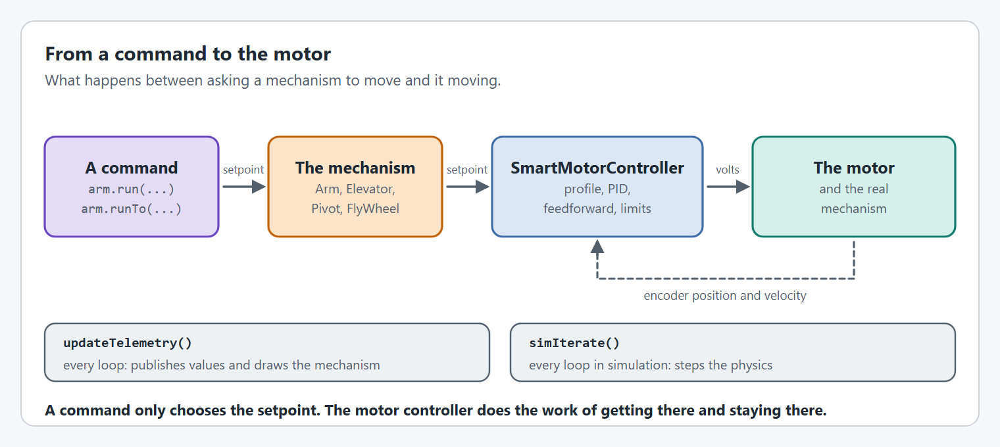
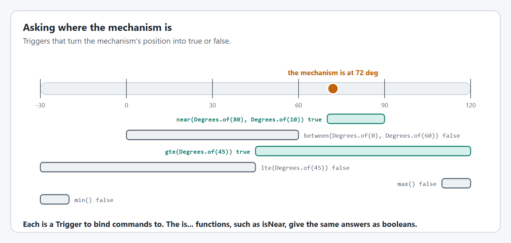

# Controlling a mechanism

An `Arm`, a `Pivot`, an `Elevator` and a `FlyWheel` are controlled the same way. This page lists what each one gives you, in one table per job, so the mechanism pages do not have to repeat it. If you have not built a mechanism yet, start with the [Arm tutorial](../tutorials/arm/).

Each column uses the mechanism's own unit:

| Mechanism  | A target is a                         | For example                                 |
| ---------- | ------------------------------------- | ------------------------------------------- |
| `Arm`      | `Angle`                               | `Degrees.of(45)`                            |
| `Pivot`    | `Angle`                               | `Degrees.of(90)`                            |
| `Elevator` | `Distance`                            | `Meters.of(1.2)`                            |
| `FlyWheel` | `AngularVelocity` or `LinearVelocity` | `RPM.of(3000)`, or `MetersPerSecond.of(16)` |

## How a command reaches the motor

<figure><figcaption><p>The same chain runs every mechanism.</p></figcaption></figure>

A YAMS mechanism is a thin layer over one [`SmartMotorController`](editor/). The mechanism knows what it is (its length, its hard stops, how to simulate it) and turns your commands into setpoints. The `SmartMotorController` does the closed loop control: the motion profile, PID and feedforward. That loop runs either on the motor controller itself or on the SystemCore, depending on the motor controller and the options you chose: [Where the loop runs](editor/config/closed-loop-control.md#where-the-loop-runs) lists which.

You do not have to manage that loop. Every closed loop command and setpoint function starts the loop when it begins, and every open loop one (a duty cycle or a voltage) stops it. So you can switch between `set(0)` and `runTo(...)` freely.

Keep one mechanism per subsystem (or Commands v3 `Mechanism`), so live tuning and command requirements stay simple.

## Commands

Every command below has the same name in Commands v2 and Commands v3, and requires the mechanism's subsystem, so two commands never fight over the motor.

| Job                                    | `Arm`, `Pivot`                                         | `Elevator`                                                 | `FlyWheel`                                                                         | Ends                                                                                       |
| -------------------------------------- | ------------------------------------------------------ | ---------------------------------------------------------- | ---------------------------------------------------------------------------------- | ------------------------------------------------------------------------------------------ |
| Go to a target and hold it             | `setAngle(Angle)`, `run(Angle)`                        | `setHeight(Distance)`, `run(Distance)`                     | `run(AngularVelocity)`, `run(LinearVelocity)`\*                                    | Never, until interrupted.                                                                  |
| Go to a target, then end               | `runTo(Angle, Angle tolerance)`                        | `runTo(Distance, Distance tolerance)`                      | `runTo(AngularVelocity, AngularVelocity tolerance)`, or the `LinearVelocity` one\* | When the mechanism has been within the tolerance for 0.1 s.                                |
| Follow a target that changes, forever  | `setAngle(Supplier<Angle>)`, `run(Supplier<Angle>)`    | `setHeight(Supplier<Distance>)`, `run(Supplier<Distance>)` | `run(Supplier<...>)` of either kind of velocity\*                                  | Never, until interrupted.                                                                  |
| Follow a target that changes, then end | `runTo(Supplier<Angle>, Angle tolerance)`              | `runTo(Supplier<Distance>, Distance tolerance)`            | `runTo(Supplier<AngularVelocity>, ...)`, or the `LinearVelocity` one\*             | When the mechanism has been within the tolerance of the supplier's latest value for 0.1 s. |
| Output a duty cycle, from -1 to 1      | `set(double)`, `set(Supplier<Double>)`                 | the same                                                   | the same                                                                           | Never, until interrupted.                                                                  |
| Output a voltage                       | `setVoltage(Voltage)`, `setVoltage(Supplier<Voltage>)` | the same                                                   | the same                                                                           | Never, until interrupted.                                                                  |

\* A `LinearVelocity` is the speed of the wheel's surface, and needs [`withDiameter`](mechanism-configs/flywheel-config.md#withdiameter) on the `FlyWheelConfig`. A flywheel has no `setAngle` or `setHeight`: `run` is its command that holds.

`setAngle` and `run` are the same command with two names, and so are `setHeight` and `run`. Both supplier versions read the supplier every loop: `run(Supplier)` follows it until something interrupts it, and `runTo(Supplier, tolerance)` follows it until the mechanism catches up with the latest value.

`set` and `setVoltage` stop the closed loop when they start and start it again when they end. If the mechanism had a closed loop setpoint before, it goes back to driving toward that setpoint.

When a command ends, the motor keeps its last request. [When mechanism commands end](../understanding/run-vs-runto.md) explains what that means for `runTo` and your default command.

## Setpoint functions

The commands are built on plain functions that set the target and return at once. Use them when something other than a ready-made command decides the target: your own command, an AdvantageKit IO class or a state machine. [How do I write my own mechanism command?](../how-to-mechanisms/how-do-i-write-my-own-mechanism-command.md) shows each.

| Function                                         | `Arm`, `Pivot`                                                                                                                               | `Elevator`                                                                 | `FlyWheel`                                                                                                          |
| ------------------------------------------------ | -------------------------------------------------------------------------------------------------------------------------------------------- | -------------------------------------------------------------------------- | ------------------------------------------------------------------------------------------------------------------- |
| `setMechanismPositionSetpoint(Angle)`            | Go to this angle.                                                                                                                            | Turn the drum to this angle. Rarely what you want: use the `Distance` one. | Not for a flywheel.                                                                                                 |
| `setMeasurementPositionSetpoint(Distance)`       | Only with a [circumference](editor/config/gearing-and-units.md#withmechanismcircumference) set, which an arm or pivot usually does not have. | Go to this height.                                                         | Not for a flywheel.                                                                                                 |
| `setMechanismVelocitySetpoint(AngularVelocity)`  | Turn at this speed. Rarely wanted on a positional mechanism.                                                                                 | The same.                                                                  | Spin at this speed.                                                                                                 |
| `setMeasurementVelocitySetpoint(LinearVelocity)` | Only with a circumference set.                                                                                                               | Move at this speed.                                                        | Spin so the surface moves at this speed. Needs [`withDiameter`](mechanism-configs/flywheel-config.md#withdiameter). |
| `setVoltageSetpoint(Voltage)`                    | Output this voltage.                                                                                                                         | The same.                                                                  | The same.                                                                                                           |
| `setDutyCycleSetpoint(double)`                   | Output this duty cycle, from -1 to 1.                                                                                                        | The same.                                                                  | The same.                                                                                                           |
| Read the current target                          | `getMechanismSetpoint()`, an `Optional<Angle>`                                                                                               | `getMeasurementSetpoint()`, an `Optional<Distance>`                        | `getMechanismSetpointVelocity()`, an `Optional<AngularVelocity>`                                                    |

A position or velocity setpoint function starts the closed loop if it was stopped. A voltage or duty cycle one stops it. A `Distance` or `LinearVelocity` function called without a circumference throws a `SmartMotorControllerConfigurationException` (a `FlyWheelConfigurationException` on a flywheel with no diameter).


The setpoint functions do not require the subsystem, so nothing stops two callers fighting over the target. Prefer the commands unless you need these.


## Asking where it is

<figure><figcaption><p>The same questions as Triggers or as booleans.</p></figcaption></figure>

Each question comes as a `Trigger`, to bind a command to, and as a `boolean`, for an `if` statement.

| As a `Trigger`             | As a `boolean`                 | True when                                                                      | On                         |
| -------------------------- | ------------------------------ | ------------------------------------------------------------------------------ | -------------------------- |
| `near(target, within)`     | `isNear(target, within)`       | The mechanism is within `within` of `target`.                                  | All four                   |
| `between(start, end)`      | `isBetween(start, end)`        | The mechanism is between the two.                                              | All four                   |
| `gte(value)`, `lte(value)` | `isGte(value)`, `isLte(value)` | The mechanism is at or above, or at or below, the value.                       | All four                   |
| `max()`, `min()`           | `isAtMax()`, `isAtMin()`       | The mechanism is at its soft limit, or its hard limit if no soft limit is set. | `Arm`, `Pivot`, `Elevator` |

A flywheel has no `max()` or `min()`, because it has no end to its travel. Its questions take an `AngularVelocity`.

To read the value itself:

| Mechanism      | Current value                                                 |
| -------------- | ------------------------------------------------------------- |
| `Arm`, `Pivot` | `getAngle()`                                                  |
| `Elevator`     | `getHeight()`, and `getVelocity()` for its speed              |
| `FlyWheel`     | `getSpeed()`, and `getLinearVelocity()` for the surface speed |

```java
// Fragment: arm and intake are fields of your RobotContainer (Commands v2)
arm.near(Degrees.of(80), Degrees.of(2)).onTrue(intake.eject());
if (arm.isNear(Degrees.of(0), Degrees.of(2))) { /* stowed */ }
```

## Next

[When mechanism commands end](../understanding/run-vs-runto.md) explains how to choose between `run`, `runTo` and `set`, and how they work with a default command.
