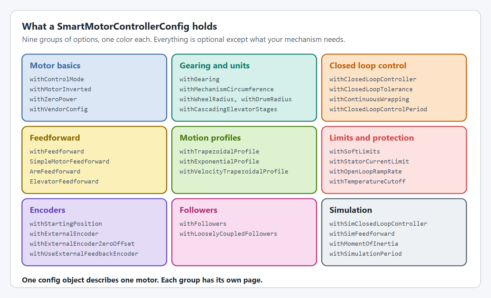
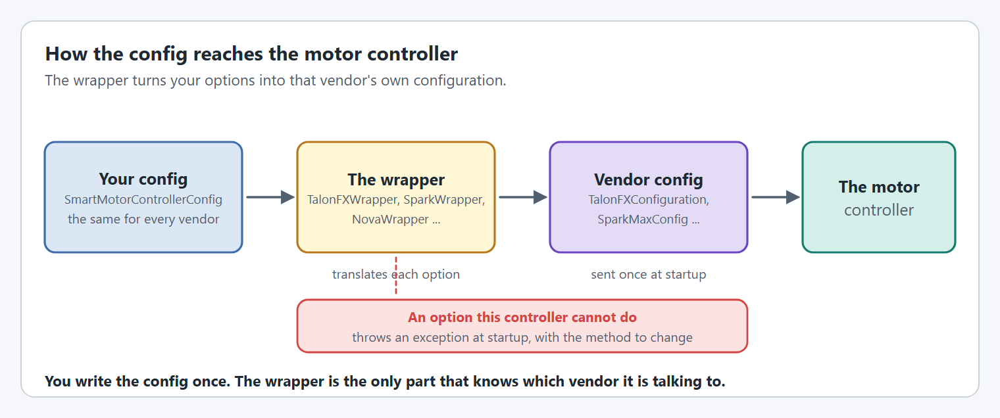

# SmartMotorControllerConfig

A `SmartMotorControllerConfig` describes one motor: how it is geared, how it is controlled, what it must not do and what it reports. You write it once, in the same way for every vendor, and hand it to a wrapper such as `TalonFXWrapper`, `SparkWrapper`, `NovaWrapper` or `A301Wrapper`.

<figure><figcaption><p>The option groups. Each has its own page.</p></figcaption></figure>

## Where to find each option

| Page                                              | What it covers                                                                                    |
| ------------------------------------------------- | ------------------------------------------------------------------------------------------------- |
| [Motor basics](motor-basics.md)                   | Control mode, inversion, brake or coast, starting from a clean config, vendor configs, telemetry. |
| [Gearing and units](gearing-and-units.md)         | Gear ratios, circumference, wheels and drums, cascading elevator stages.                          |
| [Closed loop control](closed-loop-control.md)     | PID gains, slots, tolerance, continuous wrapping, output limits, where the loop runs.             |
| [Feedforward](feedforward.md)                     | Simple, arm and elevator feedforwards and what each gain does.                                    |
| [Motion profiles](motion-profiles.md)             | Trapezoidal, velocity and exponential profiles.                                                   |
| [Limits and protection](limits-and-protection.md) | Soft limits, current limits, ramp rates, voltage compensation, temperature cutoff.                |
| [Encoders](encoders.md)                           | Starting position, encoder inversion, external encoders and their zero offset.                    |
| [Followers](followers.md)                         | Followers on one shaft, and loosely coupled followers.                                            |
| [Simulation](simulation.md)                       | Simulation-only gains, starting position, moment of inertia and step size.                        |

## How the config is used

<figure><figcaption><p>The same config works for every supported motor controller.</p></figcaption></figure>

```java
SmartMotorControllerConfig config = new SmartMotorControllerConfig(this)
    .withControlMode(ControlMode.CLOSED_LOOP)
    .withGearing(new MechanismGearing(GearBox.fromReductionStages(3, 4)))
    .withClosedLoopController(4, 0, 0)
    .withFeedforward(new ArmFeedforward(0, 0.3, 1.2))
    .withTrapezoidalProfile(DegreesPerSecond.of(180), DegreesPerSecondPerSecond.of(360))
    .withSoftLimits(Degrees.of(-20), Degrees.of(100))
    .withStatorCurrentLimit(Amps.of(40))
    .withZeroPower(MotorMode.BRAKE)
    .withTelemetry("ArmMotor", TelemetryVerbosity.HIGH);

SparkMax spark = new SparkMax(CANPort.CAN_S0, 4, MotorType.kBrushless);
SmartMotorController motor = new SparkWrapper(spark, DCMotor.getNEO(1), config);
```

This is a fragment: it goes inside a subsystem, which is the `this` passed to the config. [Step 1 of the Arm tutorial](../../../tutorials/arm/motor-controller.md) builds the same thing as a complete file.

Three things are worth knowing before reading the option pages:

* **Every `with...()` method returns the config**, so options chain. A few options depend on an earlier one and say so on their page, for example `withClosedLoopTolerance` needs a PID controller first.
* **Options are checked when the wrapper is created.** An option that motor controller cannot do throws an exception, so problems show up at startup and not mid-match. It is usually a `SmartMotorControllerConfigurationException` that names the method to change, and for a few options an `IllegalArgumentException`. Each option says which.
* **The motor's config holds the motor's limits.** Soft limits, starting position and gearing go on the `SmartMotorControllerConfig`, even when a mechanism uses the motor. The mechanism's own config (`ArmConfig`, `ElevatorConfig` and so on) describes the mechanism: its length, mass and hard stops.

## Not every option works on every motor controller


Motor controllers differ. Some options only exist on one of them, and some only work in certain situations, for example only when the closed loop runs on the SystemCore. An option a controller cannot do normally throws a `SmartMotorControllerConfigurationException` or an `IllegalArgumentException` at startup, but check the table for each option you rely on.


Every option on the following pages has a table showing where it works. The [motor controller feature matrix](../feature-matrix.md#feature-support-matrix) has every option against every motor controller in one place. The ones that most often catch teams out:

* **TalonFX and TalonFXS:** no [`withClosedLoopTolerance`](closed-loop-control.md#withclosedlooptolerance), no [`withVoltageCompensation`](limits-and-protection.md#withvoltagecompensation), no `SLOT_3`, and [`withEncoderInverted`](encoders.md#withencoderinverted) only on a TalonFXS.
* **SPARK MAX and SPARK Flex:** no [supply current limit](limits-and-protection.md#withstatorcurrentlimit-and-withsupplycurrentlimit) and no [`withVendorControlRequest`](motor-basics.md#withvendorcontrolrequest). Several options only work when the loop runs on the SystemCore, with an exponential profile or an [LQR](../../../understanding/lqr-controllers.md).
* **Thrifty Nova:** two closed loop slots, both soft limits or neither, and [one ramp rate](limits-and-protection.md#withopenloopramprate-and-withclosedloopramprate) for open and closed loop control. Like a SPARK, several options only work when the loop runs on the SystemCore. Wrapping the Nova can't do runs the loop on the SystemCore.
* **FIRST A301:** no current limits, ramp rates, voltage compensation, vendor config or [`withFollowers`](followers.md#withfollowers) (use loosely coupled followers), and its only external encoder is its own. Every closed loop runs on the SystemCore, and [soft limits](limits-and-protection.md#withsoftlimits) only move position setpoints.
* **Everywhere:** [soft limits](limits-and-protection.md#withsoftlimits) only work in closed loop mode, and [`withVendorConfig`](motor-basics.md#withvendorconfig), [`withExternalEncoder`](encoders.md#withexternalencoder) and [`withFollowers`](followers.md#withfollowers) only take that vendor's own parts.

Many of these depend on where the closed loop runs, which is explained in [where the loop runs](closed-loop-control.md#where-the-loop-runs).

## Changing a config later

Most options can be changed while the robot runs through [live tuning](../../../how-to-tuning/live-tuning/), which is the quickest way to find gains and limits. Once you have them, put the numbers back in the config so they survive a restart.

## Code reference

* [`SmartMotorControllerConfig`](https://javadocs.yassrobotics.com/yams/yams/core/motorcontrollers/SmartMotorControllerConfig.html)
