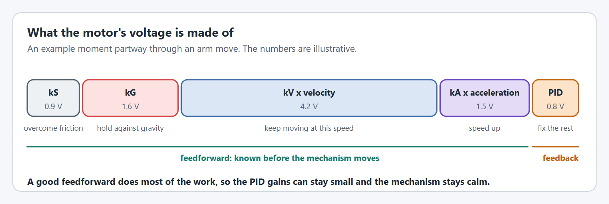
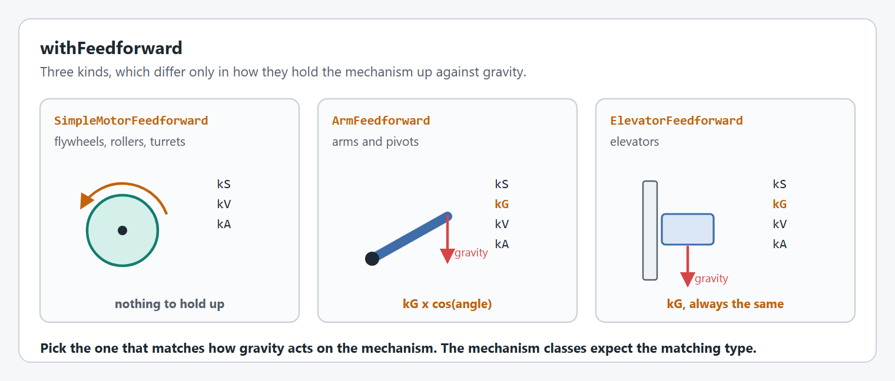
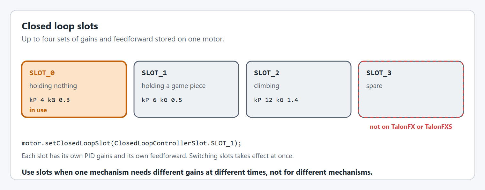

# Feedforward

A feedforward predicts the voltage a move needs from what you know about the mechanism, before any error has built up. The PID then only has to fix what the prediction missed.

<figure><figcaption><p>The parts of the output voltage at one moment in a move.</p></figcaption></figure>

## `withFeedforward`

Takes one of WPILib's three feedforward classes.

<figure><figcaption><p>The three feedforward types.</p></figcaption></figure>

```java
.withFeedforward(new SimpleMotorFeedforward(0.1, 0.12, 0.01))   // kS, kV, kA
.withFeedforward(new ArmFeedforward(0.1, 0.35, 1.2, 0.02))      // kS, kG, kV, kA
.withFeedforward(new ElevatorFeedforward(0.1, 0.4, 3.5, 0.1))   // kS, kG, kV, kA
```

| Gain | What it is for                                        | How to find it                                                                                                                                                                         |
| ---- | ----------------------------------------------------- | -------------------------------------------------------------------------------------------------------------------------------------------------------------------------------------- |
| `kS` | The voltage that just overcomes friction.             | Raise the voltage in steps of about 0.05 V until the mechanism starts to move. [Drive a motor at a voltage](../../../how-to-tuning/live-tuning/#drive-a-motor-at-a-voltage) shows how. |
| `kG` | The voltage that holds the mechanism against gravity. | The voltage at which it neither rises nor falls. For an arm, measure it with the arm level.                                                                                            |
| `kV` | The voltage per unit of speed.                        | Volts above `kS` divided by the steady speed it gives.                                                                                                                                 |
| `kA` | The voltage per unit of acceleration.                 | Usually small. Raise it if the mechanism lags at the start of a move.                                                                                                                  |

The units:

* **`kS` and `kG`** are volts.
* **`kV`** is volts per mechanism rotation per second for `ArmFeedforward` and `SimpleMotorFeedforward`, and volts per meter per second for `ElevatorFeedforward`. A `kV` of 2 on an arm adds 2 V for every rotation per second it moves.
* **`kA`** is the same, per second squared.

Giving an `ElevatorFeedforward` makes the controller [distance based](closed-loop-control.md#withlinearclosedloopcontroller).


**`ArmFeedforward` is per rotation in YAMS, not per radian.** WPILib documents an `ArmFeedforward`'s `kV` and `kA` per radian. In YAMS they are per mechanism rotation, like every other gain, and YAMS converts them for WPILib's math. A `kV` you copied from a per radian calculation is 2π (about 6.28) times too small for YAMS.


### Starting values

These are only places to start, so you can see which way to go. Tune `kS` and `kG` first, with the PID gains at 0.

| Gain | Start at                                   | Change it                                                                                |
| ---- | ------------------------------------------ | ---------------------------------------------------------------------------------------- |
| `kG` | `0`                                        | Raise in 0.05 V steps until the arm (held level) or the elevator stays where it is.      |
| `kS` | `0`                                        | Raise in 0.05 V steps until the mechanism is just about to move, then back off a little. |
| `kV` | 12 V divided by the mechanism's free speed | Raise if the speed settles below the setpoint, lower if it settles above.                |
| `kA` | `0`                                        | Raise only if the mechanism lags while it speeds up.                                     |

The mechanism's free speed is the motor's free speed divided by your gearing. A NEO (about 95 rotations per second) through 12:1 gives about 7.9 rotations per second, so `kV` starts near 12 / 7.9 = 1.5. A Kraken X60 (about 100 rotations per second) driving a flywheel 1:1 starts near 0.12. For an elevator, multiply the mechanism's free speed by the [circumference](gearing-and-units.md#withmechanismcircumference) to get meters per second first.

Graph velocity against the setpoint velocity during a long move. [Step 5 of the Arm tutorial](../../../tutorials/arm/tune.md) walks through it, and [Tuning order](../../../how-to-tuning/live-tuning/#tuning-order) has the order for each mechanism.

### These are not an exponential profile's `kV` and `kA`

An [exponential profile](../../../understanding/exponential-profiles.md) also has a `kV` and a `kA`. They share the names and the units, but they are separate settings that do different jobs, and changing one pair does not change the other.

|              | Feedforward `kV` and `kA`                                                    | Exponential profile `kV` and `kA`                                                                                                |
| ------------ | ---------------------------------------------------------------------------- | -------------------------------------------------------------------------------------------------------------------------------- |
| Set with     | `withFeedforward(...)`                                                       | `withExponentialProfile(...)`                                                                                                    |
| What they do | Turn the velocity and acceleration of the setpoint into volts for the motor. | Shape the plan. The maximum voltage divided by `kV` is the profile's top speed, and divided by `kA` is its maximum acceleration. |
| Raising them | Sends the motor more voltage.                                                | Makes the profile slower. No extra voltage is sent.                                                                              |
| Tuned by     | Watching how well the mechanism follows the setpoint.                        | Watching whether the mechanism can keep up with the profile.                                                                     |

A mechanism with an exponential profile needs both pairs: the profile's to plan the move, and the feedforward's to follow it. Do not copy one pair into the other. The profile's values are often set higher than the feedforward's, so the plan asks for less than the motor can give and leaves voltage in reserve.

[Measuring kV and kA](../../../understanding/exponential-profiles.md#measuring-kv-and-ka-optional) on the exponential profiles page measures the profile's pair, and [refining the profile live](../../../understanding/exponential-profiles.md#refining-the-profile-live) tunes them.

### Slots

A feedforward can be given a slot, so it switches together with the [PID gains in that slot](closed-loop-control.md#slots).

<figure><figcaption><p>Each slot holds a feedforward alongside its PID gains, and both switch together.</p></figcaption></figure>

```java
.withFeedforward(new ArmFeedforward(0.1, 0.35, 1.2), ClosedLoopControllerSlot.SLOT_0)
.withFeedforward(new ArmFeedforward(0.1, 0.60, 1.2), ClosedLoopControllerSlot.SLOT_1) // holding a game piece
```

**Supported on:** every supported motor controller.

## Code reference

* [`SmartMotorControllerConfig`](https://javadocs.yassrobotics.com/yams/yams/core/motorcontrollers/SmartMotorControllerConfig.html)
