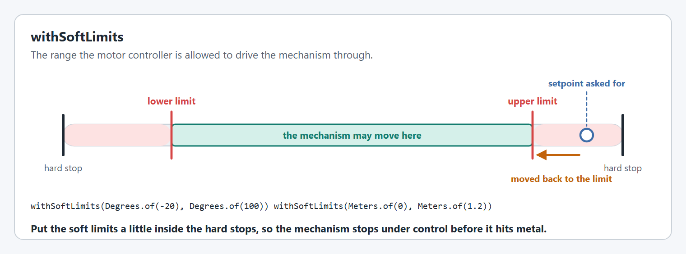
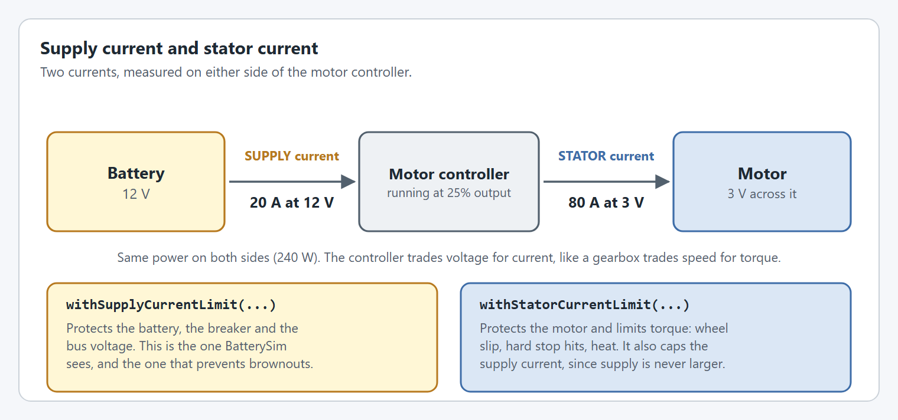
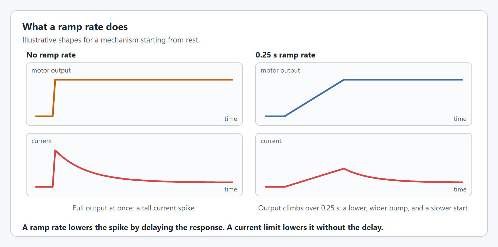
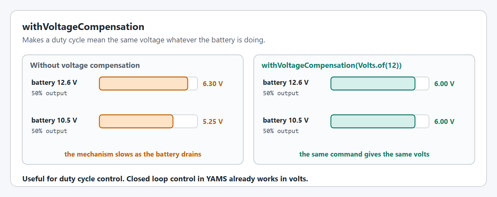
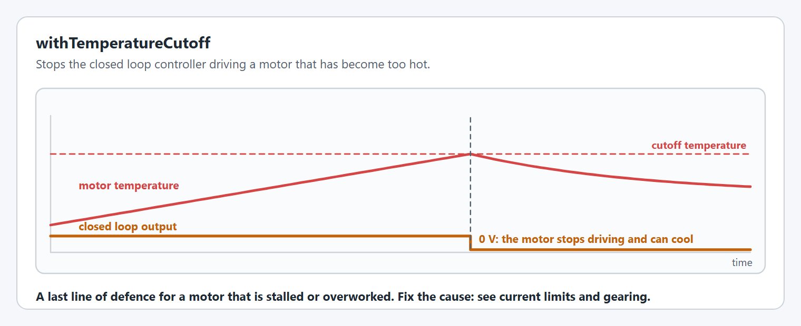

# Limits and protection

These options stop a mechanism or a motor from hurting itself or the rest of the robot.


Not every option on this page is supported on every motor controller. Each option has a table showing where it works, and an option a controller cannot do throws a `SmartMotorControllerConfigurationException` or an `IllegalArgumentException` at startup. Each option says which. The [config overview](./#not-every-option-works-on-every-motor-controller) lists them all together.


## `withSoftLimits`

The range the mechanism is allowed to move through.

<figure><figcaption><p>Soft limits sit a little inside the hard stops.</p></figcaption></figure>

```java
.withSoftLimits(Degrees.of(-20), Degrees.of(100))
.withSoftLimits(Meters.of(0), Meters.of(1.2))     // needs a circumference
```

The lower limit must be below the upper limit. Soft limits cannot be combined with [continuous wrapping](closed-loop-control.md#withcontinuouswrapping): setting both throws a `SmartMotorControllerConfigurationException`, in either order. They can be combined with [`withWrapping`](encoders.md#withwrapping), which only sets the range an absolute encoder reads.

Soft limits rely on the encoder being right. If the mechanism does not start where the encoder thinks it does, the limits are in the wrong place: see [starting position](encoders.md#withstartingposition).

**Only in closed loop mode.** Soft limits are only enforced with [`withControlMode(ControlMode.CLOSED_LOOP)`](motor-basics.md#withcontrolmode), the default. They are set on the motor controller and stop any output that would go past them, including a voltage or duty cycle. A Thrifty Nova has one enable for both limits, so it needs both an upper and a lower limit: setting only one throws a `SmartMotorControllerConfigurationException`. An A301 has no soft limits of its own, so its loop on the SystemCore enforces them: a position setpoint past a limit is moved to the limit, but a voltage or duty cycle is not stopped.

| TalonFX                     | TalonFXS                    | SPARK MAX / Flex            | Thrifty Nova                                      | A301                                                     |
| --------------------------- | --------------------------- | --------------------------- | ------------------------------------------------- | -------------------------------------------------------- |
| ⚠️ only in closed loop mode | ⚠️ only in closed loop mode | ⚠️ only in closed loop mode | ⚠️ only in closed loop mode, with both limits set | ⚠️ closed loop setpoints only, not voltage or duty cycle |

## `withStatorCurrentLimit` and `withSupplyCurrentLimit`

`withStatorCurrentLimit` limits the current through the motor, which limits its torque and heat. `withSupplyCurrentLimit` limits the current drawn from the battery, which protects the breaker and the battery voltage.

<figure><figcaption><p>Supply current and stator current.</p></figcaption></figure>

```java
.withStatorCurrentLimit(Amps.of(40))
.withSupplyCurrentLimit(Amps.of(30))
```

`withOutputCurrentLimit` is another name for `withStatorCurrentLimit`, and `withInputCurrentLimit` is another name for `withSupplyCurrentLimit`. They do exactly the same thing.

[How do I limit power consumption?](../../../how-to-motor-controllers-and-sensors/limiting-power-consumption.md#set-a-starting-limit-on-each-motor) explains how to choose them, with starting limits for common motors, and how to test them against the [battery simulation](../../../understanding/battery-simulation.md).

**Not supported everywhere.** `withSupplyCurrentLimit` is not available on SPARKs. The A301 has no current limits at all: either one throws a `SmartMotorControllerConfigurationException`.

| TalonFX | TalonFXS | SPARK MAX / Flex                                                                           | Thrifty Nova | A301 |
| ------- | -------- | ------------------------------------------------------------------------------------------ | ------------ | ---- |
| ✅       | ✅        | ⚠️ stator limit only: a supply limit throws a `SmartMotorControllerConfigurationException` | ✅            | ❌    |

## `withOpenLoopRampRate` and `withClosedLoopRampRate`

`withOpenLoopRampRate` and `withClosedLoopRampRate` set the shortest time the output may take to go from zero to full.

<figure><figcaption><p>The output with and without a ramp rate.</p></figcaption></figure>

```java
.withOpenLoopRampRate(Seconds.of(0.25))
.withClosedLoopRampRate(Seconds.of(0.1))
```

A ramp rate is the last thing to reach for. It slows everything the motor does, including the closed loop controller's reactions. [Lower the biggest load first](../../../how-to-motor-controllers-and-sensors/limiting-power-consumption.md#lower-the-biggest-load-first) lists what to try first.

**Not supported everywhere.** The A301 has no ramp rates: either one throws a `SmartMotorControllerConfigurationException`.

| TalonFX | TalonFXS | SPARK MAX / Flex | Thrifty Nova                                                                                         | A301 |
| ------- | -------- | ---------------- | ---------------------------------------------------------------------------------------------------- | ---- |
| ✅       | ✅        | ✅                | ⚠️ one ramp rate for both: two different values throw a `SmartMotorControllerConfigurationException` | ❌    |

## `withVoltageCompensation`

Scales the output so a duty cycle means the same voltage whatever the battery voltage is.

<figure><figcaption><p>A 50% output at two battery voltages.</p></figcaption></figure>

```java
.withVoltageCompensation(Volts.of(12))
```

**Not supported everywhere.** It throws an `IllegalArgumentException` on a TalonFX or TalonFXS, and a `SmartMotorControllerConfigurationException` on an A301. Use a voltage request instead of a duty cycle on those.

| TalonFX | TalonFXS | SPARK MAX / Flex | Thrifty Nova | A301 |
| ------- | -------- | ---------------- | ------------ | ---- |
| ❌       | ❌        | ✅                | ✅            | ❌    |

## `withTemperatureCutoff`

Stops the closed loop controller driving the motor once it reaches a temperature.

<figure><figcaption><p>The output drops to zero at the cutoff temperature.</p></figcaption></figure>

```java
.withTemperatureCutoff(Celsius.of(80))
```

While the motor is at or above the cutoff, the closed loop output is zero, so a mechanism that was being held up will drop. Treat it as a last resort and fix the cause with [current limits](../../../how-to-motor-controllers-and-sensors/limiting-power-consumption.md) or gearing.


On a SPARK MAX, SPARK Flex or Thrifty Nova with a **trapezoidal** position profile, or a PID alone, the cutoff is rejected: the loop runs on the motor controller, and the cutoff is only checked by the loop on the SystemCore. Use an exponential profile if you rely on the cutoff.


**Not supported everywhere.** The cutoff is enforced by the closed loop running on the SystemCore, so it only works where the loop runs there. An [LQR controller](../../../understanding/lqr-controllers.md) always runs there, so the cutoff works with LQR on every motor controller. An A301's loop always runs there, so on an A301 it works in closed loop mode.

| TalonFX                                                                     | TalonFXS                                                                    | SPARK MAX / Flex                                                                                      | Thrifty Nova                                                                                                                                                                        | A301                        |
| --------------------------------------------------------------------------- | --------------------------------------------------------------------------- | ----------------------------------------------------------------------------------------------------- | ----------------------------------------------------------------------------------------------------------------------------------------------------------------------------------- | --------------------------- |
| ⚠️ only with an [LQR controller](../../../understanding/lqr-controllers.md) | ⚠️ only with an [LQR controller](../../../understanding/lqr-controllers.md) | ⚠️ only with an exponential profile or an [LQR controller](../../../understanding/lqr-controllers.md) | ⚠️ only when the loop runs on the SystemCore, such as with an exponential profile, a velocity trapezoidal profile or an [LQR controller](../../../understanding/lqr-controllers.md) | ⚠️ only in closed loop mode |

## Code reference

* [`SmartMotorControllerConfig`](https://javadocs.yassrobotics.com/yams/yams/core/motorcontrollers/SmartMotorControllerConfig.html)
