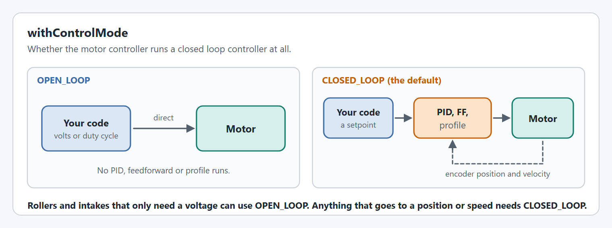
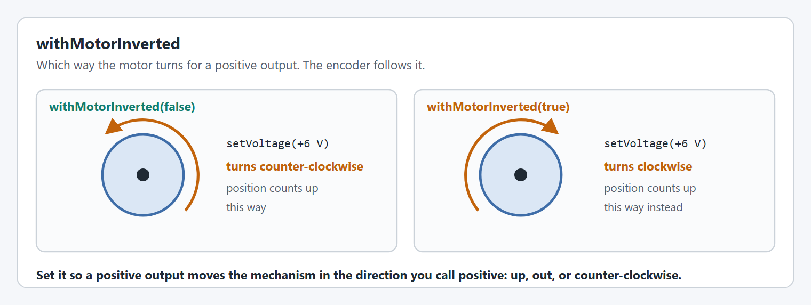
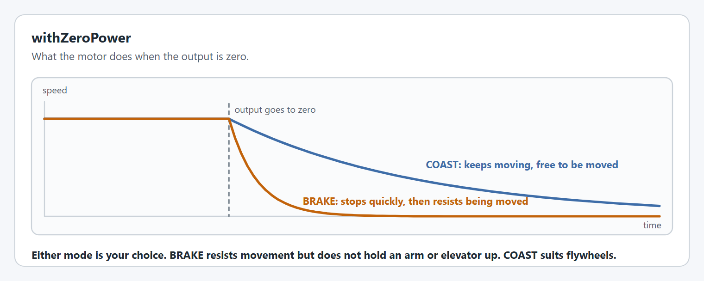
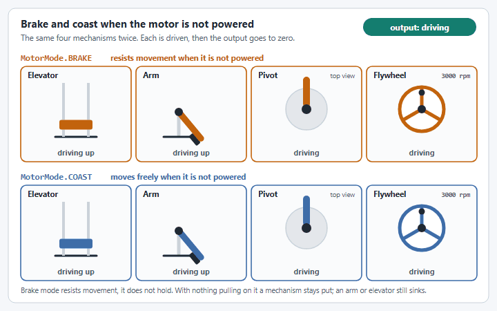
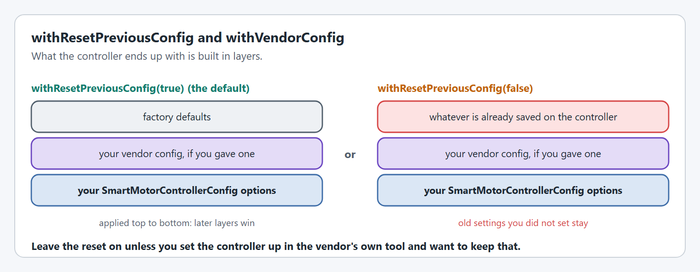
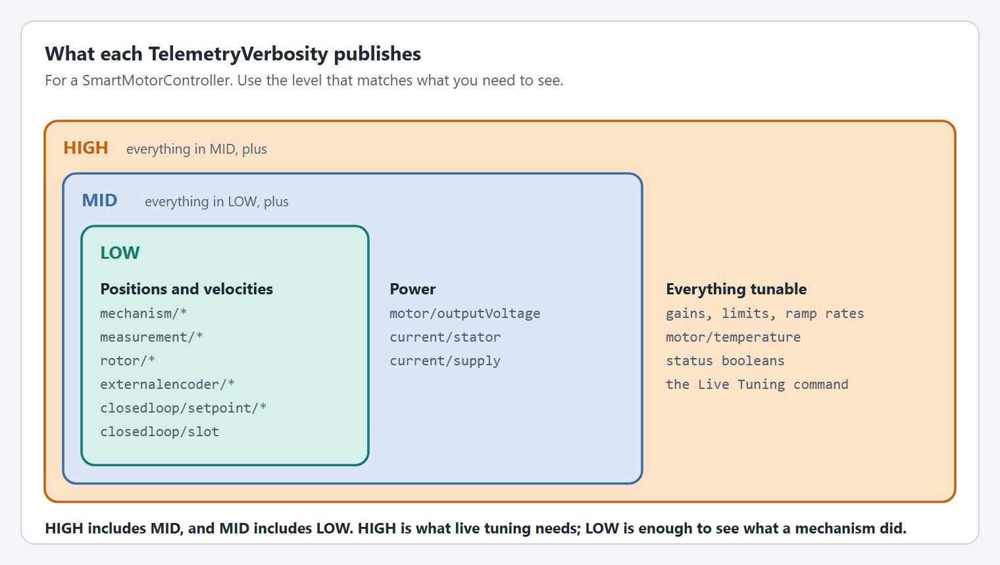

# Motor basics

The options every motor needs, whatever it drives.


Not every option on this page is supported on every motor controller. Each option has a table showing where it works, and an option a controller cannot do throws a `SmartMotorControllerConfigurationException` or an `IllegalArgumentException` at startup. Each option says which. The [config overview](./#not-every-option-works-on-every-motor-controller) lists them all together.


## `withControlMode`

Chooses whether the motor controller runs a closed loop controller. The default is `ControlMode.CLOSED_LOOP`.

<figure><figcaption><p>Open loop sends an output straight to the motor. Closed loop drives to a setpoint.</p></figcaption></figure>

```java
.withControlMode(ControlMode.OPEN_LOOP)   // a roller that only ever gets a voltage
.withControlMode(ControlMode.CLOSED_LOOP) // anything that goes to a position or a speed
```

In `OPEN_LOOP` the closed loop options on the other pages have nothing to act on, and the [soft limits](limits-and-protection.md#withsoftlimits) are not enforced on any motor controller.

**Supported on:** every supported motor controller.

## `withMotorInverted`

Chooses which way the motor turns for a positive output.

<figure><figcaption><p>The same positive voltage, not inverted and inverted.</p></figcaption></figure>

```java
.withMotorInverted(true)
```

Decide it once, with the mechanism free to move and a small voltage, before tuning anything. Encoders have their own inversion: see [Encoders](encoders.md#withencoderinverted).

**Supported on:** every supported motor controller.

## `withZeroPower`

Chooses what the motor does when the output is zero: `MotorMode.BRAKE` or `MotorMode.COAST`.

* **`MotorMode.BRAKE`**: a motor that is not powered resists being moved. It stops quickly, and it is hard to turn by hand.
* **`MotorMode.COAST`**: a motor that is not powered moves freely. It keeps going until friction stops it, and it turns easily by hand.

<figure><figcaption><p>Brake and coast after the output goes to zero.</p></figcaption></figure>

```java
.withZeroPower(MotorMode.BRAKE)
```

What that looks like on a mechanism once the output is zero:

<figure><figcaption><p>Not powered, a mechanism in brake mode resists movement and a mechanism in coast mode moves freely.</p></figcaption></figure>

| Mechanism               | Not powered in `BRAKE`      | Not powered in `COAST`                   |
| ----------------------- | --------------------------- | ---------------------------------------- |
| Elevator                | Sinks slowly                | Falls                                    |
| Arm                     | Sinks slowly                | Falls                                    |
| Pivot (turret or wrist) | Stops and stays where it is | Keeps turning, and moves when bumped     |
| Flywheel                | Stops quickly               | Keeps spinning and slows down on its own |

With nothing pulling on it, a mechanism in brake mode does not move while it is not powered, and the same mechanism in coast mode does. Gravity is something pulling on it, so most arms and elevators still sink in brake mode, only slower than they fall in coast mode.

An arm or an elevator can stay up in brake mode, but only when it was built to:

* **An elevator with a constant force spring** that carries the weight of the carriage has nothing left pulling it down.
* **An arm whose motor resists harder than gravity pulls**, through enough gearing or a light enough arm, stays where it stopped.

Both are mechanical, decided when the mechanism is designed, and nothing in your code makes them happen. Treat it as something to strive for when you design a mechanism, not something to expect from one.


**Brake mode is an option, not a requirement, and it is not how a mechanism holds its position.** An arm or an elevator does not need brake mode to hold: the closed loop controller and [`kG`](feedforward.md) hold it, in either mode, for as long as it is powered. Brake mode only changes what happens when it is not, such as when the robot is disabled.


**Supported on:** every supported motor controller.

## `withResetPreviousConfig`

By default YAMS resets the motor controller to factory defaults before applying your config, so settings left over from another robot or a vendor tool cannot surprise you.

<figure><figcaption><p>What the controller ends up with, with and without the reset.</p></figcaption></figure>

```java
.withResetPreviousConfig(false) // keep what is already saved on the controller
```

**Supported on:** every supported motor controller. An A301 ignores it.

## `withVendorConfig`

Gives YAMS a vendor config to start from, for settings YAMS has no option for. Your `SmartMotorControllerConfig` options are applied on top of it and win where both set the same thing.

```java
.withVendorConfig(new TalonFXConfiguration()
    .withVoltage(new VoltageConfigs().withPeakReverseVoltage(0)))
```

Each wrapper accepts only its own vendor's root config class. The classes and an example for each vendor are in [vendor configuration classes](../feature-matrix.md#vendor-configuration-classes), and [How do I use a vendor hardware config?](../../../how-to-motor-controllers-and-sensors/how-do-i-use-a-vendor-hardware-config.md) walks through it.

**Not supported everywhere.** Every controller but the A301 accepts a vendor config, but only its own class. Any other class throws a `SmartMotorControllerConfigurationException`. The A301 has no vendor config, so any vendor config throws one.

| TalonFX                  | TalonFXS                  | SPARK MAX / Flex                        | Thrifty Nova          | A301 |
| ------------------------ | ------------------------- | --------------------------------------- | --------------------- | ---- |
| ✅ `TalonFXConfiguration` | ✅ `TalonFXSConfiguration` | ✅ `SparkMaxConfig` or `SparkFlexConfig` | ✅ `NovaConfig.Config` | ❌    |

## `withVendorControlRequest`

Replaces the control request YAMS would send for position or velocity control with one of the vendor's own.

By default YAMS picks the request for you: a plain position or velocity request, or a Motion Magic one when you set a [motion profile](motion-profiles.md). This option is for when you want a different one, most often:

* **Torque control**, with a `TorqueCurrentFOC` request, so the closed loop commands current instead of voltage.
* **Duty cycle output**, with a `DutyCycle` request, instead of YAMS's voltage requests.
* **A request with your own settings on it**, such as `withUpdateFreqHz`, `withOverrideBrakeDurNeutral` or the limit switch options.

### How to use it

Build the request once and give it to the config. YAMS keeps your object and fills in the setpoint every time it commands the motor, so every other setting on it stays as you made it. The value you construct it with is a placeholder: `0` is fine.


```java
import com.ctre.phoenix6.controls.MotionMagicTorqueCurrentFOC;

private final SmartMotorControllerConfig motorConfig = new SmartMotorControllerConfig(this)
    .withControlMode(ControlMode.CLOSED_LOOP)
    .withClosedLoopController(60, 0, 4)
    .withTrapezoidalProfile(DegreesPerSecond.of(180), DegreesPerSecondPerSecond.of(90))
    .withGearing(new MechanismGearing(GearBox.fromReductionStages(3, 4)))
    .withZeroPower(MotorMode.BRAKE)
    .withTelemetry("ArmMotor", TelemetryVerbosity.HIGH)
    // Motion Magic on torque current instead of voltage.
    .withVendorControlRequest(new MotionMagicTorqueCurrentFOC(0));
```


Nothing else changes. `arm.run(Degrees.of(45))`, `arm.runTo(Degrees.of(45), Degrees.of(2))` and every other command work as before, and now send your request.

### Rules

* **One request per config.** A position request replaces the one used for positions, and a velocity request replaces the one used for velocities. The other kind keeps YAMS's default.
* **Match it to your profile.** YAMS only sets up Motion Magic when the config has a motion profile, so use a `MotionMagic` request with a profile and a `Position` or `Velocity` request without one.
* **A `TorqueCurrentFOC` request changes what your gains mean.** The closed loop output is current in amps, not volts, so gains tuned for a voltage request do not carry over. Tune them again from the start.
* **A `TorqueCurrentFOC` request cannot have FOC switched on or off.** It is always FOC, so the FOC toggles on the wrapper throw a `SmartMotorControllerConfigurationException` with one.

### Supported requests

**Not supported everywhere.** Anything that is not on this list throws a `SmartMotorControllerConfigurationException` when the config is applied.

| Motor controller  | Position requests                                                                                                                                                                                     | Velocity requests                                                                                                                                                       |
| ----------------- | ----------------------------------------------------------------------------------------------------------------------------------------------------------------------------------------------------- | ----------------------------------------------------------------------------------------------------------------------------------------------------------------------- |
| TalonFX, TalonFXS | `PositionVoltage`, `PositionDutyCycle`, `PositionTorqueCurrentFOC`, `MotionMagicVoltage`, `MotionMagicDutyCycle`, `MotionMagicTorqueCurrentFOC`, `MotionMagicExpoVoltage`, `MotionMagicExpoDutyCycle` | `VelocityVoltage`, `VelocityDutyCycle`, `VelocityTorqueCurrentFOC`, `MotionMagicVelocityVoltage`, `MotionMagicVelocityDutyCycle`, `MotionMagicVelocityTorqueCurrentFOC` |
| SPARK MAX / Flex  | ❌ Throws a `SmartMotorControllerConfigurationException`                                                                                                                                               | ❌ Throws a `SmartMotorControllerConfigurationException`                                                                                                                 |
| Thrifty Nova      | ❌ Throws a `SmartMotorControllerConfigurationException`                                                                                                                                               | ❌ Throws a `SmartMotorControllerConfigurationException`                                                                                                                 |
| A301              | ❌ Throws a `SmartMotorControllerConfigurationException`                                                                                                                                               | ❌ Throws a `SmartMotorControllerConfigurationException`                                                                                                                 |

On a SPARK, YAMS chooses the REV `ControlType` itself: MAXMotion when the config has a trapezoidal profile, plain position or velocity otherwise.

## `withTelemetry`

Names the motor and chooses how much it publishes.

<figure><figcaption><p>Each verbosity level includes the one below it.</p></figcaption></figure>

```java
.withTelemetry("ArmMotor", TelemetryVerbosity.HIGH)
```

`HIGH` is what [live tuning](../../../how-to-tuning/live-tuning/) needs. [Telemetry](../../../understanding/telemetry.md) lists every key and how to choose fields one by one with a `SmartMotorControllerTelemetryConfig`.

**Supported on:** every supported motor controller.

## Code reference

* [`SmartMotorControllerConfig`](https://javadocs.yassrobotics.com/yams/yams/core/motorcontrollers/SmartMotorControllerConfig.html)
