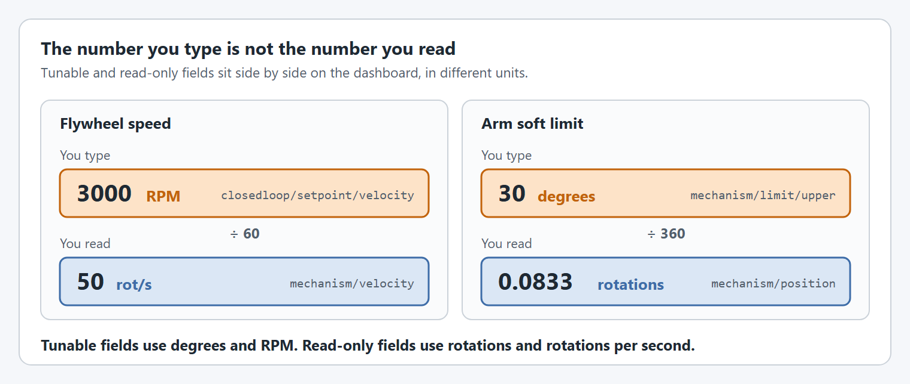
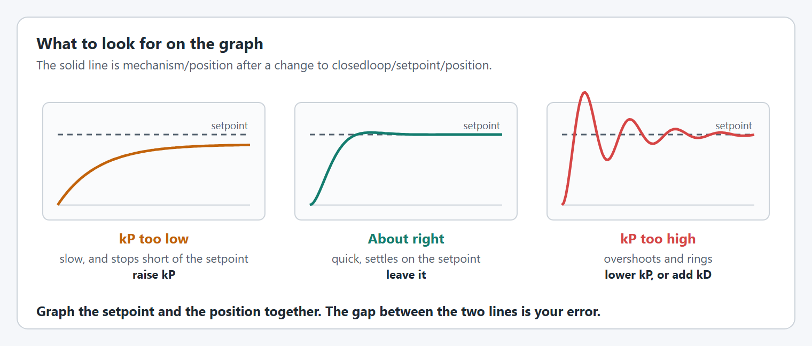

# Live tuning keys and units

This page lists where every live tuning value is published, which units it uses, and which value to watch when you change it. To learn how to start live tuning and the order to tune in, see [Live tuning](../how-to-tuning/live-tuning/).

## NetworkTables keys

Everything on this page is named by its NetworkTables key, which is what you see in AdvantageScope and Elastic.

| What                      | Where it is published                                                                                         |
| ------------------------- | ------------------------------------------------------------------------------------------------------------- |
| Values you type           | `NT:/Tuning/<Mechanism>/<Motor>/<key>`                                                                        |
| Values you watch          | `NT:/Mechanisms/<Mechanism>/<Motor>/<key>`                                                                    |
| The `Live Tuning` command | `NT:/Tuning/<Subsystem>/Live Tuning` (Commands v2) or `NT:/Tuning/<Mechanism name>/Live Tuning` (Commands v3) |

`<Mechanism>` and `<Motor>` are the names given to `withTelemetry(...)` on the mechanism config and on the `SmartMotorControllerConfig`. A motor controller used without a mechanism class has no `<Mechanism>` level.

The `Live Tuning` command is named differently. In Commands v2 it uses the subsystem's `getName()`, which is the class name unless you change it. In Commands v3 it uses the Commands v3 `Mechanism`'s `getName()`.

For example, the `ArmSubsystem` from the [Arm tutorial](../tutorials/arm/), whose mechanism is named `Arm` and whose motor is named `ArmMotor`:

* You start the command at `NT:/Tuning/ArmSubsystem/Live Tuning`.
* You type kP into `NT:/Tuning/Arm/ArmMotor/closedloop/feedback/kP`.
* You watch the arm at `NT:/Mechanisms/Arm/ArmMotor/mechanism/position`.


Some keys exist in both tables. `closedloop/setpoint/position` under `NT:/Tuning` is the setpoint you type. Under `NT:/Mechanisms` it is the setpoint the controller is using right now.


### The position and velocity to watch

Which keys hold the position and velocity depends on the mechanism.

| Mechanism                                                      | Position               | Velocity               | Units            |
| -------------------------------------------------------------- | ---------------------- | ---------------------- | ---------------- |
| Rotational: arms, pivots, turrets, flywheels                   | `mechanism/position`   | `mechanism/velocity`   | Rotations, rot/s |
| Linear: elevators, and anything with a mechanism circumference | `measurement/position` | `measurement/velocity` | Meters, m/s      |

The tables below write `mechanism/position` and `mechanism/velocity`. On a linear mechanism, read them as `measurement/position` and `measurement/velocity`.

## Units: what you type and what you read

Tunable fields and read-only fields do not use the same units.

<figure><figcaption>
The value you type is in the tunable unit, not the unit of the read-only field next to it.
</figcaption></figure>

| Quantity                                                             | You type (tunable fields)     | You read (read-only fields)   |
| -------------------------------------------------------------------- | ----------------------------- | ----------------------------- |
| Angular position                                                     | **Degrees**                   | **Rotations**                 |
| Angular velocity                                                     | **RPM**                       | **Rotations per second**      |
| Angular acceleration                                                 | **RPM per second**            | **Rotations per second²**     |
| Linear position, velocity, acceleration (linear closed loop control) | **Meters**, **m/s**, **m/s²** | **Meters**, **m/s**, **m/s²** |
| Voltage, current                                                     | **Volts**, **Amps**           | **Volts**, **Amps**           |
| Temperature                                                          | Not tunable                   | **Fahrenheit**                |

### See both in the same units with AdvantageScope

AdvantageScope can convert any read-only field for display, without changing the data or your robot code.

1. Drag the telemetry field, for example `NT:/Mechanisms/Arm/ArmMotor/mechanism/position`, into a Line Graph.
2. Right-click the field in the graph legend and choose **Convert Units…**
3. Pick the target unit: Rotations to Degrees, rot/s to RPM, Meters to Inches, and so on.

Now the graph shows degrees and RPM, the same units the tunable fields expect. When the graph shows 180°, you type `180`.


**Recommended setup for a tuning session**

* Convert `mechanism/position` and `closedloop/setpoint/position` to degrees. On a linear mechanism, convert `measurement/position` to inches if you prefer.
* Convert `mechanism/velocity` to RPM (or deg/s).
* Graph `closedloop/setpoint/position` and `mechanism/position` together. YAMS has no closed loop error field: the error is the gap between the two lines.
* Keep the graphs visible next to the tunable fields.


## What to tune and what to watch

Every tunable field has a read-only field that tells you whether your change worked.

<figure><figcaption>
What the position graph looks like after a setpoint change.
</figcaption></figure>



| You type (`NT:/Tuning`)  | Watch (`NT:/Mechanisms`)                                         | Why                                                                                                                                                          |
| ------------------------ | ---------------------------------------------------------------- | ------------------------------------------------------------------------------------------------------------------------------------------------------------ |
| `closedloop/feedback/kP` | `mechanism/position` vs `closedloop/setpoint/position`           | Error should shrink faster as kP rises. Oscillation means kP is too high.                                                                                    |
| `closedloop/feedback/kI` | `mechanism/position` vs `closedloop/setpoint/position` over time | Removes a steady error that never closes. Watch for windup: the error adds up while the mechanism cannot move, then pushes it past the setpoint once it can. |
| `closedloop/feedback/kD` | `mechanism/velocity`, `motor/outputVoltage`                      | Dampens oscillation. If voltage spikes on direction changes, kD is too high.                                                                                 |

For a velocity mechanism such as a flywheel, compare `mechanism/velocity` with `closedloop/setpoint/velocity` instead.

Gains are in volts per rotation of error (per meter for linear mechanisms). See [Gain units](keys-and-units.md#gain-units) below.



An [LQR](../understanding/lqr-controllers.md) (linear quadratic regulator) is a controller that works out its own feedback gains from a model of the mechanism and the errors you will accept. A motor controller configured with one has no kP, kI or kD fields. It publishes the LQR's own values in their place, under `closedloop/lqr/`. They only appear when the config has an LQR, and only the ones its type uses.

| You type (`NT:/Tuning`)           | Flywheel | Arm     | Elevator | Watch (`NT:/Mechanisms`)                               | Why                                                                                                  |
| --------------------------------- | -------- | ------- | -------- | ------------------------------------------------------ | ---------------------------------------------------------------------------------------------------- |
| `closedloop/lqr/qelms/position`   |          | Degrees | Meters   | `mechanism/position` vs `closedloop/setpoint/position` | The position error you tolerate. Lower it to close position error harder.                            |
| `closedloop/lqr/qelms/velocity`   | RPM      | RPM     | m/s      | `mechanism/velocity` vs `closedloop/setpoint/velocity` | The velocity error you tolerate. Lower it to damp overshoot, or on a flywheel to reach speed faster. |
| `closedloop/lqr/relms`            | Volts    | Volts   | Volts    | `motor/outputVoltage`                                  | The voltage the LQR treats as acceptable. Lower it for a gentler response.                           |
| `closedloop/lqr/model/position`   |          | Degrees | Meters   | `mechanism/position`                                   | How far you trust the model's position.                                                              |
| `closedloop/lqr/model/velocity`   | RPM      | RPM     | m/s      | `mechanism/velocity`                                   | How far you trust the model's velocity.                                                              |
| `closedloop/lqr/encoder/position` |          | Degrees | Meters   | `mechanism/position`                                   | How noisy the encoder's position is.                                                                 |
| `closedloop/lqr/encoder/velocity` | RPM      |         |          | `mechanism/velocity`                                   | How noisy the encoder's velocity is.                                                                 |
| `closedloop/lqr/maxVoltage`       | Volts    | Volts   | Volts    | `motor/outputVoltage`                                  | The most voltage the LQR outputs.                                                                    |

* **Units:** the same as the tunable setpoints, so an arm's tolerance of `5` is 5 degrees. The fields start at the values in your `LQRConfig`.
* **Retuning:** a change rebuilds the LQR from every field. The new LQR starts from the old one's state estimate, so the output doesn't jump, and it keeps holding the setpoint.
* **Bad values:** every value must be above 0. One the LQR can't use leaves it as it was, with a warning on the Driver Station naming the motor.
* **The feedforward is still tuned as usual.** The LQR only replaces kP, kI and kD. kS, kV, kG and kA are added on top of its output.

See [Tune it live](../how-to-tuning/how-do-i-use-lqr/#tune-it-live) for the order to change them in.



| You type (`NT:/Tuning`)                       | Watch (`NT:/Mechanisms`)                                                      | Why                                                                                                                                                                                                                             |
| --------------------------------------------- | ----------------------------------------------------------------------------- | ------------------------------------------------------------------------------------------------------------------------------------------------------------------------------------------------------------------------------- |
| `closedloop/feedforward/kS`                   | `motor/outputVoltage` at rest                                                 | Voltage to overcome static friction. Raise until the mechanism just starts to move.                                                                                                                                             |
| `closedloop/feedforward/kV`                   | `mechanism/velocity` vs `closedloop/setpoint/velocity`, `motor/outputVoltage` | With kP = 0, adjust until measured velocity matches the setpoint at steady state.                                                                                                                                               |
| `closedloop/feedforward/kA`                   | `mechanism/velocity` during the acceleration ramp                             | Improves tracking while a motion profile accelerates.                                                                                                                                                                           |
| `closedloop/feedforward/kG` (arms, elevators) | `mechanism/position`, `motor/outputVoltage`                                   | The voltage that holds the mechanism against gravity. Hold an arm level (an elevator mid travel) with kP and read the steady `motor/outputVoltage`: that is kG. See [Tuning order](../how-to-tuning/live-tuning/#tuning-order). |


For arms, `kG * cos(angle)` is applied: full kG when level (0°), none when vertical (±90°). YAMS handles the cosine for you.




All of these keys start with `closedloop/motionprofile/`.

| You type (`NT:/Tuning`) | Units                                | Watch (`NT:/Mechanisms`)                    | Why                                                                                                                                                                                                                             |
| ----------------------- | ------------------------------------ | ------------------------------------------- | ------------------------------------------------------------------------------------------------------------------------------------------------------------------------------------------------------------------------------- |
| `maxVelocity`           | RPM (or m/s)                         | `mechanism/velocity` while cruising         | The plateau speed. Raise to move faster; lower if the motor stalls while cruising.                                                                                                                                              |
| `maxAcceleration`       | RPM/s (or m/s²)                      | `current/stator`, `mechanism/velocity` ramp | How quickly speed builds. High acceleration means a current spike at the start.                                                                                                                                                 |
| `maxJerk`               | RPM/s²                               | Shape of `mechanism/velocity`               | Smooths the ramp when sudden acceleration causes mechanical shock.                                                                                                                                                              |
| `kV`, `kA`              | Same units as the feedforward kV, kA | `mechanism/velocity`                        | The system constants an [exponential profile](../understanding/exponential-profiles.md) plans with. An exponential profile plans each move from what the motor can actually do, instead of fixed speed and acceleration limits. |
| `maxInput`              | Volts                                | `motor/outputVoltage`                       | The most voltage the exponential profile will ask for.                                                                                                                                                                          |



| You type (`NT:/Tuning`)        | Units          | Watch (`NT:/Mechanisms`)                               | Why                                                                                                                                                            |
| ------------------------------ | -------------- | ------------------------------------------------------ | -------------------------------------------------------------------------------------------------------------------------------------------------------------- |
| `closedloop/setpoint/position` | Degrees (or m) | `mechanism/position` vs `closedloop/setpoint/position` | Send the mechanism to a position without a button binding.                                                                                                     |
| `closedloop/setpoint/velocity` | RPM (or m/s)   | `mechanism/velocity`, `motor/outputVoltage`            | Command a speed, for example to find kV without a full profile.                                                                                                |
| `closedloop/slot`              | Slot number    | `closedloop/slot`                                      | Switch which gain slot the controller uses. A [slot](editor/config/closed-loop-control.md#slots) is one of several sets of gains a motor controller can store. |

A value is applied when it changes. Typing the number that is already there does nothing, so to send the same setpoint again, type a different one first.



| You type (`NT:/Tuning`)                              | Units   | Watch (`NT:/Mechanisms`)                                 | Why                                                                                                                                                |
| ---------------------------------------------------- | ------- | -------------------------------------------------------- | -------------------------------------------------------------------------------------------------------------------------------------------------- |
| `mechanism/limit/lower`                              | Degrees | `mechanism/position`, `limits/mechanism/lower` (boolean) | The boolean turns true at the lower soft limit. Move the limit to change where it stops.                                                           |
| `mechanism/limit/upper`                              | Degrees | `mechanism/position`, `limits/mechanism/upper` (boolean) | The same for the upper soft limit.                                                                                                                 |
| `measurement/limit/lower`, `measurement/limit/upper` | Meters  | `measurement/position`                                   | Soft limits for linear mechanisms.                                                                                                                 |
| `current/limit/stator`                               | Amps    | `current/stator`, `mechanism/velocity`                   | Caps torque. Stator current is the current through the motor's windings, which sets its torque. Watch for speed sagging when the limit is too low. |
| `current/limit/supply`                               | Amps    | `current/supply`, `motor/outputVoltage`                  | Supply current is what the motor draws from the battery. Lower it if supply current spikes dip the voltage.                                        |

See [Limits and protection](editor/config/limits-and-protection.md) for what each limit does.



| You type (`NT:/Tuning`)         | Units              | Watch (`NT:/Mechanisms`)                        | Why                                                                          |
| ------------------------------- | ------------------ | ----------------------------------------------- | ---------------------------------------------------------------------------- |
| `ramprate/dutycycle/openloop`   | Seconds, 0 to 100% | `motor/outputVoltage` during open loop commands | Slows voltage changes in open loop. Reduces shock on `set(dutyCycle)`.       |
| `ramprate/dutycycle/closedloop` | Seconds, 0 to 100% | `motor/outputVoltage` during closed loop moves  | The same for closed loop, when a setpoint step causes a big voltage jump.    |
| `motor/inverted`                | Boolean            | `mechanism/velocity`                            | Flips the motor direction. Positive voltage should give a positive velocity. |
| `encoder/inverted`              | Boolean            | `mechanism/position`                            | Flips the encoder direction.                                                 |



| You type (`NT:/Tuning`) | Units   | Watch (`NT:/Mechanisms`)               | Why                                                                                                                                                           |
| ----------------------- | ------- | -------------------------------------- | ------------------------------------------------------------------------------------------------------------------------------------------------------------- |
| `voltage/enabled`       | Boolean | `motor/outputVoltage`                  | Drive the motor at `voltage/setpoint` instead of the closed loop. See [Drive a motor at a voltage](../how-to-tuning/live-tuning/#drive-a-motor-at-a-voltage). |
| `voltage/setpoint`      | Volts   | `mechanism/velocity`, `current/stator` | The voltage for the motor and its [loosely coupled followers](editor/config/followers.md#withlooselycoupledfollowers).                                        |




**Worth watching the whole time**

* `motor/temperature`: a hot motor backing off can look like a gain problem.
* `motor/outputVoltage`: the raw command the motor is getting. Confirms your feedforward math.
* `rotor/position`, `rotor/velocity`: values before gearing. Useful for checking the gearing is right.


Some settings are **not** tunable live and have to be changed in the config: the closed loop tolerance, voltage compensation, the closed loop maximum voltage and the temperature cutoff.

## Gain units

PID gains

| Gain | Unit      | Meaning                                                          |
| ---- | --------- | ---------------------------------------------------------------- |
| `kP` | V/rot     | Volts per rotation of position error. Linear mechanisms: V/m.    |
| `kI` | V/(rot·s) | Volts per accumulated position error over time. Linear: V/(m·s). |
| `kD` | V/(rot/s) | Volts per unit of velocity error. Linear: V/(m/s).               |

For position control the error is in rotations of the mechanism (or meters with linear closed loop control). For velocity control it is in rotations per second (or meters per second).

**What a kP means in practice.** A rotation is 360 degrees, so a kP of `50` on an arm is 50 V per rotation, or about 0.14 V for every degree of error. With the arm 10 degrees from its setpoint, kP asks for about 1.4 V. Divide by 360 to turn any kP into volts per degree.

Feedforward gains

| Gain | SimpleMotorFeedforward (flywheels) | ArmFeedforward (arms, pivots)                        | ElevatorFeedforward (elevators) |
| ---- | ---------------------------------- | ---------------------------------------------------- | ------------------------------- |
| `kS` | V, static friction                 | V, static friction                                   | V, static friction              |
| `kG` | Not used                           | V, holds the arm level; applied as `kG * cos(angle)` | V, constant against gravity     |
| `kV` | V/(rot/s)                          | V/(rot/s)                                            | V/(m/s)                         |
| `kA` | V/(rot/s²)                         | V/(rot/s²)                                           | V/(m/s²)                        |

In YAMS, `ArmFeedforward` uses rotations for kV and kA, like the other feedforward types.

LQR values

| Field, under `closedloop/lqr/`                         | Flywheel | Arm      | Elevator |
| ------------------------------------------------------ | -------- | -------- | -------- |
| `qelms/position`, `model/position`, `encoder/position` | Not used | Degrees  | Meters   |
| `qelms/velocity`, `model/velocity`                     | RPM      | RPM      | m/s      |
| `encoder/velocity`                                     | RPM      | Not used | Not used |
| `relms`, `maxVoltage`                                  | Volts    | Volts    | Volts    |

In code, `LQRConfig` keeps these in radians, rad/s, meters and m/s. YAMS converts them for the dashboard.

Motion profile settings in code

| Profile     | Setting          | Unit in code                                                  |
| ----------- | ---------------- | ------------------------------------------------------------- |
| Trapezoidal | Max velocity     | Any WPILib angular velocity (or linear velocity) unit         |
| Trapezoidal | Max acceleration | Any WPILib angular acceleration (or linear acceleration) unit |
| Exponential | Max input        | Volts                                                         |
| Exponential | kV, kA           | V/(rot/s), V/(rot/s²)                                         |

On the dashboard, the trapezoidal values are typed in RPM and RPM per second, as in the Motion profile tab above.

Next: go back to [Live tuning](../how-to-tuning/live-tuning/) and follow the [Tuning order](../how-to-tuning/live-tuning/#tuning-order) for your mechanism.

## Units of each key

### Read-only and tunable keys

Read-only keys are under `NT:/Mechanisms`. Keys marked **tunable** also have an editable copy under `NT:/Tuning`, typed in different units, shown in the last column.

| NetworkTables key                                   | Unit (read)                                    | Description                                                                                                                                        | Tunable copy under `NT:/Tuning`           |
| --------------------------------------------------- | ---------------------------------------------- | -------------------------------------------------------------------------------------------------------------------------------------------------- | ----------------------------------------- |
| `mechanism/position`                                | Rotations (rot)                                | Position of the mechanism output shaft                                                                                                             | No                                        |
| `mechanism/velocity`                                | Rotations per second (rot/s)                   | Velocity of the mechanism output shaft                                                                                                             | No                                        |
| `rotor/position`                                    | Rotations (rot)                                | Position of the motor rotor, before gearing                                                                                                        | No                                        |
| `rotor/velocity`                                    | Rotations per second (rot/s)                   | Velocity of the motor rotor                                                                                                                        | No                                        |
| `rotor/gearRatio`                                   | None                                           | Rotor rotations per mechanism rotation, the gear ratio YAMS converts with: 60 for a 60:1 arm. Divide a `rotor/` value by it to get the mechanism's | No                                        |
| `closedloop/setpoint/position`                      | Rotations, or meters for linear mechanisms     | Closed loop position target                                                                                                                        | **Tunable**, typed in degrees (or meters) |
| `closedloop/setpoint/velocity`                      | rot/s, or m/s                                  | Closed loop velocity target                                                                                                                        | **Tunable**, typed in RPM (or m/s)        |
| `mechanism/limit/lower`, `mechanism/limit/upper`    | Not published                                  | Soft limits                                                                                                                                        | **Tunable only**, typed in degrees        |
| `closedloop/feedback/*`, `closedloop/feedforward/*` | See [Gain units](keys-and-units.md#gain-units) | Gains                                                                                                                                              | **Tunable only**                          |
| `motor/outputVoltage`                               | Volts (V)                                      | Voltage being applied to the motor                                                                                                                 | No                                        |
| `closedloop/period`                                 | Seconds (s)                                    | How often the closed loop runs: 1 ms on the motor controller, or the closed loop control period on the SystemCore                                  | No                                        |
| `current/supply`                                    | Amps (A)                                       | Current drawn from the battery                                                                                                                     | No (`current/limit/supply` is tunable)    |
| `current/stator`                                    | Amps (A)                                       | Current through the motor windings, which sets its torque                                                                                          | No (`current/limit/stator` is tunable)    |
| `motor/temperature`                                 | Fahrenheit (°F)                                | Motor temperature                                                                                                                                  | No                                        |

### LQR keys

A motor controller configured with an [LQR](../understanding/lqr-controllers.md) publishes its values at `HIGH`, in place of kP, kI and kD, and only the ones its type uses. They are **tunable only**, under `NT:/Tuning`, and use the same units as the tunable setpoints.

| NetworkTables key                                                | Unit                                               | Description                                                |
| ---------------------------------------------------------------- | -------------------------------------------------- | ---------------------------------------------------------- |
| `closedloop/lqr/qelms/position`                                  | Degrees, or meters for an elevator                 | Position error tolerance. Arm and elevator only            |
| `closedloop/lqr/qelms/velocity`                                  | RPM, or m/s for an elevator                        | Velocity error tolerance                                   |
| `closedloop/lqr/relms`                                           | Volts (V)                                          | Control effort tolerance                                   |
| `closedloop/lqr/model/position`, `closedloop/lqr/model/velocity` | Degrees and RPM, or meters and m/s for an elevator | Model standard deviations. Position: arm and elevator only |
| `closedloop/lqr/encoder/position`                                | Degrees, or meters for an elevator                 | Encoder standard deviation. Arm and elevator only          |
| `closedloop/lqr/encoder/velocity`                                | RPM                                                | Encoder standard deviation. Flywheel only                  |
| `closedloop/lqr/maxVoltage`                                      | Volts (V)                                          | Most voltage the LQR outputs                               |

### ADRC keys

A motor controller configured with an [ADRC](../understanding/adrc-controllers/) publishes its values at `HIGH`, in place of kP, kI and kD. The first three are also **tunable** under `NT:/Tuning`; the rest are read-only, under `NT:/Mechanisms`. The applied voltage is `motor/outputVoltage`.

| NetworkTables key                   | Unit                                                                 | Description                                                      | Tunable copy under `NT:/Tuning` |
| ----------------------------------- | -------------------------------------------------------------------- | ---------------------------------------------------------------- | ------------------------------- |
| `closedloop/adrc/b0`                | Mechanism rotations, or meters for an elevator, per s or s² per volt | How strongly a volt moves the mechanism                          | **Tunable**                     |
| `closedloop/adrc/settlingTime`      | Seconds (s)                                                          | How quickly it reaches a setpoint                                | **Tunable**                     |
| `closedloop/adrc/bandwidthScale`    | None                                                                 | Scales both bandwidths                                           | **Tunable**                     |
| `closedloop/adrc/disturbance`       | The loop's units per s or s², like `b0`                              | The total disturbance the observer estimates                     | No                              |
| `closedloop/adrc/bandwidth`         | Radians per second (rad/s)                                           | The feedback's bandwidth                                         | No                              |
| `closedloop/adrc/observerBandwidth` | Radians per second (rad/s)                                           | The observer's bandwidth, 4 × the bandwidth                      | No                              |
| `closedloop/adrc/systemOrder`       | None                                                                 | The order it runs: 1 or 2 for a position loop, chosen at startup | No                              |

### Linear mechanism keys

When a mechanism has a circumference (from `.withMechanismCircumference()`, or one of the `.withWheelDiameter()`, `.withWheelRadius()` or `.withDrumRadius()` helpers), the linear keys are published too:

| NetworkTables key                                    | Unit                    | Description                                                       |
| ---------------------------------------------------- | ----------------------- | ----------------------------------------------------------------- |
| `measurement/position`                               | Meters (m)              | Linear position of the mechanism                                  |
| `measurement/circumference`                          | Meters (m)              | Meters the mechanism moves per mechanism rotation                 |
| `measurement/velocity`                               | Meters per second (m/s) | Linear velocity of the mechanism                                  |
| `measurement/limit/lower`, `measurement/limit/upper` | Meters (m)              | Soft limits in linear units. **Tunable only**, under `NT:/Tuning` |

Linear units are calculated from rotational units using your configured circumference: `linear = rotational × circumference`.
