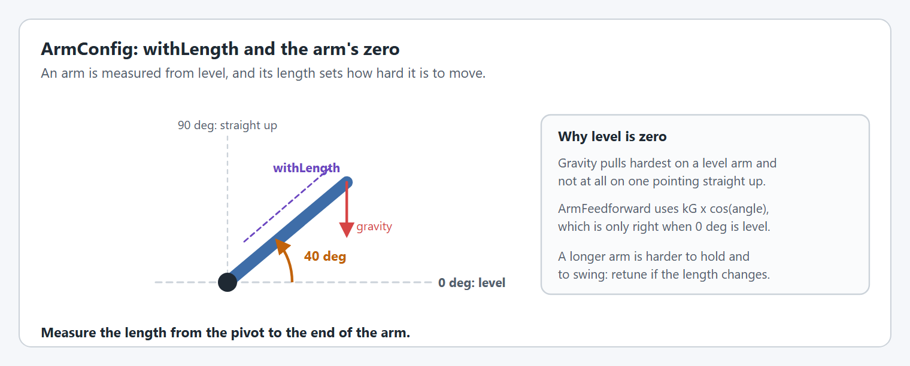

# ArmConfig

An arm is a mechanism that swings about a pivot and has to hold itself up against gravity. The [Arms](../../understanding/arms.md) page shows a complete arm.

`ArmConfig` has the [shared options](shared-options.md) and one of its own.

## `withLength`

The length of the arm, from the pivot to its end.

<figure><figcaption><p>An arm's angle is measured from level, and its length sets how hard it is to move.</p></figcaption></figure>

```java
new ArmConfig().withLength(Feet.of(3));
```

The simulation uses the length for its physics and for the drawing. A longer arm is harder to hold and to swing, so retune the gains if the length changes.

**Used in:** simulation only. **Required** for an `Arm` to be created in simulation.

## Zero is level

Angles on an `Arm` are measured from level: 0° is parallel to the ground and 90° is straight up. That is what [`ArmFeedforward`](../editor/config/feedforward.md#withfeedforward) expects, and it is why an arm's encoder must read 0 when the arm is level.

* With an absolute encoder, set its [zero offset](../editor/config/encoders.md#withexternalencoderzerooffset) so it reads 0 when the arm is level.
* Without one, set a [starting position](../editor/config/encoders.md#withstartingposition) and always turn the robot on with the arm there.

## What else an arm needs

| For                            | Use                                                                                                              |
| ------------------------------ | ---------------------------------------------------------------------------------------------------------------- |
| The physical stops             | [`withHardLimits`](shared-options.md#withhardlimits) on `ArmConfig`                                              |
| The limits the motor obeys     | [`withSoftLimits`](../editor/config/limits-and-protection.md#withsoftlimits) on the motor config                 |
| The arm's weight in simulation | [`withMomentOfInertia(length, mass)`](../editor/config/simulation.md#withmomentofinertia) on the motor config    |
| Holding against gravity        | [`ArmFeedforward`](../editor/config/feedforward.md#withfeedforward) with `kG`                                    |
| An absolute encoder            | [How do I use absolute encoders on my arm?](../../how-to-mechanisms/how-do-i-use-absolute-encoders-on-my-arm.md) |

## Code reference

* [`ArmConfig`](https://github.com/Yet-Another-Software-Suite/YAMS/blob/master/yams/java/yams/core/mechanisms/config/ArmConfig.java)
* [`Arm`](https://github.com/Yet-Another-Software-Suite/YAMS/blob/master/yams/java/yams/core/mechanisms/positional/Arm.java)
