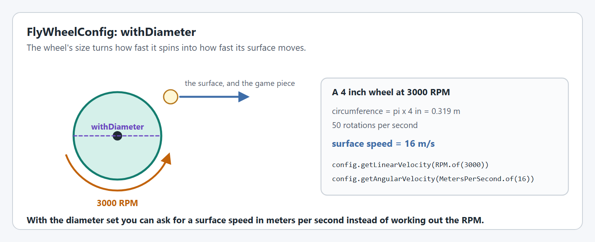
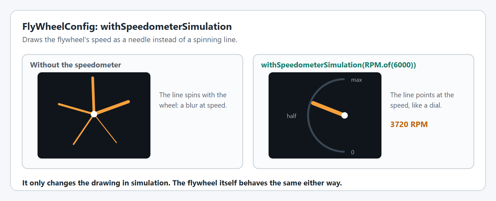

# FlyWheelConfig

A flywheel is anything that spins to a speed: shooters, rollers, intakes, feeders and indexers. The [Shooters](../../understanding/shooters.md) page shows a complete flywheel.

`FlyWheelConfig` has the [shared options](shared-options.md) except hard limits, and two of its own.

## `withDiameter`

The diameter of the wheel.

<figure><figcaption><p>The diameter converts rotation speed to surface speed.</p></figcaption></figure>

```java
FlyWheelConfig config = new FlyWheelConfig().withDiameter(Inches.of(4));

LinearVelocity  surface = config.getLinearVelocity(RPM.of(3000));
AngularVelocity spin    = config.getAngularVelocity(MetersPerSecond.of(16));
```

It is used for the drawing, and to convert between how fast the wheel spins and how fast its surface moves. The conversions throw a `FlyWheelConfigurationException` if no diameter is set.

**Used in:** simulation and on the real robot. The conversions work on the real robot. The drawing is simulation only.

## `withSpeedometerSimulation`

Draws the flywheel's speed as a needle instead of a line that spins with the wheel.

<figure><figcaption><p>The flywheel's Mechanism2d with and without the speedometer.</p></figcaption></figure>

```java
new FlyWheelConfig().withSpeedometerSimulation(RPM.of(6000)); // the speed at the top of the dial
```

Give it the fastest speed you expect. `disableSpeedometerSimulation()` turns it back off.

`withSpeedometerSimulation()`, with no speed, turns it back on with the speed you gave before, for example on a copy of a config that had it turned off. It throws a `FlyWheelConfigurationException` if no speed was ever given.

**Used in:** simulation only.

## What else a flywheel needs

| For                                  | Use                                                                                                      |
| ------------------------------------ | -------------------------------------------------------------------------------------------------------- |
| How heavy the wheel is in simulation | [`withMomentOfInertia`](../editor/config/simulation.md#withmomentofinertia) on the motor config          |
| Holding a speed                      | [`SimpleMotorFeedforward`](../editor/config/feedforward.md#withfeedforward) with `kV`, plus a small `kP` |
| A smooth spin up                     | [A velocity profile](../editor/config/motion-profiles.md#velocity-profiles-for-flywheels)                |
| A roller that only needs a voltage   | [`ControlMode.OPEN_LOOP`](../editor/config/motor-basics.md#withcontrolmode)                              |
| Coasting when stopped                | [`MotorMode.COAST`](../editor/config/motor-basics.md#withzeropower)                                      |

## Code reference

* [`FlyWheelConfig`](https://github.com/Yet-Another-Software-Suite/YAMS/blob/master/yams/java/yams/core/mechanisms/config/FlyWheelConfig.java)
* [`FlyWheel`](https://github.com/Yet-Another-Software-Suite/YAMS/blob/master/yams/java/yams/core/mechanisms/velocity/FlyWheel.java)
