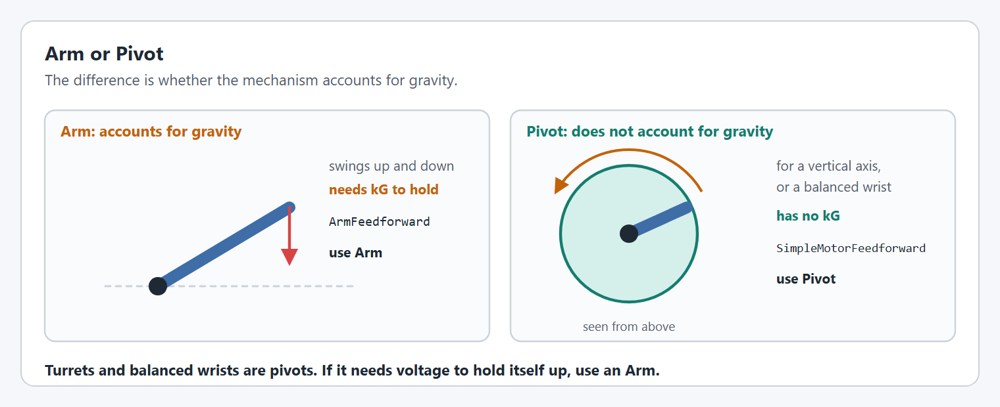

# PivotConfig

A pivot is a rotating mechanism such as a turret or a wrist. It is different from an arm because it does not account for gravity. The [Turrets/Wrists](../../understanding/turrets-wrists.md) page shows a complete pivot.

<figure><figcaption><p>An Arm accounts for gravity. A Pivot does not.</p></figcaption></figure>

`PivotConfig` has only the [shared options](shared-options.md): telemetry, hard limits, color and position. Everything else about a pivot is on its motor config.

```java
new PivotConfig()
    .withHardLimits(Degrees.of(-200), Degrees.of(200)) // wiring stops it spinning forever
    .withTelemetry("Turret", TelemetryVerbosity.HIGH);
```

## What else a pivot needs

| For                                      | Use                                                                                                                                |
| ---------------------------------------- | ---------------------------------------------------------------------------------------------------------------------------------- |
| The physical stops                       | [`withHardLimits`](shared-options.md#withhardlimits). **Required** in simulation.                                                  |
| A turret that can spin all the way round | [`withContinuousWrapping`](../editor/config/closed-loop-control.md#withcontinuouswrapping) on the motor config, and no soft limits |
| A turret limited by its wiring           | [`withSoftLimits`](../editor/config/limits-and-protection.md#withsoftlimits) on the motor config                                   |
| The pivot's weight in simulation         | [`withMomentOfInertia`](../editor/config/simulation.md#withmomentofinertia) on the motor config                                    |
| Feedforward                              | [`SimpleMotorFeedforward`](../editor/config/feedforward.md#withfeedforward): a pivot has no `kG`                                   |
| A turret geared to turn more than once   | [EasyCRT](../../understanding/easycrt.md)                                                                                          |

## Code reference

* [`PivotConfig`](https://github.com/Yet-Another-Software-Suite/YAMS/blob/master/yams/java/yams/core/mechanisms/config/PivotConfig.java)
* [`Pivot`](https://github.com/Yet-Another-Software-Suite/YAMS/blob/master/yams/java/yams/core/mechanisms/positional/Pivot.java)
