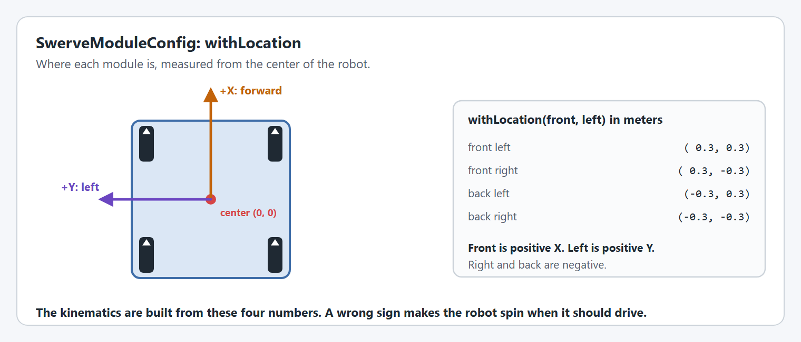
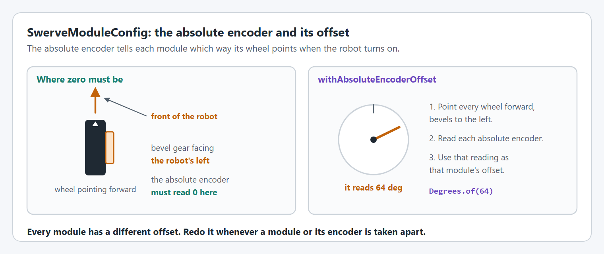
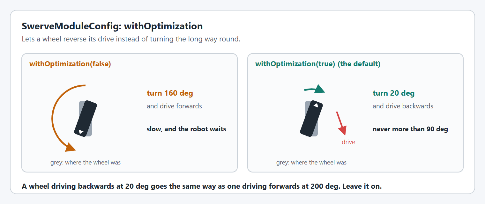
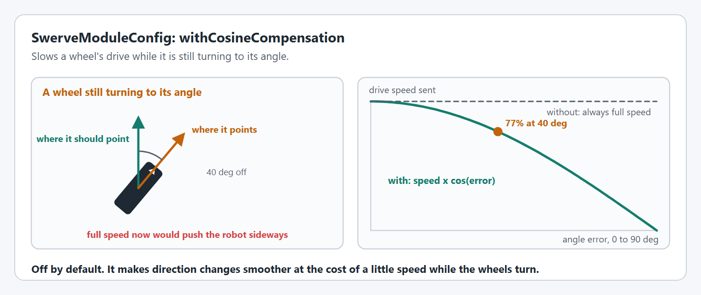
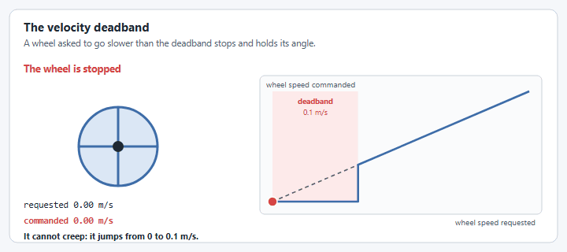
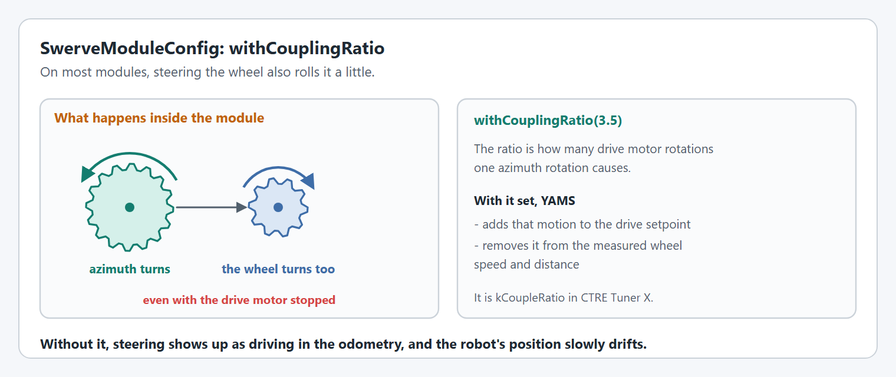

# SwerveModuleConfig

`SwerveModuleConfig` describes one swerve module: its two motors, where it is on the robot, and how its wheel is steered. The [Swerve Module](../../understanding/swerve-drive/swerve-module.md) page shows a complete module.

Every option on this page is used on the real robot and in simulation.

## The two motors

A module is built from a drive `SmartMotorController` and an azimuth `SmartMotorController`, each with its own [`SmartMotorControllerConfig`](../editor/config/).

```java
SwerveModuleConfig config = new SwerveModuleConfig(driveMotor, azimuthMotor);
```

The drive motor's config needs the wheel size, with [`withWheelRadius` or `withWheelDiameter`](../editor/config/gearing-and-units.md#withmechanismcircumference). `SwerveModuleConfig.withWheelRadius` and `withWheelDiameter` set the same thing from here, but the motor config is the better place for it. The azimuth motor's config usually has [`withContinuousWrapping`](../editor/config/closed-loop-control.md#withcontinuouswrapping), so that the wheel takes the short way round from 170 degrees to -170.

## Directions and inversion

Every direction on a swerve module follows WPILib's convention: angles are counter-clockwise positive, seen from above, and a positive wheel speed drives the robot forward when the wheel points forward. There is no inversion option on `SwerveModuleConfig` itself: each direction is set where its sensor or motor is configured.

| What             | Must be                                                               | Set it with                                                                                                                                                                                     |
| ---------------- | --------------------------------------------------------------------- | ----------------------------------------------------------------------------------------------------------------------------------------------------------------------------------------------- |
| Azimuth motor    | A positive command turns the wheel counter-clockwise, seen from above | `withMotorInverted(...)` on the azimuth motor's `SmartMotorControllerConfig`                                                                                                                    |
| Drive motor      | A positive speed rolls the wheel forward when it points forward       | `withMotorInverted(...)` on the drive motor's `SmartMotorControllerConfig`                                                                                                                      |
| Absolute encoder | Its reading goes up as the wheel turns counter-clockwise              | The encoder's own direction setting, such as a `CANcoder`'s sensor direction in Phoenix Tuner X, or `withExternalEncoderInverted(...)` for an encoder passed with `withAbsoluteEncoder(Object)` |
| Gyro             | The heading goes up as the robot turns counter-clockwise              | [`withGyroInverted`](swerve-drive-config.md#the-gyro) on the `SwerveDriveConfig`                                                                                                                |

A wheel that points the right way but rolls backward is usually not inverted: its absolute encoder offset is 180 degrees off. [Step 5: On the real robot](../../tutorials/swerve-drive/real-robot.md#check-the-directions) checks each direction in turn.

## `withLocation`

Where the module is, measured from the center of the robot.

<figure><figcaption><p>Module locations: X is forward and Y is left.</p></figcaption></figure>

```java
config.withLocation(Meters.of(0.3), Meters.of(0.3));  // front, left
config.withLocation(Meters.of(0.42), Degrees.of(45)); // distance and angle from the center
```

`withDistanceFromCenterOfRotation(front, left)` is the same as the first form. Every module needs a location: a missing or wrong one gives wrong kinematics, not an error. See [Module Location Drives the Kinematics](../../understanding/swerve-drive/#module-location-drives-the-kinematics).

## The absolute encoder

<figure><figcaption><p>Zero is the wheel pointing forward with the bevel to the left.</p></figcaption></figure>

The absolute encoder tells the module which way its wheel points when the robot turns on. Set it with one of the two forms of `withAbsoluteEncoder`, then give it an offset.

### `withAbsoluteEncoder(Supplier<Angle>)`

An absolute encoder from **any vendor**, read by your code. The module reads it once at startup and sets the azimuth motor's own encoder from it.

```java
config.withAbsoluteEncoder(canCoder.getAbsolutePosition().asSupplier());
```

A `DoubleSupplier` in rotations works too. This is the form the [Swerve Drive tutorial](../../tutorials/swerve-drive/) uses, with a `CANcoder` on a `SparkMax` azimuth.

### `withAbsoluteEncoder(Object)`

An absolute encoder from the **same vendor** as the azimuth motor, read by the motor controller itself, such as a `CANcoder` on a `TalonFX`. The azimuth motor's closed loop then runs on the absolute encoder.

```java
config.withAbsoluteEncoder(new CANcoder(11, new CANBus(CANPort.CAN_S0)));
```


This form only accepts an encoder the azimuth motor controller can read itself: see the [encoders each controller accepts](../editor/config/encoders.md#withexternalencoder). The azimuth motor's `SmartMotorControllerConfig` must also have `withUseExternalFeedbackEncoder(true)`: without it, `new SwerveModule(...)` throws a `SmartMotorControllerConfigurationException`. For any other encoder use the `Supplier<Angle>` form.


[Absolute Encoder Wiring](../../understanding/swerve-drive/swerve-module.md#absolute-encoder-wiring) covers both forms in detail.

### `withAbsoluteEncoderOffset`

The absolute encoder's reading when the wheel points straight forward with its bevel gear to the robot's left. YAMS subtracts it, so the module reads 0 there.

```java
config.withAbsoluteEncoderOffset(Degrees.of(64));
```

**The rule:** the offset is the raw reading itself, with the same sign. Point the wheel forward, bevel gear left, read `NT:/Mechanisms/<drive name>/modules/<module name>/encoder` (the raw reading in degrees, with no offset applied), and pass that number. Every module has its own. If a module then drives backward while the others drive forward, its bevel gear faced right when you read it: add 180 degrees. [Step 5: On the real robot](../../tutorials/swerve-drive/real-robot.md#set-the-absolute-encoder-offsets) walks through it.

### `withAbsoluteEncoderGearing`

For an absolute encoder that does not turn once per turn of the wheel's steering. Most modules mount it 1:1 and do not need this.

```java
config.withAbsoluteEncoderGearing(new GearBox(new double[]{1.5}));
```

## `withOptimization`

Lets a wheel reverse its drive instead of turning more than 90°. It is on by default.

<figure><figcaption><p>Turning 160° without optimization, 20° with it.</p></figcaption></figure>

```java
config.withOptimization(true);
```

[`SwerveDriveConfig.withModuleStateOptimization`](swerve-drive-config.md#withmodulestateoptimization) overrides it on every module at once. [The Flip-Decision Feedback Loop](../../understanding/swerve-drive/swerve-module.md#the-flip-decision-feedback-loop) explains how a wheel avoids flipping back and forth.

## `withCosineCompensation`

Slows a wheel's drive while it is still turning to its angle. It is off by default.

<figure><figcaption><p>Drive speed scaled by the cosine of the angle error.</p></figcaption></figure>

```java
config.withCosineCompensation(true);
```

## `withVelocityDeadband`

A wheel asked to go slower than this stops and holds its angle. The default is 0.1 m/s.

<figure><figcaption><p>Requested and commanded wheel speed with the default deadband.</p></figcaption></figure>

```java
config.withVelocityDeadband(MetersPerSecond.of(0.05));
```

[Velocity Deadband](../../understanding/swerve-drive/swerve-module.md#velocity-deadband) explains why it exists and what it costs when the robot is meant to creep.

## `withCouplingRatio`

Compensates for steering also rolling the wheel.

<figure><figcaption><p>Turning the azimuth turns the wheel through the drive gearing.</p></figcaption></figure>

```java
config.withCouplingRatio(3.5); // drive motor rotations per azimuth rotation
```

It depends on the module's gearing, and some modules do not need it. See [Steer to Drive Coupling](../../understanding/swerve-drive/swerve-module.md#steer-to-drive-coupling).

## `withTelemetry`

Names the module and chooses what it publishes. The name appears under the drive's `modules` table.

```java
config.withTelemetry("frontleft", TelemetryVerbosity.HIGH);
```

[Module Telemetry](../../understanding/swerve-drive/swerve-module.md#module-telemetry) lists the keys, and [tuning the swerve modules](../../how-to-tuning/live-tuning/swerve-drive.md#tune-the-swerve-modules) uses them.

## Code reference

* `SwerveModuleConfig`
* `SwerveModule`
