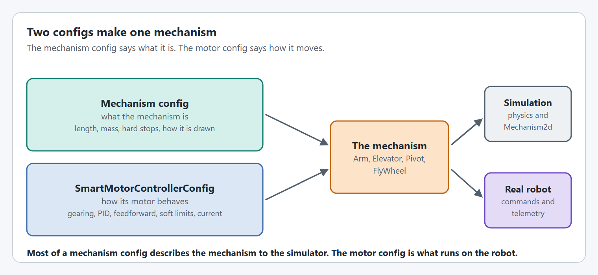
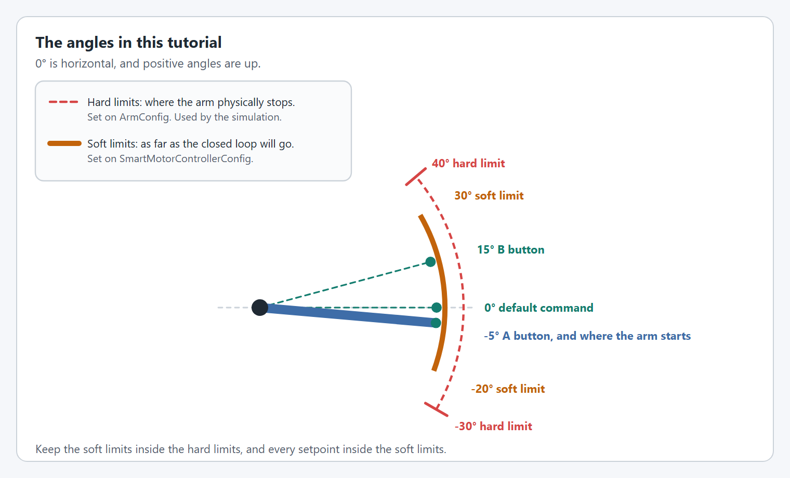

# Step 2: The arm

The `SmartMotorController` from step 1 is configured, but nothing tells it to move yet. An `Arm` adds what makes it an arm: a physics simulation, a drawing of the mechanism for your dashboard, and the commands and triggers you will use in step 3.

<figure><figcaption><p>Two configs go into one mechanism.</p></figcaption></figure>


**In a hurry?** Jump to [the complete file](mechanism.md#the-complete-file), copy it, and change the values called out under **For your robot**. The numbered parts explain each piece in a sentence or two. You do not need to understand all of it to get moving: the pages under **Understanding** go deeper when you want them.




### Describe the arm

`ArmConfig` describes the arm itself: its length and its hard limits. The simulation uses both. The hard limits are where the arm physically stops, which is different from the soft limits you set in step 1.

<figure><figcaption><p>The soft limits from step 1 sit inside the hard limits from this step.</p></figcaption></figure>




```java
private final ArmConfig armConfig = new ArmConfig()
    // The hard stops, used by the simulation.
    .withHardLimits(Degrees.of(-30), Degrees.of(40))
    // The length of the arm, used by the simulation.
    .withLength(Feet.of(3))
    // Telemetry name and how much to publish.
    .withTelemetry("Arm", TelemetryVerbosity.HIGH);
```





```java
private final ArmConfig armConfig = new ArmConfig()
    // The hard stops, used by the simulation.
    .withHardLimits(Degrees.of(-30), Degrees.of(40))
    // The length of the arm, used by the simulation.
    .withLength(Feet.of(3))
    // Telemetry name and how much to publish.
    .withTelemetry("Arm", TelemetryVerbosity.HIGH);
```





```cpp
// The arm mechanism and its config, also set up in the constructor.
yams::mechanisms::config::ArmConfig m_armConfig;
std::optional<yams::mechanisms::positional::Arm> m_arm;
```



```cpp
m_armConfig
    // The hard stops, used by the simulation.
    .WithMinAngle(-30_deg)
    .WithMaxAngle(40_deg)
    // The length of the arm, used by the simulation.
    .WithArmLength(3_ft)
    // Telemetry name.
    .WithTelemetryName("Arm");
```




**For your robot:** Set the length of your arm, and where its hard stops are.

Want the details? [Arms](../../understanding/arms.md) and [ArmConfig](../../reference/mechanism-configs/arm-config.md)



### Create the Arm

Hand the config, and the `SmartMotorController` from step 1, to the `Arm`.




```java
// The arm mechanism.
private final Arm arm = new Arm(armConfig, motor);
```





```java
// The arm mechanism.
private final Arm arm = new Arm(armConfig, motor);
```





```cpp
// The arm mechanism.
m_arm.emplace(&m_armConfig, &m_motor.value());
```






### Update it every loop

Two calls keep the mechanism alive. `updateTelemetry()` publishes its telemetry and applies anything you change through live tuning. `simIterate()` runs the physics simulation, and only needs to run in simulation.

In Commands v2 and C++ the scheduler calls a subsystem's periodic methods for you, so there is nothing more to do.

In Commands v3 nothing calls a `Mechanism` every loop, so `Robot.java` does it. `Robot.java` has the two functions you need:

* **`robotPeriodic()`** runs every loop, on the robot and in simulation. Call the mechanism's `periodic()` here, before `scheduler.run()`, so that the commands see fresh values.
* **`simulationInit()`** runs once, when the simulation starts. The template does not have it yet, so add it, and start the mechanism's `simulationPeriodic()` here with `startSimulation(...)`, which runs it in its own `Notifier` every loop, in simulation only. That keeps the simulation from adding to the robot loop's time, as [Where the tutorials put things](../project-setup/#where-the-tutorials-put-things) explains.

Every mechanism you add to the robot gets one line in each of the two.

Two smaller changes tidy up the template while you are here. Keep `Scheduler.getDefault()` in a `scheduler` attribute instead of asking for it every loop, and publish the scheduler with `Telemetry.log(...)` after it runs, so that a dashboard shows which commands are running and which mechanisms they hold.




```java
@Override
public void periodic() {
  // Publishes the arm's telemetry, and applies anything changed through live tuning.
  arm.updateTelemetry();
}

@Override
public void simulationPeriodic() {
  // Runs the arm's physics simulation.
  arm.simIterate();
}
```





```java
/** Call this from Robot.robotPeriodic(), before the scheduler runs. */
public void periodic() {
  // Publishes the arm's telemetry, and applies anything changed through live tuning.
  arm.updateTelemetry();
}

/** Robot.simulationInit() runs this in its own Notifier, every robot loop. */
public void simulationPeriodic() {
  // Runs the arm's physics simulation.
  arm.simIterate();
}
```



```java
import java.util.ArrayList;
import java.util.List;
import org.wpilib.system.Notifier;
import org.wpilib.telemetry.Telemetry;
import first.robot.mechanisms.ArmMechanism;

public class Robot extends OpModeRobot {
  // ...
  final ArmMechanism arm = new ArmMechanism();
  // ...

  // The scheduler that runs every command.
  private final Scheduler scheduler = Scheduler.getDefault();
  // Each mechanism's simulation Notifier, kept so that it is not garbage collected.
  private final List<Notifier> simulationNotifiers = new ArrayList<>();

  // ...

  @Override
  public void robotPeriodic() {
    // Runs every loop, on the robot and in simulation.
    // Update the mechanism before the scheduler runs its commands.
    arm.periodic();
    scheduler.run();
    // Publish the scheduler, so that a dashboard shows which commands are running.
    Telemetry.log("Scheduler", scheduler, Scheduler.proto);
  }

  @Override
  public void simulationInit() {
    // Runs once, when the simulation starts.
    // Run each mechanism's simulation in its own Notifier, every robot loop.
    startSimulation("Arm", arm::simulationPeriodic);
  }

  /** Runs a mechanism's simulation in its own Notifier, every robot loop period. */
  private void startSimulation(String name, Runnable simulationPeriodic) {
    Notifier notifier = new Notifier(simulationPeriodic);
    notifier.setName(name + " Simulation");
    notifier.startPeriodic(getPeriod());
    simulationNotifiers.add(notifier);
  }
}
```





```cpp
void Periodic() override;
void SimulationPeriodic() override;
```



```cpp
void ArmSubsystem::Periodic() {
  // Publishes the arm's telemetry, and applies anything changed through live tuning.
  m_arm->UpdateTelemetry();
}

void ArmSubsystem::SimulationPeriodic() {
  // Runs the arm's physics simulation.
  m_arm->SimIterate();
}
```






## The complete file



The highlighted lines are new in this step.

`ArmSubsystem` extends `SubsystemBase`, so the scheduler calls `periodic()` and `simulationPeriodic()` for you.

<pre class="language-java" data-title="subsystems/ArmSubsystem.java" data-line-numbers><code class="lang-java">package first.robot.subsystems;

import static org.wpilib.units.Units.Amps;
import static org.wpilib.units.Units.Degrees;
import static org.wpilib.units.Units.DegreesPerSecond;
import static org.wpilib.units.Units.DegreesPerSecondPerSecond;
<strong>import static org.wpilib.units.Units.Feet;
</strong>
import com.revrobotics.spark.SparkLowLevel.MotorType;
import com.revrobotics.spark.SparkMax;
import org.wpilib.command2.SubsystemBase;
import org.wpilib.hardware.bus.CANPort;
import org.wpilib.math.controller.ArmFeedforward;
import org.wpilib.math.system.DCMotor;
import yams.commands2.config.SmartMotorControllerConfig;
<strong>import yams.commands2.mechanisms.Arm;
</strong>import yams.core.gearing.GearBox;
import yams.core.gearing.MechanismGearing;
<strong>import yams.core.mechanisms.config.ArmConfig;
</strong>import yams.core.motorcontrollers.SmartMotorController;
import yams.core.motorcontrollers.enums.ControlMode;
import yams.core.motorcontrollers.enums.MotorMode;
import yams.core.motorcontrollers.local.SparkWrapper;
import yams.core.telemetry.enums.TelemetryVerbosity;

public class ArmSubsystem extends SubsystemBase {

  // What the motor controller should do: its control mode, gains, gearing and limits.
  private final SmartMotorControllerConfig smcConfig = new SmartMotorControllerConfig(this)
      .withControlMode(ControlMode.CLOSED_LOOP)
      // Feedback constants (PID), on the real robot and in simulation.
      .withClosedLoopController(50, 0, 0)
      .withSimClosedLoopController(50, 0, 0)
      // The fastest the closed loop is allowed to move and accelerate the arm.
      .withTrapezoidalProfile(DegreesPerSecond.of(90), DegreesPerSecondPerSecond.of(45))
      // Feedforward constants, on the real robot and in simulation.
      .withFeedforward(new ArmFeedforward(0, 0, 0))
      .withSimFeedforward(new ArmFeedforward(0, 0, 0))
      // Gearing from the motor rotor to the arm: a 3:1 stage and a 4:1 stage, 12:1 in total.
      .withGearing(new MechanismGearing(GearBox.fromReductionStages(3, 4)))
      .withMotorInverted(false)
      .withZeroPower(MotorMode.BRAKE)
      .withStatorCurrentLimit(Amps.of(40))
      // Where the arm is when the robot turns on.
      .withStartingPosition(Degrees.of(-5))
      // The closed loop will not take the arm past these angles.
      .withSoftLimits(Degrees.of(-20), Degrees.of(30))
      // Telemetry name and how much to publish.
      .withTelemetry("ArmMotor", TelemetryVerbosity.HIGH);

  // The vendor motor controller object: a SPARK MAX with CAN ID 4.
  private final SparkMax spark = new SparkMax(CANPort.CAN_S0, 4, MotorType.kBrushless);

  // The SmartMotorController applies the config to the SPARK MAX, which drives one NEO.
  private final SmartMotorController motor = new SparkWrapper(spark, DCMotor.getNEO(1), smcConfig);

<strong>  private final ArmConfig armConfig = new ArmConfig()
</strong><strong>      // The hard stops, used by the simulation.
</strong><strong>      .withHardLimits(Degrees.of(-30), Degrees.of(40))
</strong><strong>      // The length of the arm, used by the simulation.
</strong><strong>      .withLength(Feet.of(3))
</strong><strong>      // Telemetry name and how much to publish.
</strong><strong>      .withTelemetry("Arm", TelemetryVerbosity.HIGH);
</strong>
<strong>  // The arm mechanism.
</strong><strong>  private final Arm arm = new Arm(armConfig, motor);
</strong>
<strong>  @Override
</strong><strong>  public void periodic() {
</strong><strong>    // Publishes the arm's telemetry, and applies anything changed through live tuning.
</strong><strong>    arm.updateTelemetry();
</strong><strong>  }
</strong>
<strong>  @Override
</strong><strong>  public void simulationPeriodic() {
</strong><strong>    // Runs the arm's physics simulation.
</strong><strong>    arm.simIterate();
</strong><strong>  }
</strong>}
</code></pre>



The highlighted lines are new in this step.

Nothing calls a periodic method on a Commands v3 `Mechanism`, so give the class its own `periodic()` and `simulationPeriodic()` and create the mechanism in `Robot.java`. Then call its `periodic()` from `Robot.robotPeriodic()`, before the scheduler runs, and start its `simulationPeriodic()` in its own `Notifier` from `Robot.simulationInit()`.

<pre class="language-java" data-title="mechanisms/ArmMechanism.java" data-line-numbers><code class="lang-java">package first.robot.mechanisms;

import static org.wpilib.units.Units.Amps;
import static org.wpilib.units.Units.Degrees;
import static org.wpilib.units.Units.DegreesPerSecond;
import static org.wpilib.units.Units.DegreesPerSecondPerSecond;
<strong>import static org.wpilib.units.Units.Feet;
</strong>
import com.revrobotics.spark.SparkLowLevel.MotorType;
import com.revrobotics.spark.SparkMax;
import org.wpilib.command3.Mechanism;
import org.wpilib.hardware.bus.CANPort;
import org.wpilib.math.controller.ArmFeedforward;
import org.wpilib.math.system.DCMotor;
import yams.commands3.config.SmartMotorControllerConfig;
<strong>import yams.commands3.mechanisms.Arm;
</strong>import yams.core.gearing.GearBox;
import yams.core.gearing.MechanismGearing;
<strong>import yams.core.mechanisms.config.ArmConfig;
</strong>import yams.core.motorcontrollers.SmartMotorController;
import yams.core.motorcontrollers.enums.ControlMode;
import yams.core.motorcontrollers.enums.MotorMode;
import yams.core.motorcontrollers.local.SparkWrapper;
import yams.core.telemetry.enums.TelemetryVerbosity;

public class ArmMechanism implements Mechanism {

  // What the motor controller should do: its control mode, gains, gearing and limits.
  private final SmartMotorControllerConfig smcConfig = new SmartMotorControllerConfig(this)
      .withControlMode(ControlMode.CLOSED_LOOP)
      // Feedback constants (PID), on the real robot and in simulation.
      .withClosedLoopController(50, 0, 0)
      .withSimClosedLoopController(50, 0, 0)
      // The fastest the closed loop is allowed to move and accelerate the arm.
      .withTrapezoidalProfile(DegreesPerSecond.of(90), DegreesPerSecondPerSecond.of(45))
      // Feedforward constants, on the real robot and in simulation.
      .withFeedforward(new ArmFeedforward(0, 0, 0))
      .withSimFeedforward(new ArmFeedforward(0, 0, 0))
      // Gearing from the motor rotor to the arm: a 3:1 stage and a 4:1 stage, 12:1 in total.
      .withGearing(new MechanismGearing(GearBox.fromReductionStages(3, 4)))
      .withMotorInverted(false)
      .withZeroPower(MotorMode.BRAKE)
      .withStatorCurrentLimit(Amps.of(40))
      // Where the arm is when the robot turns on.
      .withStartingPosition(Degrees.of(-5))
      // The closed loop will not take the arm past these angles.
      .withSoftLimits(Degrees.of(-20), Degrees.of(30))
      // Telemetry name and how much to publish.
      .withTelemetry("ArmMotor", TelemetryVerbosity.HIGH);

  // The vendor motor controller object: a SPARK MAX with CAN ID 4.
  private final SparkMax spark = new SparkMax(CANPort.CAN_S0, 4, MotorType.kBrushless);

  // The SmartMotorController applies the config to the SPARK MAX, which drives one NEO.
  private final SmartMotorController motor = new SparkWrapper(spark, DCMotor.getNEO(1), smcConfig);

<strong>  private final ArmConfig armConfig = new ArmConfig()
</strong><strong>      // The hard stops, used by the simulation.
</strong><strong>      .withHardLimits(Degrees.of(-30), Degrees.of(40))
</strong><strong>      // The length of the arm, used by the simulation.
</strong><strong>      .withLength(Feet.of(3))
</strong><strong>      // Telemetry name and how much to publish.
</strong><strong>      .withTelemetry("Arm", TelemetryVerbosity.HIGH);
</strong>
<strong>  // The arm mechanism.
</strong><strong>  private final Arm arm = new Arm(armConfig, motor);
</strong>
<strong>  /** Call this from Robot.robotPeriodic(), before the scheduler runs. */
</strong><strong>  public void periodic() {
</strong><strong>    // Publishes the arm's telemetry, and applies anything changed through live tuning.
</strong><strong>    arm.updateTelemetry();
</strong><strong>  }
</strong>
<strong>  /** Robot.simulationInit() runs this in its own Notifier, every robot loop. */
</strong><strong>  public void simulationPeriodic() {
</strong><strong>    // Runs the arm's physics simulation.
</strong><strong>    arm.simIterate();
</strong><strong>  }
</strong>}
</code></pre>

<pre class="language-java" data-title="Robot.java" data-line-numbers><code class="lang-java">package first.robot;

<strong>import java.util.ArrayList;
</strong><strong>import java.util.List;
</strong>import org.wpilib.command3.Scheduler;
import org.wpilib.command3.button.CommandGamepad;
import org.wpilib.framework.OpModeRobot;
<strong>import org.wpilib.system.Notifier;
</strong><strong>import org.wpilib.telemetry.Telemetry;
</strong>import first.robot.constants.DriverConstants;
<strong>import first.robot.mechanisms.ArmMechanism;
</strong>import first.robot.mechanisms.ExampleMechanism;

public class Robot extends OpModeRobot {
  final ExampleMechanism exampleMechanism = new ExampleMechanism();
<strong>  final ArmMechanism arm = new ArmMechanism();
</strong>  final CommandGamepad exampleController =
      new CommandGamepad(DriverConstants.DRIVER_CONTROLLER_PORT);

<strong>  // The scheduler that runs every command.
</strong><strong>  private final Scheduler scheduler = Scheduler.getDefault();
</strong><strong>  // Each mechanism's simulation Notifier, kept so that it is not garbage collected.
</strong><strong>  private final List&#x3C;Notifier> simulationNotifiers = new ArrayList&#x3C;>();
</strong>
  public Robot() {}

  @Override
  public void robotPeriodic() {
<strong>    // Runs every loop, on the robot and in simulation.
</strong><strong>    // Update the mechanism before the scheduler runs its commands.
</strong><strong>    arm.periodic();
</strong><strong>    scheduler.run();
</strong><strong>    // Publish the scheduler, so that a dashboard shows which commands are running.
</strong><strong>    Telemetry.log("Scheduler", scheduler, Scheduler.proto);
</strong><strong>  }
</strong>
<strong>  @Override
</strong><strong>  public void simulationInit() {
</strong><strong>    // Runs once, when the simulation starts.
</strong><strong>    // Run each mechanism's simulation in its own Notifier, every robot loop.
</strong><strong>    startSimulation("Arm", arm::simulationPeriodic);
</strong><strong>  }
</strong>
<strong>  /** Runs a mechanism's simulation in its own Notifier, every robot loop period. */
</strong><strong>  private void startSimulation(String name, Runnable simulationPeriodic) {
</strong><strong>    Notifier notifier = new Notifier(simulationPeriodic);
</strong><strong>    notifier.setName(name + " Simulation");
</strong><strong>    notifier.startPeriodic(getPeriod());
</strong><strong>    simulationNotifiers.add(notifier);
</strong><strong>  }
</strong>}
</code></pre>



The highlighted lines are new in this step.

`ArmConfig` in C++ takes the two hard limits separately, with `WithMinAngle` and `WithMaxAngle`, and `WithArmLength` is the C++ name of `withLength`. The C++ mechanism configs take a telemetry name only.

<pre class="language-cpp" data-title="include/subsystems/ArmSubsystem.hpp" data-line-numbers><code class="lang-cpp">#pragma once

#include &#x3C;optional>

#include &#x3C;rev/SparkMax.h>
#include &#x3C;wpi/commands2/SubsystemBase.hpp>
#include &#x3C;wpi/hardware/bus/CANPort.hpp>

<strong>#include "yams/mechanisms/config/ArmConfig.hpp"
</strong><strong>#include "yams/mechanisms/positional/Arm.hpp"
</strong>#include "yams/motorcontrollers/SmartMotorControllerConfig.hpp"
#include "yams/motorcontrollers/local/SparkWrapper.hpp"

class ArmSubsystem : public wpi::cmd::SubsystemBase {
 public:
  ArmSubsystem();

<strong>  void Periodic() override;
</strong><strong>  void SimulationPeriodic() override;
</strong>
 private:
  // The vendor motor controller object: a SPARK MAX with CAN ID 4.
  rev::spark::SparkMax m_spark{wpi::CANPort::CAN_S0, 4, rev::spark::SparkMax::MotorType::kBrushless};

  // What the motor controller should do. It is filled in by the constructor.
  yams::motorcontrollers::SmartMotorControllerConfig m_smcConfig;

  // The SmartMotorController, created in the constructor once the config is ready.
  std::optional&#x3C;yams::motorcontrollers::local::SparkWrapper> m_motor;

<strong>  // The arm mechanism and its config, also set up in the constructor.
</strong><strong>  yams::mechanisms::config::ArmConfig m_armConfig;
</strong><strong>  std::optional&#x3C;yams::mechanisms::positional::Arm> m_arm;
</strong>};
</code></pre>

<pre class="language-cpp" data-title="cpp/subsystems/ArmSubsystem.cpp" data-line-numbers><code class="lang-cpp">#include "subsystems/ArmSubsystem.hpp"

#include &#x3C;wpi/math/controller/ArmFeedforward.hpp>
#include &#x3C;wpi/math/system/DCMotor.hpp>
#include &#x3C;wpi/units/angle.hpp>
#include &#x3C;wpi/units/angular_acceleration.hpp>
#include &#x3C;wpi/units/angular_velocity.hpp>
#include &#x3C;wpi/units/current.hpp>
<strong>#include &#x3C;wpi/units/length.hpp>
</strong>#include &#x3C;wpi/units/voltage.hpp>

#include "yams/gearing/GearBox.hpp"
#include "yams/gearing/MechanismGearing.hpp"

using namespace yams::gearing;
using Cfg = yams::motorcontrollers::SmartMotorControllerConfig;

ArmSubsystem::ArmSubsystem() {
  // What the motor controller should do: its control mode, gains, gearing and limits.
  m_smcConfig
      .WithSubsystem(this)
      .WithClosedLoopMode()
      // Feedback constants (PID), on the real robot and in simulation.
      .WithFeedback(50, 0, 0)
      .WithSimClosedLoopController(50, 0, 0)
      // The fastest the closed loop is allowed to move and accelerate the arm.
      .WithTrapezoidProfile(90_deg_per_s, 45_deg_per_s_sq)
      // Feedforward constants: kS, kG and kV.
      .WithFeedforward(wpi::math::ArmFeedforward{
          0_V, 0_V, wpi::units::unit_t&#x3C;wpi::math::ArmFeedforward::kv_unit>{0}})
      // Gearing from the motor rotor to the arm: a 3:1 stage and a 4:1 stage, 12:1 in total.
      .WithMotorGearing(MechanismGearing{GearBox::FromReductionStages({3.0, 4.0})})
      .WithMotorInverted(false)
      .WithZeroPower(Cfg::MotorMode::BRAKE)
      .WithStatorCurrentLimit(40_A)
      // Where the arm is when the robot turns on.
      .WithStartingPosition(-5_deg)
      // The closed loop will not take the arm past these angles.
      .WithMechanismLimits(-20_deg, 30_deg)
      // Telemetry name and how much to publish.
      .WithTelemetry("ArmMotor", Cfg::TelemetryVerbosity::HIGH);

  // The SmartMotorController applies the config to the SPARK MAX, which drives one NEO.
  m_motor.emplace(&#x26;m_spark, wpi::math::DCMotor::NEO(1), &#x26;m_smcConfig);

<strong>  m_armConfig
</strong><strong>      // The hard stops, used by the simulation.
</strong><strong>      .WithMinAngle(-30_deg)
</strong><strong>      .WithMaxAngle(40_deg)
</strong><strong>      // The length of the arm, used by the simulation.
</strong><strong>      .WithArmLength(3_ft)
</strong><strong>      // Telemetry name.
</strong><strong>      .WithTelemetryName("Arm");
</strong>
<strong>  // The arm mechanism.
</strong><strong>  m_arm.emplace(&#x26;m_armConfig, &#x26;m_motor.value());
</strong>}

<strong>void ArmSubsystem::Periodic() {
</strong><strong>  // Publishes the arm's telemetry, and applies anything changed through live tuning.
</strong><strong>  m_arm->UpdateTelemetry();
</strong><strong>}
</strong>
<strong>void ArmSubsystem::SimulationPeriodic() {
</strong><strong>  // Runs the arm's physics simulation.
</strong><strong>  m_arm->SimIterate();
</strong><strong>}
</strong></code></pre>



## Check it

Build the code again. You can already run the simulation as in [step 4](simulate.md): the arm is drawn at -5 degrees. It does not move yet, because nothing gives it a setpoint.
