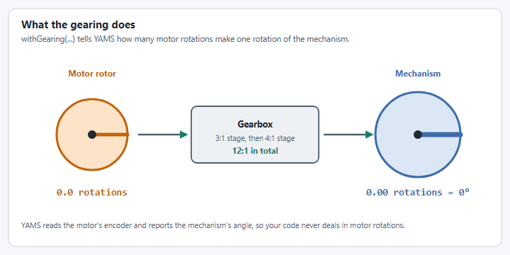
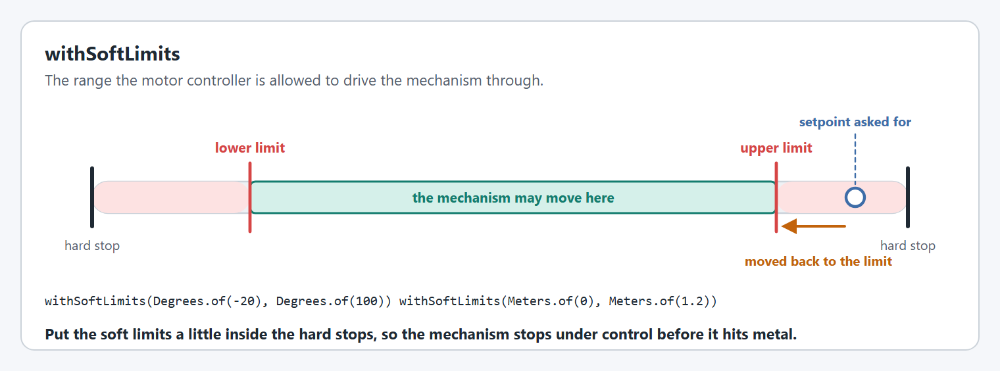

# Step 1: The motor controller


This page assumes a project with YAMS and REVLib installed. If you do not have one yet, start at [Create a project and install YAMS](../project-setup/).


A `SmartMotorController` is how YAMS talks to a motor controller. It takes three things:

1. **The vendor's motor controller object**, here a `SparkMax`.
2. **The motor** that is plugged into it, here one NEO.
3. **A `SmartMotorControllerConfig`** that says what the motor controller should do: its control mode, its PID and feedforward gains, its motion profile, the gearing between the motor and the arm, where the arm starts, and how far the closed loop may take it.

YAMS applies the config to the `SparkMax` for you, and uses the same config to build the simulation.


**In a hurry?** Jump to [the complete file](motor-controller.md#the-complete-file), copy it, and change the values called out under **For your robot**. The numbered parts explain each piece in a sentence or two. You do not need to understand all of it to get moving: the pages under **Understanding** go deeper when you want them.


## Create the file



Create `ArmSubsystem.java` in the `subsystems` folder, next to the template's `ExampleSubsystem.java`.



Create `ArmMechanism.java` in the `mechanisms` folder, next to the template's `ExampleMechanism.java`.

The config comes from `yams.commands3.config`, and it takes the `Mechanism` where Commands v2 passes the subsystem.



Create `ArmSubsystem.hpp` in `src/main/include/subsystems` and `ArmSubsystem.cpp` in `src/main/cpp/subsystems`.

YAMS keeps a pointer to the config and to the `SparkMax`, so in C++ both are members of the subsystem. The constructor fills in the config and then creates the `SmartMotorController`, which is why that one is a `std::optional`.

`WithFeedback` is the C++ name of `withClosedLoopController`, `WithMotorGearing` of `withGearing`, and `WithMechanismLimits` of `withSoftLimits`.





### Start the config

Everything the motor controller should do goes into one `SmartMotorControllerConfig`. Start it, and put it in closed loop mode so that it can hold a position.




```java
// What the motor controller should do: its control mode, gains, gearing and limits.
private final SmartMotorControllerConfig smcConfig = new SmartMotorControllerConfig(this)
    .withControlMode(ControlMode.CLOSED_LOOP)
```





```java
// What the motor controller should do: its control mode, gains, gearing and limits.
private final SmartMotorControllerConfig smcConfig = new SmartMotorControllerConfig(this)
    .withControlMode(ControlMode.CLOSED_LOOP)
```





```cpp
// What the motor controller should do. It is filled in by the constructor.
yams::motorcontrollers::SmartMotorControllerConfig m_smcConfig;
```



```cpp
// What the motor controller should do: its control mode, gains, gearing and limits.
m_smcConfig
    .WithSubsystem(this)
    .WithClosedLoopMode()
```




Want the details? [Motor basics](../../reference/editor/config/motor-basics.md)



### PID and feedforward

The PID gains correct the difference between where the arm is and where you asked it to be. The feedforward supplies the voltage you already know it needs. The `Sim` options are used only in simulation, so the simulation can be tuned without touching the real robot's gains.




```java
// Feedback constants (PID), on the real robot and in simulation.
.withClosedLoopController(50, 0, 0)
.withSimClosedLoopController(50, 0, 0)

// Feedforward constants, on the real robot and in simulation.
.withFeedforward(new ArmFeedforward(0, 0, 0))
.withSimFeedforward(new ArmFeedforward(0, 0, 0))
```





```java
// Feedback constants (PID), on the real robot and in simulation.
.withClosedLoopController(50, 0, 0)
.withSimClosedLoopController(50, 0, 0)

// Feedforward constants, on the real robot and in simulation.
.withFeedforward(new ArmFeedforward(0, 0, 0))
.withSimFeedforward(new ArmFeedforward(0, 0, 0))
```





```cpp
// Feedback constants (PID), on the real robot and in simulation.
.WithFeedback(50, 0, 0)
.WithSimClosedLoopController(50, 0, 0)

// Feedforward constants: kS, kG and kV.
.WithFeedforward(wpi::math::ArmFeedforward{
    0_V, 0_V, wpi::units::unit_t<wpi::math::ArmFeedforward::kv_unit>{0}})
```




**For your robot:** These numbers are only a place to start. Leave them, get the arm moving, then tune them with [Live tuning](../../how-to-tuning/live-tuning/).

Want the details? [Closed loop control](../../reference/editor/config/closed-loop-control.md) and [Feedforward](../../reference/editor/config/feedforward.md)



### Motion profile

The profile caps how fast the arm may move and accelerate on its way to a setpoint, so that it glides there instead of lunging.




```java
// The fastest the closed loop is allowed to move and accelerate the arm.
.withTrapezoidalProfile(DegreesPerSecond.of(90), DegreesPerSecondPerSecond.of(45))
```





```java
// The fastest the closed loop is allowed to move and accelerate the arm.
.withTrapezoidalProfile(DegreesPerSecond.of(90), DegreesPerSecondPerSecond.of(45))
```





```cpp
// The fastest the closed loop is allowed to move and accelerate the arm.
.WithTrapezoidProfile(90_deg_per_s, 45_deg_per_s_sq)
```




**For your robot:** Start slow. Raise the two numbers once the mechanism moves safely.

Want the details? [Motion profiles](../../reference/editor/config/motion-profiles.md)



### Gearing

The gearing tells YAMS how many turns of the motor make one turn of the arm.

<figure><figcaption><p>With 12:1 gearing, twelve rotations of the motor are one rotation of the mechanism.</p></figcaption></figure>




```java
// Gearing from the motor rotor to the arm: a 3:1 stage and a 4:1 stage, 12:1 in total.
.withGearing(new MechanismGearing(GearBox.fromReductionStages(3, 4)))
```





```java
// Gearing from the motor rotor to the arm: a 3:1 stage and a 4:1 stage, 12:1 in total.
.withGearing(new MechanismGearing(GearBox.fromReductionStages(3, 4)))
```





```cpp
// Gearing from the motor rotor to the arm: a 3:1 stage and a 4:1 stage, 12:1 in total.
.WithMotorGearing(MechanismGearing{GearBox::FromReductionStages({3.0, 4.0})})
```




**For your robot:** List your gearbox stages in order, from the motor outward. `3, 4` here is a 3:1 stage followed by a 4:1 stage.

Want the details? [Gearing and units](../../reference/editor/config/gearing-and-units.md)



### Direction, idle mode and current limit

Which way is positive, what the motor does when it is given no power, and the most current it may draw.




```java
.withMotorInverted(false)
.withZeroPower(MotorMode.BRAKE)
.withStatorCurrentLimit(Amps.of(40))
```





```java
.withMotorInverted(false)
.withZeroPower(MotorMode.BRAKE)
.withStatorCurrentLimit(Amps.of(40))
```





```cpp
.WithMotorInverted(false)
.WithZeroPower(Cfg::MotorMode::BRAKE)
.WithStatorCurrentLimit(40_A)
```




**For your robot:** Flip the inversion if a positive output moves your arm the wrong way. Keep the current limit within what your wiring and breaker allow.

Want the details? [Motor basics](../../reference/editor/config/motor-basics.md) and [Limits and protection](../../reference/editor/config/limits-and-protection.md)



### Starting position and soft limits

The starting position is where the arm is when the robot turns on. The soft limits are as far as the closed loop is allowed to take it.

<figure><figcaption><p>Soft limits sit a little inside the hard stops.</p></figcaption></figure>




```java
// Where the arm is when the robot turns on.
.withStartingPosition(Degrees.of(-5))
// The closed loop will not take the arm past these angles.
.withSoftLimits(Degrees.of(-20), Degrees.of(30))
```





```java
// Where the arm is when the robot turns on.
.withStartingPosition(Degrees.of(-5))
// The closed loop will not take the arm past these angles.
.withSoftLimits(Degrees.of(-20), Degrees.of(30))
```





```cpp
// Where the arm is when the robot turns on.
.WithStartingPosition(-5_deg)
// The closed loop will not take the arm past these angles.
.WithMechanismLimits(-20_deg, 30_deg)
```




**For your robot:** Set the starting position to where your arm really rests, and the soft limits just inside its hard stops.

Want the details? [Limits and protection](../../reference/editor/config/limits-and-protection.md)



### Telemetry

The name the motor gets on your dashboard, and how much it publishes. `HIGH` publishes everything, which is what you want while tuning.




```java
// Telemetry name and how much to publish.
.withTelemetry("ArmMotor", TelemetryVerbosity.HIGH);
```





```java
// Telemetry name and how much to publish.
.withTelemetry("ArmMotor", TelemetryVerbosity.HIGH);
```





```cpp
// Telemetry name and how much to publish.
.WithTelemetry("ArmMotor", Cfg::TelemetryVerbosity::HIGH);
```




Want the details? [Telemetry](../../understanding/telemetry.md)



### The motor controller object

This is the vendor's own object, exactly as you would create it without YAMS.




```java
// The vendor motor controller object: a SPARK MAX with CAN ID 4.
private final SparkMax spark = new SparkMax(CANPort.CAN_S0, 4, MotorType.kBrushless);
```





```java
// The vendor motor controller object: a SPARK MAX with CAN ID 4.
private final SparkMax spark = new SparkMax(CANPort.CAN_S0, 4, MotorType.kBrushless);
```





```cpp
// The vendor motor controller object: a SPARK MAX with CAN ID 4.
rev::spark::SparkMax m_spark{wpi::CANPort::CAN_S0, 4, rev::spark::SparkMax::MotorType::kBrushless};
```




**For your robot:** Change the CAN ID to yours. Using a different motor controller? See the [feature matrix](../../reference/editor/feature-matrix.md) for the wrapper that goes with it.



### The SmartMotorController

The wrapper brings the three together: the motor controller object, the motor plugged into it, and the config.




```java
// The SmartMotorController applies the config to the SPARK MAX, which drives one NEO.
private final SmartMotorController motor = new SparkWrapper(spark, DCMotor.getNEO(1), smcConfig);
```





```java
// The SmartMotorController applies the config to the SPARK MAX, which drives one NEO.
private final SmartMotorController motor = new SparkWrapper(spark, DCMotor.getNEO(1), smcConfig);
```





```cpp
// The SmartMotorController, created in the constructor once the config is ready.
std::optional<yams::motorcontrollers::local::SparkWrapper> m_motor;
```



```cpp
// The SmartMotorController applies the config to the SPARK MAX, which drives one NEO.
m_motor.emplace(&m_spark, wpi::math::DCMotor::NEO(1), &m_smcConfig);
```




**For your robot:** Change the motor to the kind and the number of motors you have.

Want the details? [Smart motor controllers](../../reference/editor/)



## The complete file

Every part above, in one file, with its imports.




```java
package first.robot.subsystems;

import static org.wpilib.units.Units.Amps;
import static org.wpilib.units.Units.Degrees;
import static org.wpilib.units.Units.DegreesPerSecond;
import static org.wpilib.units.Units.DegreesPerSecondPerSecond;

import com.revrobotics.spark.SparkLowLevel.MotorType;
import com.revrobotics.spark.SparkMax;
import org.wpilib.command2.SubsystemBase;
import org.wpilib.hardware.bus.CANPort;
import org.wpilib.math.controller.ArmFeedforward;
import org.wpilib.math.system.DCMotor;
import yams.commands2.config.SmartMotorControllerConfig;
import yams.core.gearing.GearBox;
import yams.core.gearing.MechanismGearing;
import yams.core.motorcontrollers.SmartMotorController;
import yams.core.motorcontrollers.enums.ControlMode;
import yams.core.motorcontrollers.enums.MotorMode;
import yams.core.motorcontrollers.local.SparkWrapper;
import yams.core.telemetry.enums.TelemetryVerbosity;

public class ArmSubsystem extends SubsystemBase {

  // What the motor controller should do: its control mode, gains, gearing and limits.
  private final SmartMotorControllerConfig smcConfig = new SmartMotorControllerConfig(this)
      .withControlMode(ControlMode.CLOSED_LOOP)
      // Feedback constants (PID), on the real robot and in simulation.
      .withClosedLoopController(50, 0, 0)
      .withSimClosedLoopController(50, 0, 0)
      // The fastest the closed loop is allowed to move and accelerate the arm.
      .withTrapezoidalProfile(DegreesPerSecond.of(90), DegreesPerSecondPerSecond.of(45))
      // Feedforward constants, on the real robot and in simulation.
      .withFeedforward(new ArmFeedforward(0, 0, 0))
      .withSimFeedforward(new ArmFeedforward(0, 0, 0))
      // Gearing from the motor rotor to the arm: a 3:1 stage and a 4:1 stage, 12:1 in total.
      .withGearing(new MechanismGearing(GearBox.fromReductionStages(3, 4)))
      .withMotorInverted(false)
      .withZeroPower(MotorMode.BRAKE)
      .withStatorCurrentLimit(Amps.of(40))
      // Where the arm is when the robot turns on.
      .withStartingPosition(Degrees.of(-5))
      // The closed loop will not take the arm past these angles.
      .withSoftLimits(Degrees.of(-20), Degrees.of(30))
      // Telemetry name and how much to publish.
      .withTelemetry("ArmMotor", TelemetryVerbosity.HIGH);

  // The vendor motor controller object: a SPARK MAX with CAN ID 4.
  private final SparkMax spark = new SparkMax(CANPort.CAN_S0, 4, MotorType.kBrushless);

  // The SmartMotorController applies the config to the SPARK MAX, which drives one NEO.
  private final SmartMotorController motor = new SparkWrapper(spark, DCMotor.getNEO(1), smcConfig);
}
```





```java
package first.robot.mechanisms;

import static org.wpilib.units.Units.Amps;
import static org.wpilib.units.Units.Degrees;
import static org.wpilib.units.Units.DegreesPerSecond;
import static org.wpilib.units.Units.DegreesPerSecondPerSecond;

import com.revrobotics.spark.SparkLowLevel.MotorType;
import com.revrobotics.spark.SparkMax;
import org.wpilib.command3.Mechanism;
import org.wpilib.hardware.bus.CANPort;
import org.wpilib.math.controller.ArmFeedforward;
import org.wpilib.math.system.DCMotor;
import yams.commands3.config.SmartMotorControllerConfig;
import yams.core.gearing.GearBox;
import yams.core.gearing.MechanismGearing;
import yams.core.motorcontrollers.SmartMotorController;
import yams.core.motorcontrollers.enums.ControlMode;
import yams.core.motorcontrollers.enums.MotorMode;
import yams.core.motorcontrollers.local.SparkWrapper;
import yams.core.telemetry.enums.TelemetryVerbosity;

public class ArmMechanism implements Mechanism {

  // What the motor controller should do: its control mode, gains, gearing and limits.
  private final SmartMotorControllerConfig smcConfig = new SmartMotorControllerConfig(this)
      .withControlMode(ControlMode.CLOSED_LOOP)
      // Feedback constants (PID), on the real robot and in simulation.
      .withClosedLoopController(50, 0, 0)
      .withSimClosedLoopController(50, 0, 0)
      // The fastest the closed loop is allowed to move and accelerate the arm.
      .withTrapezoidalProfile(DegreesPerSecond.of(90), DegreesPerSecondPerSecond.of(45))
      // Feedforward constants, on the real robot and in simulation.
      .withFeedforward(new ArmFeedforward(0, 0, 0))
      .withSimFeedforward(new ArmFeedforward(0, 0, 0))
      // Gearing from the motor rotor to the arm: a 3:1 stage and a 4:1 stage, 12:1 in total.
      .withGearing(new MechanismGearing(GearBox.fromReductionStages(3, 4)))
      .withMotorInverted(false)
      .withZeroPower(MotorMode.BRAKE)
      .withStatorCurrentLimit(Amps.of(40))
      // Where the arm is when the robot turns on.
      .withStartingPosition(Degrees.of(-5))
      // The closed loop will not take the arm past these angles.
      .withSoftLimits(Degrees.of(-20), Degrees.of(30))
      // Telemetry name and how much to publish.
      .withTelemetry("ArmMotor", TelemetryVerbosity.HIGH);

  // The vendor motor controller object: a SPARK MAX with CAN ID 4.
  private final SparkMax spark = new SparkMax(CANPort.CAN_S0, 4, MotorType.kBrushless);

  // The SmartMotorController applies the config to the SPARK MAX, which drives one NEO.
  private final SmartMotorController motor = new SparkWrapper(spark, DCMotor.getNEO(1), smcConfig);
}
```





```cpp
#pragma once

#include <optional>

#include <rev/SparkMax.h>
#include <wpi/commands2/SubsystemBase.hpp>
#include <wpi/hardware/bus/CANPort.hpp>

#include "yams/motorcontrollers/SmartMotorControllerConfig.hpp"
#include "yams/motorcontrollers/local/SparkWrapper.hpp"

class ArmSubsystem : public wpi::cmd::SubsystemBase {
 public:
  ArmSubsystem();

 private:
  // The vendor motor controller object: a SPARK MAX with CAN ID 4.
  rev::spark::SparkMax m_spark{wpi::CANPort::CAN_S0, 4, rev::spark::SparkMax::MotorType::kBrushless};

  // What the motor controller should do. It is filled in by the constructor.
  yams::motorcontrollers::SmartMotorControllerConfig m_smcConfig;

  // The SmartMotorController, created in the constructor once the config is ready.
  std::optional<yams::motorcontrollers::local::SparkWrapper> m_motor;
};
```



```cpp
#include "subsystems/ArmSubsystem.hpp"

#include <wpi/math/controller/ArmFeedforward.hpp>
#include <wpi/math/system/DCMotor.hpp>
#include <wpi/units/angle.hpp>
#include <wpi/units/angular_acceleration.hpp>
#include <wpi/units/angular_velocity.hpp>
#include <wpi/units/current.hpp>
#include <wpi/units/voltage.hpp>

#include "yams/gearing/GearBox.hpp"
#include "yams/gearing/MechanismGearing.hpp"

using namespace yams::gearing;
using Cfg = yams::motorcontrollers::SmartMotorControllerConfig;

ArmSubsystem::ArmSubsystem() {
  // What the motor controller should do: its control mode, gains, gearing and limits.
  m_smcConfig
      .WithSubsystem(this)
      .WithClosedLoopMode()
      // Feedback constants (PID), on the real robot and in simulation.
      .WithFeedback(50, 0, 0)
      .WithSimClosedLoopController(50, 0, 0)
      // The fastest the closed loop is allowed to move and accelerate the arm.
      .WithTrapezoidProfile(90_deg_per_s, 45_deg_per_s_sq)
      // Feedforward constants: kS, kG and kV.
      .WithFeedforward(wpi::math::ArmFeedforward{
          0_V, 0_V, wpi::units::unit_t<wpi::math::ArmFeedforward::kv_unit>{0}})
      // Gearing from the motor rotor to the arm: a 3:1 stage and a 4:1 stage, 12:1 in total.
      .WithMotorGearing(MechanismGearing{GearBox::FromReductionStages({3.0, 4.0})})
      .WithMotorInverted(false)
      .WithZeroPower(Cfg::MotorMode::BRAKE)
      .WithStatorCurrentLimit(40_A)
      // Where the arm is when the robot turns on.
      .WithStartingPosition(-5_deg)
      // The closed loop will not take the arm past these angles.
      .WithMechanismLimits(-20_deg, 30_deg)
      // Telemetry name and how much to publish.
      .WithTelemetry("ArmMotor", Cfg::TelemetryVerbosity::HIGH);

  // The SmartMotorController applies the config to the SPARK MAX, which drives one NEO.
  m_motor.emplace(&m_spark, wpi::math::DCMotor::NEO(1), &m_smcConfig);
}
```




## Read more

Every option used here has its own section in the `SmartMotorControllerConfig` pages:

* [Motor basics](../../reference/editor/config/motor-basics.md): control mode, inversion, what the motor does at zero power
* [Gearing and units](../../reference/editor/config/gearing-and-units.md): gearing, and how rotations become distance
* [Closed loop control](../../reference/editor/config/closed-loop-control.md), [Feedforward](../../reference/editor/config/feedforward.md) and [Motion profiles](../../reference/editor/config/motion-profiles.md)
* [Limits and protection](../../reference/editor/config/limits-and-protection.md): soft limits and current limits
* [Simulation](../../reference/editor/config/simulation.md): the simulation only gains

The PID and feedforward numbers on this page are a place to start, not tuned values. You tune them in [Step 5: Tune it](tune.md).

## Check it

Open the command palette with <kbd>Ctrl+Shift+P</kbd> and run **WPILib: Build Robot Code**. It should build. Nothing moves yet, because nothing tells the motor what to do.

* **`SparkMax` cannot be found:** REVLib is not installed. See [Install your motor controller's library](../project-setup/#install-your-motor-controllers-library).
* **`SmartMotorControllerConfig` cannot be found:** YAMS is not installed, or the import is from the other command framework (`yams.commands2` or `yams.commands3`).
