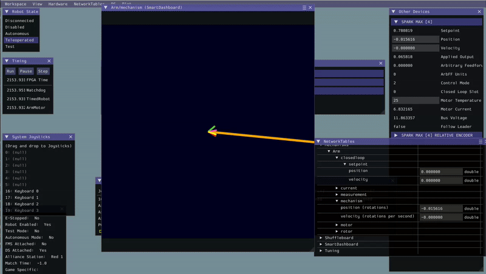

# Step 4: Simulate it

The code from the first three steps runs on your computer exactly as it will on the robot. YAMS simulates the motor, the gearing and the arm, so the closed loop, the limits and the commands all behave the way they will on the real mechanism.



### Start the simulation



Open the command palette with <kbd>Ctrl+Shift+P</kbd> and run **WPILib: Simulate Robot Code**. If you are asked which extensions to run, tick **Sim GUI**.



Open the command palette with <kbd>Ctrl+Shift+P</kbd> and run **WPILib: Simulate Robot Code**. If you are asked which extensions to run, tick **Sim GUI**.

The buttons are bound in the `ExampleTeleop` op mode, so that is the op mode to run when you enable.

If the simulated mechanism never moves, check that `Robot.java` has a `simulationInit()` that calls `startSimulation(...)` for the mechanism.



Open the command palette with <kbd>Ctrl+Shift+P</kbd> and run **WPILib: Simulate Robot Code**. If you are asked which extensions to run, tick **Sim GUI**.

The first C++ build compiles the whole project, so it takes a few minutes. Later builds are much faster.



<figure><figcaption>
The Sim GUI.
</figcaption></figure>



### Drive it

1. Connect a controller to your computer, then drag it from **System Joysticks** to **Joystick\[0]**. Commands v3: drag it to **Joystick\[1]** instead, because the Command v3 template's controller is on port 1 (`DriverConstants.DRIVER_CONTROLLER_PORT`).
2. Open the simulated mechanism with **NetworkTables -> Mechanisms -> Arm -> mechanism**. It is named after the `withTelemetry("Arm", ...)` on the `ArmConfig`.

<figure><figcaption></figcaption></figure>

3. Resize **Arm/mechanism** to your liking.
4. Commands v3: pick the `ExampleTeleop` op mode first. Then press **Teleoperated** in **Robot State**. The controller now drives the simulated arm just as it would the real one.

No controller? The Sim GUI can use the keyboard as a joystick: drag **Keyboard 0** to **Joystick\[0]** (**Joystick\[1]** for Commands v3).

<figure><figcaption></figcaption></figure>



## What you should see

* Before you enable, the arm starts at -5 degrees, its starting position, and drops toward its lower hard limit at -30 degrees: a disabled robot's motors get no power, in simulation too.
* When you enable, the default command takes it up to 0 degrees, level.
* Holding **A** takes it to -5 degrees, and holding **B** to 15 degrees. Let go, and it goes back to 0 degrees.
* Holding **X** drives it up, and **Y** drives it down, until the soft limits stop it.
* It sits a little below each setpoint. That is the placeholder gains: `kG` is 0, so nothing holds the arm up against gravity except `kP`. The next step fixes it.

## If it did not work

* **The arm is not in the NetworkTables menu.** Look under **Mechanisms**, not **SmartDashboard**.
* **The arm does not move.** Check the robot is enabled in **Teleoperated** and the controller is on **Joystick\[0]** (**Joystick\[1]** for Commands v3). Commands v3: check `Robot.simulationInit()` starts the arm's simulation.
* **The code stops with an error when the simulation starts.** Read the first error. YAMS names the setting that is missing, such as a starting position outside the hard limits.

More problems and fixes: [Troubleshooting](../troubleshooting.md).
