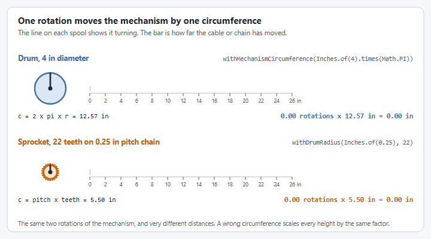
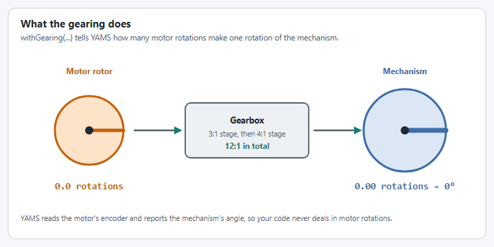
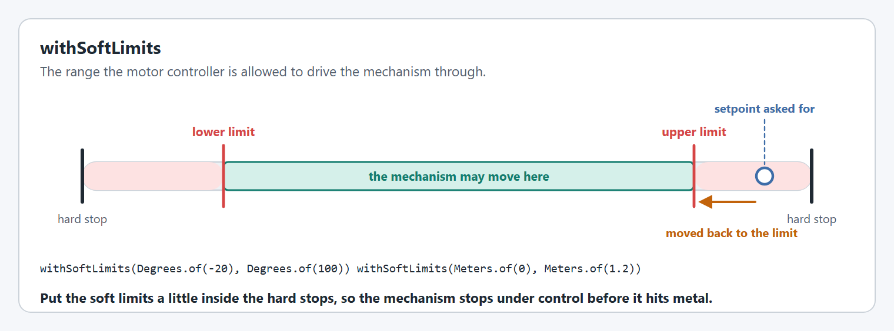

# Step 1: The motor controller


This page assumes a project with YAMS and REVLib installed. If you do not have one yet, start at [Create a project and install YAMS](../project-setup/).



**Did the arm tutorial?** This step is the same as [the arm's step 1](../arm/motor-controller.md), except:

* **The sprocket or drum** (part 2) is new. It tells YAMS how far the carriage moves for each turn, so that you can work in meters.
* **Linear units.** The motion profile, starting position and soft limits are in meters and meters per second, not degrees.
* **`ElevatorFeedforward`** replaces `ArmFeedforward`. Its `kG` is the same at every height, because gravity pulls the carriage straight down wherever it is.
* **Cascading elevators** divide the gearing by the number of stages (part 5).

Skim the parts you know and read those four.


A `SmartMotorController` is how YAMS talks to a motor controller. It takes three things:

1. **The vendor's motor controller object**, here a `SparkMax`.
2. **The motor** that is plugged into it, here one NEO.
3. **A `SmartMotorControllerConfig`** that says what the motor controller should do: its control mode, its PID and feedforward gains, its motion profile, the gearing between the motor and the sprocket, how far the carriage moves for each turn of the sprocket, where the carriage starts, and how far the closed loop may take it.

YAMS applies the config to the `SparkMax` for you, and uses the same config to build the simulation.


**In a hurry?** Jump to [the complete file](motor-controller.md#the-complete-file), copy it, and change the values called out under **For your robot**. The numbered parts explain each piece in a sentence or two. You do not need to understand all of it to get moving: the pages under **Understanding** go deeper when you want them.


## Create the file



Create `ElevatorSubsystem.java` in the `subsystems` folder, next to the template's `ExampleSubsystem.java`.



Create `ElevatorMechanism.java` in the `mechanisms` folder, next to the template's `ExampleMechanism.java`.

The config comes from `yams.commands3.config`, and it takes the `Mechanism` where Commands v2 passes the subsystem.



Create `ElevatorSubsystem.hpp` in `src/main/include/subsystems` and `ElevatorSubsystem.cpp` in `src/main/cpp/subsystems`.

YAMS keeps a pointer to the config and to the `SparkMax`, so in C++ both are members of the subsystem. The constructor fills in the config and then creates the `SmartMotorController`, which is why that one is a `std::optional`.

`WithFeedback` is the C++ name of `withClosedLoopController`, `WithMotorGearing` of `withGearing`, `WithLinearTrapezoidProfile` of the linear `withTrapezoidalProfile`, and `WithMeasurementLimits` of the linear `withSoftLimits`. The sprocket is described with `WithMechanismCircumference(pitch, teeth)` where Java uses `withDrumRadius(pitch, teeth)`.





### Start the config

Everything the motor controller should do goes into one `SmartMotorControllerConfig`. Start it, and put it in closed loop mode so that it can hold a position.




```java
// What the motor controller should do: its control mode, gains, gearing and limits.
private final SmartMotorControllerConfig smcConfig = new SmartMotorControllerConfig(this)
    .withControlMode(ControlMode.CLOSED_LOOP)
```





```java
// What the motor controller should do: its control mode, gains, gearing and limits.
private final SmartMotorControllerConfig smcConfig = new SmartMotorControllerConfig(this)
    .withControlMode(ControlMode.CLOSED_LOOP)
```





```cpp
// What the motor controller should do. It is filled in by the constructor.
yams::motorcontrollers::SmartMotorControllerConfig m_smcConfig;
```



```cpp
// What the motor controller should do: its control mode, gains, gearing and limits.
m_smcConfig
    .WithSubsystem(this)
    .WithClosedLoopMode()
```




Want the details? [Motor basics](../../reference/editor/config/motor-basics.md)



### The sprocket or drum

An elevator has to know how far the carriage moves for each turn of the output shaft. Without it YAMS cannot turn rotations into a height.

<figure><figcaption><p>Each rotation of the mechanism moves it by one circumference.</p></figcaption></figure>




```java
// How far the carriage moves for each turn of the output shaft:
// #25 chain has a 0.25 inch pitch, and the sprocket has 22 teeth,
// so one turn moves the chain pitch x teeth = 5.5 inches.
.withDrumRadius(Inches.of(0.25), 22)
```





```java
// How far the carriage moves for each turn of the output shaft:
// #25 chain has a 0.25 inch pitch, and the sprocket has 22 teeth,
// so one turn moves the chain pitch x teeth = 5.5 inches.
.withDrumRadius(Inches.of(0.25), 22)
```





```cpp
// How far the carriage moves for each turn of the output shaft:
// #25 chain has a 0.25 inch pitch, and the sprocket has 22 teeth,
// so one turn moves the chain pitch x teeth = 5.5 inches.
.WithMechanismCircumference(0.25_in, 22)
```




`withDrumRadius(pitch, teeth)` works the radius out from the chain for you: one turn of the sprocket moves the chain one pitch per tooth, 0.25 inch x 22 = 5.5 inches here.

**For your robot:** Use your own chain pitch and tooth count, or the radius of your drum:



```java
.withDrumRadius(Inches.of(0.25), 22)   // #25 chain (0.25 inch pitch), 22 tooth sprocket
.withDrumRadius(Inches.of(0.375), 16)  // #35 chain (0.375 inch pitch), 16 tooth sprocket
.withDrumRadius(Inches.of(0.875))      // a spool or drum with a 0.875 inch radius
```



```java
.withDrumRadius(Inches.of(0.25), 22)   // #25 chain (0.25 inch pitch), 22 tooth sprocket
.withDrumRadius(Inches.of(0.375), 16)  // #35 chain (0.375 inch pitch), 16 tooth sprocket
.withDrumRadius(Inches.of(0.875))      // a spool or drum with a 0.875 inch radius
```



```cpp
.WithMechanismCircumference(0.25_in, 22)   // #25 chain (0.25 inch pitch), 22 tooth sprocket
.WithMechanismCircumference(0.375_in, 16)  // #35 chain (0.375 inch pitch), 16 tooth sprocket
.WithMechanismRadius(0.875_in)             // a spool or drum with a 0.875 inch radius
```



Want the details? [How do I find my mechanism's circumference?](../../how-to-motor-controllers-and-sensors/how-to-find-your-mechanism-circumference.md)



### PID and feedforward

The PID gains correct the difference between where the elevator is and where you asked it to be. The feedforward supplies the voltage you already know it needs. The `Sim` options are used only in simulation, so the simulation can be tuned without touching the real robot's gains.

**Gravity on an elevator.** Gravity always pulls the carriage down with the same force, at the bottom, in the middle or at the top. So the motor needs the same voltage just to hold it still at any height. That voltage is `kG`, the middle number of `ElevatorFeedforward(kS, kG, kV)`. (An arm is different: its `kG` shrinks as it points up or down.)




```java
// Feedback constants (PID), on the real robot and in simulation.
.withClosedLoopController(4, 0, 0)
.withSimClosedLoopController(4, 0, 0)

// Feedforward constants, on the real robot and in simulation.
.withFeedforward(new ElevatorFeedforward(0, 0, 0))
.withSimFeedforward(new ElevatorFeedforward(0, 0, 0))
```





```java
// Feedback constants (PID), on the real robot and in simulation.
.withClosedLoopController(4, 0, 0)
.withSimClosedLoopController(4, 0, 0)

// Feedforward constants, on the real robot and in simulation.
.withFeedforward(new ElevatorFeedforward(0, 0, 0))
.withSimFeedforward(new ElevatorFeedforward(0, 0, 0))
```





```cpp
// Feedback constants (PID), on the real robot and in simulation.
.WithFeedback(4, 0, 0)
.WithSimClosedLoopController(4, 0, 0)

// Feedforward constants (kS, kG and kV), on the real robot and in simulation.
.WithFeedforward(wpi::math::ElevatorFeedforward{
    0_V, 0_V, wpi::units::unit_t<wpi::math::ElevatorFeedforward::kv_unit>{0}})
.WithSimFeedforward(wpi::math::ElevatorFeedforward{
    0_V, 0_V, wpi::units::unit_t<wpi::math::ElevatorFeedforward::kv_unit>{0}})
```




These gains are **placeholders**. `kP` of 4 is 4 volts for each meter of error, and every feedforward gain is 0.

**What to expect with them:** the elevator moves, but with `kG` at 0 only `kP` holds the carriage up. `kP` only pushes when the carriage is below its setpoint, so the carriage sags: in simulation it settles roughly 15 cm below each setpoint. That is expected. You find `kG` in [Step 5: Tune it](tune.md), and the sag goes away.

**For your robot:** Leave these numbers for now, and tune them in step 5.

Want the details? [Closed loop control](../../reference/editor/config/closed-loop-control.md) and [Feedforward](../../reference/editor/config/feedforward.md)



### Motion profile

The profile caps how fast the elevator may move and accelerate on its way to a setpoint, so that it glides there instead of lunging.




```java
// The fastest the closed loop is allowed to move and accelerate the carriage.
.withTrapezoidalProfile(MetersPerSecond.of(0.5), MetersPerSecondPerSecond.of(0.5))
```





```java
// The fastest the closed loop is allowed to move and accelerate the carriage.
.withTrapezoidalProfile(MetersPerSecond.of(0.5), MetersPerSecondPerSecond.of(0.5))
```





```cpp
// The fastest the closed loop is allowed to move and accelerate the carriage.
.WithLinearTrapezoidProfile(0.5_mps, 0.5_mps_sq)
```




**For your robot:** Start slow. Raise the two numbers once the mechanism moves safely.

Want the details? [Motion profiles](../../reference/editor/config/motion-profiles.md)



### Gearing

The gearing tells YAMS how many turns of the motor make one turn of the sprocket.

<figure><figcaption><p>With 12:1 gearing, twelve rotations of the motor are one rotation of the mechanism.</p></figcaption></figure>




```java
// Gearing from the motor rotor to the sprocket: a 3:1 stage and a 4:1 stage, 12:1 in total.
.withGearing(new MechanismGearing(GearBox.fromReductionStages(3, 4)))
```





```java
// Gearing from the motor rotor to the sprocket: a 3:1 stage and a 4:1 stage, 12:1 in total.
.withGearing(new MechanismGearing(GearBox.fromReductionStages(3, 4)))
```





```cpp
// Gearing from the motor rotor to the sprocket: a 3:1 stage and a 4:1 stage, 12:1 in total.
.WithMotorGearing(MechanismGearing{GearBox::FromReductionStages({3.0, 4.0})})
```




**For your robot:** List your gearbox stages in order, from the motor outward. `3, 4` here is a 3:1 stage followed by a 4:1 stage.

**Cascading elevator?** In a cascading elevator each stage rides on the one below, so the top carriage moves faster than the chain. Add the number of stages right **after** `withGearing`. It divides the gearing that is already set, so put before `withGearing` it would be overwritten:



```java
.withGearing(new MechanismGearing(GearBox.fromReductionStages(3, 4)))
// A two stage cascading elevator: divides the 12:1 gearing above by 2.
.withCascadingElevatorStages(2)
```



```cpp
.WithMotorGearing(MechanismGearing{GearBox::FromReductionStages({3.0, 4.0})})
// A two stage cascading elevator: divides the 12:1 gearing above by 2.
.WithCascadingElevatorStages(2)
```



Skip this for a continuous elevator, like the one in this tutorial.

Want the details? [Gearing and units](../../reference/editor/config/gearing-and-units.md)



### Direction, idle mode and current limit

Which way is positive, what the motor does when it is given no power, and the most current it may draw.




```java
.withMotorInverted(false)
.withZeroPower(MotorMode.BRAKE)
.withStatorCurrentLimit(Amps.of(40))
```





```java
.withMotorInverted(false)
.withZeroPower(MotorMode.BRAKE)
.withStatorCurrentLimit(Amps.of(40))
```





```cpp
.WithMotorInverted(false)
.WithZeroPower(Cfg::MotorMode::BRAKE)
.WithStatorCurrentLimit(40_A)
```




**For your robot:** Flip the inversion if a positive output moves your elevator the wrong way. Keep the current limit within what your wiring and breaker allow.

Want the details? [Motor basics](../../reference/editor/config/motor-basics.md) and [Limits and protection](../../reference/editor/config/limits-and-protection.md)



### Starting position and soft limits

The starting position is where the elevator is when the robot turns on. The soft limits are as far as the closed loop is allowed to take it.

<figure><figcaption><p>Soft limits sit a little inside the hard stops.</p></figcaption></figure>




```java
// Where the carriage is when the robot turns on.
.withStartingPosition(Meters.of(0))
// The closed loop will not take the carriage past these heights.
.withSoftLimits(Meters.of(0), Meters.of(2))
```





```java
// Where the carriage is when the robot turns on.
.withStartingPosition(Meters.of(0))
// The closed loop will not take the carriage past these heights.
.withSoftLimits(Meters.of(0), Meters.of(2))
```





```cpp
// Where the carriage is when the robot turns on.
.WithStartingPosition(0_m)
// The closed loop will not take the carriage past these heights.
.WithMeasurementLimits(0_m, 2_m)
```




Both take meters, so they need the sprocket from part 2 first: YAMS uses its circumference to turn meters into rotations. That is why `withDrumRadius` comes earlier in the config. In C++, `WithStartingPosition(meters)` and `WithMeasurementLimits` throw an error if `WithMechanismCircumference` has not been called yet, and in Java `withStartingPosition(meters)` and `withSoftLimits(meters)` do the same without `withDrumRadius`.

The lower soft limit here is 0 m, the same as the bottom hard stop and the starting height. That is on purpose: the carriage rests on the bottom stop, and the default command parks it there, so the closed loop never asks for a height below it.

**For your robot:** Set the starting position to where your carriage really rests when the robot turns on, and the upper soft limit a little below the top hard stop. If your carriage pushes into the bottom stop when it parks, raise the lower soft limit and the parking height a little, such as 0.02 m.

Want the details? [Limits and protection](../../reference/editor/config/limits-and-protection.md)



### Telemetry

The name the motor gets on your dashboard, and how much it publishes. `HIGH` publishes everything, which is what you want while tuning.




```java
// Telemetry name and how much to publish.
.withTelemetry("ElevatorMotor", TelemetryVerbosity.HIGH);
```





```java
// Telemetry name and how much to publish.
.withTelemetry("ElevatorMotor", TelemetryVerbosity.HIGH);
```





```cpp
// Telemetry name and how much to publish.
.WithTelemetry("ElevatorMotor", Cfg::TelemetryVerbosity::HIGH);
```




Want the details? [Telemetry](../../understanding/telemetry.md)



### The motor controller object

This is the vendor's own object, exactly as you would create it without YAMS.




```java
// The vendor motor controller object: a SPARK MAX with CAN ID 4.
private final SparkMax spark = new SparkMax(CANPort.CAN_S0, 4, MotorType.kBrushless);
```





```java
// The vendor motor controller object: a SPARK MAX with CAN ID 4.
private final SparkMax spark = new SparkMax(CANPort.CAN_S0, 4, MotorType.kBrushless);
```





```cpp
// The vendor motor controller object: a SPARK MAX with CAN ID 4.
rev::spark::SparkMax m_spark{wpi::CANPort::CAN_S0, 4, rev::spark::SparkMax::MotorType::kBrushless};
```




**For your robot:** Change the CAN ID to yours. Using a different motor controller? See the [feature matrix](../../reference/editor/feature-matrix.md) for the wrapper that goes with it.



### The SmartMotorController

The wrapper brings the three together: the motor controller object, the motor plugged into it, and the config.




```java
// The SmartMotorController applies the config to the SPARK MAX, which drives one NEO.
private final SmartMotorController motor = new SparkWrapper(spark, DCMotor.getNEO(1), smcConfig);
```





```java
// The SmartMotorController applies the config to the SPARK MAX, which drives one NEO.
private final SmartMotorController motor = new SparkWrapper(spark, DCMotor.getNEO(1), smcConfig);
```





```cpp
// The SmartMotorController, created in the constructor once the config is ready.
std::optional<yams::motorcontrollers::local::SparkWrapper> m_motor;
```



```cpp
// The SmartMotorController applies the config to the SPARK MAX, which drives one NEO.
m_motor.emplace(&m_spark, wpi::math::DCMotor::NEO(1), &m_smcConfig);
```




**For your robot:** Change the motor to the kind and the number of motors you have.

Want the details? [Smart motor controllers](../../reference/editor/)



## The complete file

Every part above, in one file, with its imports.




```java
package first.robot.subsystems;

import static org.wpilib.units.Units.Amps;
import static org.wpilib.units.Units.Inches;
import static org.wpilib.units.Units.Meters;
import static org.wpilib.units.Units.MetersPerSecond;
import static org.wpilib.units.Units.MetersPerSecondPerSecond;

import com.revrobotics.spark.SparkLowLevel.MotorType;
import com.revrobotics.spark.SparkMax;
import org.wpilib.command2.SubsystemBase;
import org.wpilib.hardware.bus.CANPort;
import org.wpilib.math.controller.ElevatorFeedforward;
import org.wpilib.math.system.DCMotor;
import yams.commands2.config.SmartMotorControllerConfig;
import yams.core.gearing.GearBox;
import yams.core.gearing.MechanismGearing;
import yams.core.motorcontrollers.SmartMotorController;
import yams.core.motorcontrollers.enums.ControlMode;
import yams.core.motorcontrollers.enums.MotorMode;
import yams.core.motorcontrollers.local.SparkWrapper;
import yams.core.telemetry.enums.TelemetryVerbosity;

public class ElevatorSubsystem extends SubsystemBase {

  // What the motor controller should do: its control mode, gains, gearing and limits.
  private final SmartMotorControllerConfig smcConfig = new SmartMotorControllerConfig(this)
      .withControlMode(ControlMode.CLOSED_LOOP)
      // How far the carriage moves for each turn of the output shaft:
      // #25 chain has a 0.25 inch pitch, and the sprocket has 22 teeth,
      // so one turn moves the chain pitch x teeth = 5.5 inches.
      .withDrumRadius(Inches.of(0.25), 22)
      // Feedback constants (PID), on the real robot and in simulation.
      .withClosedLoopController(4, 0, 0)
      .withSimClosedLoopController(4, 0, 0)
      // The fastest the closed loop is allowed to move and accelerate the carriage.
      .withTrapezoidalProfile(MetersPerSecond.of(0.5), MetersPerSecondPerSecond.of(0.5))
      // Feedforward constants, on the real robot and in simulation.
      .withFeedforward(new ElevatorFeedforward(0, 0, 0))
      .withSimFeedforward(new ElevatorFeedforward(0, 0, 0))
      // Gearing from the motor rotor to the sprocket: a 3:1 stage and a 4:1 stage, 12:1 in total.
      .withGearing(new MechanismGearing(GearBox.fromReductionStages(3, 4)))
      .withMotorInverted(false)
      .withZeroPower(MotorMode.BRAKE)
      .withStatorCurrentLimit(Amps.of(40))
      // Where the carriage is when the robot turns on.
      .withStartingPosition(Meters.of(0))
      // The closed loop will not take the carriage past these heights.
      .withSoftLimits(Meters.of(0), Meters.of(2))
      // Telemetry name and how much to publish.
      .withTelemetry("ElevatorMotor", TelemetryVerbosity.HIGH);

  // The vendor motor controller object: a SPARK MAX with CAN ID 4.
  private final SparkMax spark = new SparkMax(CANPort.CAN_S0, 4, MotorType.kBrushless);

  // The SmartMotorController applies the config to the SPARK MAX, which drives one NEO.
  private final SmartMotorController motor = new SparkWrapper(spark, DCMotor.getNEO(1), smcConfig);
}
```





```java
package first.robot.mechanisms;

import static org.wpilib.units.Units.Amps;
import static org.wpilib.units.Units.Inches;
import static org.wpilib.units.Units.Meters;
import static org.wpilib.units.Units.MetersPerSecond;
import static org.wpilib.units.Units.MetersPerSecondPerSecond;

import com.revrobotics.spark.SparkLowLevel.MotorType;
import com.revrobotics.spark.SparkMax;
import org.wpilib.command3.Mechanism;
import org.wpilib.hardware.bus.CANPort;
import org.wpilib.math.controller.ElevatorFeedforward;
import org.wpilib.math.system.DCMotor;
import yams.commands3.config.SmartMotorControllerConfig;
import yams.core.gearing.GearBox;
import yams.core.gearing.MechanismGearing;
import yams.core.motorcontrollers.SmartMotorController;
import yams.core.motorcontrollers.enums.ControlMode;
import yams.core.motorcontrollers.enums.MotorMode;
import yams.core.motorcontrollers.local.SparkWrapper;
import yams.core.telemetry.enums.TelemetryVerbosity;

public class ElevatorMechanism implements Mechanism {

  // What the motor controller should do: its control mode, gains, gearing and limits.
  private final SmartMotorControllerConfig smcConfig = new SmartMotorControllerConfig(this)
      .withControlMode(ControlMode.CLOSED_LOOP)
      // How far the carriage moves for each turn of the output shaft:
      // #25 chain has a 0.25 inch pitch, and the sprocket has 22 teeth,
      // so one turn moves the chain pitch x teeth = 5.5 inches.
      .withDrumRadius(Inches.of(0.25), 22)
      // Feedback constants (PID), on the real robot and in simulation.
      .withClosedLoopController(4, 0, 0)
      .withSimClosedLoopController(4, 0, 0)
      // The fastest the closed loop is allowed to move and accelerate the carriage.
      .withTrapezoidalProfile(MetersPerSecond.of(0.5), MetersPerSecondPerSecond.of(0.5))
      // Feedforward constants, on the real robot and in simulation.
      .withFeedforward(new ElevatorFeedforward(0, 0, 0))
      .withSimFeedforward(new ElevatorFeedforward(0, 0, 0))
      // Gearing from the motor rotor to the sprocket: a 3:1 stage and a 4:1 stage, 12:1 in total.
      .withGearing(new MechanismGearing(GearBox.fromReductionStages(3, 4)))
      .withMotorInverted(false)
      .withZeroPower(MotorMode.BRAKE)
      .withStatorCurrentLimit(Amps.of(40))
      // Where the carriage is when the robot turns on.
      .withStartingPosition(Meters.of(0))
      // The closed loop will not take the carriage past these heights.
      .withSoftLimits(Meters.of(0), Meters.of(2))
      // Telemetry name and how much to publish.
      .withTelemetry("ElevatorMotor", TelemetryVerbosity.HIGH);

  // The vendor motor controller object: a SPARK MAX with CAN ID 4.
  private final SparkMax spark = new SparkMax(CANPort.CAN_S0, 4, MotorType.kBrushless);

  // The SmartMotorController applies the config to the SPARK MAX, which drives one NEO.
  private final SmartMotorController motor = new SparkWrapper(spark, DCMotor.getNEO(1), smcConfig);
}
```





```cpp
#pragma once

#include <optional>

#include <rev/SparkMax.h>
#include <wpi/commands2/SubsystemBase.hpp>
#include <wpi/hardware/bus/CANPort.hpp>

#include "yams/motorcontrollers/SmartMotorControllerConfig.hpp"
#include "yams/motorcontrollers/local/SparkWrapper.hpp"

class ElevatorSubsystem : public wpi::cmd::SubsystemBase {
 public:
  ElevatorSubsystem();

 private:
  // The vendor motor controller object: a SPARK MAX with CAN ID 4.
  rev::spark::SparkMax m_spark{wpi::CANPort::CAN_S0, 4, rev::spark::SparkMax::MotorType::kBrushless};

  // What the motor controller should do. It is filled in by the constructor.
  yams::motorcontrollers::SmartMotorControllerConfig m_smcConfig;

  // The SmartMotorController, created in the constructor once the config is ready.
  std::optional<yams::motorcontrollers::local::SparkWrapper> m_motor;
};
```



```cpp
#include "subsystems/ElevatorSubsystem.hpp"

#include <wpi/math/controller/ElevatorFeedforward.hpp>
#include <wpi/math/system/DCMotor.hpp>
#include <wpi/units/acceleration.hpp>
#include <wpi/units/current.hpp>
#include <wpi/units/length.hpp>
#include <wpi/units/velocity.hpp>
#include <wpi/units/voltage.hpp>

#include "yams/gearing/GearBox.hpp"
#include "yams/gearing/MechanismGearing.hpp"

using namespace yams::gearing;
using Cfg = yams::motorcontrollers::SmartMotorControllerConfig;

ElevatorSubsystem::ElevatorSubsystem() {
  // What the motor controller should do: its control mode, gains, gearing and limits.
  m_smcConfig
      .WithSubsystem(this)
      .WithClosedLoopMode()
      // How far the carriage moves for each turn of the output shaft:
      // #25 chain has a 0.25 inch pitch, and the sprocket has 22 teeth,
      // so one turn moves the chain pitch x teeth = 5.5 inches.
      .WithMechanismCircumference(0.25_in, 22)
      // Feedback constants (PID), on the real robot and in simulation.
      .WithFeedback(4, 0, 0)
      .WithSimClosedLoopController(4, 0, 0)
      // The fastest the closed loop is allowed to move and accelerate the carriage.
      .WithLinearTrapezoidProfile(0.5_mps, 0.5_mps_sq)
      // Feedforward constants (kS, kG and kV), on the real robot and in simulation.
      .WithFeedforward(wpi::math::ElevatorFeedforward{
          0_V, 0_V, wpi::units::unit_t<wpi::math::ElevatorFeedforward::kv_unit>{0}})
      .WithSimFeedforward(wpi::math::ElevatorFeedforward{
          0_V, 0_V, wpi::units::unit_t<wpi::math::ElevatorFeedforward::kv_unit>{0}})
      // Gearing from the motor rotor to the sprocket: a 3:1 stage and a 4:1 stage, 12:1 in total.
      .WithMotorGearing(MechanismGearing{GearBox::FromReductionStages({3.0, 4.0})})
      .WithMotorInverted(false)
      .WithZeroPower(Cfg::MotorMode::BRAKE)
      .WithStatorCurrentLimit(40_A)
      // Where the carriage is when the robot turns on.
      .WithStartingPosition(0_m)
      // The closed loop will not take the carriage past these heights.
      .WithMeasurementLimits(0_m, 2_m)
      // Telemetry name and how much to publish.
      .WithTelemetry("ElevatorMotor", Cfg::TelemetryVerbosity::HIGH);

  // The SmartMotorController applies the config to the SPARK MAX, which drives one NEO.
  m_motor.emplace(&m_spark, wpi::math::DCMotor::NEO(1), &m_smcConfig);
}
```




## Read more

Every option used here has its own section in the `SmartMotorControllerConfig` pages:

* [Motor basics](../../reference/editor/config/motor-basics.md): control mode, inversion, what the motor does at zero power
* [Gearing and units](../../reference/editor/config/gearing-and-units.md): gearing, and how rotations become distance
* [Closed loop control](../../reference/editor/config/closed-loop-control.md), [Feedforward](../../reference/editor/config/feedforward.md) and [Motion profiles](../../reference/editor/config/motion-profiles.md)
* [Limits and protection](../../reference/editor/config/limits-and-protection.md): soft limits and current limits
* [Simulation](../../reference/editor/config/simulation.md): the simulation only gains

The PID and feedforward numbers on this page are a place to start, not tuned values. You tune them in [Step 5: Tune it](tune.md).

## Check it

Open the command palette with <kbd>Ctrl+Shift+P</kbd> and run **WPILib: Build Robot Code**. It should build. Nothing moves yet, because nothing tells the motor what to do.

* **`SparkMax` or `SparkWrapper` cannot be found:** REVLib is not installed. See [Install your motor controller's library](../project-setup/#install-your-motor-controllers-library).
* **`SmartMotorControllerConfig` cannot be found:** YAMS is not installed, or the import is from the other command framework (`yams.commands2` or `yams.commands3`).
