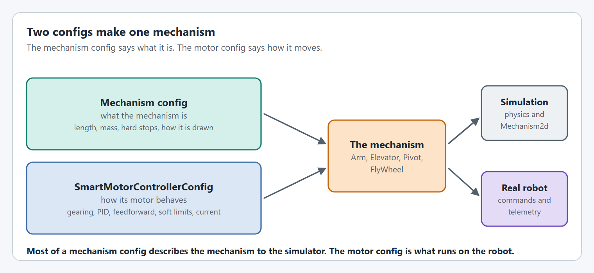
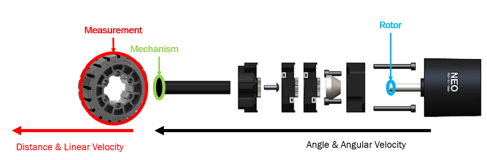
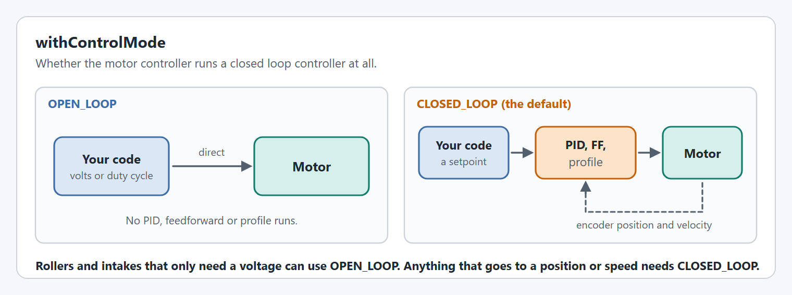

# How YAMS drives a motor

This page explains the ideas every other page assumes that you already know. Read it once before the tutorials, and come back when a word on another page is new.

* Three layers of YAMS code
* Definitions for:
  * A rotor according to YAMS
  * Mechanism
  * Measurement
* Open and closed loops
* Units for gains

## Three layers

Every YAMS mechanism is built from the same three layers, from the motor up.

1. **The motor controller.** The vendor's object, such as a `SparkMax` or a `TalonFX`, talks to the hardware. YAMS wraps it in a `SmartMotorController` (a `SparkWrapper`, `TalonFXWrapper`, `TalonFXSWrapper`, `NovaWrapper` or `A301Wrapper`), and you describe how the motor should behave in a `SmartMotorControllerConfig`: gearing, gains, limits and encoders. The config is written the same way for every vendor.
2. **The mechanism.** An `Arm`, `Elevator`, `Pivot` or `FlyWheel` takes the `SmartMotorController` and a mechanism config (`ArmConfig`, `ElevatorConfig` and so on) that says what the mechanism is: its length, mass and hard stops. It gives you commands such as `arm.run(Degrees.of(45))`, simulates the physics and draws the mechanism on the dashboard.
3. **The subsystem.** In Commands v2 a `SubsystemBase` holds the mechanism and hands its commands to the rest of the robot. In Commands v3 a class that `implements Mechanism` does the same job. Keep at most one YAMS mechanism in each, so live tuning can find it.

<figure><figcaption>
Two configs go into one mechanism.
</figcaption></figure>

You can skip layer 2 and command a `SmartMotorController` yourself: see [How do I control a mechanism without a mechanism class?](../how-to-mechanisms/how-do-i-control-a-mechanism-without-a-mechanism-class.md)

## Rotor, mechanism and measurement

YAMS measures a motor's movement in three places. These words mean the same thing on every page.

<figure><figcaption>
Rotor, mechanism and measurement.
</figcaption></figure>

* **Rotor** is the motor's own shaft, before any gearing.
* **Mechanism** is the output after the gearing: an arm's pivot, an elevator's drum, a flywheel's axle. YAMS reports positions as mechanism angles, such as `Degrees.of(90)` for an arm.
* **Measurement** is the distance the mechanism moves in a line, such as an elevator's height in meters. It needs the [mechanism circumference](../reference/editor/config/gearing-and-units.md#withmechanismcircumference): one mechanism rotation moves one circumference.

[`withGearing`](../reference/editor/config/gearing-and-units.md#withgearing) tells YAMS how many rotor rotations make one mechanism rotation, so you only ever think in mechanism units.


#### Engineering Note

A rotor is the rotating part of an electric motor. It sits inside the stator, and turns when it inteacts with the magnetic field produced by the stator.\
\
The rotor is connected to the **motor shaft**. A motor shaft is a solid steel rod running through the center of the rotor. The shaft then transfers the mechanical motion to the load.\
\
in the above documentation, the shaft is incorrectly called a rotor...


> "I'm not changing the entire API because I called a shaft, a rotor and you don't like it!" \~nstrike

## Open loop and closed loop

<figure><figcaption>
Open loop sends an output straight to the motor. Closed loop drives to a setpoint.
</figcaption></figure>

* **Open loop** sends a voltage or a duty cycle (a fraction of full output, from -1 to 1) straight to the motor. Nothing checks where the mechanism ends up. Commands such as `arm.set(0.2)` and `arm.setVoltage(Volts.of(2))` are open loop.
* **Closed loop** takes a **setpoint**, the position or speed you want, and keeps adjusting the voltage until the encoder says the mechanism is there. It adds three parts: a **feedforward** that predicts the voltage the move needs, a **PID** controller that corrects the error left over, and an optional **motion profile** that slides the setpoint there smoothly. `arm.run(Degrees.of(45))` is closed loop.

[`withControlMode`](../reference/editor/config/motor-basics.md#withcontrolmode) chooses between them. `ControlMode.CLOSED_LOOP` is the default, and it still lets you send voltages.

## Where the loop runs

The closed loop runs either on the motor controller itself, every millisecond, or on the SystemCore, every 20 ms by default. Which one depends on the motor controller and the options you pick: a TalonFX or Thrifty Nova runs PID and trapezoidal profiles itself, while an LQR runs on the SystemCore on every motor controller, and an A301, which has no closed loop of its own, runs everything on the SystemCore. You do not call anything either way. It matters for a few options, and for tuning: gains found with the loop in one place do not carry over to the other. [Where the loop runs](../reference/editor/config/closed-loop-control.md#where-the-loop-runs) has the full table of options.

## Units of your gains

Write every gain in mechanism units: **volts per mechanism rotation**, or **volts per meter** for an elevator or another mechanism that moves in a line. A `kP` of 4 on an arm means 4 V of output for each full rotation of error, which is about 0.1 V for each 10° off. A feedforward `kV` of 2 means 2 V for each rotation per second.

YAMS converts your gains to whatever each motor controller wants, so the same numbers behave the same on a SPARK, a Talon, a Nova or an A301. You never multiply by the gear ratio yourself.

## Next

Build one: start with the [Arm tutorial](arm/). Look up an option: [SmartMotorControllerConfig](../reference/editor/config/).
