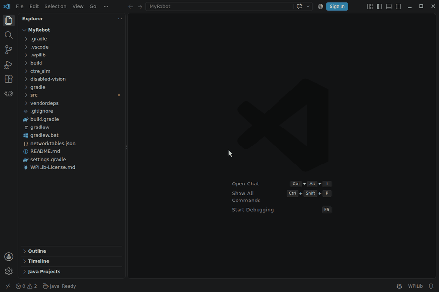
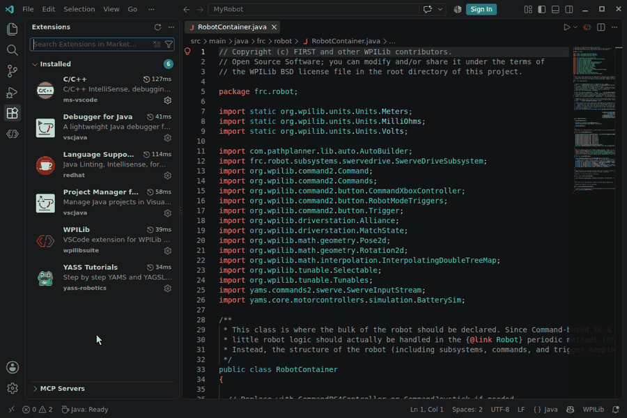
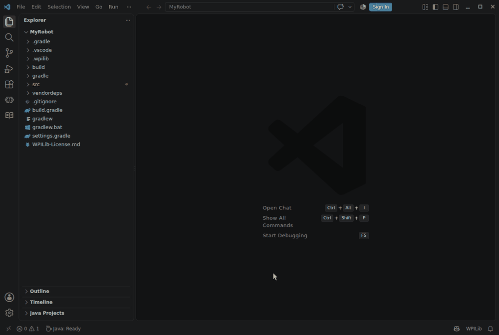
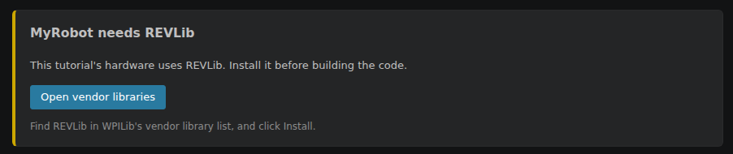
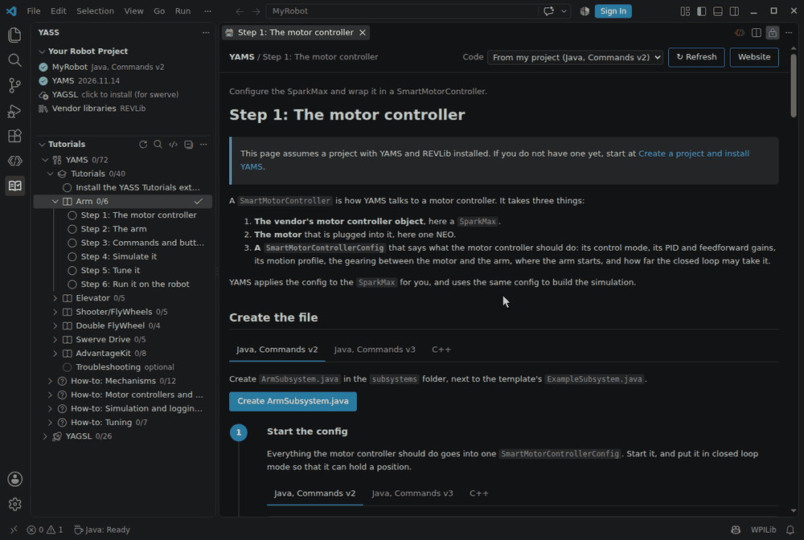
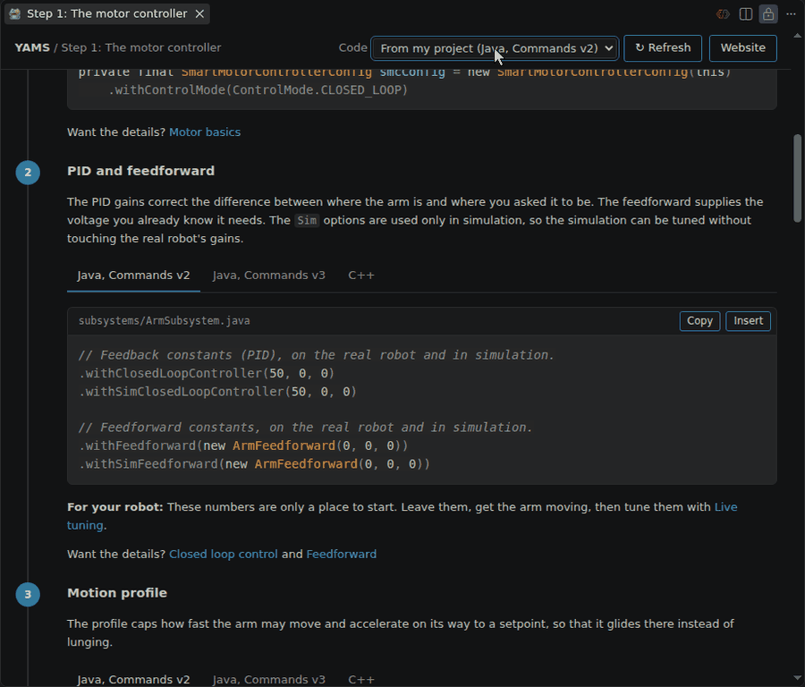
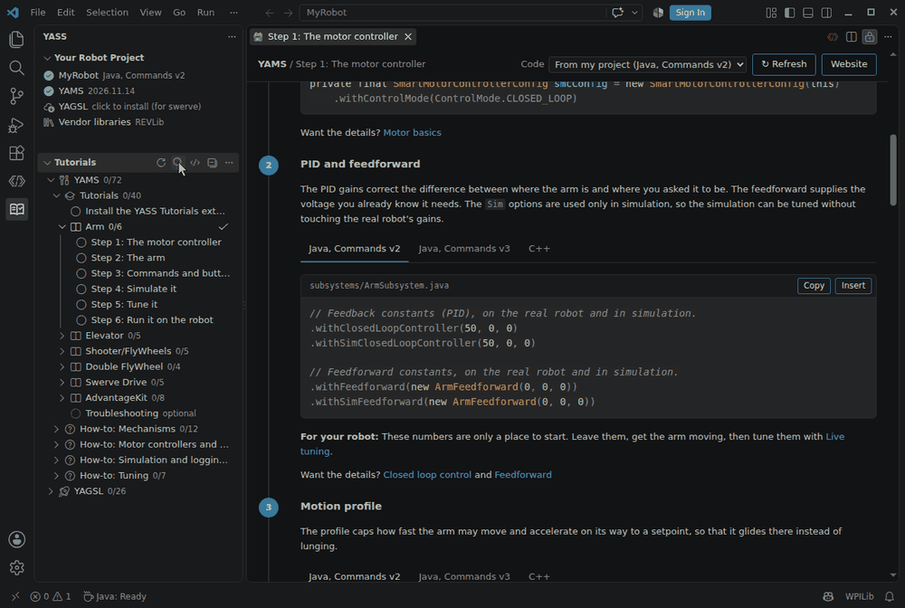

# Install the YASS Tutorials extension

The YASS Tutorials extension brings these tutorials into WPILib VS Code. It adds a **YASS** tab that lists every YAMS and YAGSL tutorial step by step, and opens each step beside your code. The tutorials are the same as on this site, so the extension is optional.



### Download the extension

Download [yass-tutorials.vsix](https://github.com/Yet-Another-Software-Suite/yass-tutorials-vscode/releases/download/latest/yass-tutorials.vsix).



### Install it in WPILib VS Code

1. Click **Extensions** in the activity bar on the left.
2. Click **...** at the top of the Extensions view.
3. Click **Install from VSIX...**, pick the `yass-tutorials.vsix` you downloaded and click **Open**.

**YASS Tutorials** appears in the list of installed extensions, and a book icon appears in the activity bar.

<figure><figcaption>
Installing yass-tutorials.vsix from the Extensions view.
</figcaption></figure>


Install it in WPILib VS Code, the one the WPILib installer adds. The extension uses WPILib's extension to create robot projects and install vendordeps.




### Open a tutorial

Click the book icon. Under **Tutorials**, click the arrow beside a tutorial to see its steps, then click a step to open it beside your code.

<figure><figcaption>
Opening the Arm tutorial's first step beside the code.
</figcaption></figure>



## Use the extension

### Install YAMS and YAGSL

**Your Robot Project** shows the open project and whether it has YAMS and YAGSL. Click **YAMS** or **YAGSL** to install the vendordep that matches your project: Commands v2 or Commands v3, Java or C++. Then click **Build Robot Code** so that the library downloads.

<figure><figcaption>
Installing YAMS from Your Robot Project.
</figcaption></figure>

When a tutorial's hardware needs a vendor library your project doesn't have, the step says so at the top. Click **Open vendor libraries**, find the library in WPILib's list and click **Install**.

<figure><figcaption>
A step that needs REVLib.
</figcaption></figure>

### Create files and insert code

When a step says to create a file, click its **Create** button. The extension writes the file to the right folder, starts it so that it compiles, and opens it beside the tutorial.

Each code sample has **Copy** and **Insert**. Click where the code goes in your file, then click **Insert** to put the sample at the cursor.

<figure><figcaption>
Creating ArmSubsystem.java, then inserting a sample into it.
</figcaption></figure>

### Pick your code language

The **Code** list at the top of every step switches every sample to **Java, Commands v2**, **Java, Commands v3** or **C++**. It starts at **From my project**, which matches the project you have open.

<figure><figcaption>
Switching the samples to C++.
</figcaption></figure>

### Track your progress and search

Hover over a step in **Tutorials** and click its check mark when you finish it. Each tutorial counts the steps you have done. To find a topic, click the magnifying glass at the top of **Tutorials** and type what you are looking for, then click a result to open it.

<figure><figcaption>
Marking a step as done, then searching for flywheel speed.
</figcaption></figure>

## Updates

The tutorials update themselves: the extension checks for new ones every day and keeps the ones it has for when you are offline. Click **Refresh** at the top of **Tutorials** to check right away.

The extension itself doesn't update on its own. To get new features, download `yass-tutorials.vsix` again and install it the same way.
