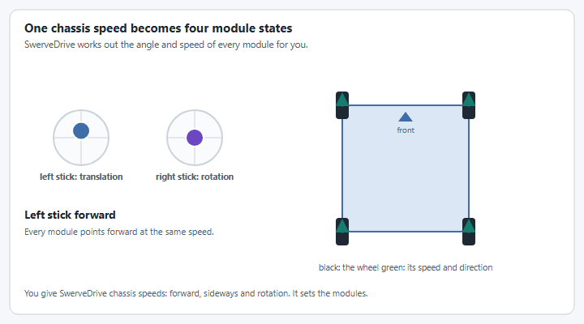
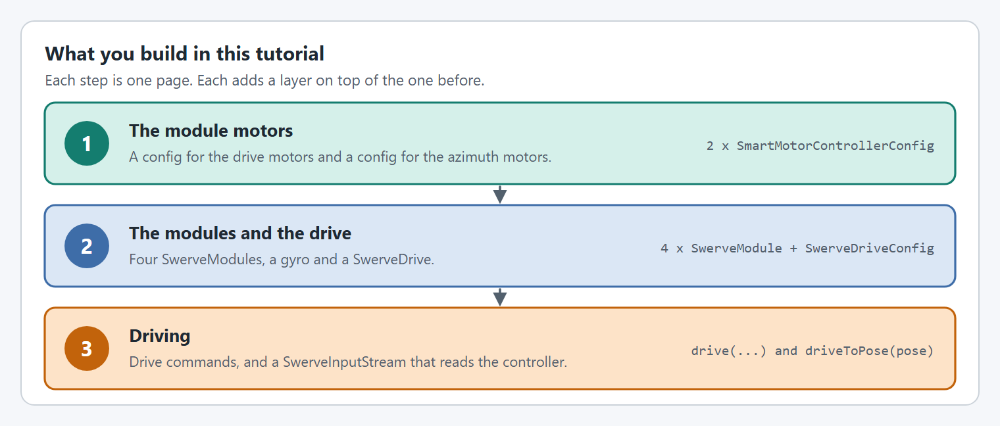

# Swerve Drive


This tutorial needs three libraries: YAMS, REVLib (for the `SparkMax` motor controllers) and Phoenix 6 (for the `CANcoder`s and the `Pigeon2`). [Create a project and install YAMS](../project-setup/) walks through installing them.


## Intro

This tutorial builds a swerve drive that works in real life and simulation with the same code.

<figure><figcaption>
You ask for a chassis speed. <code>SwerveDrive</code> works out the four modules.
</figcaption></figure>

## Details

This swerve drive uses the following hardware and controls:

* 4x `SparkMax` (NEO) drive motors, CAN IDs 1, 4, 7, 10
* 4x `SparkMax` (NEO) azimuth motors, CAN IDs 2, 5, 8, 11
* 4x `CANcoder` absolute encoders, CAN IDs 3, 6, 9, 12
* `Pigeon2` gyro, CAN ID 14
* SDS MK4 L2 modules: drive gear ratio `6.75:1`, azimuth gear ratio `12.8:1`, 4 inch wheels
* The left stick translates, and the right stick's X axis rotates
* Holding the left bumper drives to a pose on the field, and the top face button zeroes the gyro


YAMS simulates all eight motors, so a swerve simulation uses more of your computer than a single mechanism does. If it runs slowly, close other programs while it runs.


## The steps

<figure><figcaption>
The three coding steps, one page each. Step 4 then tunes it in simulation, and step 5 runs it on the real robot.
</figcaption></figure>

Every step has a tab for **Java with Commands v2**, **Java with Commands v3** and **C++**. Steps 1 to 3 each end with a check you can run, and each check names the likely failures. [Troubleshooting](../troubleshooting.md) has more.

| Step                                                      | What you do                                                                                              |
| --------------------------------------------------------- | -------------------------------------------------------------------------------------------------------- |
| [Before you start](../project-setup/)                     | Create a WPILib project and install YAMS, REVLib and Phoenix 6. Skip this if you already have a project. |
| [Step 1: The module motors](module-motors.md)             | A config for the drive motors and a config for the azimuth motors.                                       |
| [Step 2: The modules and the drive](modules-and-drive.md) | Build four `SwerveModule`s, add the gyro, and create the `SwerveDrive`.                                  |
| [Step 3: Driving](driving.md)                             | Drive commands, a `SwerveInputStream` for the sticks, and the bindings.                                  |
| [Step 4: Tune it](tune.md)                                | Practice tuning the azimuth and drive motors in simulation with AdvantageScope.                          |
| [Step 5: On the real robot](real-robot.md)                | Set the encoder offsets, check every direction, tune the modules and drive on the ground.                |

## Complete example

The following files from the YAMS `simple_robot-2027` Commands v2 example are a complete swerve drive for the same hardware. The example has no encoder offsets or tuned gains, so it is a reference for the code, not for your robot's numbers.





The same drive in the other two flavors:

* **Java, Commands v3:** [`SwerveMechanism.java`](https://github.com/Yet-Another-Software-Suite/YAMS/blob/master/examples/commands3/simple_robot-2027/src/main/java/first/robot/mechanisms/SwerveMechanism.java) in `examples/commands3/simple_robot-2027`
* **C++:** [`SwerveSubsystem.h`](https://github.com/Yet-Another-Software-Suite/YAMS/blob/master/examples/cpptest/src/main/include/subsystems/SwerveSubsystem.h) and [`SwerveSubsystem.cpp`](https://github.com/Yet-Another-Software-Suite/YAMS/blob/master/examples/cpptest/src/main/cpp/subsystems/SwerveSubsystem.cpp) in `examples/cpptest`

## Read more

* [AdvantageKit Integration](../advantagekit-integration/) for swerve
* [Organizing Configs in Constants](../../understanding/config-organization.md) for cleaner code
* [How do I view my DataLog in AdvantageScope?](../../how-to-simulation-and-logging/how-do-i-view-my-datalog-in-advantagescope.md), to review this drive's telemetry after a match
