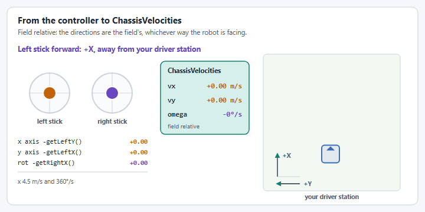

# Step 3: Driving

`SwerveDrive` takes a chassis speed (forward, sideways and rotation) and sets all four modules for you.

Four things are added in this step:

* **A drive command**, `driveFieldRelative`, that gives the drive field relative chassis speeds every loop.
* **A `SwerveInputStream`**, which turns the raw stick values into field relative chassis speeds, with the deadband and the cubing already applied.
* **`driveToPose(pose)`**, which uses the two PID controllers from step 2 to drive to a pose on the field.
* **`zeroGyro()`**, a button that makes the way the robot faces now its "forward".


**In a hurry?** Jump to [the complete file](driving.md#the-complete-file), copy it, and change the values called out under **For your robot**. The numbered parts explain each piece in a sentence or two. You do not need to understand all of it to get moving: the pages under **Understanding** go deeper when you want them.




### Read the sticks, and drive with them

A `SwerveInputStream` turns the raw stick values into field relative chassis speeds, with the deadband and the cubing already applied. A drive command gives those speeds to the drive every loop.

The command is called `driveFieldRelative`, not `drive`, on purpose: `SwerveDrive` has its own `drive(...)` command, and that one takes **robot** relative speeds.

<figure><figcaption><p>How each stick movement becomes a field relative velocity.</p></figcaption></figure>




```java
/** Drive with field relative chassis speeds. */
public Command driveFieldRelative(Supplier<ChassisVelocities> speedsSupplier) {
  return run(() -> drive.setFieldRelativeChassisSpeeds(speedsSupplier.get()))
      .withName("Field Oriented Drive");
}

/** Turn three controller axes into field relative chassis speeds. */
public SwerveInputStream getChassisSpeedsSupplier(DoubleSupplier translationX, DoubleSupplier translationY,
                                                  DoubleSupplier rotation) {
  return SwerveInputStream.of(drive, translationX, translationY)
      .withControllerRotationAxis(rotation)
      // What a full stick means. 1 m/s is slow on purpose, for the first drives.
      .withMaximumLinearVelocity(MetersPerSecond.of(1))
      .withMaximumAngularVelocity(DegreesPerSecond.of(360))
      // Ignore a stick that is barely off center.
      .withDeadband(0.05)
      // Cube the sticks, for finer control at low speed.
      .withCubeTranslationControllerAxis()
      .withCubeRotationControllerAxis()
      // Publish the stream's inputs and outputs, and allow live tuning of it.
      .withTelemetry("Driver", TelemetryVerbosity.HIGH);
}
```





```java
/** Drive with field relative chassis speeds. */
public Command driveFieldRelative(Supplier<ChassisVelocities> speedsSupplier) {
  return run(coroutine -> {
    while (true) {
      drive.setFieldRelativeChassisSpeeds(speedsSupplier.get());
      coroutine.yield();
    }
  }).named("Field Oriented Drive");
}

/** Turn three controller axes into field relative chassis speeds. */
public SwerveInputStream getChassisSpeedsSupplier(DoubleSupplier translationX, DoubleSupplier translationY,
                                                  DoubleSupplier rotation) {
  return SwerveInputStream.of(drive, translationX, translationY)
      .withControllerRotationAxis(rotation)
      // What a full stick means. 1 m/s is slow on purpose, for the first drives.
      .withMaximumLinearVelocity(MetersPerSecond.of(1))
      .withMaximumAngularVelocity(DegreesPerSecond.of(360))
      // Ignore a stick that is barely off center.
      .withDeadband(0.05)
      // Cube the sticks, for finer control at low speed.
      .withCubeTranslationControllerAxis()
      .withCubeRotationControllerAxis()
      // Publish the stream's inputs and outputs, and allow live tuning of it.
      .withTelemetry("Driver", TelemetryVerbosity.HIGH);
}
```





```cpp
/** Drive field relative from three controller axes. */
wpi::cmd::CommandPtr DriveWithSticks(std::function<double()> translationX,
                                     std::function<double()> translationY,
                                     std::function<double()> rotation);

// Turns the controller axes into field relative chassis speeds.
std::optional<yams::mechanisms::swerve::utility::SwerveInputStream<4>> m_inputStream;
```



```cpp
wpi::cmd::CommandPtr SwerveSubsystem::DriveWithSticks(std::function<double()> translationX,
                                                      std::function<double()> translationY,
                                                      std::function<double()> rotation) {
  m_inputStream.emplace(
      utility::SwerveInputStream<4>::Of(m_drive.value(), translationX, translationY)
          .WithControllerRotationAxis(rotation)
          // What a full stick means. 1 m/s is slow on purpose, for the first drives.
          .WithMaximumLinearVelocity(1_mps)
          .WithMaximumAngularVelocity(360_deg_per_s)
          // Ignore a stick that is barely off center.
          .WithDeadband(0.05)
          // Cube the sticks, for finer control at low speed.
          .WithCubeTranslationControllerAxis()
          .WithCubeRotationControllerAxis()
          // Publish the stream's inputs and outputs, and allow live tuning of it.
          .WithTelemetry("Driver", Cfg::TelemetryVerbosity::HIGH));

  return Run([this] { m_drive->SetFieldRelativeChassisSpeeds(m_inputStream->Get()); })
      .WithName("Field Oriented Drive");
}
```




**For your robot:** Set the two maximum velocities to what a full stick should mean on your robot. Keep 1 m/s until the robot has driven on the ground in [Step 5](real-robot.md), then raise it.

Want the details? [Swerve Input Stream](../../reference/swerve-input-stream/)

#### What forward means

Field relative means pushing the stick forward drives the robot **away from the driver station**, whichever way the robot itself faces. To know which way that is, the drive uses the gyro: a heading of 0 degrees is "facing away from the driver station".

The gyro starts at 0 when the code starts, and step 2 set the starting pose to 0 degrees too. So the drive assumes the robot faces away from you when it turns on. Two habits keep that true:

* **Turn the robot on facing away from the driver station.**
* **Press the zero gyro button** (bound in part 3) with the robot facing away from you, whenever forward on the stick stops matching forward on the field. That happens after the robot is turned on facing another way, or after the gyro drifts.


This tutorial leaves out `withAllianceRelativeControl()`. It flips the sticks 180 degrees on the red alliance, which is only right when the robot's pose is a real field pose: on red, a robot facing away from its driver station has a heading of 180 degrees, not 0. Add it once your autonomous routine or vision sets the real pose. See [Alliance-relative control](../../reference/swerve-input-stream/#alliance-relative-control).




### Drive to a pose, lock the wheels and zero the gyro

`driveToPose(pose)` uses the two PID controllers from step 2 to drive to a pose on the field. `lock()` turns every module toward the robot center, the X pattern, and holds it there. `zeroGyro()` makes the way the robot faces now the new 0 degrees, so forward on the stick drives the way the robot faced when you pressed it.




```java
/** Drive to a pose on the field. */
public Command driveToPose(Pose2d pose) {
  return drive.driveToPose(pose);
}

/** Turn the wheels into an X, which resists being pushed. */
public Command lock() {
  return run(drive::lockPose);
}

/** Make the way the robot faces now "forward" for field relative driving. */
public Command zeroGyro() {
  return runOnce(drive::zeroGyro).withName("Zero Gyro");
}
```





```java
/** Drive to a pose on the field. */
public Command driveToPose(Pose2d pose) {
  return drive.driveToPose(pose);
}

/** Turn the wheels into an X, which resists being pushed. */
public Command lock() {
  return run(coroutine -> {
    while (true) {
      drive.lockPose();
      coroutine.yield();
    }
  }).named("Swerve Lock");
}

/** Make the way the robot faces now "forward" for field relative driving. */
public Command zeroGyro() {
  return run(coroutine -> {
    drive.zeroGyro();
  }).named("Zero Gyro");
}
```





```cpp
/** Drive to a pose on the field. */
wpi::cmd::CommandPtr DriveToPose(wpi::math::Pose2d pose);

/** Turn the wheels into an X, which resists being pushed. */
wpi::cmd::CommandPtr Lock();

/** Make the way the robot faces now "forward" for field relative driving. */
wpi::cmd::CommandPtr ZeroGyro();
```



```cpp
wpi::cmd::CommandPtr SwerveSubsystem::DriveToPose(wpi::math::Pose2d pose) {
  return m_drive->DriveToPose(pose);
}

wpi::cmd::CommandPtr SwerveSubsystem::Lock() {
  return Run([this] { m_drive->LockPose(); });
}

wpi::cmd::CommandPtr SwerveSubsystem::ZeroGyro() {
  return RunOnce([this] { m_drive->ZeroGyro(); });
}
```




Want the details? [Auto-align](../../understanding/swerve-drive/#auto-align)



### Create it, set the default command and bind a button

Pushing a stick forward or to the left reads **negative** on a controller, so each axis is negated to match WPILib's convention: +X forward, +Y left, and counterclockwise positive.



These are three fragments of `RobotContainer.java`. [The complete file](driving.md#the-complete-file) shows where each goes, with its imports.


```java
private final SwerveSubsystem drive = new SwerveSubsystem();
```



```java
// The left stick translates and the right stick's X axis rotates.
// Pushing a stick forward or left reads negative, so negate each axis to match
// WPILib's convention: +X forward, +Y left, counterclockwise positive.
drive.setDefaultCommand(drive.driveFieldRelative(
    drive.getChassisSpeedsSupplier(
        () -> -driverController.getLeftY(),
        () -> -driverController.getLeftX(),
        () -> -driverController.getRightX())));
```



```java
// Drive to a pose on the field while the left bumper is held.
driverController.leftBumper().whileTrue(drive.driveToPose(
    new Pose2d(Meters.of(3), Meters.of(3), Rotation2d.fromDegrees(30))));

// Press the top face button to make the way the robot faces now "forward".
driverController.faceUp().onTrue(drive.zeroGyro());
```





```java
// The left stick translates and the right stick's X axis rotates.
// Pushing a stick forward or left reads negative, so negate each axis to match
// WPILib's convention: +X forward, +Y left, counterclockwise positive.
robot.drive.setDefaultCommand(robot.drive.driveFieldRelative(
    robot.drive.getChassisSpeedsSupplier(
        () -> -robot.exampleController.getLeftY(),
        () -> -robot.exampleController.getLeftX(),
        () -> -robot.exampleController.getRightX())));

// Drive to a pose on the field while the left bumper is held.
robot.exampleController.leftBumper().whileTrue(robot.drive.driveToPose(
    new Pose2d(Meters.of(3), Meters.of(3), Rotation2d.fromDegrees(30))));

// Press the top face button to make the way the robot faces now "forward".
robot.exampleController.faceUp().onTrue(robot.drive.zeroGyro());
```





```cpp
SwerveSubsystem drive;
```



```cpp
// The left stick translates and the right stick's X axis rotates.
// Pushing a stick forward or left reads negative, so negate each axis to match
// WPILib's convention: +X forward, +Y left, counterclockwise positive.
drive.SetDefaultCommand(drive.DriveWithSticks(
    [this] { return -driverController.GetLeftY(); },
    [this] { return -driverController.GetLeftX(); },
    [this] { return -driverController.GetRightX(); }));
```



```cpp
// Drive to a pose on the field while the left bumper is held.
driverController.LeftBumper().WhileTrue(
    drive.DriveToPose(wpi::math::Pose2d{3_m, 3_m, wpi::math::Rotation2d{30_deg}}));

// Press the top face button to make the way the robot faces now "forward".
driverController.FaceUp().OnTrue(drive.ZeroGyro());
```




**For your robot:** Change the pose to somewhere useful on your field, and bind `lock()` to a button if you want it. The zero gyro button can be any button the driver will not press by accident.



## The complete file



The highlighted lines are new in this step.

Add the commands and the input stream to `SwerveSubsystem.java`, then create the subsystem, set its default command and bind the left bumper and the zero gyro button in `RobotContainer.java`. The default command goes in the constructor, and the two buttons go in `configureBindings()`.

<pre class="language-java" data-title="subsystems/SwerveSubsystem.java" data-line-numbers><code class="lang-java">package first.robot.subsystems;

import static org.wpilib.units.Units.Amps;
import static org.wpilib.units.Units.Degrees;
<strong>import static org.wpilib.units.Units.DegreesPerSecond;
</strong>import static org.wpilib.units.Units.Inches;
<strong>import static org.wpilib.units.Units.MetersPerSecond;
</strong>import static org.wpilib.units.Units.Rotations;

import com.ctre.phoenix6.CANBus;
import com.ctre.phoenix6.hardware.CANcoder;
import com.ctre.phoenix6.hardware.Pigeon2;
import com.revrobotics.spark.SparkLowLevel.MotorType;
import com.revrobotics.spark.SparkMax;
<strong>import java.util.function.DoubleSupplier;
</strong><strong>import java.util.function.Supplier;
</strong><strong>import org.wpilib.command2.Command;
</strong>import org.wpilib.command2.SubsystemBase;
import org.wpilib.hardware.bus.CANPort;
import org.wpilib.math.controller.PIDController;
import org.wpilib.math.controller.SimpleMotorFeedforward;
import org.wpilib.math.geometry.Pose2d;
import org.wpilib.math.geometry.Rotation2d;
import org.wpilib.math.geometry.Translation2d;
<strong>import org.wpilib.math.kinematics.ChassisVelocities;
</strong>import org.wpilib.math.system.DCMotor;
import org.wpilib.units.measure.Angle;
import yams.commands2.config.SmartMotorControllerConfig;
import yams.commands2.config.SwerveDriveConfig;
import yams.commands2.swerve.SwerveDrive;
<strong>import yams.commands2.swerve.SwerveInputStream;
</strong>import yams.core.gearing.MechanismGearing;
import yams.core.mechanisms.config.SwerveModuleConfig;
import yams.core.mechanisms.swerve.SwerveModule;
import yams.core.motorcontrollers.SmartMotorController;
import yams.core.motorcontrollers.local.SparkWrapper;
import yams.core.telemetry.enums.TelemetryVerbosity;

public class SwerveSubsystem extends SubsystemBase {

  private final SwerveDrive drive;

  // The gyro: a Pigeon2 with CAN ID 14.
  private final Pigeon2 gyro = new Pigeon2(14, new CANBus(CANPort.CAN_S0));

  /** The config of one drive motor. Drive motors are velocity controlled. */
  private SmartMotorControllerConfig buildDriveCfg() {
    return new SmartMotorControllerConfig(this)
        // The wheel diameter turns wheel rotations into distance driven.
        .withWheelDiameter(Inches.of(4))
        // kP trims the velocity error that is left after the feedforward.
        .withClosedLoopController(0.3, 0, 0)
        // Gearing from the motor rotor to the wheel: 6.75:1, an MK4 L2 module.
        .withGearing(new MechanismGearing(6.75))
        // kV, in volts per wheel rotation per second, does most of the work of holding a speed.
        // 0.85 is a placeholder, about right for a NEO on 6.75:1. Step 4 tunes it.
        .withFeedforward(new SimpleMotorFeedforward(0, 0.85))
        // Set this to true if the wheel spins backward when it is told to drive forward.
        .withMotorInverted(false)
        .withStatorCurrentLimit(Amps.of(40))
        .withTelemetry("driveMotor", TelemetryVerbosity.HIGH);
  }

  /** The config of one azimuth (steering) motor. Azimuth motors are position controlled. */
  private SmartMotorControllerConfig buildAzimuthCfg() {
    return new SmartMotorControllerConfig(this)
        // kP, in volts per rotation of angle error. A placeholder: Step 4 tunes it.
        .withClosedLoopController(4, 0, 0)
        // The wheel turns all the way round, so -180 and +180 degrees are the same angle.
        // Without this, a wheel at 170 degrees asked for -170 turns the long way round.
        .withContinuousWrapping(Rotations.of(-0.5), Rotations.of(0.5))
        // Gearing from the motor rotor to the module's steering axis: 12.8:1, an MK4 module.
        .withGearing(new MechanismGearing(12.8))
        // Set this to true if the wheel turns clockwise, seen from above, when told to turn counter-clockwise.
        .withMotorInverted(false)
        // The azimuth motor rarely works hard, so it gets a lower limit.
        .withStatorCurrentLimit(Amps.of(20))
        .withTelemetry("angleMotor", TelemetryVerbosity.HIGH);
  }

  /** All four modules share their gearing and gains, so one method builds each of them. */
  private SwerveModule createModule(SparkMax drive, SparkMax azimuth, CANcoder absoluteEncoder,
                                    Angle encoderOffset, String moduleName, Translation2d location) {
    SmartMotorController driveMotor = new SparkWrapper(drive, DCMotor.getNEO(1), buildDriveCfg());
    SmartMotorController azimuthMotor = new SparkWrapper(azimuth, DCMotor.getNEO(1), buildAzimuthCfg());

    return new SwerveModule(new SwerveModuleConfig(driveMotor, azimuthMotor)
        // The CANcoder tells the module which way it points when the robot turns on.
        .withAbsoluteEncoder(absoluteEncoder.getAbsolutePosition().asSupplier())
        // The CANcoder's raw reading when the wheel points forward with its bevel gear to the left.
        // Every module has its own. Step 5 measures it on the real robot.
        .withAbsoluteEncoderOffset(encoderOffset)
        .withTelemetry(moduleName, TelemetryVerbosity.HIGH)
        // Where the module is on the robot: +X is forward, +Y is left.
        .withLocation(location)
        // Turn the module at most 90 degrees, reversing the wheel instead of turning further.
        .withOptimization(true));
  }

  public SwerveSubsystem() {
    // Each module is 24 inches forward or back and 24 inches left or right of the robot center.
    // CAN IDs are grouped by module: drive, azimuth, CANcoder.
    // Every encoder offset is 0 until Step 5 measures the real ones.
    var frontLeft = createModule(new SparkMax(CANPort.CAN_S0, 1, MotorType.kBrushless),
                                 new SparkMax(CANPort.CAN_S0, 2, MotorType.kBrushless),
                                 new CANcoder(3, new CANBus(CANPort.CAN_S0)), Degrees.of(0), "frontleft",
                                 new Translation2d(Inches.of(24), Inches.of(24)));
    var frontRight = createModule(new SparkMax(CANPort.CAN_S0, 4, MotorType.kBrushless),
                                  new SparkMax(CANPort.CAN_S0, 5, MotorType.kBrushless),
                                  new CANcoder(6, new CANBus(CANPort.CAN_S0)), Degrees.of(0), "frontright",
                                  new Translation2d(Inches.of(24), Inches.of(-24)));
    var backLeft = createModule(new SparkMax(CANPort.CAN_S0, 7, MotorType.kBrushless),
                                new SparkMax(CANPort.CAN_S0, 8, MotorType.kBrushless),
                                new CANcoder(9, new CANBus(CANPort.CAN_S0)), Degrees.of(0), "backleft",
                                new Translation2d(Inches.of(-24), Inches.of(24)));
    var backRight = createModule(new SparkMax(CANPort.CAN_S0, 10, MotorType.kBrushless),
                                 new SparkMax(CANPort.CAN_S0, 11, MotorType.kBrushless),
                                 new CANcoder(12, new CANBus(CANPort.CAN_S0)), Degrees.of(0), "backright",
                                 new Translation2d(Inches.of(-24), Inches.of(-24)));

    SwerveDriveConfig config = new SwerveDriveConfig(this, frontLeft, frontRight, backLeft, backRight)
        // The gyro's attitude. Its yaw is the heading used for field relative driving.
        .withGyro(gyro::getRotation3d)
        .withStartingPose(new Pose2d(0, 0, Rotation2d.fromDegrees(0)))
        // Used by driveToPose(). A kP of 1 is a careful place to start.
        .withTranslationController(new PIDController(1, 0, 0))
        .withRotationController(new PIDController(1, 0, 0))
        // Publishes under NT:/Mechanisms/swerve. HIGH also publishes the live tuning keys.
        .withTelemetry("swerve", TelemetryVerbosity.HIGH);

    drive = new SwerveDrive(config);
  }

<strong>  /** Drive with field relative chassis speeds. */
</strong><strong>  public Command driveFieldRelative(Supplier&#x3C;ChassisVelocities> speedsSupplier) {
</strong><strong>    return run(() -> drive.setFieldRelativeChassisSpeeds(speedsSupplier.get()))
</strong><strong>        .withName("Field Oriented Drive");
</strong><strong>  }
</strong>
<strong>  /** Drive to a pose on the field. */
</strong><strong>  public Command driveToPose(Pose2d pose) {
</strong><strong>    return drive.driveToPose(pose);
</strong><strong>  }
</strong>
<strong>  /** Turn the wheels into an X, which resists being pushed. */
</strong><strong>  public Command lock() {
</strong><strong>    return run(drive::lockPose);
</strong><strong>  }
</strong>
<strong>  /** Make the way the robot faces now "forward" for field relative driving. */
</strong><strong>  public Command zeroGyro() {
</strong><strong>    return runOnce(drive::zeroGyro).withName("Zero Gyro");
</strong><strong>  }
</strong>
<strong>  /** Turn three controller axes into field relative chassis speeds. */
</strong><strong>  public SwerveInputStream getChassisSpeedsSupplier(DoubleSupplier translationX, DoubleSupplier translationY,
</strong><strong>                                                    DoubleSupplier rotation) {
</strong><strong>    return SwerveInputStream.of(drive, translationX, translationY)
</strong><strong>        .withControllerRotationAxis(rotation)
</strong><strong>        // What a full stick means. 1 m/s is slow on purpose, for the first drives.
</strong><strong>        .withMaximumLinearVelocity(MetersPerSecond.of(1))
</strong><strong>        .withMaximumAngularVelocity(DegreesPerSecond.of(360))
</strong><strong>        // Ignore a stick that is barely off center.
</strong><strong>        .withDeadband(0.05)
</strong><strong>        // Cube the sticks, for finer control at low speed.
</strong><strong>        .withCubeTranslationControllerAxis()
</strong><strong>        .withCubeRotationControllerAxis()
</strong><strong>        // Publish the stream's inputs and outputs, and allow live tuning of it.
</strong><strong>        .withTelemetry("Driver", TelemetryVerbosity.HIGH);
</strong><strong>  }
</strong>
  @Override
  public void periodic() {
    // Updates the pose estimate, the telemetry and the drive's Field2d.
    drive.updateTelemetry();
  }

  @Override
  public void simulationPeriodic() {
    // Runs the physics simulation of all eight motors.
    drive.simIterate();
    // Optional: in simulation the drive's heading comes from the simulated robot, not the
    // Pigeon2. This keeps the Pigeon2's own reading in step, for code that reads it directly.
    gyro.getSimState().setRawYaw(drive.getSimPose().getRotation().getMeasure());
  }
}
</code></pre>

<pre class="language-java" data-title="RobotContainer.java" data-line-numbers><code class="lang-java">package first.robot;

<strong>import static org.wpilib.units.Units.Meters;
</strong>
import org.wpilib.command2.Command;
import org.wpilib.command2.button.CommandGamepad;
import org.wpilib.command2.button.Trigger;
<strong>import org.wpilib.math.geometry.Pose2d;
</strong><strong>import org.wpilib.math.geometry.Rotation2d;
</strong>import first.robot.Constants.OperatorConstants;
import first.robot.commands.Autos;
import first.robot.commands.ExampleCommand;
<strong>import first.robot.subsystems.SwerveSubsystem;
</strong>import first.robot.subsystems.ExampleSubsystem;

/**
 * This class is where the bulk of the robot should be declared. Since Command-based is a
 * "declarative" paradigm, very little robot logic should actually be handled in the {@link Robot}
 * periodic methods (other than the scheduler calls). Instead, the structure of the robot (including
 * subsystems, commands, and trigger mappings) should be declared here.
 */
public class RobotContainer {
  // The robot's subsystems and commands are defined here...
  private final ExampleSubsystem exampleSubsystem = new ExampleSubsystem();
<strong>  private final SwerveSubsystem drive = new SwerveSubsystem();
</strong>
  private final CommandGamepad driverController =
      new CommandGamepad(OperatorConstants.DRIVER_CONTROLLER_PORT);

  /** The container for the robot. Contains subsystems, OI devices, and commands. */
  public RobotContainer() {
    // Configure the trigger bindings
    configureBindings();

<strong>    // The left stick translates and the right stick's X axis rotates.
</strong><strong>    // Pushing a stick forward or left reads negative, so negate each axis to match
</strong><strong>    // WPILib's convention: +X forward, +Y left, counterclockwise positive.
</strong><strong>    drive.setDefaultCommand(drive.driveFieldRelative(
</strong><strong>        drive.getChassisSpeedsSupplier(
</strong><strong>            () -> -driverController.getLeftY(),
</strong><strong>            () -> -driverController.getLeftX(),
</strong><strong>            () -> -driverController.getRightX())));
</strong>  }

  /**
   * Use this method to define your trigger->command mappings. Triggers can be created via the
   * {@link Trigger#Trigger(java.util.function.BooleanSupplier)} constructor with an arbitrary
   * predicate, or via the named factories in {@link org.wpilib.command2.button.CommandGenericHID}'s
   * subclasses for {@link CommandGamepad Gamepad} gamepads or {@link
   * org.wpilib.command2.button.CommandJoystick Flight joysticks}.
   */
  private void configureBindings() {
    // Schedule `ExampleCommand` when `exampleCondition` changes to `true`
    new Trigger(exampleSubsystem::exampleCondition).onTrue(new ExampleCommand(exampleSubsystem));

    // Schedule `exampleMethodCommand` when the Gamepad's right face button is pressed,
    // cancelling on release.
    driverController.faceRight().whileTrue(exampleSubsystem.exampleMethodCommand());

<strong>    // Drive to a pose on the field while the left bumper is held.
</strong><strong>    driverController.leftBumper().whileTrue(drive.driveToPose(
</strong><strong>        new Pose2d(Meters.of(3), Meters.of(3), Rotation2d.fromDegrees(30))));
</strong>
<strong>    // Press the top face button to make the way the robot faces now "forward".
</strong><strong>    driverController.faceUp().onTrue(drive.zeroGyro());
</strong>  }

  /**
   * Use this to pass the autonomous command to the main {@link Robot} class.
   *
   * @return the command to run in autonomous
   */
  public Command getAutonomousCommand() {
    // An example command will be run in autonomous
    return Autos.exampleAuto(exampleSubsystem);
  }
}
</code></pre>



The highlighted lines are new in this step.

Add the commands and the input stream to `SwerveMechanism.java`, then set the default command and bind the left bumper and the zero gyro button in `ExampleTeleop.java`. Setting the drive's default command in the teleop op mode means an autonomous op mode never reads the sticks.

`SwerveInputStream` comes from `yams.commands3.swerve`.

<pre class="language-java" data-title="mechanisms/SwerveMechanism.java" data-line-numbers><code class="lang-java">package first.robot.mechanisms;

import static org.wpilib.units.Units.Amps;
import static org.wpilib.units.Units.Degrees;
<strong>import static org.wpilib.units.Units.DegreesPerSecond;
</strong>import static org.wpilib.units.Units.Inches;
<strong>import static org.wpilib.units.Units.MetersPerSecond;
</strong>import static org.wpilib.units.Units.Rotations;

import com.ctre.phoenix6.CANBus;
import com.ctre.phoenix6.hardware.CANcoder;
import com.ctre.phoenix6.hardware.Pigeon2;
import com.revrobotics.spark.SparkLowLevel.MotorType;
import com.revrobotics.spark.SparkMax;
<strong>import java.util.function.DoubleSupplier;
</strong><strong>import java.util.function.Supplier;
</strong><strong>import org.wpilib.command3.Command;
</strong>import org.wpilib.command3.Mechanism;
import org.wpilib.hardware.bus.CANPort;
import org.wpilib.math.controller.PIDController;
import org.wpilib.math.controller.SimpleMotorFeedforward;
import org.wpilib.math.geometry.Pose2d;
import org.wpilib.math.geometry.Rotation2d;
import org.wpilib.math.geometry.Translation2d;
<strong>import org.wpilib.math.kinematics.ChassisVelocities;
</strong>import org.wpilib.math.system.DCMotor;
import org.wpilib.units.measure.Angle;
import yams.commands3.config.SmartMotorControllerConfig;
import yams.commands3.config.SwerveDriveConfig;
import yams.commands3.swerve.SwerveDrive;
<strong>import yams.commands3.swerve.SwerveInputStream;
</strong>import yams.core.gearing.MechanismGearing;
import yams.core.mechanisms.config.SwerveModuleConfig;
import yams.core.mechanisms.swerve.SwerveModule;
import yams.core.motorcontrollers.SmartMotorController;
import yams.core.motorcontrollers.local.SparkWrapper;
import yams.core.telemetry.enums.TelemetryVerbosity;

public class SwerveMechanism implements Mechanism {

  private final SwerveDrive drive;

  // The gyro: a Pigeon2 with CAN ID 14.
  private final Pigeon2 gyro = new Pigeon2(14, new CANBus(CANPort.CAN_S0));

  /** The config of one drive motor. Drive motors are velocity controlled. */
  private SmartMotorControllerConfig buildDriveCfg() {
    return new SmartMotorControllerConfig(this)
        // The wheel diameter turns wheel rotations into distance driven.
        .withWheelDiameter(Inches.of(4))
        // kP trims the velocity error that is left after the feedforward.
        .withClosedLoopController(0.3, 0, 0)
        // Gearing from the motor rotor to the wheel: 6.75:1, an MK4 L2 module.
        .withGearing(new MechanismGearing(6.75))
        // kV, in volts per wheel rotation per second, does most of the work of holding a speed.
        // 0.85 is a placeholder, about right for a NEO on 6.75:1. Step 4 tunes it.
        .withFeedforward(new SimpleMotorFeedforward(0, 0.85))
        // Set this to true if the wheel spins backward when it is told to drive forward.
        .withMotorInverted(false)
        .withStatorCurrentLimit(Amps.of(40))
        .withTelemetry("driveMotor", TelemetryVerbosity.HIGH);
  }

  /** The config of one azimuth (steering) motor. Azimuth motors are position controlled. */
  private SmartMotorControllerConfig buildAzimuthCfg() {
    return new SmartMotorControllerConfig(this)
        // kP, in volts per rotation of angle error. A placeholder: Step 4 tunes it.
        .withClosedLoopController(4, 0, 0)
        // The wheel turns all the way round, so -180 and +180 degrees are the same angle.
        // Without this, a wheel at 170 degrees asked for -170 turns the long way round.
        .withContinuousWrapping(Rotations.of(-0.5), Rotations.of(0.5))
        // Gearing from the motor rotor to the module's steering axis: 12.8:1, an MK4 module.
        .withGearing(new MechanismGearing(12.8))
        // Set this to true if the wheel turns clockwise, seen from above, when told to turn counter-clockwise.
        .withMotorInverted(false)
        // The azimuth motor rarely works hard, so it gets a lower limit.
        .withStatorCurrentLimit(Amps.of(20))
        .withTelemetry("angleMotor", TelemetryVerbosity.HIGH);
  }

  /** All four modules share their gearing and gains, so one method builds each of them. */
  private SwerveModule createModule(SparkMax drive, SparkMax azimuth, CANcoder absoluteEncoder,
                                    Angle encoderOffset, String moduleName, Translation2d location) {
    SmartMotorController driveMotor = new SparkWrapper(drive, DCMotor.getNEO(1), buildDriveCfg());
    SmartMotorController azimuthMotor = new SparkWrapper(azimuth, DCMotor.getNEO(1), buildAzimuthCfg());

    return new SwerveModule(new SwerveModuleConfig(driveMotor, azimuthMotor)
        // The CANcoder tells the module which way it points when the robot turns on.
        .withAbsoluteEncoder(absoluteEncoder.getAbsolutePosition().asSupplier())
        // The CANcoder's raw reading when the wheel points forward with its bevel gear to the left.
        // Every module has its own. Step 5 measures it on the real robot.
        .withAbsoluteEncoderOffset(encoderOffset)
        .withTelemetry(moduleName, TelemetryVerbosity.HIGH)
        // Where the module is on the robot: +X is forward, +Y is left.
        .withLocation(location)
        // Turn the module at most 90 degrees, reversing the wheel instead of turning further.
        .withOptimization(true));
  }

  public SwerveMechanism() {
    // Each module is 24 inches forward or back and 24 inches left or right of the robot center.
    // CAN IDs are grouped by module: drive, azimuth, CANcoder.
    // Every encoder offset is 0 until Step 5 measures the real ones.
    var frontLeft = createModule(new SparkMax(CANPort.CAN_S0, 1, MotorType.kBrushless),
                                 new SparkMax(CANPort.CAN_S0, 2, MotorType.kBrushless),
                                 new CANcoder(3, new CANBus(CANPort.CAN_S0)), Degrees.of(0), "frontleft",
                                 new Translation2d(Inches.of(24), Inches.of(24)));
    var frontRight = createModule(new SparkMax(CANPort.CAN_S0, 4, MotorType.kBrushless),
                                  new SparkMax(CANPort.CAN_S0, 5, MotorType.kBrushless),
                                  new CANcoder(6, new CANBus(CANPort.CAN_S0)), Degrees.of(0), "frontright",
                                  new Translation2d(Inches.of(24), Inches.of(-24)));
    var backLeft = createModule(new SparkMax(CANPort.CAN_S0, 7, MotorType.kBrushless),
                                new SparkMax(CANPort.CAN_S0, 8, MotorType.kBrushless),
                                new CANcoder(9, new CANBus(CANPort.CAN_S0)), Degrees.of(0), "backleft",
                                new Translation2d(Inches.of(-24), Inches.of(24)));
    var backRight = createModule(new SparkMax(CANPort.CAN_S0, 10, MotorType.kBrushless),
                                 new SparkMax(CANPort.CAN_S0, 11, MotorType.kBrushless),
                                 new CANcoder(12, new CANBus(CANPort.CAN_S0)), Degrees.of(0), "backright",
                                 new Translation2d(Inches.of(-24), Inches.of(-24)));

    SwerveDriveConfig config = new SwerveDriveConfig(this, frontLeft, frontRight, backLeft, backRight)
        // The gyro's attitude. Its yaw is the heading used for field relative driving.
        .withGyro(gyro::getRotation3d)
        .withStartingPose(new Pose2d(0, 0, Rotation2d.fromDegrees(0)))
        // Used by driveToPose(). A kP of 1 is a careful place to start.
        .withTranslationController(new PIDController(1, 0, 0))
        .withRotationController(new PIDController(1, 0, 0))
        // Publishes under NT:/Mechanisms/swerve. HIGH also publishes the live tuning keys.
        .withTelemetry("swerve", TelemetryVerbosity.HIGH);

    drive = new SwerveDrive(config);
  }

<strong>  /** Drive with field relative chassis speeds. */
</strong><strong>  public Command driveFieldRelative(Supplier&#x3C;ChassisVelocities> speedsSupplier) {
</strong><strong>    return run(coroutine -> {
</strong><strong>      while (true) {
</strong><strong>        drive.setFieldRelativeChassisSpeeds(speedsSupplier.get());
</strong><strong>        coroutine.yield();
</strong><strong>      }
</strong><strong>    }).named("Field Oriented Drive");
</strong><strong>  }
</strong>
<strong>  /** Drive to a pose on the field. */
</strong><strong>  public Command driveToPose(Pose2d pose) {
</strong><strong>    return drive.driveToPose(pose);
</strong><strong>  }
</strong>
<strong>  /** Turn the wheels into an X, which resists being pushed. */
</strong><strong>  public Command lock() {
</strong><strong>    return run(coroutine -> {
</strong><strong>      while (true) {
</strong><strong>        drive.lockPose();
</strong><strong>        coroutine.yield();
</strong><strong>      }
</strong><strong>    }).named("Swerve Lock");
</strong><strong>  }
</strong>
<strong>  /** Make the way the robot faces now "forward" for field relative driving. */
</strong><strong>  public Command zeroGyro() {
</strong><strong>    return run(coroutine -> {
</strong><strong>      drive.zeroGyro();
</strong><strong>    }).named("Zero Gyro");
</strong><strong>  }
</strong>
<strong>  /** Turn three controller axes into field relative chassis speeds. */
</strong><strong>  public SwerveInputStream getChassisSpeedsSupplier(DoubleSupplier translationX, DoubleSupplier translationY,
</strong><strong>                                                    DoubleSupplier rotation) {
</strong><strong>    return SwerveInputStream.of(drive, translationX, translationY)
</strong><strong>        .withControllerRotationAxis(rotation)
</strong><strong>        // What a full stick means. 1 m/s is slow on purpose, for the first drives.
</strong><strong>        .withMaximumLinearVelocity(MetersPerSecond.of(1))
</strong><strong>        .withMaximumAngularVelocity(DegreesPerSecond.of(360))
</strong><strong>        // Ignore a stick that is barely off center.
</strong><strong>        .withDeadband(0.05)
</strong><strong>        // Cube the sticks, for finer control at low speed.
</strong><strong>        .withCubeTranslationControllerAxis()
</strong><strong>        .withCubeRotationControllerAxis()
</strong><strong>        // Publish the stream's inputs and outputs, and allow live tuning of it.
</strong><strong>        .withTelemetry("Driver", TelemetryVerbosity.HIGH);
</strong><strong>  }
</strong>
  /** Call this from Robot.robotPeriodic(), before the scheduler runs. */
  public void periodic() {
    // Updates the pose estimate, the telemetry and the drive's Field2d.
    drive.updateTelemetry();
  }

  /** Robot.simulationInit() runs this in its own Notifier, every robot loop. */
  public void simulationPeriodic() {
    // Runs the physics simulation of all eight motors.
    drive.simIterate();
    // Optional: in simulation the drive's heading comes from the simulated robot, not the
    // Pigeon2. This keeps the Pigeon2's own reading in step, for code that reads it directly.
    gyro.getSimState().setRawYaw(drive.getSimPose().getRotation().getMeasure());
  }
}
</code></pre>

<pre class="language-java" data-title="ExampleTeleop.java" data-line-numbers><code class="lang-java">package first.robot;

<strong>import static org.wpilib.units.Units.Meters;
</strong>
<strong>import org.wpilib.math.geometry.Pose2d;
</strong><strong>import org.wpilib.math.geometry.Rotation2d;
</strong>import org.wpilib.opmode.OpMode;
import org.wpilib.opmode.Teleop;

@Teleop
public class ExampleTeleop implements OpMode {
  public ExampleTeleop(Robot robot) {
    robot.exampleController.rightStick().whileTrue(robot.exampleMechanism.exampleCommand());

<strong>    // The left stick translates and the right stick's X axis rotates.
</strong><strong>    // Pushing a stick forward or left reads negative, so negate each axis to match
</strong><strong>    // WPILib's convention: +X forward, +Y left, counterclockwise positive.
</strong><strong>    robot.drive.setDefaultCommand(robot.drive.driveFieldRelative(
</strong><strong>        robot.drive.getChassisSpeedsSupplier(
</strong><strong>            () -> -robot.exampleController.getLeftY(),
</strong><strong>            () -> -robot.exampleController.getLeftX(),
</strong><strong>            () -> -robot.exampleController.getRightX())));
</strong>
<strong>    // Drive to a pose on the field while the left bumper is held.
</strong><strong>    robot.exampleController.leftBumper().whileTrue(robot.drive.driveToPose(
</strong><strong>        new Pose2d(Meters.of(3), Meters.of(3), Rotation2d.fromDegrees(30))));
</strong>
<strong>    // Press the top face button to make the way the robot faces now "forward".
</strong><strong>    robot.exampleController.faceUp().onTrue(robot.drive.zeroGyro());
</strong>  }
}
</code></pre>



The highlighted lines are new in this step.

In C++ the subsystem owns the `SwerveInputStream`, because the drive command reads it every loop. `DriveWithSticks` builds the stream from three functions that read the controller and returns the command that drives with it.

<pre class="language-cpp" data-title="include/subsystems/SwerveSubsystem.hpp" data-line-numbers><code class="lang-cpp">#pragma once

<strong>#include &#x3C;functional>
</strong>#include &#x3C;optional>
#include &#x3C;string>

#include &#x3C;ctre/phoenix6/CANcoder.hpp>
#include &#x3C;ctre/phoenix6/Pigeon2.hpp>
#include &#x3C;rev/SparkMax.h>
<strong>#include &#x3C;wpi/commands2/CommandPtr.hpp>
</strong>#include &#x3C;wpi/commands2/SubsystemBase.hpp>
#include &#x3C;wpi/hardware/bus/CANPort.hpp>
<strong>#include &#x3C;wpi/math/geometry/Pose2d.hpp>
</strong>#include &#x3C;wpi/math/geometry/Translation2d.hpp>
#include &#x3C;wpi/units/angle.hpp>

#include "yams/mechanisms/config/SwerveModuleConfig.hpp"
#include "yams/mechanisms/swerve/SwerveDrive.hpp"
#include "yams/mechanisms/swerve/SwerveDriveConfig.hpp"
#include "yams/mechanisms/swerve/SwerveModule.hpp"
<strong>#include "yams/mechanisms/swerve/utility/SwerveInputStream.hpp"
</strong>#include "yams/motorcontrollers/SmartMotorControllerConfig.hpp"
#include "yams/motorcontrollers/local/SparkWrapper.hpp"

class SwerveSubsystem : public wpi::cmd::SubsystemBase {
 public:
  SwerveSubsystem();

<strong>  /** Drive field relative from three controller axes. */
</strong><strong>  wpi::cmd::CommandPtr DriveWithSticks(std::function&#x3C;double()> translationX,
</strong><strong>                                       std::function&#x3C;double()> translationY,
</strong><strong>                                       std::function&#x3C;double()> rotation);
</strong>
<strong>  /** Drive to a pose on the field. */
</strong><strong>  wpi::cmd::CommandPtr DriveToPose(wpi::math::Pose2d pose);
</strong>
<strong>  /** Turn the wheels into an X, which resists being pushed. */
</strong><strong>  wpi::cmd::CommandPtr Lock();
</strong>
<strong>  /** Make the way the robot faces now "forward" for field relative driving. */
</strong><strong>  wpi::cmd::CommandPtr ZeroGyro();
</strong>
  void Periodic() override;
  void SimulationPeriodic() override;

 private:
  /** Fill in the config of one drive motor. Drive motors are velocity controlled. */
  void ConfigureDrive(yams::motorcontrollers::SmartMotorControllerConfig&#x26; config);

  /** Fill in the config of one azimuth (steering) motor. Azimuth motors are position controlled. */
  void ConfigureAzimuth(yams::motorcontrollers::SmartMotorControllerConfig&#x26; config);

  // Everything one module is made of. YAMS keeps pointers to the configs and the
  // motor controllers, so they live here, next to the module that uses them.
  struct Module {
    Module(int driveId, int azimuthId, int encoderId)
        : drive{wpi::CANPort::CAN_S0, driveId, rev::spark::SparkMax::MotorType::kBrushless},
          azimuth{wpi::CANPort::CAN_S0, azimuthId, rev::spark::SparkMax::MotorType::kBrushless},
          encoder{encoderId, ctre::phoenix6::CANBus{}} {}

    rev::spark::SparkMax drive;
    rev::spark::SparkMax azimuth;
    ctre::phoenix6::hardware::CANcoder encoder;
    yams::motorcontrollers::SmartMotorControllerConfig driveConfig;
    yams::motorcontrollers::SmartMotorControllerConfig azimuthConfig;
    std::optional&#x3C;yams::motorcontrollers::local::SparkWrapper> driveMotor;
    std::optional&#x3C;yams::motorcontrollers::local::SparkWrapper> azimuthMotor;
    yams::mechanisms::config::SwerveModuleConfig config;
    std::optional&#x3C;yams::mechanisms::swerve::SwerveModule> module;
  };

  /** All four modules share their gearing and gains, so one method sets up each of them. */
  void SetupModule(Module&#x26; module, const std::string&#x26; name, wpi::math::Translation2d location,
                   wpi::units::degree_t encoderOffset);

  // The gyro: a Pigeon2 with CAN ID 14.
  ctre::phoenix6::hardware::Pigeon2 m_gyro{14, ctre::phoenix6::CANBus{}};

  // CAN IDs are grouped by module: drive, azimuth, CANcoder.
  Module m_frontLeft{1, 2, 3};
  Module m_frontRight{4, 5, 6};
  Module m_backLeft{7, 8, 9};
  Module m_backRight{10, 11, 12};

  yams::mechanisms::swerve::SwerveDriveConfig m_driveConfig;
  std::optional&#x3C;yams::mechanisms::swerve::SwerveDrive&#x3C;4>> m_drive;

<strong>  // Turns the controller axes into field relative chassis speeds.
</strong><strong>  std::optional&#x3C;yams::mechanisms::swerve::utility::SwerveInputStream&#x3C;4>> m_inputStream;
</strong>};
</code></pre>

<pre class="language-cpp" data-title="cpp/subsystems/SwerveSubsystem.cpp" data-line-numbers><code class="lang-cpp">#include "subsystems/SwerveSubsystem.hpp"

#include &#x3C;wpi/math/controller/PIDController.hpp>
#include &#x3C;wpi/math/controller/SimpleMotorFeedforward.hpp>
#include &#x3C;wpi/math/geometry/Rotation3d.hpp>
#include &#x3C;wpi/math/system/DCMotor.hpp>
#include &#x3C;wpi/units/angle.hpp>
<strong>#include &#x3C;wpi/units/angular_velocity.hpp>
</strong>#include &#x3C;wpi/units/current.hpp>
#include &#x3C;wpi/units/length.hpp>
<strong>#include &#x3C;wpi/units/velocity.hpp>
</strong>#include &#x3C;wpi/units/voltage.hpp>

using namespace yams::mechanisms::config;
using namespace yams::mechanisms::swerve;
using Cfg = yams::motorcontrollers::SmartMotorControllerConfig;
using Feedforward = wpi::math::SimpleMotorFeedforward&#x3C;wpi::units::turns>;

void SwerveSubsystem::ConfigureDrive(Cfg&#x26; config) {
  config
      .WithSubsystem(this)
      // The wheel diameter turns wheel rotations into distance driven.
      .WithMechanismDiameter(4_in)
      // kP trims the velocity error that is left after the feedforward.
      .WithFeedback(0.3, 0, 0)
      // Gearing from the motor rotor to the wheel: 6.75:1, an MK4 L2 module.
      .WithMotorGearing(6.75)
      // kV, in volts per wheel rotation per second, does most of the work of holding a speed.
      // 0.85 is a placeholder, about right for a NEO on 6.75:1. Step 4 tunes it.
      .WithFeedforward(Feedforward{0_V, wpi::units::unit_t&#x3C;Feedforward::kv_unit>{0.85}})
      // Set this to true if the wheel spins backward when it is told to drive forward.
      .WithMotorInverted(false)
      .WithStatorCurrentLimit(40_A)
      .WithTelemetry("driveMotor", Cfg::TelemetryVerbosity::HIGH);
}

void SwerveSubsystem::ConfigureAzimuth(Cfg&#x26; config) {
  config
      .WithSubsystem(this)
      // kP, in volts per rotation of angle error. A placeholder: Step 4 tunes it.
      .WithFeedback(4, 0, 0)
      // The wheel turns all the way round, so -180 and +180 degrees are the same angle.
      // Without this, a wheel at 170 degrees asked for -170 turns the long way round.
      .WithContinuousWrapping(-0.5_tr, 0.5_tr)
      // Gearing from the motor rotor to the module's steering axis: 12.8:1, an MK4 module.
      .WithMotorGearing(12.8)
      // Set this to true if the wheel turns clockwise, seen from above, when told to turn counter-clockwise.
      .WithMotorInverted(false)
      // The azimuth motor rarely works hard, so it gets a lower limit.
      .WithStatorCurrentLimit(20_A)
      .WithTelemetry("angleMotor", Cfg::TelemetryVerbosity::HIGH);
}

void SwerveSubsystem::SetupModule(Module&#x26; module, const std::string&#x26; name,
                                  wpi::math::Translation2d location,
                                  wpi::units::degree_t encoderOffset) {
  ConfigureDrive(module.driveConfig);
  ConfigureAzimuth(module.azimuthConfig);
  module.driveMotor.emplace(&#x26;module.drive, wpi::math::DCMotor::NEO(1), &#x26;module.driveConfig);
  module.azimuthMotor.emplace(&#x26;module.azimuth, wpi::math::DCMotor::NEO(1), &#x26;module.azimuthConfig);

  module.config = SwerveModuleConfig{&#x26;module.driveMotor.value(), &#x26;module.azimuthMotor.value()};
  module.config
      // The CANcoder tells the module which way it points when the robot turns on.
      .WithAbsoluteEncoder([&#x26;module]() -> wpi::units::degree_t {
        return wpi::units::turn_t{module.encoder.GetAbsolutePosition().GetValue()};
      })
      // The CANcoder's raw reading when the wheel points forward with its bevel gear to the left.
      // Every module has its own. Step 5 measures it on the real robot.
      .WithAbsoluteEncoderOffset(encoderOffset)
      .WithTelemetry(name, Cfg::TelemetryVerbosity::HIGH)
      // Where the module is on the robot: +X is forward, +Y is left.
      .WithLocation(location)
      // Turn the module at most 90 degrees, reversing the wheel instead of turning further.
      .WithOptimization(true);

  module.module.emplace(&#x26;module.config);
}

SwerveSubsystem::SwerveSubsystem() {
  // Each module is 24 inches forward or back and 24 inches left or right of the robot center.
  // Every encoder offset is 0 until Step 5 measures the real ones.
  SetupModule(m_frontLeft, "frontleft", wpi::math::Translation2d{24_in, 24_in}, 0_deg);
  SetupModule(m_frontRight, "frontright", wpi::math::Translation2d{24_in, -24_in}, 0_deg);
  SetupModule(m_backLeft, "backleft", wpi::math::Translation2d{-24_in, 24_in}, 0_deg);
  SetupModule(m_backRight, "backright", wpi::math::Translation2d{-24_in, -24_in}, 0_deg);

  m_driveConfig
      .WithSubsystem(this)
      .WithModules({&#x26;m_frontLeft.module.value(), &#x26;m_frontRight.module.value(),
                    &#x26;m_backLeft.module.value(), &#x26;m_backRight.module.value()})
      // The gyro's attitude. Its yaw is the heading used for field relative driving.
      .WithGyro([this]() -> wpi::math::Rotation3d { return m_gyro.GetRotation3d(); })
      .WithStartingPose(wpi::math::Pose2d{})
      // Used by DriveToPose(). A kP of 1 is a careful place to start.
      .WithTranslationController(wpi::math::PIDController{1, 0, 0})
      .WithRotationController(wpi::math::PIDController{1, 0, 0})
      // Publishes under NT:/Mechanisms/swerve. HIGH also publishes the live tuning keys.
      .WithTelemetry("swerve", Cfg::TelemetryVerbosity::HIGH);

  m_drive.emplace(&#x26;m_driveConfig);
}

<strong>wpi::cmd::CommandPtr SwerveSubsystem::DriveWithSticks(std::function&#x3C;double()> translationX,
</strong><strong>                                                      std::function&#x3C;double()> translationY,
</strong><strong>                                                      std::function&#x3C;double()> rotation) {
</strong><strong>  m_inputStream.emplace(
</strong><strong>      utility::SwerveInputStream&#x3C;4>::Of(m_drive.value(), translationX, translationY)
</strong><strong>          .WithControllerRotationAxis(rotation)
</strong><strong>          // What a full stick means. 1 m/s is slow on purpose, for the first drives.
</strong><strong>          .WithMaximumLinearVelocity(1_mps)
</strong><strong>          .WithMaximumAngularVelocity(360_deg_per_s)
</strong><strong>          // Ignore a stick that is barely off center.
</strong><strong>          .WithDeadband(0.05)
</strong><strong>          // Cube the sticks, for finer control at low speed.
</strong><strong>          .WithCubeTranslationControllerAxis()
</strong><strong>          .WithCubeRotationControllerAxis()
</strong><strong>          // Publish the stream's inputs and outputs, and allow live tuning of it.
</strong><strong>          .WithTelemetry("Driver", Cfg::TelemetryVerbosity::HIGH));
</strong>
<strong>  return Run([this] { m_drive->SetFieldRelativeChassisSpeeds(m_inputStream->Get()); })
</strong><strong>      .WithName("Field Oriented Drive");
</strong><strong>}
</strong>
<strong>wpi::cmd::CommandPtr SwerveSubsystem::DriveToPose(wpi::math::Pose2d pose) {
</strong><strong>  return m_drive->DriveToPose(pose);
</strong><strong>}
</strong>
<strong>wpi::cmd::CommandPtr SwerveSubsystem::Lock() {
</strong><strong>  return Run([this] { m_drive->LockPose(); });
</strong><strong>}
</strong>
<strong>wpi::cmd::CommandPtr SwerveSubsystem::ZeroGyro() {
</strong><strong>  return RunOnce([this] { m_drive->ZeroGyro(); });
</strong><strong>}
</strong>
void SwerveSubsystem::Periodic() {
  // Updates the pose estimate, the telemetry and the drive's Field2d.
  m_drive->UpdateTelemetry();
}

void SwerveSubsystem::SimulationPeriodic() {
  // Runs the physics simulation of all eight motors.
  m_drive->SimIterate();
  // Optional: in simulation the drive's heading comes from the simulated robot, not the
  // Pigeon2. This keeps the Pigeon2's own reading in step, for code that reads it directly.
  m_gyro.GetSimState().SetRawYaw(m_drive->GetSimPose().Rotation().Degrees());
}
</code></pre>

<pre class="language-cpp" data-title="include/RobotContainer.hpp" data-line-numbers><code class="lang-cpp">#pragma once

#include "Constants.hpp"
<strong>#include "subsystems/SwerveSubsystem.hpp"
</strong>#include "subsystems/ExampleSubsystem.hpp"
#include "wpi/commands2/CommandPtr.hpp"
#include "wpi/commands2/button/CommandGamepad.hpp"

/**
 * This class is where the bulk of the robot should be declared.  Since
 * Command-based is a "declarative" paradigm, very little robot logic should
 * actually be handled in the {@link Robot} periodic methods (other than the
 * scheduler calls).  Instead, the structure of the robot (including subsystems,
 * commands, and trigger mappings) should be declared here.
 */
class RobotContainer {
 public:
  RobotContainer();

  wpi::cmd::CommandPtr GetAutonomousCommand();

 private:
  // Replace with CommandPS4Controller or CommandJoystick if needed
  wpi::cmd::CommandGamepad driverController{
      OperatorConstants::DRIVER_CONTROLLER_PORT};

  // The robot's subsystems are defined here...
  ExampleSubsystem subsystem;
<strong>  SwerveSubsystem drive;
</strong>
  void ConfigureBindings();
};
</code></pre>

<pre class="language-cpp" data-title="cpp/RobotContainer.cpp" data-line-numbers><code class="lang-cpp">#include "RobotContainer.hpp"

#include "commands/Autos.hpp"
#include "commands/ExampleCommand.hpp"
#include "wpi/commands2/button/Trigger.hpp"
<strong>#include "wpi/math/geometry/Pose2d.hpp"
</strong><strong>#include "wpi/math/geometry/Rotation2d.hpp"
</strong><strong>#include "wpi/units/angle.hpp"
</strong><strong>#include "wpi/units/length.hpp"
</strong>
RobotContainer::RobotContainer() {
  // Initialize all of your commands and subsystems here

<strong>  // The left stick translates and the right stick's X axis rotates.
</strong><strong>  // Pushing a stick forward or left reads negative, so negate each axis to match
</strong><strong>  // WPILib's convention: +X forward, +Y left, counterclockwise positive.
</strong><strong>  drive.SetDefaultCommand(drive.DriveWithSticks(
</strong><strong>      [this] { return -driverController.GetLeftY(); },
</strong><strong>      [this] { return -driverController.GetLeftX(); },
</strong><strong>      [this] { return -driverController.GetRightX(); }));
</strong>
  // Configure the button bindings
  ConfigureBindings();
}

void RobotContainer::ConfigureBindings() {
  // Configure your trigger bindings here

  // Schedule `ExampleCommand` when `exampleCondition` changes to `true`
  wpi::cmd::Trigger([this] {
    return subsystem.ExampleCondition();
  }).OnTrue(ExampleCommand(&#x26;subsystem).ToPtr());

  // Schedule `ExampleMethodCommand` when the Gamepad's Face Right button is
  // pressed, cancelling on release.
  driverController.FaceRight().WhileTrue(subsystem.ExampleMethodCommand());

<strong>  // Drive to a pose on the field while the left bumper is held.
</strong><strong>  driverController.LeftBumper().WhileTrue(
</strong><strong>      drive.DriveToPose(wpi::math::Pose2d{3_m, 3_m, wpi::math::Rotation2d{30_deg}}));
</strong>
<strong>  // Press the top face button to make the way the robot faces now "forward".
</strong><strong>  driverController.FaceUp().OnTrue(drive.ZeroGyro());
</strong>}

wpi::cmd::CommandPtr RobotContainer::GetAutonomousCommand() {
  // An example command will be run in autonomous
  return autos::ExampleAuto(&#x26;subsystem);
}
</code></pre>



These methods use `ChassisVelocities`, which is WPILib 2027's name for `ChassisSpeeds`.


In simulation, `drive.getSimPose()` returns a ground truth `Pose2d`, separate from `getPose()`'s fused odometry estimate. It is a convenient "known truth" for a simulated vision subsystem to generate target detections from. It only advances during `simIterate()` and stays at the starting pose on a real robot.



**Tuning the `driveToPose()` gains live**: when both the translation and the rotation controller are configured, YAMS publishes a tuning command and a tunable target pose. See [auto-align](../../understanding/swerve-drive/#auto-align) for how to use it.


## Simulate it

1. Run **WPILib: Simulate Robot Code** from the command palette (<kbd>Ctrl+Shift+P</kbd>). If you are asked which extensions to run, tick **Sim GUI**.
2. Connect a controller, then in the Sim GUI drag it from **System Joysticks** to **Joystick\[0]**. The code reads port 0. Commands v3: drag it to **Joystick\[1]**, because the Command v3 template's controller is on port 1 (`DriverConstants.DRIVER_CONTROLLER_PORT`).
3. Show the field. In AdvantageScope (**File > Connect to Simulator**), drag `NT:/Mechanisms/swerve/pose` onto a **2D Field** tab. On an Elastic dashboard, add `NT:/Mechanisms/swerve/field` instead: it is the `Field2d` from `drive.getField2d()`.
4. Press **Teleoperated** in the Sim GUI's **Robot State**. In Commands v3, pick the `ExampleTeleop` op mode first.

**What you should see:** left stick forward drives the robot away from the blue alliance wall at up to 1 m/s. Left stick left drives it toward the left of the field as seen from the blue driver station, and right stick left turns it counter-clockwise. Hold the left bumper and it drives to (3, 3), facing 30 degrees.

**If not:**

* **The robot does not move.** The controller is not on **Joystick\[0]** (**Joystick\[1]** for Commands v3), the robot is not in Teleoperated, or (Commands v3) `ExampleTeleop` is not the selected op mode.
* **Forward on the stick drives the wrong way, or the sticks are swapped.** An axis is missing its minus sign in the default command. Each axis must be negated.

More fixes are on [Troubleshooting](../troubleshooting.md).

## Read more

* [Swerve Input Stream](../../reference/swerve-input-stream/): everything the stream can do, including heading control and aiming
* [Swerve Drive](../../understanding/swerve-drive/): vision measurements, odometry, auto-align and more
