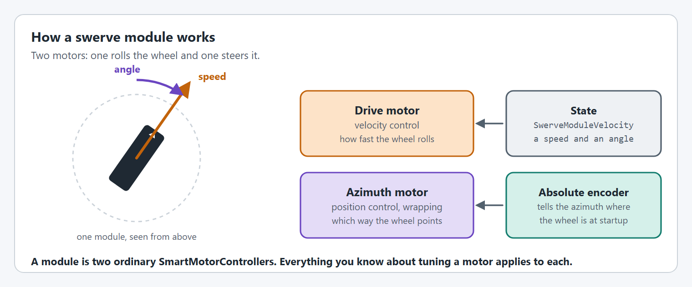

# Step 1: The module motors


This page assumes a project with YAMS and REVLib and Phoenix 6 installed. If you do not have one yet, start at [Create a project and install YAMS](../project-setup/).


Every swerve module has two motors, and they do different jobs:

<figure><figcaption><p>One module is a drive motor, an azimuth motor and an absolute encoder.</p></figcaption></figure>

* The **drive** motor turns the wheel. It is **velocity** controlled, so it gets a PID controller and a feedforward, and it needs the wheel diameter to turn rotations into distance.
* The **azimuth** motor steers the module. It is **position** controlled.

All four modules are built the same, so you write each config once and reuse it.


**In a hurry?** Jump to [the complete file](module-motors.md#the-complete-file), copy it, and change the values called out under **For your robot**. The numbered parts explain each piece in a sentence or two. You do not need to understand all of it to get moving: the pages under **Understanding** go deeper when you want them.


## Create the file



Create `SwerveSubsystem.java` in the `subsystems` folder. Each method builds a fresh config, because every motor needs a config of its own.



Create `SwerveMechanism.java` in the `mechanisms` folder. Each method builds a fresh config, because every motor needs a config of its own.

The config comes from `yams.commands3.config`, and it takes the `Mechanism` where Commands v2 passes the subsystem.



Create `SwerveSubsystem.hpp` in `src/main/include/subsystems` and `SwerveSubsystem.cpp` in `src/main/cpp/subsystems`.

YAMS keeps a pointer to each config, so in C++ a config cannot be a temporary. These two methods fill in a config that someone else owns; step 2 gives every module its own.

`WithFeedback` is the C++ name of `withClosedLoopController`, `WithMotorGearing` of `withGearing`, and `WithMechanismDiameter` of `withWheelDiameter`.





### The drive motor config

The drive motor turns the wheel and is **velocity** controlled. It needs the wheel diameter to turn rotations into distance, a PID controller, and a feedforward whose `kV` does most of the work of holding a speed.

The gains are placeholders. `kV` is the voltage for each wheel rotation per second: a NEO turns a 6.75:1 wheel about 14 times a second at 12 volts, so `12 / 14`, about `0.85`, is close. With it the robot drives at roughly the speed you ask for. If it drives noticeably slower than the stick asks, `kV` is too low; if it lurches past the speed, it is too high. [Step 5](real-robot.md) tunes it properly.




```java
/** The config of one drive motor. Drive motors are velocity controlled. */
private SmartMotorControllerConfig buildDriveCfg() {
  return new SmartMotorControllerConfig(this)
      // The wheel diameter turns wheel rotations into distance driven.
      .withWheelDiameter(Inches.of(4))
      // kP trims the velocity error that is left after the feedforward.
      .withClosedLoopController(0.3, 0, 0)
      // Gearing from the motor rotor to the wheel: 6.75:1, an MK4 L2 module.
      .withGearing(new MechanismGearing(6.75))
      // kV, in volts per wheel rotation per second, does most of the work of holding a speed.
      // 0.85 is a placeholder, about right for a NEO on 6.75:1. Step 4 tunes it.
      .withFeedforward(new SimpleMotorFeedforward(0, 0.85))
      // Set this to true if the wheel spins backward when it is told to drive forward.
      .withMotorInverted(false)
      .withStatorCurrentLimit(Amps.of(40))
      .withTelemetry("driveMotor", TelemetryVerbosity.HIGH);
}
```





```java
/** The config of one drive motor. Drive motors are velocity controlled. */
private SmartMotorControllerConfig buildDriveCfg() {
  return new SmartMotorControllerConfig(this)
      // The wheel diameter turns wheel rotations into distance driven.
      .withWheelDiameter(Inches.of(4))
      // kP trims the velocity error that is left after the feedforward.
      .withClosedLoopController(0.3, 0, 0)
      // Gearing from the motor rotor to the wheel: 6.75:1, an MK4 L2 module.
      .withGearing(new MechanismGearing(6.75))
      // kV, in volts per wheel rotation per second, does most of the work of holding a speed.
      // 0.85 is a placeholder, about right for a NEO on 6.75:1. Step 4 tunes it.
      .withFeedforward(new SimpleMotorFeedforward(0, 0.85))
      // Set this to true if the wheel spins backward when it is told to drive forward.
      .withMotorInverted(false)
      .withStatorCurrentLimit(Amps.of(40))
      .withTelemetry("driveMotor", TelemetryVerbosity.HIGH);
}
```





```cpp
/** Fill in the config of one drive motor. Drive motors are velocity controlled. */
void ConfigureDrive(yams::motorcontrollers::SmartMotorControllerConfig& config);
```



```cpp
void SwerveSubsystem::ConfigureDrive(Cfg& config) {
  config
      .WithSubsystem(this)
      // The wheel diameter turns wheel rotations into distance driven.
      .WithMechanismDiameter(4_in)
      // kP trims the velocity error that is left after the feedforward.
      .WithFeedback(0.3, 0, 0)
      // Gearing from the motor rotor to the wheel: 6.75:1, an MK4 L2 module.
      .WithMotorGearing(6.75)
      // kV, in volts per wheel rotation per second, does most of the work of holding a speed.
      // 0.85 is a placeholder, about right for a NEO on 6.75:1. Step 4 tunes it.
      .WithFeedforward(Feedforward{0_V, wpi::units::unit_t<Feedforward::kv_unit>{0.85}})
      // Set this to true if the wheel spins backward when it is told to drive forward.
      .WithMotorInverted(false)
      .WithStatorCurrentLimit(40_A)
      .WithTelemetry("driveMotor", Cfg::TelemetryVerbosity::HIGH);
}
```




**For your robot:** Set your wheel diameter and your module's drive gear ratio. Your module's maker publishes the ratio: this tutorial uses an MK4 L2, which is 6.75:1. Leave `withMotorInverted(false)` for now: [Step 5](real-robot.md#check-the-directions) checks which way the wheel spins and tells you when to change it.

Want the details? [Live tuning](../../how-to-tuning/live-tuning/) has a section on tuning a swerve module's drive motor.



### The azimuth motor config

The azimuth motor steers the module and is **position** controlled. Two settings matter here:

* **`withContinuousWrapping`** tells the controller that the wheel can turn all the way round, so -180 and +180 degrees are the same angle. Without it a wheel at 170 degrees asked for -170 degrees spins nearly a full turn the long way, instead of 20 degrees the short way. It must come after `withClosedLoopController`.
* **`withMotorInverted`** sets which way the motor turns. Angles are counter-clockwise positive, seen from above, so a positive command must turn the wheel counter-clockwise. [Step 5](real-robot.md#check-the-directions) checks it.




```java
/** The config of one azimuth (steering) motor. Azimuth motors are position controlled. */
private SmartMotorControllerConfig buildAzimuthCfg() {
  return new SmartMotorControllerConfig(this)
      // kP, in volts per rotation of angle error. A placeholder: Step 4 tunes it.
      .withClosedLoopController(4, 0, 0)
      // The wheel turns all the way round, so -180 and +180 degrees are the same angle.
      // Without this, a wheel at 170 degrees asked for -170 turns the long way round.
      .withContinuousWrapping(Rotations.of(-0.5), Rotations.of(0.5))
      // Gearing from the motor rotor to the module's steering axis: 12.8:1, an MK4 module.
      .withGearing(new MechanismGearing(12.8))
      // Set this to true if the wheel turns clockwise, seen from above, when told to turn counter-clockwise.
      .withMotorInverted(false)
      // The azimuth motor rarely works hard, so it gets a lower limit.
      .withStatorCurrentLimit(Amps.of(20))
      .withTelemetry("angleMotor", TelemetryVerbosity.HIGH);
}
```





```java
/** The config of one azimuth (steering) motor. Azimuth motors are position controlled. */
private SmartMotorControllerConfig buildAzimuthCfg() {
  return new SmartMotorControllerConfig(this)
      // kP, in volts per rotation of angle error. A placeholder: Step 4 tunes it.
      .withClosedLoopController(4, 0, 0)
      // The wheel turns all the way round, so -180 and +180 degrees are the same angle.
      // Without this, a wheel at 170 degrees asked for -170 turns the long way round.
      .withContinuousWrapping(Rotations.of(-0.5), Rotations.of(0.5))
      // Gearing from the motor rotor to the module's steering axis: 12.8:1, an MK4 module.
      .withGearing(new MechanismGearing(12.8))
      // Set this to true if the wheel turns clockwise, seen from above, when told to turn counter-clockwise.
      .withMotorInverted(false)
      // The azimuth motor rarely works hard, so it gets a lower limit.
      .withStatorCurrentLimit(Amps.of(20))
      .withTelemetry("angleMotor", TelemetryVerbosity.HIGH);
}
```





```cpp
/** Fill in the config of one azimuth (steering) motor. Azimuth motors are position controlled. */
void ConfigureAzimuth(yams::motorcontrollers::SmartMotorControllerConfig& config);
```



```cpp
void SwerveSubsystem::ConfigureAzimuth(Cfg& config) {
  config
      .WithSubsystem(this)
      // kP, in volts per rotation of angle error. A placeholder: Step 4 tunes it.
      .WithFeedback(4, 0, 0)
      // The wheel turns all the way round, so -180 and +180 degrees are the same angle.
      // Without this, a wheel at 170 degrees asked for -170 turns the long way round.
      .WithContinuousWrapping(-0.5_tr, 0.5_tr)
      // Gearing from the motor rotor to the module's steering axis: 12.8:1, an MK4 module.
      .WithMotorGearing(12.8)
      // Set this to true if the wheel turns clockwise, seen from above, when told to turn counter-clockwise.
      .WithMotorInverted(false)
      // The azimuth motor rarely works hard, so it gets a lower limit.
      .WithStatorCurrentLimit(20_A)
      .WithTelemetry("angleMotor", Cfg::TelemetryVerbosity::HIGH);
}
```




**For your robot:** Set your module's steering gear ratio. An MK4 steers at 12.8:1. Other modules, such as an MK4i, use a different ratio: check your module maker's page.

Want the details? [Swerve Module](../../understanding/swerve-drive/swerve-module.md)



## The complete file




```java
package first.robot.subsystems;

import static org.wpilib.units.Units.Amps;
import static org.wpilib.units.Units.Inches;
import static org.wpilib.units.Units.Rotations;

import org.wpilib.command2.SubsystemBase;
import org.wpilib.math.controller.SimpleMotorFeedforward;
import yams.commands2.config.SmartMotorControllerConfig;
import yams.core.gearing.MechanismGearing;
import yams.core.telemetry.enums.TelemetryVerbosity;

public class SwerveSubsystem extends SubsystemBase {

  /** The config of one drive motor. Drive motors are velocity controlled. */
  private SmartMotorControllerConfig buildDriveCfg() {
    return new SmartMotorControllerConfig(this)
        // The wheel diameter turns wheel rotations into distance driven.
        .withWheelDiameter(Inches.of(4))
        // kP trims the velocity error that is left after the feedforward.
        .withClosedLoopController(0.3, 0, 0)
        // Gearing from the motor rotor to the wheel: 6.75:1, an MK4 L2 module.
        .withGearing(new MechanismGearing(6.75))
        // kV, in volts per wheel rotation per second, does most of the work of holding a speed.
        // 0.85 is a placeholder, about right for a NEO on 6.75:1. Step 4 tunes it.
        .withFeedforward(new SimpleMotorFeedforward(0, 0.85))
        // Set this to true if the wheel spins backward when it is told to drive forward.
        .withMotorInverted(false)
        .withStatorCurrentLimit(Amps.of(40))
        .withTelemetry("driveMotor", TelemetryVerbosity.HIGH);
  }

  /** The config of one azimuth (steering) motor. Azimuth motors are position controlled. */
  private SmartMotorControllerConfig buildAzimuthCfg() {
    return new SmartMotorControllerConfig(this)
        // kP, in volts per rotation of angle error. A placeholder: Step 4 tunes it.
        .withClosedLoopController(4, 0, 0)
        // The wheel turns all the way round, so -180 and +180 degrees are the same angle.
        // Without this, a wheel at 170 degrees asked for -170 turns the long way round.
        .withContinuousWrapping(Rotations.of(-0.5), Rotations.of(0.5))
        // Gearing from the motor rotor to the module's steering axis: 12.8:1, an MK4 module.
        .withGearing(new MechanismGearing(12.8))
        // Set this to true if the wheel turns clockwise, seen from above, when told to turn counter-clockwise.
        .withMotorInverted(false)
        // The azimuth motor rarely works hard, so it gets a lower limit.
        .withStatorCurrentLimit(Amps.of(20))
        .withTelemetry("angleMotor", TelemetryVerbosity.HIGH);
  }
}
```





```java
package first.robot.mechanisms;

import static org.wpilib.units.Units.Amps;
import static org.wpilib.units.Units.Inches;
import static org.wpilib.units.Units.Rotations;

import org.wpilib.command3.Mechanism;
import org.wpilib.math.controller.SimpleMotorFeedforward;
import yams.commands3.config.SmartMotorControllerConfig;
import yams.core.gearing.MechanismGearing;
import yams.core.telemetry.enums.TelemetryVerbosity;

public class SwerveMechanism implements Mechanism {

  /** The config of one drive motor. Drive motors are velocity controlled. */
  private SmartMotorControllerConfig buildDriveCfg() {
    return new SmartMotorControllerConfig(this)
        // The wheel diameter turns wheel rotations into distance driven.
        .withWheelDiameter(Inches.of(4))
        // kP trims the velocity error that is left after the feedforward.
        .withClosedLoopController(0.3, 0, 0)
        // Gearing from the motor rotor to the wheel: 6.75:1, an MK4 L2 module.
        .withGearing(new MechanismGearing(6.75))
        // kV, in volts per wheel rotation per second, does most of the work of holding a speed.
        // 0.85 is a placeholder, about right for a NEO on 6.75:1. Step 4 tunes it.
        .withFeedforward(new SimpleMotorFeedforward(0, 0.85))
        // Set this to true if the wheel spins backward when it is told to drive forward.
        .withMotorInverted(false)
        .withStatorCurrentLimit(Amps.of(40))
        .withTelemetry("driveMotor", TelemetryVerbosity.HIGH);
  }

  /** The config of one azimuth (steering) motor. Azimuth motors are position controlled. */
  private SmartMotorControllerConfig buildAzimuthCfg() {
    return new SmartMotorControllerConfig(this)
        // kP, in volts per rotation of angle error. A placeholder: Step 4 tunes it.
        .withClosedLoopController(4, 0, 0)
        // The wheel turns all the way round, so -180 and +180 degrees are the same angle.
        // Without this, a wheel at 170 degrees asked for -170 turns the long way round.
        .withContinuousWrapping(Rotations.of(-0.5), Rotations.of(0.5))
        // Gearing from the motor rotor to the module's steering axis: 12.8:1, an MK4 module.
        .withGearing(new MechanismGearing(12.8))
        // Set this to true if the wheel turns clockwise, seen from above, when told to turn counter-clockwise.
        .withMotorInverted(false)
        // The azimuth motor rarely works hard, so it gets a lower limit.
        .withStatorCurrentLimit(Amps.of(20))
        .withTelemetry("angleMotor", TelemetryVerbosity.HIGH);
  }
}
```





```cpp
#pragma once

#include <wpi/commands2/SubsystemBase.hpp>

#include "yams/motorcontrollers/SmartMotorControllerConfig.hpp"

class SwerveSubsystem : public wpi::cmd::SubsystemBase {
 public:
  SwerveSubsystem();

 private:
  /** Fill in the config of one drive motor. Drive motors are velocity controlled. */
  void ConfigureDrive(yams::motorcontrollers::SmartMotorControllerConfig& config);

  /** Fill in the config of one azimuth (steering) motor. Azimuth motors are position controlled. */
  void ConfigureAzimuth(yams::motorcontrollers::SmartMotorControllerConfig& config);
};
```



```cpp
#include "subsystems/SwerveSubsystem.hpp"

#include <wpi/math/controller/SimpleMotorFeedforward.hpp>
#include <wpi/units/angle.hpp>
#include <wpi/units/current.hpp>
#include <wpi/units/length.hpp>
#include <wpi/units/voltage.hpp>

using Cfg = yams::motorcontrollers::SmartMotorControllerConfig;
using Feedforward = wpi::math::SimpleMotorFeedforward<wpi::units::turns>;

void SwerveSubsystem::ConfigureDrive(Cfg& config) {
  config
      .WithSubsystem(this)
      // The wheel diameter turns wheel rotations into distance driven.
      .WithMechanismDiameter(4_in)
      // kP trims the velocity error that is left after the feedforward.
      .WithFeedback(0.3, 0, 0)
      // Gearing from the motor rotor to the wheel: 6.75:1, an MK4 L2 module.
      .WithMotorGearing(6.75)
      // kV, in volts per wheel rotation per second, does most of the work of holding a speed.
      // 0.85 is a placeholder, about right for a NEO on 6.75:1. Step 4 tunes it.
      .WithFeedforward(Feedforward{0_V, wpi::units::unit_t<Feedforward::kv_unit>{0.85}})
      // Set this to true if the wheel spins backward when it is told to drive forward.
      .WithMotorInverted(false)
      .WithStatorCurrentLimit(40_A)
      .WithTelemetry("driveMotor", Cfg::TelemetryVerbosity::HIGH);
}

void SwerveSubsystem::ConfigureAzimuth(Cfg& config) {
  config
      .WithSubsystem(this)
      // kP, in volts per rotation of angle error. A placeholder: Step 4 tunes it.
      .WithFeedback(4, 0, 0)
      // The wheel turns all the way round, so -180 and +180 degrees are the same angle.
      // Without this, a wheel at 170 degrees asked for -170 turns the long way round.
      .WithContinuousWrapping(-0.5_tr, 0.5_tr)
      // Gearing from the motor rotor to the module's steering axis: 12.8:1, an MK4 module.
      .WithMotorGearing(12.8)
      // Set this to true if the wheel turns clockwise, seen from above, when told to turn counter-clockwise.
      .WithMotorInverted(false)
      // The azimuth motor rarely works hard, so it gets a lower limit.
      .WithStatorCurrentLimit(20_A)
      .WithTelemetry("angleMotor", Cfg::TelemetryVerbosity::HIGH);
}

SwerveSubsystem::SwerveSubsystem() {
}
```





The gains here are a place to start. [Step 4: Tune it](tune.md) practices tuning them in simulation with the swerve tuning command, and [Step 5: On the real robot](real-robot.md) tunes the real modules.


## Check it

Build the code: **WPILib: Build Robot Code** from the command palette (<kbd>Ctrl+Shift+P</kbd>). It should end with `BUILD SUCCESSFUL`. Nothing moves yet: the configs are not used until step 2.

If it does not build:

* **A REV or CTRE class cannot be found.** REVLib or Phoenix 6 is not installed. See [Create a project and install YAMS](../project-setup/).
* **`Rotations` or `Inches` cannot be found.** An `import static org.wpilib.units.Units...` line is missing. Copy the imports from the complete file.

More fixes are on [Troubleshooting](../troubleshooting.md).

Next: [Step 2: The modules and the drive](modules-and-drive.md).
