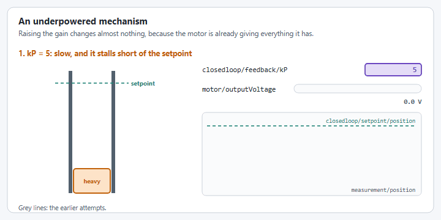
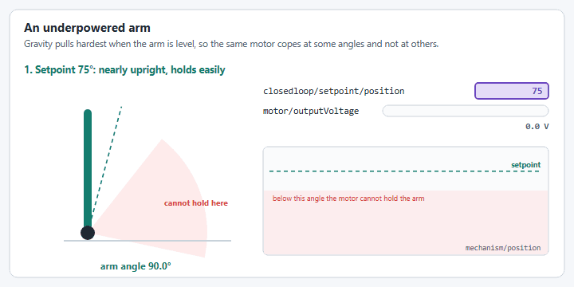
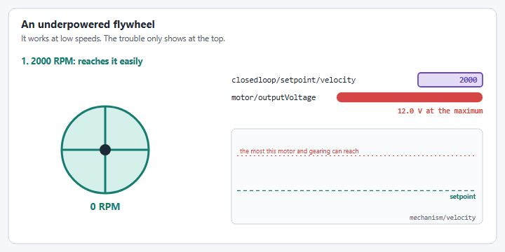
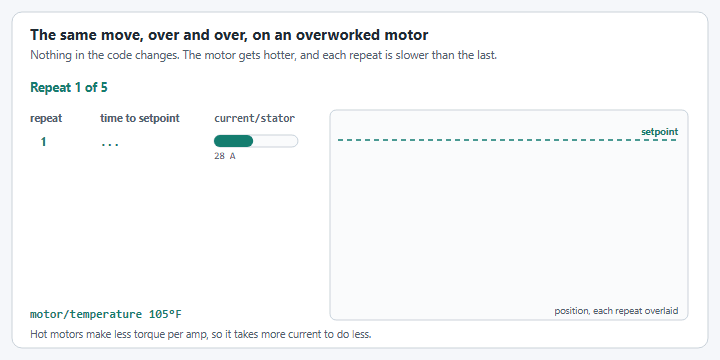

# Troubleshooting

Find what you see, then work down its list. The first check is the most likely cause.

## It does not build

**`SmartMotorController`, `Arm` or another YAMS class cannot be found**

* YAMS is not installed. Install it as in [Create a project and install YAMS](project-setup/#install-yams).
* Both YAMS vendordeps are installed. Install only one: Commands v2 or Commands v3. Remove the other from the `vendordeps` folder.
* The import is from the wrong command framework. Commands v2 code imports `yams.commands2`, and Commands v3 code imports `yams.commands3`.

**`SparkMax`, `TalonFX` or another vendor class cannot be found**

* The vendor's own library is not installed. YAMS drives the vendor's objects, so install REVLib, Phoenix 6 or the other vendor library too. See [Install your motor controller's library](project-setup/#install-your-motor-controllers-library).

## It crashes when the code starts

Read the first error in the Driver Station or the simulation console. YAMS names the setting that is missing and the method that sets it.

| The error says                                         | Fix                                                                                            |
| ------------------------------------------------------ | ---------------------------------------------------------------------------------------------- |
| `Arm starting angle is empty`                          | Add `withStartingPosition(...)` to the `SmartMotorControllerConfig`.                           |
| `Arm starting angle is outside hard limits`            | Make the starting position fall between the `ArmConfig` hard limits.                           |
| `Arm Length is empty`, `Arm lower hard limit is empty` | Add `withLength(...)` and `withHardLimits(...)` to the `ArmConfig`. The simulation needs them. |
| An elevator, pivot or flywheel error                   | The same idea: the error names the method to add.                                              |

## I can't find the mechanism on the dashboard

* It is not under `SmartDashboard`. The simulated mechanism is at **NetworkTables > Mechanisms >&#x20;**_**name**_**&#x20;> mechanism**, where _name_ is the name given to the mechanism config's `withTelemetry`, such as `Arm`.
* The motor's values are at `NT:/Mechanisms/<mechanism name>/<motor name>/`, such as `NT:/Mechanisms/Arm/ArmMotor/`.
* Nothing publishes until the mechanism's `updateTelemetry()` runs. Commands v2: check that the subsystem's `periodic()` calls it. Commands v3: check that the mechanism's `periodic()` calls it, and that `Robot.robotPeriodic()` calls the mechanism's `periodic()`. See [Step 2: The arm](arm/mechanism.md#update-it-every-loop).

## It does not move in simulation

* The robot is disabled. Press **Teleoperated** in the Sim GUI.
* The controller is not on the port the code reads. Drag it from **System Joysticks** to **Joystick\[0]**, or **Joystick\[1]** for Commands v3: the Command v3 template's controller is on port 1 (`DriverConstants.DRIVER_CONTROLLER_PORT`).
* Commands v3: the wrong op mode is selected. Pick `ExampleTeleop`, where the buttons are bound.
* Commands v3: the mechanism's simulation never runs. Check that `Robot.simulationInit()` starts it with `startSimulation(...)`.
* Commands v2: check that `simulationPeriodic()` in the subsystem calls the mechanism's `simIterate()`.
* The setpoint is outside the soft limits. The closed loop holds a setpoint at the nearest soft limit, so a target past the limit never moves the mechanism further.

## It moves, but not as it should

**It falls, or a flywheel coasts down, while the robot is disabled**

* That is expected. A disabled robot's motors get no power, so the simulation gives them 0 V. When you enable, the closed loop starts from wherever the mechanism ended up.

**It sags below its setpoint, or an elevator drifts down**

* `kG` is 0. Tune it as in [Step 5: Tune it](arm/tune.md#kg-hold-the-arm-up).

**It stops short of its setpoint (a flywheel never reaches speed)**

* `kP` is too low, or a flywheel has no `kV`. A velocity loop needs `kV` to do most of the work.

**It swings back and forth, or rings around the setpoint**

* `kP` is too high. Lower it by about a third, then add a little `kD` if it still overshoots.

**It moves the wrong way, or runs straight into a hard stop**

* The motor direction is wrong. Check it with the robot disabled as in [Step 6: Run it on the robot](arm/robot.md#check-the-direction-with-the-robot-disabled), and set `withMotorInverted(true)` if positive is the wrong way.

**It goes the wrong distance**

* The gearing does not match the mechanism. List each stage from the motor outward, as in [Step 1](arm/motor-controller.md#gearing).
* For an elevator or a wheel, the circumference is wrong. See [How do I find my mechanism's circumference?](../how-to-motor-controllers-and-sensors/how-to-find-your-mechanism-circumference.md)

**Angles are off by the same amount every time**

* The mechanism was not at its starting position when the code started. Rest it there before the code starts, or change `withStartingPosition` to where it really rests.

**A command that should end never ends**

* `run(...)` never ends on its own: it holds the setpoint until another command takes over. Use `runTo(...)` with a tolerance to end once the mechanism gets there.
* The `runTo(...)` tolerance is too tight, or the setpoint is past a soft limit, so the mechanism never gets close enough. Widen the tolerance, or move the setpoint inside the limits.

## Live tuning does nothing

* AdvantageScope's **tuning mode** is off. Turn it on with the sliders icon beside the search box.
* The `Live Tuning` command is not running. It is at `NT:/Tuning/<subsystem or mechanism name>/Live Tuning`, such as `NT:/Tuning/ArmSubsystem/Live Tuning`. Start it again after pressing any of the mechanism's buttons, which take over from it.
* The value was typed under `NT:/Mechanisms`. Type values under `NT:/Tuning`. `NT:/Mechanisms` only shows what the mechanism is doing.
* The motor's telemetry is not `TelemetryVerbosity.HIGH`.
* The config has no subsystem (`new SmartMotorControllerConfig(this)` or `withSubsystem(...)`, Commands v2) or mechanism (`new SmartMotorControllerConfig(this)` or `withMechanism(...)`, Commands v3), so YAMS has nothing to register the `Live Tuning` command with.
* The values were lost after a restart. Copy them into your code, as in [Step 5](arm/tune.md#copy-the-numbers-into-your-code).

See [Live tuning](../how-to-tuning/live-tuning/) for more.

## On the real robot

**Nothing moves, and the Driver Station shows a CAN error**

* The CAN ID in the code does not match the motor controller. Check it in the vendor's tool (REV Hardware Client or Phoenix Tuner X).
* Two devices share an ID, or the CAN wiring is loose.

**The robot browns out, or the mechanism slows down under load**

* The current limits are too high. See [Limiting power consumption](../how-to-motor-controllers-and-sensors/limiting-power-consumption.md).
* The motor is hot. Watch `motor/temperature`; a hot motor backs off and looks like a gain problem.

**It worked in simulation but not on the robot**

* The real robot uses `withClosedLoopController` and `withFeedforward`. The simulation uses the `withSim...` versions. Tune the robot separately, as in [Step 6](arm/robot.md#tune-it-on-the-robot).

## When tuning does not help

Some mechanisms cannot be tuned, because the motor does not have enough torque for the job. No gain fixes that, and it is worth recognizing early so you stop chasing numbers.



<figure><figcaption>
Sixteen times the gain, the same move. Illustrative, not a recording.
</figcaption></figure>

Raising kP does nothing, because the motor was already at full voltage with the smaller gain.



<figure><figcaption>
The same arm at three setpoints. Illustrative, not a recording.
</figcaption></figure>

An arm needs the most torque when it is level and almost none when it is upright. An underpowered arm therefore looks fine at some setpoints and hopeless at others. If it only misbehaves near level, suspect torque before you suspect the gains.



<figure><figcaption>
The same flywheel at three setpoints. Illustrative, not a recording.
</figcaption></figure>

A flywheel has a top speed set by the motor, the gearing and the battery voltage. Below it everything works, and the closer the setpoint gets to it the longer the spin up takes. Above it, no gain will ever get there. Remember that the battery sags under load, so the top speed in a match is lower than on a fresh battery on the bench.



### It works at low setpoints

This is what makes an underpowered mechanism hard to spot. It tunes well on the easy moves, and then the same gains fail on the hard ones:

| Mechanism | Works                                         | Fails                                                         |
| --------- | --------------------------------------------- | ------------------------------------------------------------- |
| Elevator  | Short moves, slow profiles, an empty carriage | Long fast moves, or carrying a game piece                     |
| Arm       | Setpoints near upright                        | Setpoints near level, where gravity pulls hardest             |
| Flywheel  | Low speeds                                    | Speeds near the motor's top speed, and recovery between shots |

When that happens, do not retune for the hard case. Look at `motor/outputVoltage` during the move that fails. If it is at the maximum, the gains are not the problem.

### How to recognize an underpowered mechanism

| Watch (`NT:/Mechanisms`)                       | What you see                                                                        |
| ---------------------------------------------- | ----------------------------------------------------------------------------------- |
| `motor/outputVoltage`                          | Pinned at the maximum for most of the move, not just at the start.                  |
| `current/stator`                               | Sitting on the stator current limit.                                                |
| `mechanism/position` or `measurement/position` | The same slow curve whatever you set kP to, and it may stop short of the setpoint.  |
| `mechanism/velocity` or `measurement/velocity` | Far below the profile's `closedloop/setpoint/velocity`, however the profile is set. |
| `motor/temperature`                            | Climbing quickly while the mechanism holds a position.                              |

### What to do about it

The fix is mechanical or electrical, not a gain:

* **More gear reduction.** The most common fix. It trades top speed, which you are not reaching anyway, for torque.
* **More motors**, or a stronger motor.
* **Take load off the motor**: a lighter mechanism, a counterweight, or a [constant force spring](../how-to-tuning/live-tuning/#elevators-with-a-constant-force-spring) on an elevator.
* **Check the current limit.** A stator limit set too low makes a capable motor look underpowered. Raise `current/limit/stator` and see whether the move changes. See [How do I limit power consumption?](../how-to-motor-controllers-and-sensors/limiting-power-consumption.md).
* **Check for binding.** Disable the robot and move the mechanism by hand through its whole travel.
* **Ask for less.** Lower the motion profile's `maxVelocity` and `maxAcceleration` to what the motor can deliver.


Check this in simulation first. With the real motor, gearing and mass in the config, an underpowered mechanism shows the same pinned voltage in simulation, before anything is built.


### It gets slower every time

An overworked motor heats up, and a hot motor is weaker. The first few moves look fine, then each one takes a little longer, until the mechanism stops reaching its setpoint at all.

<figure><figcaption>
Five repeats of one move. Illustrative numbers.
</figcaption></figure>

| Watch (`NT:/Mechanisms`)                       | What you see                                                         |
| ---------------------------------------------- | -------------------------------------------------------------------- |
| `current/stator`                               | Higher on every repeat of the same move, until it sits on the limit. |
| `motor/temperature`                            | Climbing steadily and not coming back down between moves.            |
| `mechanism/velocity` or `measurement/velocity` | The peak speed of the same move dropping over time.                  |
| `mechanism/position` or `measurement/position` | Arriving later each time, then stopping short.                       |


If the gains that worked ten minutes ago no longer work, check `motor/temperature` before you touch them. Retuning to a hot motor gives you gains that are wrong once it cools, and running it harder is how motors burn out. Stop, let it cool, and fix the load.

