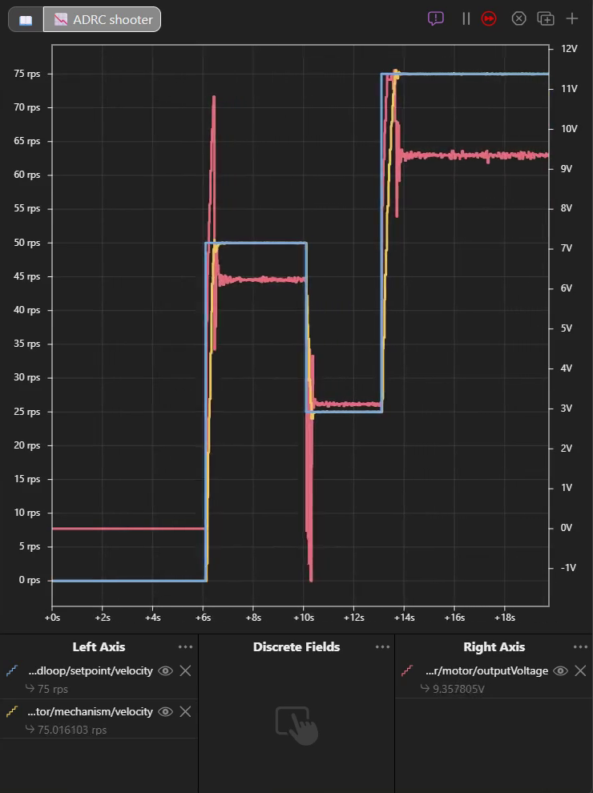

# ADRC controllers

**ADRC in YAMS was written by FRC Team 8331**, who contributed it to YAMS. This page explains how it works and how it compares to PID and LQR. To set one up, see [How do I use ADRC instead of PID?](../../how-to-tuning/how-do-i-use-adrc.md).

## What is ADRC?

**Active disturbance rejection control (ADRC)** treats everything that pushes a mechanism off course as one unknown: gravity, friction, back-EMF, a game piece, a wrong model. It estimates that unknown every loop and cancels it, so the rest of the controller only has to drive a simple, ideal mechanism.


**Key difference from PID**: with PID and a feedforward, you tune gains and model gravity and friction yourself with kS, kV and kG. With ADRC, you say what kind of mechanism it is and how quickly it should settle, and it measures the disturbances as it runs.


It has three parts:

* **An extended state observer (ESO)** estimates the mechanism's position, its speed and the total disturbance from the encoder and the voltage it applied.
* **A feedback law** drives the estimated position or speed to the setpoint, like a PD controller tuned from the settling time.
* **Disturbance cancellation** subtracts the estimated disturbance, divided by `b0`, from the voltage. This is what holds an arm up without a kG.

<figure><figcaption><p>The observer is never told about gravity or the game piece. It finds each from how the arm moves, and the ADRC cancels it. Made with YAMS's ADRC on a simulated NEO 12:1 arm.</p></figcaption></figure>

`b0` is how strongly a volt moves the mechanism. YAMS works it out from the motor, the gearing and the moment of inertia, so you rarely set it.

## Where it runs

The ADRC always runs on the SystemCore, on every motor controller, every closed loop control period (20 ms by default). The motor controller only receives the voltage it asks for. So:

* **The same settings behave the same on every vendor.** A TalonFX, a SPARK, a Thrifty Nova and an A301 all run the same ADRC.
* **The motor config's output limits apply to it.** `withClosedLoopControllerMaximumVoltage(...)` caps its voltage, and `withClosedLoopRampRate(...)` ramps it, on every controller. The ADRC itself has no limits, so always set the maximum voltage: 12 V for normal use, and about 6 V the first time on the robot. [How do I use ADRC instead of PID?](../../how-to-tuning/how-do-i-use-adrc.md#limit-the-output) explains why.
* **A motion profile on the motor config shapes its setpoint**, as it does for a PID.

## The settings

| Setting            | What it does                                     | Where it comes from                                                          |
| ------------------ | ------------------------------------------------ | ---------------------------------------------------------------------------- |
| System order       | What kind of mechanism it is                     | You, with `withSystemOrder(...)`                                             |
| Settling time      | How quickly it reaches a setpoint                | You, with `withSettlingTime(...)`. The main thing to tune                    |
| `b0`               | How strongly a volt moves the mechanism          | Worked out from the motor, gearing and moment of inertia, or `withB0(...)`   |
| Bandwidth          | How hard the feedback pushes                     | Worked out from the settling time: 2 × (order + 1) ÷ settling time, in rad/s |
| Observer bandwidth | How quickly the observer follows the disturbance | 4 × the bandwidth                                                            |
| Bandwidth scale    | Scales both bandwidths together                  | 1 by default. The settling time does the same job                            |

A shorter settling time makes both the feedback and the observer faster. Too short, and the mechanism overshoots, or the voltage chatters as the observer amplifies sensor noise.

## Two kinds of position loop

A motor's back-EMF slows it down as it speeds up. How quickly it does so, at the mechanism, is the back-EMF time constant:

τ = J·R ÷ (G²·Kt·Ke)

where J is the moment of inertia, R the motor's resistance, G the gear ratio, and Kt and Ke the motor's torque and back-EMF constants. A big reduction makes it very short.

* **Heavily geared (τ under 2 control periods).** The motor reaches the speed a voltage gives it almost at once, so the voltage sets the speed. The position is a **first order** system, and `b0` is the speed per volt.
* **Lightly geared or heavy (τ of 2 control periods or more).** The voltage sets the acceleration. The position is a **second order** system, and `b0` is the acceleration per volt.

`SystemOrder.ARM`, `PIVOT`, `POSITION` and `ELEVATOR` work out τ when the controller is built and choose for you. For example, a NEO on a 60:1 arm has τ of about 6 ms and is first order; on 12:1, about 160 ms and second order.

<figure><figcaption><p>The same 60:1 pivot. Left: forced to second order at 0.6 s, it rings. Right: <code>PIVOT</code> chooses first order, at 0.3 s.</p></figcaption></figure>

A second order loop's observer also models the back-EMF, from the same time constant, so the disturbance it estimates only holds what the model misses, such as gravity. A first order loop's `b0` already includes the back-EMF.

The wrong form works badly, so choosing it needs the moment of inertia. An `ELEVATOR` without one stays first order; `ARM`, `PIVOT` and `POSITION` refuse to start without one. `FIRST` to `FOURTH` fix the order yourself, with your own `b0`.

### Units

An elevator's ADRC works in meters, so `ELEVATOR` requires `withLinearClosedLoopController(true)`. Its `b0` is in meters per second per volt. Every other position loop works in rotations of the mechanism, and a flywheel's in rotations per second.

## `b0` and the disturbance

The observer absorbs a `b0` that is off by up to a factor of two: whatever the model misses becomes part of the disturbance it cancels. Off by more, and it struggles:

* **`b0` too high** makes the ADRC push too little, then correct late: it overshoots. On a 12:1 arm, twice the derived `b0` overshot by 13.6°.
* **`b0` too low** makes it push harder than it needs: it is slower to settle, but calmer. Half the derived `b0` cut that arm's overshoot from 2.7° to 1.2°.

`closedloop/adrc/disturbance` shows what the observer estimates. On an arm at rest it is the gravity it holds against; on a shooter at speed, mostly back-EMF.

<figure><figcaption><p>The shooter finds the voltage each speed needs without a kV.</p></figcaption></figure>

## Following a motion profile

With a [motion profile](../exponential-profiles.md) on the motor config, YAMS gives the ADRC the profile's state now and its state one loop ahead, and a second order position loop's observer models the motor's back-EMF. Together they let a mechanism follow the profile closely and stop on its goal: a 12:1 pivot stayed within 1.5° of its profile and overshot by at most 1.1°, where fed only the profile's position it trailed by up to 32°. [ADRC and motion profiles](adrc-motion-profiles.md) explains why both are needed.

## Smoothing the setpoint without a profile

A **tracking differentiator** is a filter in front of the ADRC that turns a step setpoint into a glide, for a mechanism with no motion profile. Start with the `LD` method and one parameter, a time constant in seconds:

```java
new ADRCConfig()
    .withSystemOrder(SystemOrder.ARM)
    .withSettlingTime(Seconds.of(0.3))
    // A 0.08 s time constant: a 90° step is followed in about 0.46 s.
    .withTrackingDifferentiator(TrackingDifferentiator.Method.LD, 0.08)
```

YAMS refuses a tracking differentiator and a motion profile together, since both shape the setpoint. [Tracking differentiators](adrc-tracking-differentiators.md) covers every method, its parameters, how they compare and how to tune one.

## ADRC, PID or LQR?

|                      | PID + feedforward                    | LQR                                 | ADRC                             |
| -------------------- | ------------------------------------ | ----------------------------------- | -------------------------------- |
| What you tune        | kP, kI, kD, kS, kV, kA, kG           | Error and effort tolerances         | Settling time, maybe `b0`        |
| Model needed         | None, but tuning stands in for one   | Motor, gearing, inertia, accurately | Motor, gearing, inertia, roughly |
| Gravity and friction | You model them with kG and kS        | You add a feedforward               | Estimated and cancelled          |
| Where it runs        | On the motor controller where it can | SystemCore                          | SystemCore                       |
| Loop rate            | Up to 1 kHz on the controller        | 50 Hz by default                    | 50 Hz by default                 |

Reach for ADRC when a mechanism's load changes, or its gravity and friction are hard to model. Keep a PID on the motor controller when you need its 1 kHz loop, or already have gains that work.

## Telemetry

At `HIGH` verbosity, the ADRC publishes under the motor's `closedloop/adrc/` entry. `b0`, `settlingTime` and `bandwidthScale` are also tunable under `NT:/Tuning`. See [ADRC keys](../../reference/keys-and-units.md#adrc-keys).

## Using it without a mechanism

`ADRCController` also runs on its own, like a WPILib `PIDController`: call `calculate(measurement, setpoint)` each loop and apply its voltage. It does not limit its output, so clamp it, and wrap it in a WPILib `SlewRateLimiter` if it needs a ramp. Then tell it what it really applied with `calculate(measurement, setpoint, appliedVoltage)`, so it does not mistake the clamp for a disturbance. [ADRCConfig](../../reference/editor/adrc-config.md) lists every setting and method, including the input delay and the cascaded observer.
