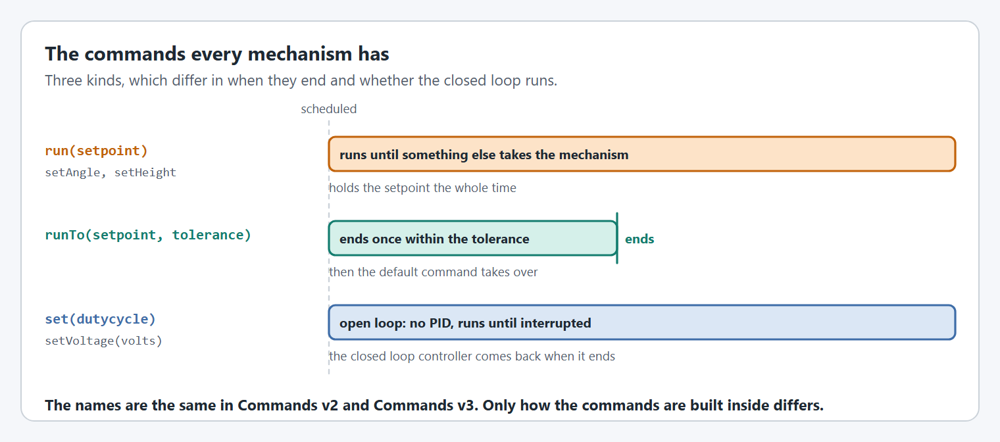

# When mechanism commands end

Every YAMS mechanism gives you three kinds of command: `run` (also called `setAngle` or `setHeight`), `runTo`, and `set` with `setVoltage`. They differ in one way that matters a lot: when they end. This page explains that, and what happens to the motor and to your default command afterwards. The full list of commands for each mechanism is in [Controlling a mechanism](../reference/controlling-a-mechanism.md).

You need to know what a command and a default command are. [WPILib's command-based docs](https://docs.wpilib.org/en/stable/docs/software/commandbased/index.html) cover both.

## Three kinds of command

<figure><figcaption><p>When each kind of command ends.</p></figcaption></figure>

| Command                        | Control                    | Ends                                                        | Good for                                         |
| ------------------------------ | -------------------------- | ----------------------------------------------------------- | ------------------------------------------------ |
| `run(target)`                  | Closed loop                | Never. Something else has to interrupt it.                  | Default commands, `whileTrue` buttons, tracking  |
| `runTo(target, tolerance)`     | Closed loop                | When the mechanism has been within the tolerance for 0.1 s. | Steps in a sequence, one press to go to a preset |
| `set(dutyCycle)`, `setVoltage` | Open loop, closed loop off | Never. Something else has to interrupt it.                  | Rollers, resting a mechanism, manual control     |

All three require the mechanism's subsystem, so starting one interrupts whichever was running. Every closed loop command starts the closed loop when it begins. `set` and `setVoltage` stop it when they begin and start it again when they end.

With a supplier, `run(Supplier)` follows the target forever, and `runTo(Supplier, tolerance)` follows it until the mechanism has caught up with the supplier's latest value.

## The motor keeps its last request

Ending a command does not stop the motor. The `SmartMotorController` keeps doing the last thing it was asked: after `runTo(Meters.of(1.0), ...)` ends, the elevator keeps holding 1 meter. That is on purpose, so a mechanism does not go limp between one step of a sequence and the next.

So when a command ends, the question is never "does the motor stop?" but "what runs next?". If nothing does, the mechanism holds. If the subsystem has a default command, that runs next.

## runTo and the default command

The examples below use two command factories on the subsystem:



```java
// In ElevatorSubsystem. elevator here is the YAMS Elevator field.
public Command hold(Distance height)
{
  return elevator.setHeight(height); // never ends
}

public Command moveTo(Distance height)
{
  return elevator.runTo(height, Centimeters.of(2)); // ends when it gets there
}
```



```java
// In ElevatorMechanism. elevator here is the YAMS Elevator field.
public Command hold(Distance height)
{
  return run(coroutine -> coroutine.await(elevator.setHeight(height)))
      .withPriority(Command.LOWEST_PRIORITY) // so any other command can take over
      .named("Elevator Hold");
}

public Command moveTo(Distance height)
{
  return elevator.runTo(height, Centimeters.of(2)); // ends when it gets there
}
```



This is the most common surprise. A default command that holds the bottom, and a button that moves to the top:

```java
// In RobotContainer (Commands v2) or Robot (Commands v3). elevator is the subsystem.
elevator.setDefaultCommand(elevator.hold(Meters.of(0)));
controller.a().onTrue(elevator.moveTo(Meters.of(1.0)));
```

You press A. The elevator rises to 1 meter, `runTo` ends, the default command starts, and the elevator goes straight back down. Nothing is broken: `runTo` did its job and ended, and then the default command did its job. Pick the fix that matches what you want the robot to do.

### Solution 1: stay there, with run

If the elevator should stay at the target until another button moves it, use the command that never ends. The default command only comes back once nothing else is running.

```java
controller.a().onTrue(elevator.hold(Meters.of(1.0)));
```

### Solution 2: no default command

If the elevator should hold wherever it was last sent, do not give it a default command. When `runTo` ends nothing else runs, and the motor keeps holding the last target.

```java
// No setDefaultCommand for the elevator
controller.a().onTrue(elevator.moveTo(Meters.of(0.5)));
controller.b().onTrue(elevator.moveTo(Meters.of(1.0)));
```

### Solution 3: only while the button is held

If the elevator should go home whenever the driver lets go, hold the target while the button is held. The default command takes over on release.

```java
elevator.setDefaultCommand(elevator.hold(Meters.of(0)));
controller.a().whileTrue(elevator.hold(Meters.of(1.0)));
```

## runTo in a sequence

`runTo` is the command to use when the next step must wait for the mechanism.



```java
// In RobotContainer. elevator, arm and intake are subsystems with the command factories
// elevator.moveTo(Distance), arm.moveTo(Angle) and intake.eject(), as on their pages.
public Command scoreHigh()
{
  return Commands.sequence(
      elevator.moveTo(Meters.of(1.2)),   // ends at 1.2 m, and keeps holding it
      arm.moveTo(Degrees.of(45)),        // ends at 45 degrees
      intake.eject().withTimeout(0.5),   // eject() never ends, so give it a time
      arm.moveTo(Degrees.of(0)),
      elevator.moveTo(Meters.of(0)));
}
```

A sequence requires every subsystem in it until the whole sequence ends, so no default command runs between the steps.



```java
// In Robot. elevator, arm and intake are mechanisms with the command factories
// elevator.moveTo(Distance), arm.moveTo(Angle) and intake.eject(), as on their pages.
public Command scoreHigh()
{
  return Command.requiring(elevator, arm).executing(coroutine -> {
    coroutine.await(elevator.moveTo(Meters.of(1.2)));  // ends at 1.2 m, and keeps holding it
    coroutine.await(arm.moveTo(Degrees.of(45)));       // ends at 45 degrees
    coroutine.awaitAny(intake.eject(), Command.waitFor(Seconds.of(0.5)).named("Eject Time"));
    coroutine.await(arm.moveTo(Degrees.of(0)));
    coroutine.await(elevator.moveTo(Meters.of(0)));
  }).named("Score High");
}
```

`Command.requiring(elevator, arm)` keeps both mechanisms for the whole sequence, so their default commands do not run between the steps. With `Command.noRequirements(...)` instead, each mechanism is only owned while its own step runs, and its default command takes over as soon as its `moveTo` ends.



## Stopping the motor

To let the motor go, run `set(0)`. It stops the closed loop and outputs zero, and it never ends by itself, so it makes a good default command for a mechanism that should rest, such as a flywheel that should coast or [an arm with a brake](arms.md#arms-with-a-brake). When another command takes over, `set(0)` ends and starts the closed loop again, and the new command sets its own target.

You can also call `setDutyCycleSetpoint(0)` at the end of your own command. The motor rests until the next closed loop command, which starts the closed loop when it begins.


When `set` or `setVoltage` ends, the closed loop starts again and drives toward the last closed loop target, if there was one. So `set(0).withTimeout(1)` on a flywheel that was at 4000 RPM spins it back up after a second, unless another command takes over. Use `set(0)` as a default command, or follow it with the command you want next.


## Which one do I use?

```
Should the motor be off, or only get a voltage?
└── Yes → set() or setVoltage()
Should the command end by itself?
├── No → run()  (default commands, whileTrue buttons, tracking a target)
└── Yes → runTo()
    └── Does the subsystem have a default command?
        ├── No → fine: the mechanism holds where it stopped
        └── Yes → Is it fine for the default command to take over when runTo() ends?
            ├── Yes → fine (inside a sequence, it does not take over until the end)
            └── No → Solution 1, 2 or 3 above
```

## Common pitfalls

| Pitfall                                          | What you see                                        | Fix                                                                 |
| ------------------------------------------------ | --------------------------------------------------- | ------------------------------------------------------------------- |
| `runTo` with a default command                   | The mechanism reaches the goal, then goes back      | Solution 1, 2 or 3                                                  |
| `run` as a step in a sequence                    | The sequence never gets past that step              | Use `runTo` for steps that must end                                 |
| Expecting the motor to stop when a command ends  | The mechanism keeps holding, or keeps spinning      | Run `set(0)` when you want it off                                   |
| Tolerance smaller than the error that remains    | `runTo` never ends                                  | Widen the tolerance, or tune the mechanism so it settles closer     |
| Tolerance too tight for a mechanism that wobbles | `runTo` never ends, or takes a long time            | Widen it: the 0.1 s only counts while the mechanism stays inside it |
| `Command.noRequirements` sequence in Commands v3 | Each mechanism's default command runs between steps | Use `Command.requiring(...)` for the mechanisms the sequence moves  |

## Best practices

1. Make default commands never end: `run`, or `set(0)` for a mechanism that should rest. In Commands v3, also give them `Command.LOWEST_PRIORITY`.
2. Pair `whileTrue` with `run`.
3. Use `runTo` for each step of a sequence that must finish before the next.
4. For each `runTo`, decide what should run after it, and check the default command does that.
5. Test what happens when a command ends, not only while it runs.

## Next

To write a command that the built-in ones do not cover, see [How do I write my own mechanism command?](../how-to-mechanisms/how-do-i-write-my-own-mechanism-command.md)
