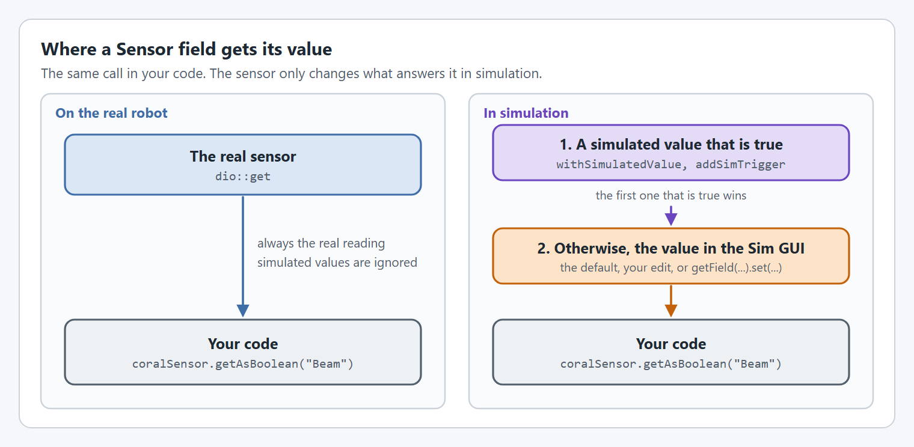
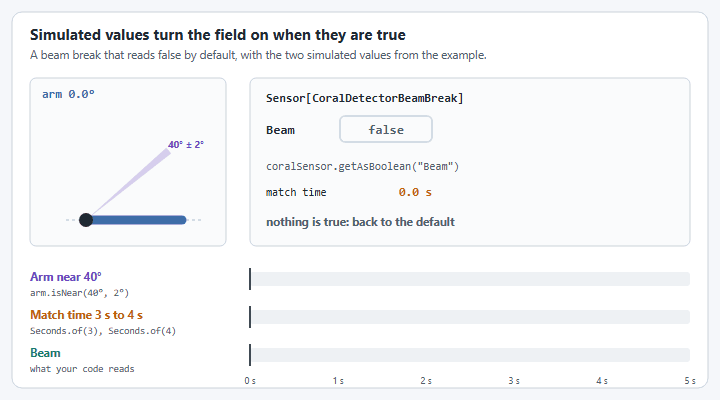

# Sensors

YAMS simulates your mechanisms well, but most sensors have no simulation of their own: in simulation a beam break never breaks and a limit switch is never pressed. A YAMS `Sensor` fixes that.

## What is a `Sensor`?

A `Sensor` wraps a real sensor on your robot, such as a beam break, a limit switch, a `CANrange`, a `LaserCAN` or a `CanandColor`. It has one or more named **fields**, and each field reads a value from the real sensor. In simulation you can also say what each field should read, and when: while the match time (the time left in the period, counting down) is in a window, or while a condition is true, such as the arm being at the angle where it breaks the beam.

Fields hold `boolean`, `int`, `long` or `double` values.

<figure><figcaption><p>Your code makes the same call on the real robot and in simulation.</p></figcaption></figure>

## How do I create a `Sensor`?

Build it with a `SensorConfig`, which takes the sensor's name, then a field for each value it reports.


Declare the `Sensor` field after every field its lambdas use, such as the `DigitalInput`, the motor and the mechanism. Java does not let a field's initializer use a field declared after it, even inside a lambda.


```java
import static org.wpilib.units.Units.Degrees;
import static org.wpilib.units.Units.Seconds;

import org.wpilib.hardware.discrete.DigitalInput;
import yams.core.mechanisms.config.SensorConfig;
import yams.core.motorcontrollers.simulation.Sensor;

// Fields of your subsystem, after the arm field
private final DigitalInput dio = new DigitalInput(0);
private final Sensor coralSensor = new SensorConfig("CoralDetectorBeamBreak") // the sensor's name
    .withField("Beam", dio::get, false)                              // field "Beam" reads dio.get(), default false
    .withSimulatedValue("Beam", Seconds.of(3), Seconds.of(4), true)  // in simulation, true from 4 s left until 3 s left in the period
    .withSimulatedValue("Beam", () -> arm.isNear(Degrees.of(40), Degrees.of(2)), true) // and while the arm is near 40 degrees
    .getSensor();
```

Reading through a `Sensor` is a little slower than reading the input directly. For a beam break or a limit switch that does not matter.

## How do I add simulated values to a sensor?

You can add a simulated value to a `Sensor` you already have with `addSimTrigger(field, value, condition)`. The value is a `HALValue` (`org.wpilib.hardware.hal.HALValue`), for example `HALValue.makeBoolean(true)`.

```java
// Fragment: coralSensor is the Sensor above, without its second withSimulatedValue
coralSensor.addSimTrigger("Beam", HALValue.makeBoolean(true),
                          () -> arm.isNear(Degrees.of(40), Degrees.of(2))); // true while the arm is near 40 degrees
```

<figure><figcaption><p>The field reads true while either simulated value is true, and goes back to what it was when neither is.</p></figcaption></figure>

## What does this look like?

<figure><figcaption><p>The sensor's fields appear under Other Devices in the simulation GUI.</p></figcaption></figure>

The circled value turns true while the arm is within 2° of 40°. You can also change it by hand in the simulation GUI.

## How do I use the value from a `Sensor`?


A simulated value only updates when your code reads the sensor. Read it every loop, for example from a `Trigger` or `periodic()`, or its simulated values never take effect.


Read the field from the `Sensor`, not from the input it wraps:

```java
public boolean getBeamBreak()
{
  // return dio.get(); // does not see the simulated values
  return coralSensor.getAsBoolean("Beam");
}
```

`getAsInt`, `getAsLong` and `getAsDouble` read the other kinds of field.

## How do I simulate the sensor value?

You can set a field by hand: get it with `getField` and call `set`. The new value stays until it is changed again, from the simulation GUI or with `set`.


This only changes the value in simulation. It does not affect the real sensor on the robot.




```java
public void setBeamBreakWhenArmIsLow()
{
  arm.lte(Degrees.of(10)).onTrue(Commands.runOnce(() -> coralSensor.getField("Beam").set(true)));
}
```



```java
public void setBeamBreakWhenArmIsLow()
{
  arm.lte(Degrees.of(10)).onTrue(Command.noRequirements(coroutine -> coralSensor.getField("Beam").set(true))
                                        .named("Set Beam Break"));
}
```



## How do I simulate a sensor the mechanism triggers?

Some sensors are triggered by the mechanism itself, like a limit switch at a hard stop, or a beam break the arm passes through. Simulate those from where the simulated mechanism really is, rather than from what its encoder says. The motor's sim supplier (`SmartMotorController.getSimSupplier()`) has the simulated mechanism's position. It is empty on a real robot, so the condition is `false` there.

```java
// Fields of ArmSubsystem, after motor
private final DigitalInput lowerSwitchInput = new DigitalInput(4);
private final Sensor lowerSwitch = new SensorConfig("ArmLowerSwitch")
    .withField("Pressed", lowerSwitchInput::get, false)
    // Pressed while the simulated arm is within 0.05° of its lower hard stop at -30°.
    .withSimulatedValue("Pressed", () -> motor.getSimSupplier()
        .map(sim -> sim.getMechanismPosition().lte(Degrees.of(-29.95)))
        .orElse(false), true)
    .getSensor();
```

For an elevator, convert the simulated position to a height with the motor controller's config: `smcConfig.convertFromMechanism(sim.getMechanismPosition())`.

A real limit switch is pressed by the mechanism, not by its encoder. If the encoder is off, say after a belt skips, a switch simulated from the encoder (`arm.isNear(...)`) is pressed in the wrong place. One simulated from the sim supplier is pressed at the hard stop, as the real one is.

A SystemCore Smart IO port reads `true` while a normally open switch, wired between the signal and power pins, is pressed. So the field is `input::get`, not `!input.get()`.

## Next

To reset the encoder each time a limit switch is pressed, see [How do I home a mechanism with limit switches?](../how-to-mechanisms/how-do-i-home-a-mechanism-with-limit-switches.md) [YAMG](https://yamg.yassrobotics.com) generates the sensor and the homing code when you turn on **Homing**.
