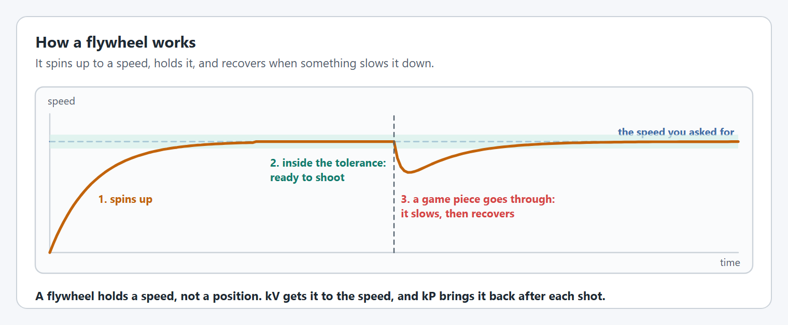
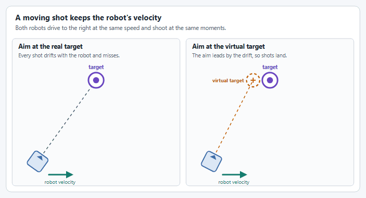
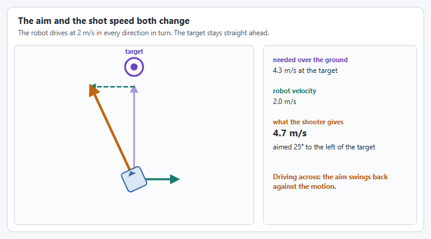
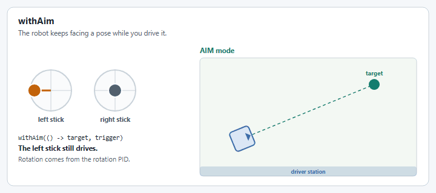
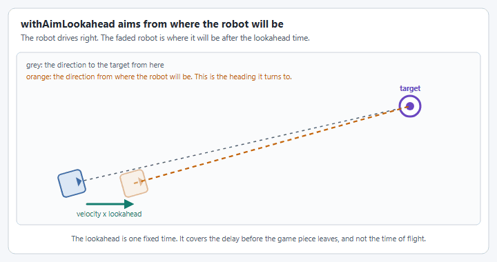

# Shooters

A shooter is a `FlyWheel` in YAMS, and so is anything else that spins: rollers, intakes, feeders and indexers.

## How a flywheel works

<figure><figcaption><p>A flywheel holds a speed.</p></figcaption></figure>

Where an arm or an elevator goes to a position, a flywheel goes to a speed. Most of the voltage comes from the `kV` term of [`SimpleMotorFeedforward`](../reference/editor/config/feedforward.md#withfeedforward), which is the voltage that speed needs, and a small `kP` corrects what is left and brings the wheel back after a game piece slows it.

A roller that only ever needs a voltage is still a `FlyWheel`: put its motor in [`ControlMode.OPEN_LOOP`](../reference/editor/config/motor-basics.md#withcontrolmode) and drive it with `set` or `setVoltage`, as in [Intakes, rollers and feeders](shooters.md#intakes-rollers-and-feeders) below.

## Creating a flywheel

This is the shape of a shooter class, not a complete file: the imports and the motor controller object (`spark`, a `SparkMax`) are left out. [Step 2 of the Shooter/FlyWheels tutorial](../tutorials/shooter-flywheels/mechanism.md) builds the complete file. The code is the same for Commands v2 and Commands v3 except for the package you import from and the class that owns the mechanism.



```java
import yams.commands2.config.SmartMotorControllerConfig;
import yams.commands2.mechanisms.FlyWheel;

public class ShooterSubsystem extends SubsystemBase
{
  private final SmartMotorControllerConfig motorConfig = new SmartMotorControllerConfig(this)
      .withControlMode(ControlMode.CLOSED_LOOP)
      .withGearing(new MechanismGearing(1))
      .withClosedLoopController(0.1, 0, 0)
      .withFeedforward(new SimpleMotorFeedforward(0.1, 0.12, 0.01))
      .withMomentOfInertia(Inches.of(4), Pounds.of(1))
      .withStatorCurrentLimit(Amps.of(40))
      .withZeroPower(MotorMode.COAST)
      .withTelemetry("ShooterMotor", TelemetryVerbosity.HIGH);
  private final SmartMotorController motor = new SparkWrapper(spark, DCMotor.getNEO(1), motorConfig);
  private final FlyWheelConfig config = new FlyWheelConfig()
      .withDiameter(Inches.of(4))
      .withTelemetry("Shooter", TelemetryVerbosity.HIGH);
  private final FlyWheel flywheel = new FlyWheel(config, motor); // the YAMS FlyWheel inside the shooter

  @Override
  public void periodic()
  {
    flywheel.updateTelemetry(); // every loop
  }

  @Override
  public void simulationPeriodic()
  {
    flywheel.simIterate(); // every loop, in simulation
  }
}
```

`this` is the `Subsystem`. The scheduler calls `periodic()` and `simulationPeriodic()` for you.



```java
import yams.commands3.config.SmartMotorControllerConfig;
import yams.commands3.mechanisms.FlyWheel;

public class ShooterMechanism implements Mechanism
{
  private final SmartMotorControllerConfig motorConfig = new SmartMotorControllerConfig(this)
      .withControlMode(ControlMode.CLOSED_LOOP)
      .withGearing(new MechanismGearing(1))
      .withClosedLoopController(0.1, 0, 0)
      .withFeedforward(new SimpleMotorFeedforward(0.1, 0.12, 0.01))
      .withMomentOfInertia(Inches.of(4), Pounds.of(1))
      .withStatorCurrentLimit(Amps.of(40))
      .withZeroPower(MotorMode.COAST)
      .withTelemetry("ShooterMotor", TelemetryVerbosity.HIGH);
  private final SmartMotorController motor = new SparkWrapper(spark, DCMotor.getNEO(1), motorConfig);
  private final FlyWheelConfig config = new FlyWheelConfig()
      .withDiameter(Inches.of(4))
      .withTelemetry("Shooter", TelemetryVerbosity.HIGH);
  private final FlyWheel flywheel = new FlyWheel(config, motor); // the YAMS FlyWheel inside the shooter

  public void periodic()
  {
    flywheel.updateTelemetry(); // every loop
  }

  public void simulationPeriodic()
  {
    flywheel.simIterate(); // every loop, in simulation
  }
}
```

`this` is the Commands v3 `Mechanism`. A `Mechanism` has no periodic hook, so call `periodic()` yourself from `Robot.robotPeriodic()`, and run `simulationPeriodic()` in its own `Notifier`, started from `Robot.simulationInit()`. [Where the tutorials put things](../tutorials/project-setup/#where-the-tutorials-put-things) shows both.



The options in `motorConfig` are explained in [SmartMotorControllerConfig](../reference/editor/config/), and the options in `config` in [FlyWheelConfig](../reference/mechanism-configs/flywheel-config.md).

In the rest of your code, `shooter` is the `ShooterSubsystem` (or `ShooterMechanism`), and `flywheel` is the YAMS `FlyWheel` inside it.


The gains (`kP` of 0.1, `kS` of 0.1, `kV` of 0.12) are placeholders. In simulation the wheel should spin up close to the speed you ask for, perhaps settling a little under or over it. On your robot they will be wrong: the [Shooter/FlyWheels tutorial](../tutorials/shooter-flywheels/tune.md) finds the real ones.


## Controlling a flywheel

A flywheel takes speed targets: `flywheel.run(RPM.of(3000))` spins at 3000 RPM until interrupted, `flywheel.runTo(RPM.of(3000), RPM.of(100))` ends once it is at speed, and `flywheel.getSpeed()` reads how fast it is going. [Controlling a mechanism](../reference/controlling-a-mechanism.md) lists every command, setpoint function and check, and [When mechanism commands end](run-vs-runto.md) explains how they work with a default command.

A shooter subsystem usually wraps them in a few command factories:



```java
// In ShooterSubsystem
public Command spin(AngularVelocity speed)
{
  return flywheel.run(speed); // holds the speed, never ends
}

public Command spinUp(AngularVelocity speed)
{
  return flywheel.runTo(speed, RPM.of(100)); // ends once it is at speed
}

public Command stop()
{
  return flywheel.set(0); // closed loop off, output 0: the wheel coasts down
}

public Trigger atSpeed(AngularVelocity speed)
{
  return flywheel.near(speed, RPM.of(100));
}

// In RobotContainer
shooter.setDefaultCommand(shooter.stop());
```



```java
// In ShooterMechanism
public Command spin(AngularVelocity speed)
{
  return flywheel.run(speed); // holds the speed, never ends
}

public Command spinUp(AngularVelocity speed)
{
  return flywheel.runTo(speed, RPM.of(100)); // ends once it is at speed
}

public Command stop()
{
  return run(coroutine -> coroutine.await(flywheel.set(0))) // closed loop off, output 0
      .withPriority(Command.LOWEST_PRIORITY)                // so any other command can take over
      .named("Shooter Stop");
}

public Trigger atSpeed(AngularVelocity speed)
{
  return flywheel.near(speed, RPM.of(100));
}

// In Robot
shooter.setDefaultCommand(shooter.stop());
```



Make `set(0)` the default command, not `run(RPM.of(0))`. A speed of zero is a closed loop target, so the motor would brake the wheel to a stop against its momentum, drawing current to do it. `set(0)` turns the closed loop off and lets the wheel coast down, with `MotorMode.COAST`.

## Shooting

A shot is two flywheels working together: the shooter spins up, and a feeder pushes the game piece in once the shooter is at speed. Gate the feeder on the shooter's `atSpeed` trigger:

```java
// In RobotContainer (Commands v2) or Robot (Commands v3).
// feeder is a roller subsystem with a feed() command, as in the next section.
controller.rightTrigger().whileTrue(shooter.spin(RPM.of(3000)));
controller.rightTrigger().and(shooter.atSpeed(RPM.of(3000))).whileTrue(feeder.feed());
```

While the trigger is held the shooter holds 3000 RPM, and the feeder only runs while the shooter is within 100 RPM of it. On release, both default commands take over. [How do I shoot with a shooter?](../how-to-mechanisms/how-to-shoot-with-a-shooter.md) walks through it, and [Double FlyWheel](../tutorials/double-flywheel/) covers two wheels spinning at different speeds.

## Shooting on the move

A shooter on a moving robot needs a lead: [How do I shoot on the move?](../how-to-mechanisms/how-do-i-shoot-on-the-move/) lists where to learn the math and which YAMS call does each part, and [Shoot on the move: worked example](../how-to-mechanisms/how-do-i-shoot-on-the-move/shoot-on-the-move-example.md) builds a complete robot. This section explains the idea, and what the Swerve Input Stream does for you.

### The idea in one picture

A game piece keeps the robot's velocity when it leaves the shooter, so a robot that aims straight at the target while driving sideways misses. The sources listed in [How do I shoot on the move?](../how-to-mechanisms/how-do-i-shoot-on-the-move/) all solve the same problem: work out a **lead** that cancels the robot's motion.

<figure><figcaption><p>The shot keeps the robot's velocity, so the aim has to lead it.</p></figcaption></figure>

### A primer: vector subtraction

**Read:** Eeshwar's [Shooting on the Fly](https://blog.eeshwark.com/robotblog/shooting-on-the-fly) and [Shooting on the Fly, Part 2: The LUT Approach](https://blog.eeshwark.com/robotblog/shooting-on-the-fly-pt2).

Before you pick a firing strategy, it helps to see the lead as one subtraction, which is how Eeshwar's posts explain it:

1. The time of flight in your lookup table gives the horizontal speed of the standing shot: the distance divided by the time.
2. Point a velocity of that speed at the target. This is the velocity the game piece needs over the ground.
3. Subtract the robot's velocity. What is left is the velocity the shooter has to give the game piece.
4. The direction of that vector is where to aim, and its length is the speed the shot needs.

<figure><figcaption><p>The orange arrow is what the shooter has to give: the purple arrow minus the green one.</p></figcaption></figure>

Two things follow from this, and every firing strategy has to deal with both. The **aim** changes when the robot moves, and so does the **speed** of the shot: drive toward the target and the shooter needs less, drive away and it needs more. The firing strategies in the [worked example](../how-to-mechanisms/how-do-i-shoot-on-the-move/shoot-on-the-move-example.md) are different ways of working out that same lead from the time of flight in your table.

<figure><figcaption><p>Toward the target the shot needs less speed, away it needs more, and across it the aim swings back.</p></figcaption></figure>

### What `SwerveInputStream` does, and what it leaves to you

The stream's aim mode uses the simplest method there is, **point at the pose**. [`withAim`](../reference/swerve-input-stream/swerve-input-stream-aim.md#aim-at-a-target) takes a target pose, works out the direction from the robot to it, and lets the drive's rotation PID controller turn the front of the robot that way while the left stick keeps translating.

<figure><figcaption><p><code>withAim</code>: the left stick drives, and the robot keeps facing the target it is given.</p></figcaption></figure>

Four options refine it: [`withAimLookahead`](../reference/swerve-input-stream/swerve-input-stream-aim.md#aim-lookahead), [`withAimFeedforward`](../reference/swerve-input-stream/swerve-input-stream-aim.md#aim-feedforward), [`withAimHeadingOffset`](../reference/swerve-input-stream/swerve-input-stream-aim.md#aim-heading-offset) and [`aimLock`](../reference/swerve-input-stream/swerve-input-stream-aim.md#aim-lock). The [Swerve Input Stream](../reference/swerve-input-stream/swerve-input-stream-aim.md#aim-at-a-target) page explains each one.

<figure><figcaption><p><code>withAimLookahead</code>: the robot turns to the direction it will need a moment from now.</p></figcaption></figure>

Even with all four, the stream on its own does **not** shoot on the move the way you might expect:

* **The lookahead is one fixed time.** Aiming from where the robot will be in 0.3 seconds is the same as leading the target by 0.3 seconds of travel. That is only the right lead when the time of flight is 0.3 seconds, which is true at one distance. Use the lookahead for what the sources call latency: the short, constant delay before the game piece leaves the robot.
* **It only turns the robot.** A lead changes the distance of the shot as well as its direction. The stream knows nothing about your flywheel, your hood or your tables, so it cannot change the shot to match.
* **It assumes a straight line.** The lookahead takes the robot's velocity right now and assumes it stays the same.
* **Without a feedforward, the rotation lags.** The PID controller only reacts to error, so while the robot drives past the target it trails a little behind.

So let the stream do the turning, and give it the right thing to turn to. The lead itself comes from one of the methods in the sources, which is the part you write.

## Intakes, rollers and feeders

A roller that only needs to push a game piece in or out does not need a speed. Make it a `FlyWheel` in its own subsystem, with its motor in open loop, and give it a voltage:

```java
// Fragment of FeederSubsystem (Commands v2). spark is the SparkMax for the roller.
private final SmartMotorControllerConfig motorConfig = new SmartMotorControllerConfig(this)
    .withControlMode(ControlMode.OPEN_LOOP)            // no PID or feedforward
    .withGearing(new MechanismGearing(3))
    .withMomentOfInertia(Inches.of(1), Pounds.of(0.5)) // for the simulation
    .withStatorCurrentLimit(Amps.of(40))
    .withZeroPower(MotorMode.COAST)
    .withTelemetry("FeederMotor", TelemetryVerbosity.HIGH);
private final SmartMotorController motor = new SparkWrapper(spark, DCMotor.getNEO(1), motorConfig);
private final FlyWheel roller = new FlyWheel(
    new FlyWheelConfig().withTelemetry("Feeder", TelemetryVerbosity.HIGH), motor);

public Command feed()
{
  return roller.setVoltage(Volts.of(8));  // push the game piece toward the shooter, until interrupted
}

public Command eject()
{
  return roller.set(-0.8);                // 80% backwards, until interrupted
}

public Command stop()
{
  return roller.set(0);                   // the default command
}
```

`set` takes a duty cycle from -1 to 1, and `setVoltage` a voltage. A voltage gives the same push as the battery drains, so prefer it. An intake is the same class with an `intake()` command. In Commands v3, write `stop()` as a lowest priority default command, as for the shooter above. [How do I set up an intake roller?](../how-to-mechanisms/how-do-i-set-up-an-intake-roller.md) has complete files for both.

## When a flywheel will not reach its speed

A flywheel that reaches low speeds but not high ones, or that slows down more with every shot, is usually short of power and not badly tuned: see [when tuning does not help](../tutorials/troubleshooting.md#when-tuning-does-not-help).

## Configuring and tuning a flywheel, step by step

Do the configuration steps first, in simulation, then tune the real flywheel with [live tuning](../how-to-tuning/live-tuning/). Tuning something that is configured wrong wastes the time.


Like all tuning, this can be dangerous. Keep clear of the mechanism, start with low current limits and small moves, and practice in simulation first.


### Configure it



#### Set the gearing

Give the reduction from the motor to the wheel with [`withGearing`](../reference/editor/config/gearing-and-units.md#withgearing). An overdrive, where the wheel spins faster than the motor, is a number below 1.



#### Choose the positive direction

Positive should be the direction that shoots or intakes. Flip [`withMotorInverted`](../reference/editor/config/motor-basics.md#withmotorinverted) if it is not.



#### Let it coast

Use `MotorMode.COAST` so the wheel is not braked to a stop every time the command ends, and set a [stator current limit](../reference/editor/config/limits-and-protection.md#withstatorcurrentlimit-and-withsupplycurrentlimit).



#### Set the diameter

Set [`withDiameter`](../reference/mechanism-configs/flywheel-config.md#withdiameter) if you want to ask for surface speeds.



#### Describe it to the simulator

Set [`withMomentOfInertia`](../reference/editor/config/simulation.md#withmomentofinertia) on the motor config.



### What is different when tuning a flywheel

The [Shooter/FlyWheels tutorial](../tutorials/shooter-flywheels/tune.md) walks through tuning a flywheel, and [Tuning order](../how-to-tuning/live-tuning/#tuning-order) lists the order with the keys to watch. What sets a flywheel apart:

* **kV does most of the work.** It is the voltage the speed needs. Find kS, then raise kV until `mechanism/velocity` settles on the setpoint with no help from kP, and check it at a low and a high speed.
* **kP only needs to be small.** Its job is to bring the wheel back after a game piece slows it. Too much makes the speed ripple.
* **There is no kG and no position.** Nothing to hold up, and no soft limits.
* **Choose the tolerance by shooting.** Shoot at the edges of your `atSpeed` tolerance, and use the widest one where the shots still land, so the shooter is ready sooner.
* **A brownout is not a tuning problem.** If spinning up browns out the robot, add a [velocity profile](../reference/editor/config/motion-profiles.md#velocity-profiles-for-flywheels) or a [current limit](../reference/editor/config/limits-and-protection.md#withstatorcurrentlimit-and-withsupplycurrentlimit), and test it against the [battery simulation](battery-simulation.md).

## FlyWheelConfig options

Every `FlyWheelConfig` option is on the [FlyWheelConfig](../reference/mechanism-configs/flywheel-config.md) page under this one, with a graphic and an example for each. Options shared by every mechanism are in [Shared options](../reference/mechanism-configs/shared-options.md).

A `FlyWheel` needs nothing on its config to be simulated. Its [moment of inertia](../reference/editor/config/simulation.md#withmomentofinertia) is on the motor config.

## Code reference




