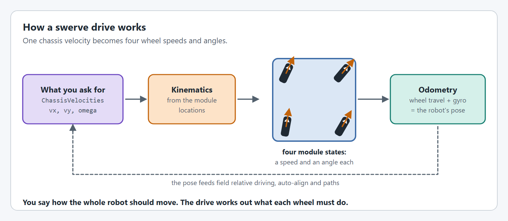

# Swerve Drive

This page explains how `SwerveDrive` works and what it can do. Every `SwerveDriveConfig` option, with a graphic and an example, is on the [SwerveDriveConfig](../../reference/mechanism-configs/swerve-drive-config.md) page under this one. To build one from scratch, follow the [Swerve Drive tutorial](../../tutorials/swerve-drive/).

## How a swerve drive works

<figure><figcaption><p>From one chassis velocity to four wheels, and back to a pose.</p></figcaption></figure>

You tell the drive how the whole robot should move, as a `ChassisVelocities`: forward speed, sideways speed and turn rate. The drive's kinematics, built from where each module is, turn that into a speed and an angle for every wheel. Each [swerve module](swerve-module.md) then steers and drives its own wheel.

Going the other way, the drive adds up how far each wheel has rolled and combines it with the gyro to estimate where the robot is on the field. That pose is what makes field relative driving, auto-align and path following possible.

## Why `SwerveDrive` is different from other mechanisms

Every other mechanism in YAMS (`Arm`, `Elevator`, `Pivot`, `FlyWheel`) wraps a single `SmartMotorController`. `SwerveDrive` is a mechanism made of mechanisms: it owns an array of `SwerveModule`s, and each `SwerveModule` owns two `SmartMotorController`s of its own (drive and azimuth). `SwerveDriveConfig` is where the two levels meet: you build each `SwerveModule` (and its own `SwerveModuleConfig`) first, then hand the finished modules to `SwerveDriveConfig`, which derives the robot's kinematics automatically from where you told each module it physically sits.

## Basic swerve config

Here is the shape of a four-module config, condensed from the [tutorial](../../tutorials/swerve-drive/). The modules are passed front left, front right, back left, back right. The kinematics come from each module's location, so that order is not what makes the robot drive, but arrays such as `getModuleStates()` and the feedforward `Force[]` use the same order.

Robot code imports `SmartMotorControllerConfig`, `SwerveDriveConfig`, `SwerveDrive` and `SwerveInputStream` from the command framework package that matches your vendordep, and everything else from `yams.core`:



```java
import yams.commands2.config.SmartMotorControllerConfig;
import yams.commands2.config.SwerveDriveConfig;
import yams.commands2.swerve.SwerveDrive;
import yams.commands2.swerve.SwerveInputStream;
import yams.core.gearing.MechanismGearing;
import yams.core.mechanisms.config.SwerveModuleConfig;
import yams.core.mechanisms.swerve.SwerveModule;
import yams.core.motorcontrollers.SmartMotorController;
import yams.core.motorcontrollers.local.SparkWrapper;
import yams.core.telemetry.enums.TelemetryVerbosity;
```



```java
import yams.commands3.config.SmartMotorControllerConfig;
import yams.commands3.config.SwerveDriveConfig;
import yams.commands3.swerve.SwerveDrive;
import yams.commands3.swerve.SwerveInputStream;
import yams.core.gearing.MechanismGearing;
import yams.core.mechanisms.config.SwerveModuleConfig;
import yams.core.mechanisms.swerve.SwerveModule;
import yams.core.motorcontrollers.SmartMotorController;
import yams.core.motorcontrollers.local.SparkWrapper;
import yams.core.telemetry.enums.TelemetryVerbosity;
```

In Commands v3, `this` is your `Mechanism` instead of a `Subsystem`.



A fragment for your subsystem's or mechanism's constructor. `driveMotor`, `azimuthMotor`, `encoder` and `gyro` are your hardware objects, and the gains are placeholders:

```java
SmartMotorControllerConfig driveCfg = new SmartMotorControllerConfig(this)
      .withWheelDiameter(Inches.of(4))
      .withGearing(new MechanismGearing(6.75))
      .withClosedLoopController(0.3, 0, 0)
      .withFeedforward(new SimpleMotorFeedforward(0, 0.85))
      .withStatorCurrentLimit(Amps.of(40))
      .withTelemetry("driveMotor", TelemetryVerbosity.HIGH);

SmartMotorControllerConfig azimuthCfg = new SmartMotorControllerConfig(this)
      .withClosedLoopController(4, 0, 0)
      .withContinuousWrapping(Rotations.of(-0.5), Rotations.of(0.5))
      .withGearing(new MechanismGearing(12.8))
      .withStatorCurrentLimit(Amps.of(20))
      .withTelemetry("angleMotor", TelemetryVerbosity.HIGH);

SmartMotorController driveSMC   = new SparkWrapper(driveMotor,   DCMotor.getNEO(1), driveCfg);
SmartMotorController azimuthSMC = new SparkWrapper(azimuthMotor, DCMotor.getNEO(1), azimuthCfg);

SwerveModuleConfig moduleConfig = new SwerveModuleConfig(driveSMC, azimuthSMC)
      .withAbsoluteEncoder(encoder.getAbsolutePosition().asSupplier())
      .withAbsoluteEncoderOffset(Degrees.of(64.2)) // this module's own reading, wheel forward
      .withLocation(Meters.of(0.3), Meters.of(0.3)) // front, left, from robot center
      .withOptimization(true)
      .withTelemetry("frontleft", TelemetryVerbosity.HIGH);

SwerveModule fl = new SwerveModule(moduleConfig);
// ...repeat for fr, bl, br with their own locations...

SwerveDriveConfig config = new SwerveDriveConfig(this, fl, fr, bl, br)
      .withGyro(gyro::getRotation3d) // e.g. a Pigeon2 or the SystemCore's OnboardIMU
      .withMaximumChassisSpeed(MetersPerSecond.of(4.5), DegreesPerSecond.of(360))
      .withTranslationController(new PIDController(1.0, 0, 0))
      .withRotationController(new PIDController(1.0, 0, 0))
      .withStartingPose(new Pose2d());

SwerveDrive drive = new SwerveDrive(config);
```

## Commands

`SwerveDrive` has the same commands and functions in Commands v2 and Commands v3.

| Command or function                    | Commands v2 | Commands v3 | What it does                                                                                                                                                                 |
| -------------------------------------- | ----------- | ----------- | ---------------------------------------------------------------------------------------------------------------------------------------------------------------------------- |
| `drive(Supplier<ChassisVelocities>)`   | ✅           | ✅           | Drives with **robot relative** speeds until interrupted.                                                                                                                     |
| `driveToPose(Pose2d)`                  | ✅           | ✅           | Drives to a pose with the [auto-align controllers](../../reference/mechanism-configs/swerve-drive-config.md#auto-align-controllers) until interrupted, then stops the drive. |
| `driveToPose(Pose2d, Distance, Angle)` | ✅           | ✅           | The same, ending once the robot is within the tolerances.                                                                                                                    |
| `isNear(Pose2d, Distance, Angle)`      | ✅           | ✅           | Whether the robot is within the tolerances of a pose.                                                                                                                        |
| `stop()`                               | ✅           | ✅           | Commands zero speed.                                                                                                                                                         |

Field relative driving from a controller is a command you write around a [`SwerveInputStream`](../../reference/swerve-input-stream/). These are outlines of the class: `config` is the `SwerveDriveConfig` from above.



```java
public class SwerveSubsystem extends SubsystemBase
{
  private final SwerveDrive drive = new SwerveDrive(config);

  public Command driveFieldRelative(SwerveInputStream input)
  {
    return run(() -> drive.setFieldRelativeChassisSpeeds(input.get()));
  }

  @Override
  public void periodic()
  {
    drive.updateTelemetry(); // also updates the pose estimate
  }

  @Override
  public void simulationPeriodic()
  {
    drive.simIterate();
  }
}
```



```java
public class SwerveMechanism implements Mechanism
{
  private final SwerveDrive drive = new SwerveDrive(config);

  public Command driveFieldRelative(SwerveInputStream input)
  {
    return run(coroutine -> {
      while (true)
      {
        drive.setFieldRelativeChassisSpeeds(input.get());
        coroutine.yield();
      }
    }).named("Drive");
  }

  public void periodic() // call from Robot.robotPeriodic()
  {
    drive.updateTelemetry(); // also updates the pose estimate
  }

  public void simulationPeriodic() // Robot.simulationInit() runs this in its own Notifier
  {
    drive.simIterate();
  }
}
```




`updateTelemetry()` is what updates the pose estimate, so it must be called every loop even if you do not look at the telemetry.


## Driving functions

These set what the drive does and return at once. They are what the commands above are built on.

| Function                                           | What it does                                                                                                       |
| -------------------------------------------------- | ------------------------------------------------------------------------------------------------------------------ |
| `setFieldRelativeChassisSpeeds(ChassisVelocities)` | Drive with speeds measured against the field. This is what a `SwerveInputStream` gives you.                        |
| `setRobotRelativeChassisSpeeds(ChassisVelocities)` | Drive with speeds measured against the robot. An overload adds a feedforward force per module, for path followers. |
| `setSwerveModuleStates(SwerveModuleVelocity[])`    | Set every module directly, skipping the kinematics.                                                                |
| `lockPose()`                                       | Turn the wheels into an X so the robot is hard to push.                                                            |
| `resetOdometry(Pose2d)`                            | Tell the drive where it is. The gyro keeps its reading.                                                            |
| `zeroOdometryHeading()`, or `zeroGyro()`           | Make the direction the robot faces now the new zero heading.                                                       |
| `addVisionMeasurement(Pose2d, double)`             | Correct the pose estimate with a vision measurement.                                                               |

## Asking where it is

| Function                                                            | Returns                                                                                 |
| ------------------------------------------------------------------- | --------------------------------------------------------------------------------------- |
| `getPose()`                                                         | The estimated position and heading on the field.                                        |
| `getRobotRelativeSpeed()`, `getFieldRelativeSpeed()`                | How the robot is moving now.                                                            |
| `getModuleStates()`, `getModulePositions()`                         | Each wheel's speed and angle, and how far it has rolled.                                |
| `getRotation()`                                                     | The robot's rotation from odometry, the heading of `getPose()`.                         |
| `getGyroRotation3d()`                                               | The robot's attitude from the gyro.                                                     |
| `getDistanceFromPose(Pose2d)`, `getAngleDifferenceFromPose(Pose2d)` | How far the robot is from a pose.                                                       |
| `getField2d()`                                                      | The `Field2d` the drive publishes its pose to. Use this one instead of making your own. |

## Setting up a swerve drive on a real robot

Setting the encoder offsets, checking every direction, tuning the modules and the first drive on the ground are steps in a tutorial now: see [Step 5: On the real robot](../../tutorials/swerve-drive/real-robot.md). It ends with the speed limits, the drift corrections and auto-align, in the order to do them.

## Module location drives the kinematics

[`SwerveModuleConfig.withLocation(front, left)`](../../reference/mechanism-configs/swerve-module-config.md#withlocation) is not just bookkeeping. `SwerveDrive` builds its `SwerveDriveKinematics` directly from the locations of every module you pass it, so the drive and rotate math is always right for your chassis without you ever constructing a `SwerveDriveKinematics` yourself.


Every module needs its location set before it's handed to `SwerveDriveConfig`. A missing or wrong location silently produces incorrect kinematics rather than a compile error, so double check trackwidth/wheelbase math when a robot doesn't drive straight.


The `withOptimization(true)` seen in the config above is a per-module flag, not a drive-level one. See [Optimization and Cosine Compensation](swerve-module.md#optimization-and-cosine-compensation) on the Swerve Module page for what it (and its counterpart `withCosineCompensation`) actually does.

## Gyro integration and field vs. robot relative speeds

`SwerveDriveConfig.withRotation(Supplier<Rotation3d>)`, or `withGyro`, which is the same method, gives `SwerveDrive` the gyro. The supplier returns the gyro's full attitude, such as `pigeon::getRotation3d` or `imu::getRotation3d`: its yaw is the robot's heading, and its roll and pitch are the robot's tilt. Odometry starts from the gyro's heading, and vision measurements can correct it.

Internally, `SwerveDrive` always drives the modules with robot-relative speeds. `setFieldRelativeChassisSpeeds` rotates the requested speeds into the robot frame with `getRotation()`, the robot's rotation from odometry (the heading of `getPose()`), then hands them to the same code path robot-relative callers use. `getFieldRelativeSpeed()`, driving to a pose and `SwerveInputStream`'s heading control use the same rotation, so a vision correction to the pose's heading also corrects which way "forward" is. Without vision, it's the gyro's heading. `resetOdometry(pose)` and `zeroOdometryHeading()` (or `zeroGyro()`) reset that rotation and leave the gyro alone: the pose estimator keeps the offset between the two.

```java
drive.setFieldRelativeChassisSpeeds(new ChassisVelocities(1.0, 0, 0));
```

[`withGyroInverted`](../../reference/mechanism-configs/swerve-drive-config.md#the-gyro) corrects the gyro's sign without touching your drive code. It applies to the heading (the yaw). There is no gyro offset: the pose estimator keeps the offset between the gyro and the pose, so set where the robot faces with the starting pose, `resetOdometry(pose)` or `zeroOdometryHeading()`.

### Gyros mounted on their side

If the gyro is not mounted flat, the robot turning shows up as the gyro's roll or pitch instead of its yaw. `withGyroHeadingAxis(GyroAxis)` tells `SwerveDriveConfig` which gyro axis points up through the robot. `GyroAxis` lives in `yams.core.mechanisms.config.enums` and has three values:

| `GyroAxis` | Gyro axis pointing up | Use when                                                 |
| ---------- | --------------------- | -------------------------------------------------------- |
| `YAW`      | Z                     | The gyro is mounted flat. This is the default.           |
| `ROLL`     | X                     | The gyro is on its side, with its Y axis to robot left.  |
| `PITCH`    | Y                     | The gyro is on its side, with its X axis to robot front. |

```java
import yams.core.mechanisms.config.enums.GyroAxis;

config.withGyro(pigeon::getRotation3d)
      .withGyroHeadingAxis(GyroAxis.ROLL);
```

The gyro's attitude is rotated into the robot's frame first, then `withGyroInverted` is applied to the resulting heading.

### Reading the heading

`SwerveDrive.getGyroRotation3d()` (and `SwerveDriveConfig.getGyroRotation3d()`) returns the robot's attitude after the heading axis, inversion and offset are applied. Its yaw (`getZ()`, or `toRotation2d()`) is the heading, wrapped to +/-180 degrees, and its roll and pitch are the robot's tilt. In simulation, `SwerveDrive.getGyroRotation3d()` returns the simulated heading with no tilt.

```java
Rotation2d heading = drive.getGyroRotation3d().toRotation2d();
```


`GyroAxis`, `withGyroHeadingAxis` and `getGyroRotation3d` are Java only. C++ takes a heading with `WithGyro(std::function<wpi::units::degree_t()>)` and reads it back with `GetGyroAngle()`.


`withGyroVelocity` and `withGyroAngularVelocityScaleFactor` correct the path of a robot that drives and turns at the same time, using how fast the gyro says the robot is turning. [`withGyroAngularVelocityScaleFactor`](../../reference/mechanism-configs/swerve-drive-config.md#withgyroangularvelocityscalefactor) explains how to find the value.


`SwerveInputStream` is the recommended way to turn raw joystick axes into a field-relative `ChassisVelocities` supplier; it handles deadbanding, axis cubing, and alliance-relative flipping so you don't have to write that math by hand. See [Swerve Input Stream](../../reference/swerve-input-stream/) for the full picture, or the [tutorial](../../tutorials/swerve-drive/) for a worked example.


A Commands v2 fragment, in the subsystem's constructor. `controller` is a `CommandGamepad`:

```java
SwerveInputStream input =
    SwerveInputStream.of(drive, () -> -controller.getLeftY(), () -> -controller.getLeftX())
        .withControllerRotationAxis(() -> -controller.getRightX());
// SwerveInputStream output is field relative.
setDefaultCommand(run(() -> drive.setFieldRelativeChassisSpeeds(input.get())));
```

## Locking the wheels (X pattern)

`SwerveDrive.lockPose()` turns every wheel to point at the robot center (each module's angle from its `withLocation(...)`) without driving it. On a rectangular chassis the four wheels form an X, so the robot resists being pushed. Call it every loop for as long as the lock should hold:



```java
public Command lockPose() {
  return run(drive::lockPose).withName("Lock Pose");
}
```



```java
public Command lock() {
  return run(coroutine -> {
    while (true) {
      drive.lockPose();
      coroutine.yield();
    }
  }).named("Swerve Lock");
}
```



In Java each module is locked through `SwerveModule.setAzimuthAngle(Rotation2d)`, which uses `SwerveModuleConfig.getLockedState(...)`. Unlike a normal zero-speed module state, the lock skips the module's [velocity deadband](swerve-module.md#velocity-deadband), which would otherwise hold the wheels where they are, so the wheels actually turn into the X. With optimization enabled each wheel turns to whichever of the lock angle and its opposite is nearer, since both hold the robot the same way. C++ `LockPose()` does the same through `SwerveModule::SetAzimuthAngle(...)`. To turn every module to one angle without driving, as the azimuth live tuning does, use `setAzimuthAngles(Rotation2d)` (C++ `SetAzimuthAngles(...)`).


`lockPose()` is not compatible with AdvantageKit, like the other `SwerveDrive` methods that command the modules directly.


## How to: follow PathPlanner paths with feedforward forces

`setRobotRelativeChassisSpeeds` has an overload that accepts a per-module drive-wheel feedforward `Force[]` (FL, FR, BL, BR order, matching module order) alongside the `ChassisVelocities`:

```java
drive.setRobotRelativeChassisSpeeds(speeds, feedforwardForces);
```

This exists specifically to plug into PathPlanner's `AutoBuilder.configure(...)`, whose `driveRobotRelative` consumer hands back a `DriveFeedforwards` alongside the requested `ChassisVelocities`. Its `linearForces()` is exactly the `Force[]` this overload expects:

```java
AutoBuilder.configure(
    drive::getPose,
    drive::resetOdometry,
    drive::getRobotRelativeSpeed,
    (speeds, feedforwards) -> drive.setRobotRelativeChassisSpeeds(speeds, feedforwards.linearForces()),
    new PPHolonomicDriveController(new PIDConstants(5.0, 0.0, 0.0), new PIDConstants(5.0, 0.0, 0.0)),
    RobotConfig.fromGUISettings(),
    () -> MatchState.getAlliance().map(alliance -> alliance == Alliance.RED).orElse(false),
    this);
```

Each module's drive `SmartMotorController` converts its share of the `Force[]` into the correct feedforward for whatever control mode it's using (voltage or torque-current) via `SmartMotorControllerConfig.convertToVoltage(...)`/`convertToCurrent(...)`, which need `withGearing(...)` and `withMechanismCircumference(...)`/`withWheelRadius(...)` configured on that motor to do the conversion. Passing an empty `Force[]` (or just calling the original single-argument overload) skips the feedforward entirely, so existing code that only calls `setRobotRelativeChassisSpeeds(speeds)` keeps working unchanged.




`SmartMotorController.setVelocity(velocity, force)` is the underlying per-motor API this builds on, and it isn't specific to swerve: any velocity-controlled `SmartMotorController` with gearing and a mechanism circumference configured can take a feedforward `Force` the same way. A `null`/unset force falls back to plain velocity control, which is what `getSetpointFeedforwardForce()` and the `SetpointForce` telemetry field then read back as empty/`0`.


## Auto-Align

`SwerveDrive` has a built-in field relative auto-align.

| Method                                 | What it does                                                                                                                             |
| -------------------------------------- | ---------------------------------------------------------------------------------------------------------------------------------------- |
| `driveToPose(Pose2d)`                  | Returns a `Command` that drives to the pose until it is interrupted, then stops the drive.                                               |
| `driveToPose(Pose2d, Distance, Angle)` | Returns a `Command` that drives to the pose and ends once the robot is within the distance and heading tolerances, then stops the drive. |
| `isNear(Pose2d, Distance, Angle)`      | Whether the robot is within the distance and heading tolerances of the pose.                                                             |
| `driveToPoseSetpoint(Pose2d)`          | Computes the `ChassisVelocities` that drive toward the pose, for use in your own command.                                                |

The commands and `driveToPoseSetpoint` use the translation and rotation `PIDController`s from `SwerveDriveConfig.withTranslationController(...)` and `withRotationController(...)`. Each command is a Commands v2 or Commands v3 `Command`, depending on which `SwerveDrive` you use, and all of them exist in both.

A fragment for your bindings. `driver` is a `CommandGamepad`:

```java
// Hold to align: drives to the pose for as long as the button is held.
driver.faceDown().whileTrue(drive.driveToPose(new Pose2d(2, 4, Rotation2d.ZERO)));

// Press to align: ends by itself within 5 cm and 3 degrees, so it can be used in a sequence or an auto.
driver.faceRight().onTrue(drive.driveToPose(new Pose2d(2, 4, Rotation2d.ZERO), Centimeters.of(5), Degrees.of(3)));
```

Use the version with tolerances whenever something has to happen after the robot arrives. The version without them never ends on its own.


The auto-align gains, and the drive and azimuth motor gains, can be tuned from a dashboard without redeploying. See [Tune a swerve drive](../../how-to-tuning/live-tuning/swerve-drive.md).


## Telemetry verbosity

Like every other mechanism, `SwerveDriveConfig.withTelemetry(name, TelemetryVerbosity)` picks a preset bundle of fields to publish. `LOW` publishes everything a dashboard's swerve drive widget needs: the pose, the robot's rotation from odometry, the gyro's rotation, the current and desired chassis speeds and module states, and the modules' maximum speed. `MID` adds the field-relative chassis speeds, and `HIGH` the tuning keys. Each level includes everything the level below it publishes. Whenever NetworkTables output is on, `.type` reads `SwerveDrive`, so a dashboard can recognize the drive's table.

```java
config.withTelemetry("swerve", TelemetryVerbosity.HIGH);
```

| Field                                      | NetworkTables key                   | `LOW` | `MID` | `HIGH` |
| ------------------------------------------ | ----------------------------------- | :---: | :---: | :----: |
| Pose                                       | `pose`                              |   ✓   |   ✓   |    ✓   |
| Rotation from odometry (`Rotation2d`)      | `rotation`                          |   ✓   |   ✓   |    ✓   |
| Gyro rotation (`Rotation2d`)               | `gyro`                              |   ✓   |   ✓   |    ✓   |
| Current robot-relative ChassisVelocities   | `chassis/current`                   |   ✓   |   ✓   |    ✓   |
| Desired robot-relative ChassisVelocities   | `chassis/desired`                   |   ✓   |   ✓   |    ✓   |
| Current module states                      | `states/current`                    |   ✓   |   ✓   |    ✓   |
| Desired module states                      | `states/desired`                    |   ✓   |   ✓   |    ✓   |
| Maximum module speed (m/s)                 | `maxModuleVelocity`                 |   ✓   |   ✓   |    ✓   |
| Field-relative ChassisVelocities           | `chassis/field`                     |       |   ✓   |    ✓   |
| Translation P/I/D (tunable)                | `autoalign/translation/p,i,d`       |       |       |    ✓   |
| Rotation P/I/D (tunable)                   | `autoalign/rotation/p,i,d`          |       |       |    ✓   |
| Auto-align target X (tunable)              | `autoalign/setpoint/x`              |       |       |    ✓   |
| Auto-align target Y (tunable)              | `autoalign/setpoint/y`              |       |       |    ✓   |
| Auto-align target rotation (tunable)       | `autoalign/setpoint/rot`            |       |       |    ✓   |
| Auto-align enabled (tunable)               | `autoalign/enabled`                 |       |       |    ✓   |
| Modules drive P/I/D (tunable, shared)      | `modules/drive/feedback/p,i,d`      |       |       |    ✓   |
| Modules drive kS/kV/kA (tunable, shared)   | `modules/drive/feedforward/s,v,a`   |       |       |    ✓   |
| Modules drive velocity (tunable, shared)   | `modules/drive/velocity`            |       |       |    ✓   |
| Modules drive tuning enabled (tunable)     | `modules/drive/enabled`             |       |       |    ✓   |
| Modules drive in place (tunable)           | `modules/drive/inplace`             |       |       |    ✓   |
| Modules drive voltage (tunable, shared)    | `modules/drive/voltage/setpoint`    |       |       |    ✓   |
| Modules drive voltage enabled (tunable)    | `modules/drive/voltage/enabled`     |       |       |    ✓   |
| Modules azimuth P/I/D (tunable, shared)    | `modules/azimuth/feedback/p,i,d`    |       |       |    ✓   |
| Modules azimuth kS/kV/kA (tunable, shared) | `modules/azimuth/feedforward/s,v,a` |       |       |    ✓   |
| Modules azimuth angle (tunable, shared)    | `modules/azimuth/angle`             |       |       |    ✓   |
| Modules azimuth tuning enabled (tunable)   | `modules/azimuth/enabled`           |       |       |    ✓   |
| Modules azimuth voltage (tunable, shared)  | `modules/azimuth/voltage/setpoint`  |       |       |    ✓   |
| Modules azimuth voltage enabled (tunable)  | `modules/azimuth/voltage/enabled`   |       |       |    ✓   |


`autoalign/setpoint/x`/`autoalign/setpoint/y`/`autoalign/setpoint/rot` and `autoalign/enabled`, and the `modules/drive/*`/`modules/azimuth/*` tuning fields, only take effect while the `Tuning/<name>/Live Tuning` command is scheduled, since that's the loop that actually reads them. Publishing values to them with the tuning command idle has no effect on the robot.



The `modules/drive/*` and `modules/azimuth/*` fields are **shared across every module**, not per-module. There is no way to tune a single module's PID or setpoint independently through this mechanism; it applies the same gains and setpoint to all modules on the drive at once.


### Using `SwerveDriveTelemetryConfig` directly

Pass a `SwerveDriveTelemetryConfig` instead of a verbosity level when you need finer control than a preset gives you, such as disabling the auto-align tuning fields, or routing telemetry to a DataLog instead of NetworkTables during competition:

```java
SwerveDriveTelemetryConfig telemetryCfg =
    new SwerveDriveTelemetryConfig(TelemetryVerbosity.HIGH)
        // HIGH enables this by default; opt back out if you don't want live driveToPose tuning exposed.
        .withCustom(SwerveDriveTelemetry.BooleanTelemetryField.AutoAlignEnabled, false)
        .withoutNetworkTables()
        .withDataLogName("swerve");

SwerveDriveConfig config = new SwerveDriveConfig(this, fl, fr, bl, br)
      .withGyro(gyro::getRotation3d)
      .withTranslationController(new PIDController(1.0, 0, 0))
      .withRotationController(new PIDController(1.0, 0, 0))
      .withTelemetry("swerve", telemetryCfg);
```

`SwerveDriveTelemetryConfig(TelemetryVerbosity)` is a shorthand constructor equivalent to `new SwerveDriveTelemetryConfig().withTelemetryVerbosity(verbosity)`, useful when you're about to layer more `with*()` calls on top anyway. See [Telemetry](../telemetry.md) for the shared telemetry architecture these configs build on.

## Code reference


